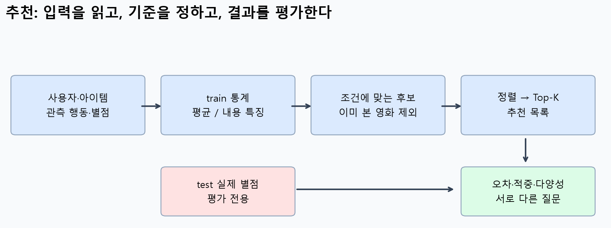
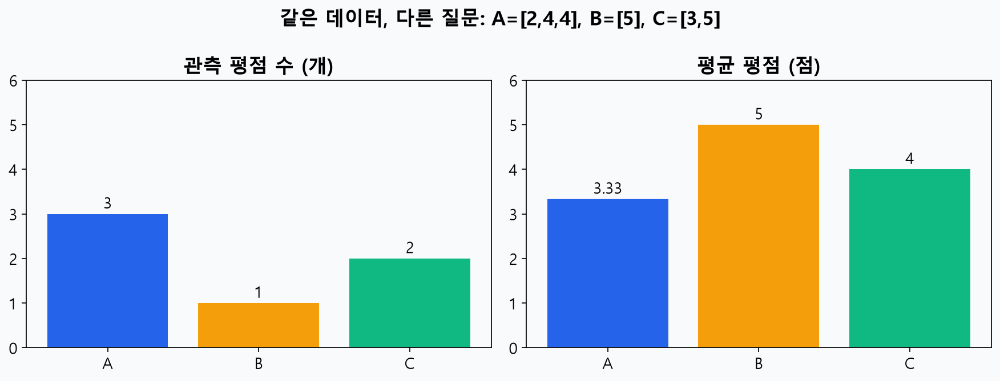
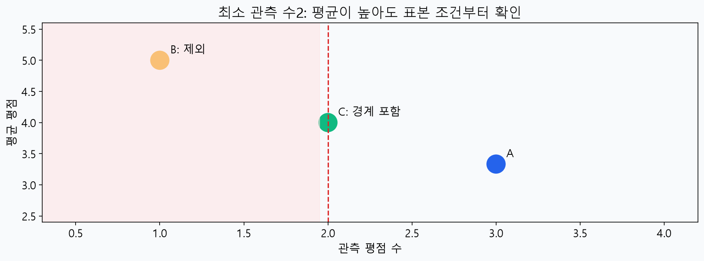
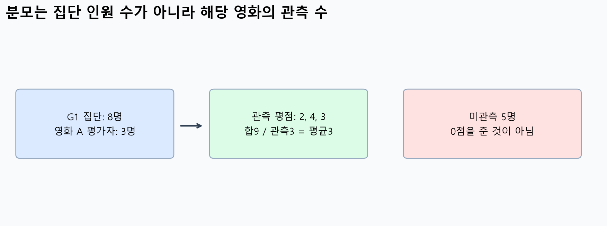
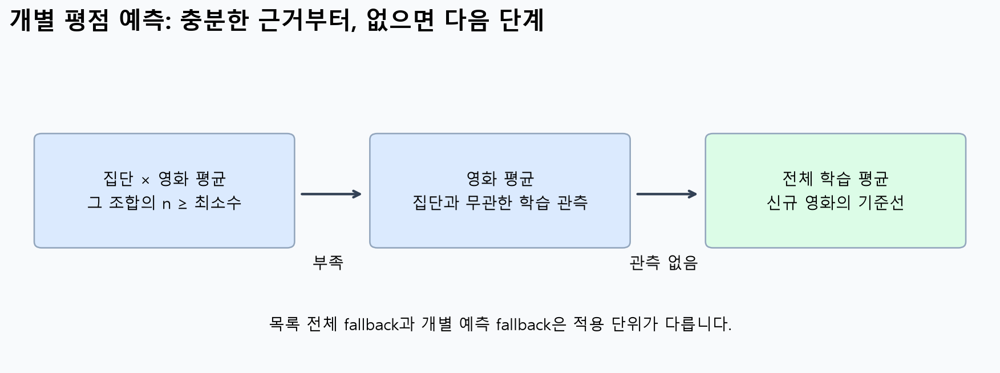
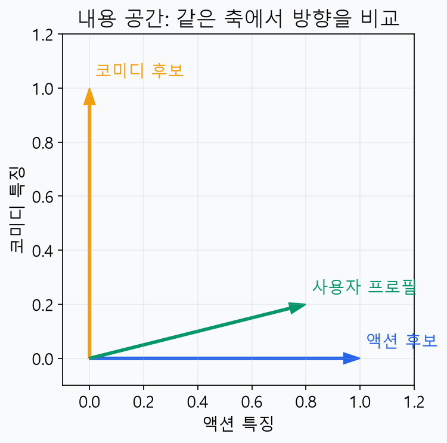
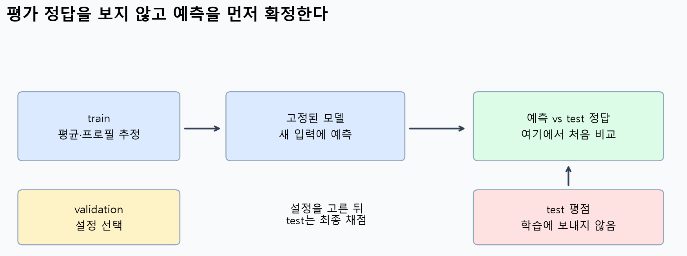
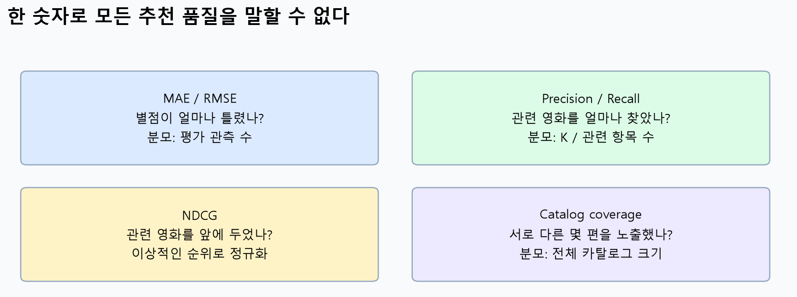

# W07A · SVD 마무리와 중간고사 대비 ①

딥러닝응용I(추천시스템) · 동덕여자대학교 데이터사이언스전공 · 유원상 교수 · 2026-2 · 2026년 10월 13일

이번에는 새 알고리즘을 더 배우기보다, 지금까지의 개념을 작은 숫자로 다시 연결합니다. 처음부터 이해하지 못했던 부분이 있어도 괜찮습니다. **무엇을 모으고, 무엇으로 나누고, 어떤 순서로 고르며, 무엇과 비교하는지**부터 차근차근 확인하세요.

## 학습 순서와 복습 일정

1. 별도 **SVD 섹션 8–13 마무리 노트**로 지난 수업의 계산과 실습을 마칩니다.
2. 아래 핵심 요약을 읽고, 일반 문제 Q01–Q39와 Python 문제 Q40–Q60을 풉니다. 총60문항이며 일반65%, Python35%입니다.
3. Colab A에서 데이터·평균·집단을, Colab B에서 내용·평가·마지막 웹 앱을 실험합니다. 두 실습은 독립 실행됩니다.
4. 답만 외우지 말고 **입력 확인 → 식과 조건 → 중간 계산 → 최종값과 의미 → 검산**을 적습니다. 중간고사는 이 자료의 문제를 조금씩 변형해 출제할 예정입니다.

| 복습 수업 | 범위 |
|---|---|
| 10월13일 W07a | 실제1–2주차: 개념·데이터·기본 추천·내용 기반·기본 평가 |
| 10월15일 W07b | 실제3주차 복습 |
| 10월20일 W08a | 실제4주차 복습 |

60문항을 수업 중 한 번에 모두 풀 필요는 없습니다. 대표 문항은 Q08·Q13·Q20·Q28·Q38·Q43·Q50·Q59입니다. 어려우면 먼저 기초 표시 문항을 풀고, 적용·통합 문항으로 넘어가세요. 새로 부과하는 성적 과제나 제출 마감은 없습니다. SVD 보충 내용은 아래60문항의 범위와 구분합니다.

## 1. 추천시스템의 전체 흐름

추천시스템은 여러 후보 중 특정 사용자에게 먼저 보여줄 아이템을 고르는 방법입니다. “좋아할 점수는 몇 점인가?”라는 예측과 “무엇을 먼저 보여줄까?”라는 순위는 연결되지만 같은 출력이 아닙니다.



그림1. 왼쪽부터 입력→통계/특징→후보→목록→평가를 읽으세요. 아래쪽 test 화살표는 채점으로만 연결됩니다. 수업용 독자 제작 도식입니다. **그림 확인 V1:** test의 실제 별점이 평균 계산으로 들어가도 될까요?

| 구분 | 사용하는 핵심 정보 | 예 |
|---|---|---|
| 전체 평균 기반 목록 | 다른 사용자들의 영화별 관측 평점 | 모두에게 같은 평균 순위 |
| 집단 기반 | 집단 속성과 집단×영화 평점 | 집단별 평균 순위 |
| 내용 기반 | 장르·줄거리·태그와 개인 선호 | 좋아한 내용과 비슷한 영화 |
| 협업 필터링 | 여러 사용자의 상호작용 패턴 | 비슷한 평가 패턴 활용 |

개인화는 사용자 정보를 점수 결정에 사용하는지로 판단합니다. 개인화해도 취향이 같거나 후보가 적으면 같은 목록을 받을 수 있습니다. 별점은 명시적 신호, 클릭·시청은 암묵적 신호입니다. 비클릭은 비노출일 수도 있으므로 곧바로 싫어함의 정답으로 바꾸지 않습니다.

## 2. 표의 한 행부터 읽기

사용자 표의 한 행은 한 사람, 아이템 표의 한 행은 한 아이템, 평점 표의 한 행은 사용자–아이템 관측입니다. 두 표를 연결할 때는 행 위치가 아니라 ID를 사용합니다. 사용자 속성표의 ID가 중복이면 연결 후 평점 행이 복제되어 평균까지 바뀔 수 있습니다.

설명용 표에는 사용자3명과 영화2편이 있고 관측은 다음과 같습니다. 실제 MovieLens가 아닌 작은 합성 예입니다.

| 사용자 | A | B |
|---|---:|---:|
| u1 | 4 | 미관측 |
| u2 | 2 | 5 |
| u3 | 미관측 | 3 |

가능한 쌍은6개, 관측은4개입니다. 관측 비율은4/6, 미관측은2칸입니다. A의 관측 평균은(4+2)/2=3이고, 사용자3명으로 나눈2가 아닙니다. **모르는 값과 실제0점은 다릅니다.**



그림2. 같은 영화의 관측 개수와 평균을 다른 축에서 읽습니다. 데이터 A=[2,4,4], B=[5], C=[3,5]를 직접 계산한 그림입니다. 단위는 왼쪽이 개수, 오른쪽이 평점입니다. **V2:** B가 평균1위라는 사실만으로 가장 많이 평가된 영화라고 말할 수 있을까요?

## 3. 인기제품 추천: 평균·개수·후보 조건

교재의 **인기제품 방식(best-seller)은 영화별 평균 평점**을 사용합니다. 평점 수 순위는 이를 비교하기 위해 수업에서 추가한 기준입니다. 평점 수는 관측 참여량이며 전체 관객 수와 같다고 단정하지 않습니다.

$$
\bar r_i=\frac{\sum_{u:(u,i)\in\Omega_{\mathrm{train}}}r_{ui}}{n_i},\qquad
n_i=\#\{u:(u,i)\in\Omega_{\mathrm{train}}\}.
$$

기호가 낯설면 먼저 “영화 i에 실제 남긴 학습 평점만 모아 합하고, 그 개수로 나눈다”라고 읽으세요. 관측이0개이면 이 영화 평균은 정의되지 않습니다. 임의로0점을 만드는 대신 정해진 대체 기준을 사용하거나 후보에서 제외합니다.

전체 관측 평균을 구할 때 영화별 평균을 다시 단순 평균하지 않습니다. 예를 들어 A는3명·평균10/3, B는1명·평균5, C는2명·평균4입니다. 전체 합은10+5+8=23, 관측 수는6이므로23/6≈3.8333입니다. 영화마다 관측 수가 다르기 때문에 관측 수를 가중치로 써야 합니다.



그림3. 가로축은 관측 수, 세로축은 평균입니다. 최소 개수2 조건은 평균에 상관없이 관측1개인 B를 제외합니다. 이 조건만으로 품질이나 통계적 신뢰성이 보장되지는 않습니다. **V3:** 조건을 높였을 때 후보 수와 성능이 반드시 함께 좋아질까요?

추천 순서는 **조건에 맞는 후보 찾기 → 점수 내림차순 → 동점 기준 적용 → 상위 K개**입니다. 기본 동점 규칙은 점수, 관측 수 내림차순, 마지막 ID 오름차순입니다. 이미 본 영화는 ID로 제외합니다. 후보가 부족하면 짧은 목록과 사유를 반환하며 조건을 몰래 완화하지 않습니다.

## 4. 집단 평균: 누구의 어떤 평점인가?

집단 평균은 집단과 영화의 두 키로 묶습니다. 집단 G의 영화 i 평균은 그 집단이 그 영화에 남긴 **관측 수**로 나눕니다. 집단의 전체 인원 수가 분모가 아닙니다.



그림4. 집단8명 중 영화A를 평가한3명의 평점이2,4,3이면 평균은9/3=3입니다. 나머지5명의 평점은 모릅니다. 독자 제작 예시입니다. **V4:** 나머지5명을 분모에 넣는 것은 어떤 가정을 추가하는 것일까요?



그림5. 개별 평점 예측의 대체 순서입니다. 집단×영화가 충분하면 사용하고, 부족하면 영화 전체 관측을 찾습니다. 영화도 없으면 학습 전체 평균을 사용합니다. **V5:** 집단 관측1개·영화 관측10개일 때 집단 최소2 조건이라면 어느 단계인가요?

**추천 목록의 대체와 구별:** 이번 앱의 집단 목록은 조건에 맞는 미관람 영화가 하나도 없을 때 전체 영화평균 목록으로 전환합니다. 일부 유효 영화가 있으면 부족한 다른 영화를 개별적으로 채워 넣지 않습니다. 반면 평점 예측은 각 쌍마다 대체합니다. 결과의 `basis`를 읽으면 어떤 기준을 사용했는지 확인할 수 있습니다.

집단을 더 잘게 나누면 각 평균의 관측 수가 줄어듭니다. 표현이 세밀해져도 성능 향상은 보장되지 않습니다. 집단 평균이 높다는 사실은 그 집단의 모든 개인이 더 좋아한다는 뜻도 아닙니다.

## 5. 내용 벡터와 사용자 프로필

내용 기반은 아이템의 특징을 숫자 벡터로 표현합니다. 모든 벡터에서 같은 열은 같은 특징이어야 합니다. [액션,코미디] 순서라면 (1,0)은 액션, (0,1)은 코미디, (1,1)은 두 특징이 있다는 뜻입니다.

$$
\mathbf p_u=\frac{1}{|L_u|}\sum_{i\in L_u}\mathbf x_i,\qquad
\cos(\mathbf p_u,\mathbf x_i)=\frac{\mathbf p_u^\top\mathbf x_i}{\lVert\mathbf p_u\rVert_2\lVert\mathbf x_i\rVert_2}.
$$

여기서는 좋아한 학습 영화 집합을 L이라 하고 같은 가중치로 평균합니다. 좋아한 영화가 없으면 프로필 평균을 계산할 수 없습니다. 영벡터는 길이가0이라 코사인도 정의되지 않습니다. 구현의 예외 처리 규칙을 명시해야 합니다.



그림6. 프로필 방향과 가까운 후보가 더 높은 코사인을 얻습니다. 화살표 길이와 방향을 구별하세요. 그림의 프로필(0.8,0.2)은 독자적인 설명용 값입니다. **V6:** 프로필을 같은 양의 숫자로2배 늘리면 코사인은 달라질까요?

내적은 같은 좌표끼리 곱해 더한 숫자 하나입니다. 코사인은 이 내적을 두 길이의 곱으로 나눕니다. 코사인 점수는 별점 예측이나 구매 확률이 아닙니다. 질의 영화 자신은 ID로 제외해야 합니다. 동일한 벡터를 가진 영화가 여러 편이면 첫 행만 지우는 방식은 안전하지 않습니다.

## 6. TF–IDF를 두 단계로 읽기

교재2.5는 영화 줄거리의 단어 특징을 이용합니다. 이번 작은 문제는 직접 만든 짧은 문장을 사용합니다. TF는 한 문서의 단어 등장 횟수, DF는 그 단어가 들어 있는 문서 수입니다. 한 문서에서 여러 번 나와도 DF에서는 그 문서를 한 번만 셉니다.

$$
\operatorname{idf}(t)=\ln\frac{1+N}{1+\operatorname{df}(t)}+1,\qquad
w_{td}=\operatorname{tf}(t,d)\operatorname{idf}(t).
$$

여기서는 기존 W02B와 같은 평활 IDF를 씁니다. N은 문서 수이며 로그는 자연로그입니다. 각 문서 벡터를 L2 정규화하려면 벡터의 길이로 각 좌표를 나눕니다. 예를 들어 (6,8)의 길이는10이므로 정규화 결과는(0.6,0.8)입니다. 필요한 로그·제곱근 근삿값은 문제에서 제공합니다.

공식의 선택과 정규화 유무에 따라 TF–IDF 값은 달라질 수 있습니다. 따라서 공식을 먼저 확인하고 계산해야 합니다. 어떤 라이브러리의 클래스 이름을 외우는 것이 이번 문제의 목표는 아닙니다.

## 7. 학습과 평가의 역할



그림7. train으로 평균·프로필을 만든 뒤 test 입력에 예측합니다. test 정답은 채점 시 비교합니다. 모델 설정은 validation으로 선택합니다. **V7:** test를 보며 최소 평점 수를 여러 번 고른다면 test는 어떤 역할까지 하게 될까요?

평가 목적에 맞는 분할 단위도 중요합니다. 관측 행 무작위 분할은 기존 사용자·아이템의 다른 관측 예측을 보는 입문 실험입니다. 새 사용자나 미래 행동까지 검증했다는 뜻은 아닙니다. 같은 관측의 복제본이 양쪽에 들어가면 행 번호가 달라도 누수일 수 있습니다.

$$
e_j=y_j-\widehat y_j,\quad
\operatorname{MAE}=\frac1n\sum_{j=1}^n|e_j|,\quad
\operatorname{RMSE}=\sqrt{\frac1n\sum_{j=1}^ne_j^2}.
$$

분모 n은 평가한 평점 관측 수입니다. 사용자별로 먼저 계산한 지표를 평균내는 것과 전체 행 지표는 다를 수 있습니다. 예를 들어 오차가[1,−2]라면 MAE=1.5, RMSE=√2.5≈1.5811입니다. 부호를 그대로 합한−0.5는 MAE가 아닙니다.

## 8. 평가 지표가 묻는 다른 질문



그림8. 같은 추천시스템에도 여러 질문이 필요합니다. 단위와 분모가 다르므로 수치 크기만 직접 비교하지 않습니다. **V8:** RMSE0.8과 Precision0.7 중 숫자가 작다는 이유로 더 좋다고 할 수 있을까요?

| 지표 | 계산·해석 | 좋은 방향 |
|---|---|---|
| MAE/RMSE | 실제 별점과 예측 별점의 오차 | 낮을수록 좋음 |
| Precision@K | Top-K 적중 수/K | 높을수록 좋음 |
| Recall@K | Top-K 적중 수/전체 관련 아이템 수 | 높을수록 좋음 |
| NDCG@K | 위치를 가중한 DCG/이상적 DCG | 높을수록 좋음 |
| Catalog coverage | 추천한 서로 다른 아이템 수/전체 카탈로그 크기 | 더 넓은 아이템 노출 |

이진 관련성의 DCG는 각 순위 j의 관련성0/1을 log₂(j+1)로 나누어 더합니다. 이상적인 순위에서는 관련 아이템을 앞에 배치합니다. 관련 아이템이0개이면 Recall과NDCG가 정의되지 않으므로 이 실습은 `None`으로 표시합니다. 짧은 목록의 Precision 분모는 이번 앱에서 요청한K로 고정합니다. 일반 문제는 필요한K와 관련 집합을 모두 제시합니다.

커버리지가 높다고 만족도가 높다고 단정할 수 없습니다. 관련 없는 여러 아이템을 넓게 노출해도 커버리지는 높아집니다. 평가표를 읽을 때는 **같은 분할·후보·K·관련성·제외 규칙·집계 방식**인지 먼저 확인합니다.

## 9. Python을 읽는 최소 문법

| 표현 | 의미 |
|---|---|
| `values=[2,4]` | 값들을 순서대로 담은 리스트 |
| `sum(values)`, `len(values)` | 합, 원소 수 |
| `for v in values:` | 각 값을 차례로 꺼내 아래 들여쓴 문장 실행 |
| `if 조건:` | 조건이 참이면 아래 문장 실행 |
| `x in values`, `x not in values` | 포함, 미포함 |
| `d[key]` | 딕셔너리에서 키의 값 찾기 |
| `+=` | 현재 값에 더해 저장 |
| `None`, `is not None` | 아직 값 없음, 값이 있는지 검사 |
| `**2`, `**0.5`, `abs(x)` | 제곱, 제곱근, 절댓값 |
| `range(2)` | 0,1을 차례로 제공 |

문제의 잘못된 코드는 읽고 고치기 위한 것입니다. Colab에서는 문제 코드를 설명 셀에 제시하고, 작성할 답과 자동 시연 변수를 분리합니다. 따라서 전체 실행이 끝났다고 자신의 답이 정답이라는 뜻은 아닙니다. 결과 예측을 먼저 적고, 수정 코드를 자신의 셀에서 실행하세요.

## 10. 실습과 마지막 웹 앱

[Colab A · 데이터·평균·집단](https://colab.research.google.com/github/lunalab-ai/recommender/blob/2026-fall-w07a/notebooks/student/w07a-review-foundations.ipynb)

[Colab B · 내용·평가·웹 앱](https://colab.research.google.com/github/lunalab-ai/recommender/blob/2026-fall-w07a/notebooks/student/w07a-review-content-app.ipynb)

CPU에서 위부터 실행하면 수업용 합성 표를 자동으로 준비합니다. GPU·개인 파일 업로드·유료 API는 필요 없습니다. 자신의 수정은 Drive 사본에 저장하세요. 설치 후 재시작 안내가 나오면 재시작하고 첫 셀부터 다시 실행합니다.

코드는 공개 저장소의 `2026-fall-w07a` 버전에 고정합니다. 노트북의 **함수 이름 바로가기**는 그 설치 버전의 실제 정의 행으로 연결됩니다. 함수의 목적→입력→출력→검증 조건을 읽고 내부 구현을 확인하세요.

마지막 앱에서 `mean/count/group/content`, 최소 평점 수, Top-K를 바꿉니다. 변경 전 예상 → 추천 목록과 관측 수 확인 → 평가 표 확인 → 자신의 설명 함수 한 줄 수정 → 앱 재실행의 순서로 진행합니다. **LAB-B:** 조건을2로 높였을 때 빠진 영화와 그 근거를 설명하는 문장을 앱에 추가하세요. 평가 점수를 조작하는 문제가 아닙니다.

앱에는 SVD 재구성 탭도 있습니다. k=1과2를 비교해 원본 재구성과 숨긴 평점 예측을 구별하세요. Colab이 만드는 Gradio 공유 주소는 임시 주소입니다. 다시 열 때는 위의 고정 Colab 링크에서 실행합니다.

선택 확장은 [기존 W02B 실습](https://github.com/lunalab-ai/recommender/tree/main/notebooks/student)에서 MovieLens100K 자동 준비와 평균·내용 비교를 다시 수행합니다. 이번 합성 표의 수치를 실제 MovieLens 성능이라고 보고하지 않습니다.

## 연습문제 안내

일반 문항은 단답형이지만 풀이과정과 근거가 필요합니다. 각 문제는 독립적으로 풀 수 있도록 입력과 조건을 다시 적었습니다. Python 문제는 빈칸9개·오류 수정8개·출력 추적4개입니다. 기초30·적용24·통합6문항이며 문제 번호는 Notion·PDF·실습에서 같습니다. 별도 지시가 없으면 마지막 단계에서 소수 넷째 자리까지 반올림합니다.

아래에는 연습문제의 정답을 넣지 않았습니다. 학습용으로 이미 설명한 예제와 시험 대비 연습문항을 구별하세요.


## Q01 · 개인화의 판단 기준

**일반 · 기초 · 추천 개념 · 복습 W01A**

서비스 P는 모든 사용자에게 이번 주 평균평점 상위 3편을 보여 준다. 서비스 Q는 각 사용자가 좋아한 장르를 이용해 3편을 고른다. 어느 서비스가 개인화인가? Q에서 두 사용자의 목록이 같으면 개인화가 아니라고 결론 내릴 수 있는지도 이유와 함께 쓰라.

풀이 기록: 적용할 개념과 조건 / 중간 계산·코드 추적 / 최종값과 한 문장 해석 / 검산


---

## Q02 · 명시적·암묵적 신호

**일반 · 기초 · 추천 개념 · 복습 W01A**

5점 척도의 별점, 상품 클릭, 30초 시청 기록을 명시적/암묵적 신호로 분류하라. 클릭하지 않은 상품을 싫어한다고 단정할 수 없는 이유 2개를 쓰라.

풀이 기록: 적용할 개념과 조건 / 중간 계산·코드 추적 / 최종값과 한 문장 해석 / 검산


---

## Q03 · 내용과 협업의 입력

**일반 · 기초 · 추천 개념 · 복습 W01A**

방법 A는 영화 줄거리의 단어와 내가 좋아한 영화를 사용한다. 방법 B는 여러 사용자의 영화 평가 패턴을 사용한다. 두 방법의 이름과 핵심 입력을 각각 쓰라. 이 문제에서는 유사도 계산은 요구하지 않는다.

풀이 기록: 적용할 개념과 조건 / 중간 계산·코드 추적 / 최종값과 한 문장 해석 / 검산


---

## Q04 · 점수 예측과 순위

**일반 · 기초 · 추천 개념 · 복습 W01A**

영화 A,B,C의 예상 별점은 각각 3.8,4.4,4.0이다. 높은 점수부터 Top-2를 고르라. 예측한 숫자와 추천 목록이 답하는 질문은 어떻게 다른가?

풀이 기록: 적용할 개념과 조건 / 중간 계산·코드 추적 / 최종값과 한 문장 해석 / 검산


---

## Q05 · 새 사용자와 기본 추천

**일반 · 기초 · 추천 개념 · 복습 W01A**

아직 별점·클릭을 남기지 않은 신규 사용자에게 전체 평균평점 목록을 제시하는 이유와 한계 1개씩을 쓰라. 가입 시 관심 장르를 받는다면 어떤 정보를 보완하는가?

풀이 기록: 적용할 개념과 조건 / 중간 계산·코드 추적 / 최종값과 한 문장 해석 / 검산


---

## Q06 · 추천 절차 정리

**일반 · 기초 · 추천 개념 · 복습 W01A**

다음 네 단계를 올바르게 배열하고 각 단계의 역할을 한 문장씩 쓰라: ㉠ 후보를 점수순으로 정렬, ㉡ 학습 데이터에서 점수 기준 계산, ㉢ 이미 본 영화·조건 미충족 영화 제외, ㉣ 상위 K개 반환. 전체 후보에 점수를 계산한 뒤 필터링한다고 가정한다.

풀이 기록: 적용할 개념과 조건 / 중간 계산·코드 추적 / 최종값과 한 문장 해석 / 검산


---

## Q07 · 한 행의 의미

**일반 · 기초 · 데이터 · 복습 W01B·W02A**

평점 행은 (u1,A,4), (u1,B,2), (u2,A,5), (u3,C,3)이다. 관측 평점 수, 서로 다른 사용자 수, 서로 다른 영화 수를 구하고, 영화 A가 두 번 나오는 이유를 쓰라.

풀이 기록: 적용할 개념과 조건 / 중간 계산·코드 추적 / 최종값과 한 문장 해석 / 검산


---

## Q08 · 희소성과 미관측

**일반 · 기초 · 데이터 · 복습 W01B·W02A**

사용자 u1,u2,u3과 영화 A,B,C가 있고, 관측은 (u1,A,4),(u1,B,2),(u2,A,5),(u3,C,3)뿐이다. 3×3 평점표를 만들고 미관측 칸 수와 관측 비율을 구하라. 미관측은 ?로 표시한다.

풀이 기록: 적용할 개념과 조건 / 중간 계산·코드 추적 / 최종값과 한 문장 해석 / 검산


---

## Q09 · 결측과 0점

**일반 · 기초 · 데이터 · 복습 W01B·W02A**

한 영화의 사용자별 값이 [5,미관측,1]이다. 관측 평균을 계산하라. 미관측을 0으로 바꿔 세 사람으로 나누면 어떤 값이 나오며 왜 다른 질문이 되는가?

풀이 기록: 적용할 개념과 조건 / 중간 계산·코드 추적 / 최종값과 한 문장 해석 / 검산


---

## Q10 · ID로 표 연결하기

**일반 · 기초 · 데이터 · 복습 W01B·W02A**

사용자 표가 [(u2,G2),(u1,G1)]이고 평점 표가 [(u1,A,5),(u2,A,2)]이다. 각 평점에 집단을 붙여라. 두 표의 첫 행끼리 위치로 붙이면 왜 틀리는가?

풀이 기록: 적용할 개념과 조건 / 중간 계산·코드 추적 / 최종값과 한 문장 해석 / 검산


---

## Q11 · 중복 ID와 부풀려진 평균

**일반 · 적용 · 데이터 · 복습 W01B·W02A**

사용자 표에 u1의 동일한 집단 행이 2개, u2의 행이 1개 있다. 평점은 u1의 A=5, u2의 A=1이다. ID로 모두 연결하여 행이 복제되면 A 평균은 얼마가 되는가? 원래 평균과 비교하고 수정 원칙을 쓰라.

풀이 기록: 적용할 개념과 조건 / 중간 계산·코드 추적 / 최종값과 한 문장 해석 / 검산


---

## Q12 · 분할 단위 확인

**일반 · 통합 · 데이터 · 복습 W01B·W02A**

기록 (u1,A,5)이 수집 오류로 2번 저장되었다. 한 복제본은 train, 다른 복제본은 test에 들어갔다. train/test 행 번호가 겹치지 않으므로 평가가 공정하다는 주장에 답하고, 분할 전 점검 및 평가 목적을 각각 쓰라.

풀이 기록: 적용할 개념과 조건 / 중간 계산·코드 추적 / 최종값과 한 문장 해석 / 검산


---

## Q13 · 평점 수와 평균의 다른 순위

**일반 · 기초 · 인기·평균·후보 · 복습 W02A**

영화 A의 평점 [1,3,2,2], B [5], C [4,4]가 있다. 각 영화의 평점 수와 평균을 구하고 각각 내림차순 순위를 쓰라.

풀이 기록: 적용할 개념과 조건 / 중간 계산·코드 추적 / 최종값과 한 문장 해석 / 검산


---

## Q14 · 후보 제한 후 Top-K

**일반 · 기초 · 인기·평균·후보 · 복습 W02A**

영화 통계는 A(평균4.5,개수3), B(5.0,1), C(4.0,2)이다. 사용자는 A를 이미 보았다. 최소 평점 수2, 본 영화 제외, 평균 내림차순, Top-2를 적용하라. 2편을 반환하지 못하면 어떻게 보고해야 하는가?

풀이 기록: 적용할 개념과 조건 / 중간 계산·코드 추적 / 최종값과 한 문장 해석 / 검산


---

## Q15 · 전체 평균의 가중치

**일반 · 적용 · 인기·평균·후보 · 복습 W02A**

A는 4명이 평가하여 평균2, B는 1명이 평가하여 평균5, C는 2명이 평가하여 평균4이다. 모든 관측 평점의 전체 평균을 구하라. 영화 평균 세 개를 단순 평균한 값과 비교하라.

풀이 기록: 적용할 개념과 조건 / 중간 계산·코드 추적 / 최종값과 한 문장 해석 / 검산


---

## Q16 · 동점 규칙

**일반 · 기초 · 인기·평균·후보 · 복습 W02A**

A(평균4,개수3), B(평균4,개수3), C(평균4,개수2)이다. 평균 내림차순 → 개수 내림차순 → ID 알파벳 오름차순으로 Top-2를 구하고 각 비교 단계를 쓰라.

풀이 기록: 적용할 개념과 조건 / 중간 계산·코드 추적 / 최종값과 한 문장 해석 / 검산


---

## Q17 · 최소 표본 수의 효과

**일반 · 기초 · 인기·평균·후보 · 복습 W02A**

영화별 평점 수는 A=1,B=2,C=4,D=7이다. 최소 평점 수를2에서5로 올릴 때 후보 집합을 각각 구하라. 후보 수와 실제 성능이 반드시 같은 방향으로 변하는가?

풀이 기록: 적용할 개념과 조건 / 중간 계산·코드 추적 / 최종값과 한 문장 해석 / 검산


---

## Q18 · 평균과 제곱오차

**일반 · 적용 · 인기·평균·후보 · 복습 W02A**

평점 [1,3,5]를 같은 상수 a로 예측한다. a=2와 a=3의 제곱오차 합을 각각 구하고 어떤 값이 더 좋은지 쓰라. 관측 평균과 연결하여 설명하라.

풀이 기록: 적용할 개념과 조건 / 중간 계산·코드 추적 / 최종값과 한 문장 해석 / 검산


---

## Q19 · 추가 평점과 순위 변화

**일반 · 통합 · 인기·평균·후보 · 복습 W02A**

영화 A는 평점2개의 평균이4이고 B는 평점4개의 평균이3.5이다. A에 새 평점1이 추가된다. A의 새 평균과 평균 순위의 변화를 구하라. 모든 영화는 후보 조건을 만족한다고 가정한다.

풀이 기록: 적용할 개념과 조건 / 중간 계산·코드 추적 / 최종값과 한 문장 해석 / 검산


---

## Q20 · 집단평균의 분모

**일반 · 기초 · 집단·분모·대체 · 복습 W02A·W02B**

G1에는 사용자10명이 있다. 그중 영화 A에 평점을 남긴 사람은2명이고 점수는5,3이다. G1×A의 평균과 평점 수를 구하라. 나머지8명을 분모에 포함할 수 없는 이유를 쓰라.

풀이 기록: 적용할 개념과 조건 / 중간 계산·코드 추적 / 최종값과 한 문장 해석 / 검산


---

## Q21 · 두 집단의 상반된 선호

**일반 · 기초 · 집단·분모·대체 · 복습 W02A·W02B**

G1의 A평점은 [5,3], B는 [2,2]이다. G2의 A평점은 [1,3], B는 [4,4]이다. 각 집단의 영화별 평균과 Top-1을 구하라. 최소 평점 수는2이다.

풀이 기록: 적용할 개념과 조건 / 중간 계산·코드 추적 / 최종값과 한 문장 해석 / 검산


---

## Q22 · 영화 평균으로 대체하기

**일반 · 기초 · 집단·분모·대체 · 복습 W02A·W02B**

평점 예측 규칙은 집단×영화 관측2개 이상이면 집단 평균, 부족하면 영화 평균, 영화 관측도 없으면 전체 평균이다. G1×A는 [5]이고 영화 A 전체는 [5,3,1]이다. 전체 학습 평균은3.5이다. G1 사용자의 A 예측과 선택 근거를 쓰라.

풀이 기록: 적용할 개념과 조건 / 중간 계산·코드 추적 / 최종값과 한 문장 해석 / 검산


---

## Q23 · 전체 평균으로 대체하기

**일반 · 적용 · 집단·분모·대체 · 복습 W02A·W02B**

신규 영화 Z에는 학습 평점이 없다. 집단 통계도 없다. 학습 평점 전체는 [5,4,2,1]이다. 집단→영화→전체 평균 순의 평점 예측값과 근거를 쓰라. 이것이 Z의 실제 품질을 안다는 뜻인지도 설명하라.

풀이 기록: 적용할 개념과 조건 / 중간 계산·코드 추적 / 최종값과 한 문장 해석 / 검산


---

## Q24 · 목록 대체와 평점 대체 구별

**일반 · 기초 · 집단·분모·대체 · 복습 W02A·W02B**

추천 목록 모드는 선택 집단에서 조건에 맞는 영화가 하나도 없을 때 전체 영화평균 목록으로 전환한다. 평점 예측 모드는 각 사용자–영화 쌍마다 집단→영화→전체 평균으로 대체한다. 집단에 유효 영화A만 있고 B는 표본 부족이면, 목록 모드가 B를 자동 보충한다고 말해도 되는가?

풀이 기록: 적용할 개념과 조건 / 중간 계산·코드 추적 / 최종값과 한 문장 해석 / 검산


---

## Q25 · 집단 세분화의 대가

**일반 · 적용 · 집단·분모·대체 · 복습 W02A·W02B**

동일 영화에 학습 평점40개가 있다. 집단을 2개로 나누면 각20개, 10개로 나누면 각4개씩 있다고 하자. 최소 집단 표본 수5일 때 통과하는 집단 수를 구하고, 세분화가 항상 더 좋은 이유가 될 수 없는 점을 설명하라.

풀이 기록: 적용할 개념과 조건 / 중간 계산·코드 추적 / 최종값과 한 문장 해석 / 검산


---

## Q26 · 집단 평균과 개인의 취향

**일반 · 통합 · 집단·분모·대체 · 복습 W02A·W02B**

G1의 영화A 평균4.5가 G2의 평균3보다 높다. “G1의 모든 사람은 G2의 모든 사람보다 A를 더 좋아한다”는 결론이 가능한가? 평균을 만족하면서 이 결론을 깨는 간단한 점수 예를 만들라.

풀이 기록: 적용할 개념과 조건 / 중간 계산·코드 추적 / 최종값과 한 문장 해석 / 검산


---

## Q27 · 특징의 같은 좌표

**일반 · 기초 · 내용·벡터·TF–IDF · 복습 W02B**

벡터의 순서를 [액션,코미디]로 고정한다. A=(1,0), B=(0,1), C=(1,1)이다. 각 영화의 장르를 쓰고, B만 [코미디,액션] 순서로 저장한 채 내적을 구하면 왜 잘못되는지 설명하라.

풀이 기록: 적용할 개념과 조건 / 중간 계산·코드 추적 / 최종값과 한 문장 해석 / 검산


---

## Q28 · 코사인 손계산

**일반 · 기초 · 내용·벡터·TF–IDF · 복습 W02B**

x=(1,0), y=(1,1)이다. 내적, 두 길이, 코사인 유사도를 순서대로 구하라. √2≈1.4142를 사용하고 최종값은 소수 넷째 자리까지 쓰라.

풀이 기록: 적용할 개념과 조건 / 중간 계산·코드 추적 / 최종값과 한 문장 해석 / 검산


---

## Q29 · 크기와 방향

**일반 · 기초 · 내용·벡터·TF–IDF · 복습 W02B**

x=(1,2), y=(2,4)이다. 코사인 유사도를 구하고, 같은 장르 비율을 가진 벡터를 2배로 늘렸을 때 방향 비교가 어떻게 되는지 설명하라.

풀이 기록: 적용할 개념과 조건 / 중간 계산·코드 추적 / 최종값과 한 문장 해석 / 검산


---

## Q30 · 사용자 프로필

**일반 · 기초 · 내용·벡터·TF–IDF · 복습 W02B**

좋아한 영화 두 편의 특징은 A=(1,0), B=(1,1)이다. 같은 가중치의 평균으로 사용자 프로필을 만들라. 미관람 후보 C=(1,0), D=(0,1) 중 코사인이 큰 것을 구하라. √1.25≈1.1180을 제공한다.

풀이 기록: 적용할 개념과 조건 / 중간 계산·코드 추적 / 최종값과 한 문장 해석 / 검산


---

## Q31 · TF와 DF

**일반 · 적용 · 내용·벡터·TF–IDF · 복습 W02B**

문서 A="robot robot space", B="robot comedy", C="family comedy"이다. A에서 robot의 TF와 전체 문서에서 robot의 DF를 구하라. 단순 단어 횟수를 TF로 사용한다.

풀이 기록: 적용할 개념과 조건 / 중간 계산·코드 추적 / 최종값과 한 문장 해석 / 검산


---

## Q32 · 평활 IDF와 정규화

**일반 · 적용 · 내용·벡터·TF–IDF · 복습 W02B**

문서 수 N=3, 어떤 단어의 DF=1, 현재 문서 TF=2이다. idf=ln((1+N)/(1+DF))+1을 사용한다. ln2≈0.6931일 때 IDF와 정규화 전 TF–IDF를 구하라. 원시 TF–IDF 벡터가 (3,4)이면 L2 정규화 결과도 구하라.

풀이 기록: 적용할 개념과 조건 / 중간 계산·코드 추적 / 최종값과 한 문장 해석 / 검산


---

## Q33 · 영벡터와 자기 자신 제외

**일반 · 통합 · 내용·벡터·TF–IDF · 복습 W02B**

영화A와 B는 동일한 비영 특징벡터를 가지고 있고 A가 질의 영화이다. A와 B의 코사인은 모두1이다. 정렬 후 첫 행만 버리면 자기 자신 제외가 항상 올바른가? 특징이 모두0인 영화Z와의 코사인은 수학적으로 정의되는가? 처리 규칙을 쓰라.

풀이 기록: 적용할 개념과 조건 / 중간 계산·코드 추적 / 최종값과 한 문장 해석 / 검산


---

## Q34 · MAE와 RMSE

**일반 · 기초 · 분할·평가 · 복습 W02A·W02B**

실제 평점 y=[5,2,4], 예측 p=[3,3,4]이다. 오차 y−p, 절대오차, 제곱오차를 표로 쓰고 MAE와 RMSE를 구하라. √(5/3)≈1.2910을 제공한다.

풀이 기록: 적용할 개념과 조건 / 중간 계산·코드 추적 / 최종값과 한 문장 해석 / 검산


---

## Q35 · Precision과 Recall

**일반 · 기초 · 분할·평가 · 복습 W02A·W02B**

추천 Top-3 목록은 [A,B,C], 이 사용자가 관련 있다고 평가한 전체 후보 집합은 {B,C,D,E}이다. 관련성은 이 집합에 포함되는지로 정의한다. Precision@3과 Recall@3을 구하고 분모의 뜻을 쓰라.

풀이 기록: 적용할 개념과 조건 / 중간 계산·코드 추적 / 최종값과 한 문장 해석 / 검산


---

## Q36 · 적중 위치와 NDCG

**일반 · 적용 · 분할·평가 · 복습 W02A·W02B**

관련 아이템은 총2개이다. Top-3 관련성 순서가 P=[1,0,1], Q=[0,1,1]이다. DCG는 rel1/1+rel2/1.585+rel3/2, IDCG는1+1/1.585로 정의한다. 두 NDCG@3을 소수 넷째 자리까지 구하라.

풀이 기록: 적용할 개념과 조건 / 중간 계산·코드 추적 / 최종값과 한 문장 해석 / 검산


---

## Q37 · 카탈로그 커버리지

**일반 · 적용 · 분할·평가 · 복습 W02A·W02B**

전체 카탈로그는 {A,B,C,D,E,F}이다. 세 사용자의 추천 목록은 [A,B], [B,C], [A,C]이다. Catalog coverage를 구하라. 추천 슬롯 수6을 분자로 쓰면 왜 틀리는가?

풀이 기록: 적용할 개념과 조건 / 중간 계산·코드 추적 / 최종값과 한 문장 해석 / 검산


---

## Q38 · 평균에 test가 섞이면

**일반 · 적용 · 분할·평가 · 복습 W02A·W02B**

학습 평점은 [1,3], 가려둔 test 평점은5이다. 학습 평균만 예측할 때와 전체 [1,3,5]의 평균으로 test를 예측할 때 각각 예측값·절대오차를 구하라. 더 작은 오차를 공정한 개선이라고 보고할 수 있는가?

풀이 기록: 적용할 개념과 조건 / 중간 계산·코드 추적 / 최종값과 한 문장 해석 / 검산


---

## Q39 · 공정한 비교의 결론

**일반 · 통합 · 분할·평가 · 복습 W02A·W02B**

모델 M은 평점 예측을 하며 test RMSE=0.9이다. 모델 C는 내용 코사인 점수로 추천하며 같은 후보에서 Precision@3=2/3이다. 한 학생이 0.9>2/3이므로 C가 좋다고 했다. 잘못된 점과 올바른 비교 절차를 쓰라. 최소 평점 수를 test로 여러 번 골랐다면 무엇을 바꾸어야 하는가?

풀이 기록: 적용할 개념과 조건 / 중간 계산·코드 추적 / 최종값과 한 문장 해석 / 검산


---

## Q40 · 개인 후보의 빈칸

**Python · 기초 · 추천 개념 · 복습 W01A**

빈칸 ___을 채워 이미 본 영화는 제외하라. `not in`은 목록에 포함되지 않음을 뜻한다. 결과도 쓰라.

```python
items=['A','B','C']
seen=['B']
out=[]
for item in items:
    if item ___ seen:
        out.append(item)
print(out)
```

풀이 기록: 적용할 개념과 조건 / 중간 계산·코드 추적 / 최종값과 한 문장 해석 / 검산


---

## Q41 · 클릭 기록의 논리 오류

**Python · 기초 · 추천 개념 · 복습 W01A**

코드는 클릭한 영화만 추천 후보로 남긴다. 이번 목표는 클릭하지 않은 영화를 탐색 후보로 만드는 것이다. 조건을 고치고, 비클릭을 싫음으로 단정할 수 없는 이유를 쓰라.

```python
clicked={'A':True,'B':False,'C':False}
out=[]
for item in clicked:
    if clicked[item]:
        out.append(item)
print(out)
```

풀이 기록: 적용할 개념과 조건 / 중간 계산·코드 추적 / 최종값과 한 문장 해석 / 검산


---

## Q42 · 관측 평점 수

**Python · 기초 · 데이터 · 복습 W01B·W02A**

`None`은 미관측이다. `is not None`은 실제 값이 있음을 검사한다. ___을 채워 관측 개수를 구하라.

```python
ratings=[5,None,2,None,4]
n=0
for r in ratings:
    if r is not None:
        n += ___
print(n)
```

풀이 기록: 적용할 개념과 조건 / 중간 계산·코드 추적 / 최종값과 한 문장 해석 / 검산


---

## Q43 · None을 포함한 평균 오류

**Python · 기초 · 데이터 · 복습 W01B·W02A**

다음 코드는 TypeError가 난다. 관측값만 모은 뒤 평균을 내도록 고치고 결과를 쓰라. 빈 목록은 없다고 가정한다.

```python
ratings=[5,None,1]
mean=sum(ratings)/len(ratings)
print(mean)
```

풀이 기록: 적용할 개념과 조건 / 중간 계산·코드 추적 / 최종값과 한 문장 해석 / 검산


---

## Q44 · ID 연결의 빈칸

**Python · 기초 · 데이터 · 복습 W01B·W02A**

딕셔너리는 키로 값을 찾는다. ___을 채워 각 평점에 맞는 집단을 출력하라.

```python
groups={'u2':'G2','u1':'G1'}
rows=[('u1','A',4),('u2','B',2)]
out=[]
for u,item,r in rows:
    out.append((item,groups[___],r))
print(out)
```

풀이 기록: 적용할 개념과 조건 / 중간 계산·코드 추적 / 최종값과 한 문장 해석 / 검산


---

## Q45 · 서로 다른 사용자 세기

**Python · 적용 · 데이터 · 복습 W01B·W02A**

출력은 평점 행 수를 세고 있다. 리스트만 사용하여 서로 다른 사용자 수를 출력하도록 고쳐라. `in`은 포함 여부를 검사한다.

```python
rows=[('u1','A',5),('u1','B',2),('u2','A',4)]
print(len(rows))
```

풀이 기록: 적용할 개념과 조건 / 중간 계산·코드 추적 / 최종값과 한 문장 해석 / 검산


---

## Q46 · 평균의 분모

**Python · 기초 · 인기·평균·후보 · 복습 W02A**

sum은 합, len은 원소 개수이다. ___을 채워 평균을 계산하라.

```python
values=[2,4,3]
mean=sum(values)/___
print(mean)
```

풀이 기록: 적용할 개념과 조건 / 중간 계산·코드 추적 / 최종값과 한 문장 해석 / 검산


---

## Q47 · 최소 개수 경계 오류

**Python · 적용 · 인기·평균·후보 · 복습 W02A**

최소 평점 수2는2개도 포함한다. 다음 코드의 한 연산자를 고치고 결과를 쓰라.

```python
counts={'A':1,'B':2,'C':4}
out=[]
for item in counts:
    if counts[item] > 2:
        out.append(item)
print(out)
```

풀이 기록: 적용할 개념과 조건 / 중간 계산·코드 추적 / 최종값과 한 문장 해석 / 검산


---

## Q48 · 평점 누적의 빈칸

**Python · 적용 · 인기·평균·후보 · 복습 W02A**

각 행은 영화와 평점이다. ___을 채워 영화별 합을 누적하라. 딕셔너리에서 totals[item]은 그 영화의 현재 합이다.

```python
rows=[('A',2),('B',5),('A',4)]
totals={}
for item,r in rows:
    if item not in totals:
        totals[item]=0
    totals[item] += ___
print(totals)
```

풀이 기록: 적용할 개념과 조건 / 중간 계산·코드 추적 / 최종값과 한 문장 해석 / 검산


---

## Q49 · 정렬 방향 오류

**Python · 적용 · 인기·평균·후보 · 복습 W02A**

`sorted(scores,key=scores.get)`은 점수 오름차순이다. 낮은 점수를 추천하는 오류를 수정해 Top-2를 구하라. `reverse=True`는 내림차순이며 `[:2]`는 앞2개이다.

```python
scores={'A':2,'B':5,'C':4}
ranked=sorted(scores,key=scores.get)
print(ranked[:2])
```

풀이 기록: 적용할 개념과 조건 / 중간 계산·코드 추적 / 최종값과 한 문장 해석 / 검산


---

## Q50 · 두 키로 집계하기

**Python · 적용 · 집단·분모·대체 · 복습 W02A·W02B**

___에 (group,item) 튜플을 사용하도록 채워 집단×영화별 평점 목록을 만들라. 튜플은 두 값을 묶어 하나의 키로 사용한다.

```python
rows=[('G1','A',5),('G2','A',1),('G1','A',3)]
buckets={}
for group,item,r in rows:
    key=___
    if key not in buckets:
        buckets[key]=[]
    buckets[key].append(r)
print(buckets)
```

풀이 기록: 적용할 개념과 조건 / 중간 계산·코드 추적 / 최종값과 한 문장 해석 / 검산


---

## Q51 · 집단 분모 오류

**Python · 적용 · 집단·분모·대체 · 복습 W02A·W02B**

집단10명 중2명만 영화에 평점을 남겼다. 관측평균으로 고치고 분모의 의미를 쓰라.

```python
group_size=10
observed=[5,3]
mean=sum(observed)/group_size
print(mean)
```

풀이 기록: 적용할 개념과 조건 / 중간 계산·코드 추적 / 최종값과 한 문장 해석 / 검산


---

## Q52 · 대체 경로의 빈칸

**Python · 적용 · 집단·분모·대체 · 복습 W02A·W02B**

집단 관측 수가2 미만이면 영화 평균을 사용한다. ___을 채우고 출력하라. 영화 관측은 존재한다고 가정한다.

```python
group_values=[5]
movie_values=[5,3,1]
if len(group_values)>=2:
    prediction=sum(group_values)/len(group_values)
else:
    prediction=sum(___)/len(___)
print(prediction)
```

풀이 기록: 적용할 개념과 조건 / 중간 계산·코드 추적 / 최종값과 한 문장 해석 / 검산


---

## Q53 · fallback 출력 추적

**Python · 적용 · 집단·분모·대체 · 복습 W02A·W02B**

코드를 실행하지 않고 pred와 level의 최종 출력 및 실행한 분기를 쓰라. 딕셔너리의 `in`은 키 존재 여부이다.

```python
group_means={}
movie_means={'A':4}
global_mean=3
key=('G1','Z')
if key in group_means:
    pred=group_means[key];level='group'
elif key[1] in movie_means:
    pred=movie_means[key[1]];level='movie'
else:
    pred=global_mean;level='global'
print(pred,level)
```

풀이 기록: 적용할 개념과 조건 / 중간 계산·코드 추적 / 최종값과 한 문장 해석 / 검산


---

## Q54 · 내적 빈칸

**Python · 적용 · 내용·벡터·TF–IDF · 복습 W02B**

같은 위치의 특징끼리 곱해 더하도록 ___을 채워라. range(2)는0,1을 차례로 준다.

```python
x=[1,2]
y=[3,1]
dot=0
for j in range(2):
    dot += ___
print(dot)
```

풀이 기록: 적용할 개념과 조건 / 중간 계산·코드 추적 / 최종값과 한 문장 해석 / 검산


---

## Q55 · 코사인 분모 오류

**Python · 적용 · 내용·벡터·TF–IDF · 복습 W02B**

**0.5는 제곱근이다. 아래 코드는 두 벡터 길이의 합으로 나눈다. 두 길이의 곱으로 수정하고 소수 넷째 자리까지 출력하라.

```python
x=[1,1]
y=[1,0]
dot=1
nx=(1**2+1**2)**0.5
ny=(1**2+0**2)**0.5
sim=dot/(nx+ny)
print(round(sim,4))
```

풀이 기록: 적용할 개념과 조건 / 중간 계산·코드 추적 / 최종값과 한 문장 해석 / 검산


---

## Q56 · 프로필 출력 추적

**Python · 적용 · 내용·벡터·TF–IDF · 복습 W02B**

두 선호 영화의 특징을 같은 가중치로 평균한다. 코드를 실행하지 않고 출력 리스트와 각 좌표의 의미를 쓰라.

```python
liked=[[1,0],[1,1]]
profile=[0,0]
for v in liked:
    for j in range(2):
        profile[j]+=v[j]
for j in range(2):
    profile[j]/=len(liked)
print(profile)
```

풀이 기록: 적용할 개념과 조건 / 중간 계산·코드 추적 / 최종값과 한 문장 해석 / 검산


---

## Q57 · DF 출력 추적

**Python · 적용 · 내용·벡터·TF–IDF · 복습 W02B**

`set(words)`는 한 문서의 중복 단어를 제거한다. df의 최종값과 중복 제거 이유를 쓰라.

```python
docs=[['robot','robot'],['robot','space'],['space']]
df=0
for words in docs:
    if 'robot' in set(words):
        df+=1
print(df)
```

풀이 기록: 적용할 개념과 조건 / 중간 계산·코드 추적 / 최종값과 한 문장 해석 / 검산


---

## Q58 · MAE 빈칸

**Python · 적용 · 분할·평가 · 복습 W02A·W02B**

abs는 절댓값이다. ___을 채워 MAE를 계산하라. y와 p는 같은 관측 순서이다.

```python
y=[5,2,4]
p=[4,4,4]
errors=[]
for j in range(len(y)):
    errors.append(abs(y[j]-p[j]))
mae=sum(errors)/___
print(mae)
```

풀이 기록: 적용할 개념과 조건 / 중간 계산·코드 추적 / 최종값과 한 문장 해석 / 검산


---

## Q59 · 학습 평균의 누수 오류

**Python · 적용 · 분할·평가 · 복습 W02A·W02B**

test는 평가 정답이다. 누수 없이 예측하도록 잘못된 줄을 고치고 예측값과 MAE를 쓰라.

```python
train=[1,3]
test=[5]
pred=sum(train+test)/len(train+test)
mae=sum(abs(y-pred) for y in test)/len(test)
print(pred,mae)
```

풀이 기록: 적용할 개념과 조건 / 중간 계산·코드 추적 / 최종값과 한 문장 해석 / 검산


---

## Q60 · 정확도와 커버리지 출력 추적

**Python · 통합 · 분할·평가 · 복습 W02A·W02B**

관련 집합은 {B,C,D,E}, 추천 목록은 [A,B,C], 전체 카탈로그는 [A,B,C,D,E,F]이다. 코드를 실행하지 않고 p,r,coverage를 구하라. coverage는 이 한 사용자 목록의 카탈로그 커버리지이다.

```python
recommended=['A','B','C']
relevant=['B','C','D','E']
catalog=['A','B','C','D','E','F']
hits=0
for item in recommended:
    if item in relevant:
        hits+=1
p=hits/len(recommended)
r=hits/len(relevant)
coverage=len(set(recommended))/len(catalog)
print(round(p,4),r,coverage)
```

풀이 기록: 적용할 개념과 조건 / 중간 계산·코드 추적 / 최종값과 한 문장 해석 / 검산


## 점검 퀴즈

다음5개는 SVD 마무리 확인용이며, 위의 중간고사 대비60문항과 별도입니다.

1. SVD에서 AᵀA의 고유값이36이면 특이값은 얼마이며 왜 제곱근을 취하나요?
2. 대표 예제의 rank-1에서 오차제곱합16과 Frobenius오차는 어떻게 연결되나요?
3. 축소 SVD는 언제나 근사라는 말이 맞나요?
4. 좌우 특이벡터의 부호가 답지와 다르면 무엇으로 검산하나요?
5. 미관측에0을 넣고 완전히 재구성하면 숨긴 평점도 정확히 맞힌 것인가요?

## 출처와 범위

임일(2025), 『AI 에이전트를 위한 개인화 추천 알고리즘』, 청람,1장·2장 및 SVD 보충의4.6. 기존 W01A/W01B/W02A/W02B의 실제 수업 범위를 복습합니다. 주교재 인쇄16쪽은 평균평점 인기제품,22쪽은 관측표와 결측,27·31쪽은 내용 기반 절차의 근거입니다. 그림1–8과60문항은 독자 제작 합성 예제입니다. 집단 fallback·동점·평가 분모는 기존 수업의 추가 설계이며 교재의 모든 구현과 동일하다는 뜻은 아닙니다.

[Google 내용 기반 추천](https://developers.google.com/machine-learning/recommendation/content-based/basics) · [scikit-learn 데이터 누수](https://scikit-learn.org/stable/common_pitfalls.html) · [TF–IDF 공식과 정규화](https://scikit-learn.org/stable/modules/generated/sklearn.feature_extraction.text.TfidfTransformer.html) · [NumPy SVD](https://numpy.org/doc/stable/reference/generated/numpy.linalg.svd.html). 공식 문서 확인2026-10-12.
