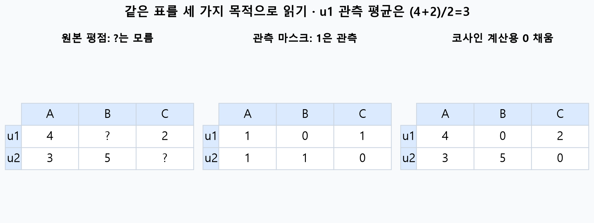
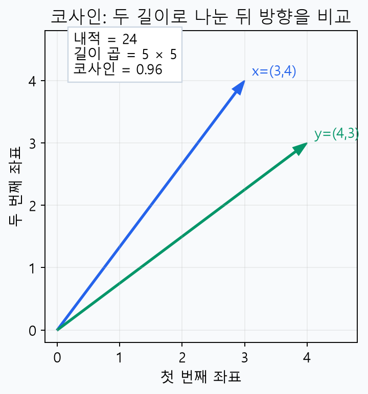
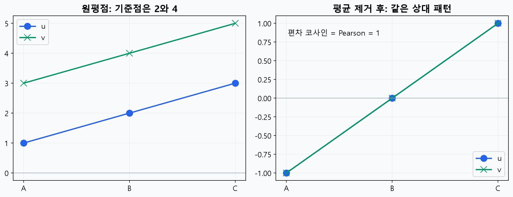
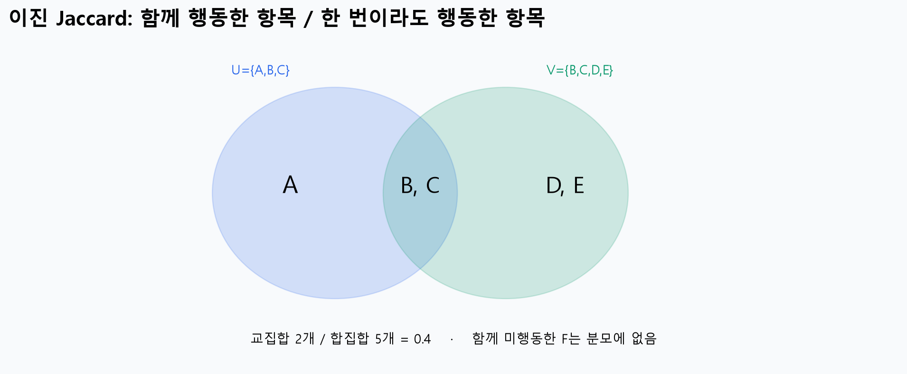
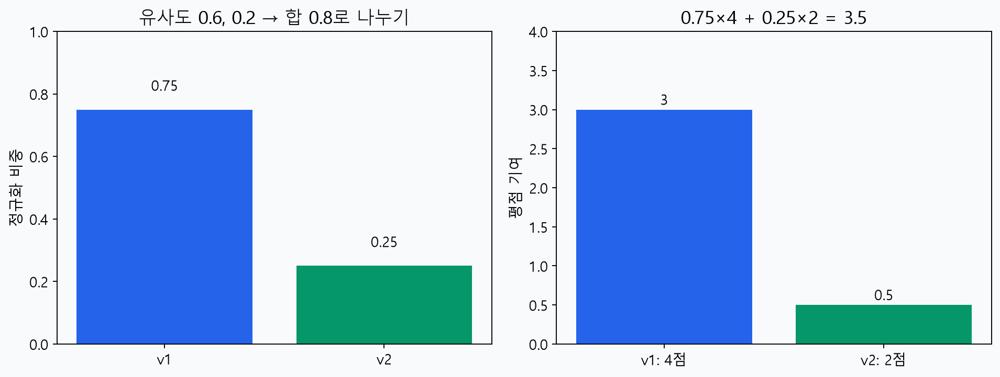
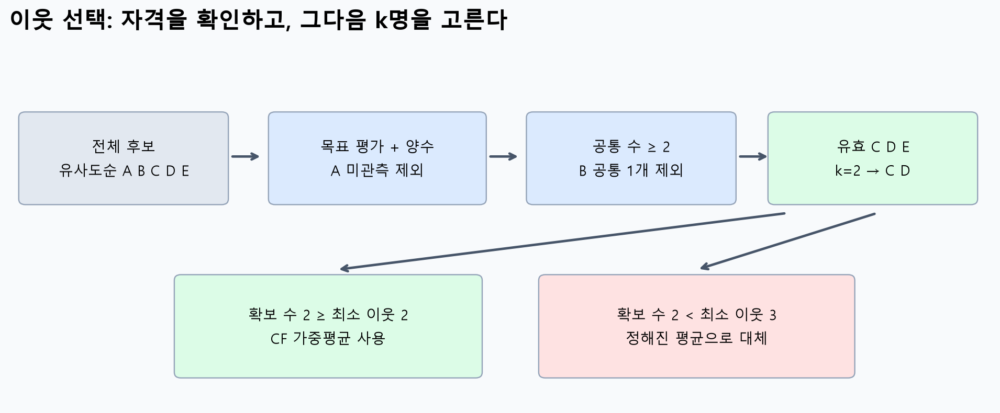
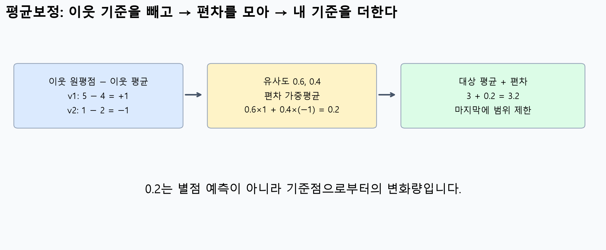
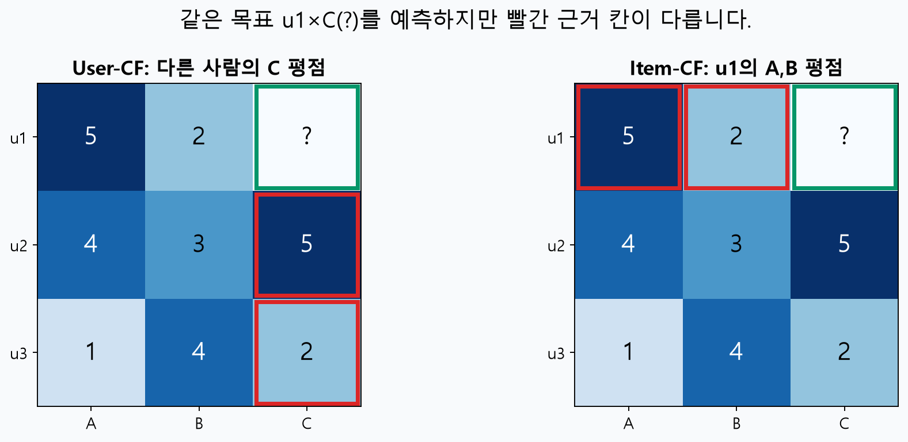
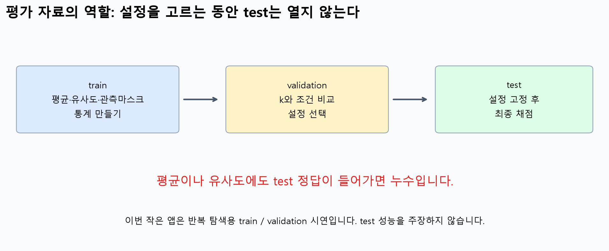
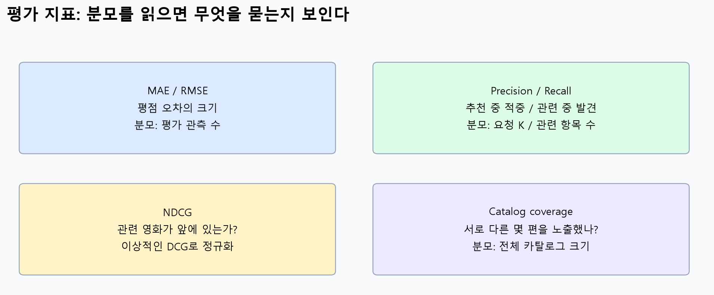

# W07B ·협업 필터링 3~4주차 핵심 복습과 60문제

딥 러닝 응용 I(추천 시스템) ·동덕여자대학교 데이터 사이언스 전공 ·유원상 교수 ·2026년 10월 15일

공식이 기억나지 않아도 괜찮습니다. 먼저 **어떤 칸을 쓰는지 → 누구를 이웃으로 고르는지 → 무엇으로 나누는지 → 결과가 무엇을 뜻하는지**부터 확인해 봅시다. 이번 자료는 실제 3~4주차의 협업 필터링을 복습합니다. 정답 숫자만 외우기보다 계산과 선택의 이유를 자신의 말로 적는 것이 중요합니다.

## 학습 순서와 바뀐 복습 일정

| 수업 | 복습 범위 |
|---|---|
| 10월 13일 W07a | 실제 1~2주차 |
| 10월 15일 W07b ·이번 수업 | 실제 3~4주차: 협업 필터링, 이웃, 평균보정, 평가 |
| 10월 20일 W08a | 실제 5~6주차: MF·SGD·SVD와 학습·검증 |

1. 핵심 요약의 그림을 보고, 그림 아래 질문 V1 –V10에 한 문장으로 답해 보세요.
2. 일반 Q01–Q39와 Python Q40–Q60 중 기초 문항부터 풉니다. 총 60 문항, 일반 65 %·코딩 35 %입니다. 하위 질문을 따로 세어 문항 수를 늘리지 않았습니다.
3. [Colab A ·관측·유사도·가중평균](https://colab.research.google.com/github/lunalab-ai/recommender/blob/2026-fall-w07b/notebooks/student/w07b-cf-foundations.ipynb), [Colab B ·이웃·평균보정·평가·마지막 앱](https://colab.research.google.com/github/lunalab-ai/recommender/blob/2026-fall-w07b/notebooks/student/w07b-cf-evidence-app.ipynb)을 차례로 실험합니다. 각각 독립 실행되며 CPU로 충분합니다.
4. 계산이 끝나면 입력 범위, 분모, 이웃 집합, 결과의 의미를 검산하세요. 중간고사는 이 연습 문제의 숫자와 조건 등을 조금씩 변형하여 출제할 예정입니다.

60 문항 전체를 수업 중 한 번에 풀어야 하는 것은 아닙니다. 대표 문항은 **Q02·Q08·Q16·Q20·Q28·Q38·Q48·Q52·Q55**입니다. 먼저 기초 30 문항을 풀고 적용 24 문항·통합 6 문항으로 넘어가세요. 추가 성적 과제나 제출 마감은 없습니다. 교재의 CF 기본 절차와 이번 수업에서 보충한 경계 조건·평가 규칙은 아래에서 구별합니다.

## 1. 미관측은 0점이 아니다

평점 행렬의 행은 사용자, 열은 영화입니다. 한 칸의 숫자는 그 사용자가 그 영화에 남긴 평점입니다. 빈 칸은 아직 모르는 값이며 싫어한다는 정답이 아닙니다. 관측 집합을 $\Omega_{\mathrm{train}}$, 관측 여부를 $M_{ui}$로 씁니다.

$$
M_{ui}=\begin{cases}1,&(u,i)\in\Omega_{\mathrm{train}},\\0,&\text{otherwise}.\end{cases}
\qquad
\bar r_u=\frac{\sum_{i:(u,i)\in\Omega_{\mathrm{train}}}r_{ui}}{\#\{i:(u,i)\in\Omega_{\mathrm{train}}\}}.
$$

말로 읽으면 “사용자 u가 실제로 평가한 학습 영화만 모아 합하고, 그 개수로 나눈다”입니다. 관측이 0개면 이 평균은 정의되지 않습니다.



그림 1. 왼쪽 →가운데 →오른쪽 순서로 읽으세요. u1의 관측은 4와 2뿐이므로 평균 3입니다. 0 채움은 코사인용 벡터를 만들기 위한 규약이며 관측 평균의 분모를 3으로 바꾸는 지시가 아닙니다. 모든 그림은 작은 합성 예제로 독자 제작했습니다. **V1:** 미관측 영화 열이 하나 추가되어도 u1의 관측 평균은 변할까요?

협업 필터링(CF)은 여러 사람의 평가·행동 패턴을 활용합니다. 내용 기반 추천은 장르·줄거리 등 아이템 속성을 활용합니다. 영화끼리 비교하더라도 평가 열을 비교하면 아이템 CF, 장르 벡터를 비교하면 내용 기반입니다.

## 2. 유사도는 무엇을 같은 것으로 보는가

### 2.1 코사인: 방향 비교

$$
s(x,y)=\frac{\sum_{j=1}^{d}x_jy_j}{\sqrt{\sum_jx_j^2}\sqrt{\sum_jy_j^2}}.
$$

분자는 같은 좌표끼리 곱한 합입니다. 분모는 두 벡터 길이의 **곱**입니다. 양쪽 길이가 양수여야 합니다. 양의 상수 배 벡터의 코사인은 1이지만 각 평점 숫자가 같다는 뜻은 아닙니다.



그림 2. 화살표가 나타내는 방향을 먼저 읽고 내적 24, 길이곱 25, 유사도 0.96 을 연결하세요. **V2:** 한 벡터를 2 배 늘리면 방향과 코사인은 어떻게 될까요?

**좌표 집합을 명시하세요.** 기존 수업의 기본 코사인 구현은 전체 영화 좌표에서 미관측을 계산용 0으로 채웁니다. 공통 관측만 잘라 계산하는 방식과는 결과가 다를 수 있습니다. 예를 들어 u =(4, 미관측), v =(4,3)이면 전체 0 채움 코사인은 0.8, 공통 첫 영화만의 코사인은 1입니다. 공통 1개에서 나온 1을 충분한 근거로 오해하지 마세요.

### 2.2 Pearson: 각자의 평균을 뺀 패턴

두 사용자가 공통으로 평가한 영화 집합을 $C_{uv}$라 합니다. 아래 평균은 **공통 집합에서 각각 계산한 평균**입니다.

$$
\rho_{uv}=\frac{\sum_{i\in C_{uv}}(r_{ui}-\bar r_{u,C})(r_{vi}-\bar r_{v,C})}{\sqrt{\sum_{i\in C_{uv}}(r_{ui}-\bar r_{u,C})^2}\sqrt{\sum_{i\in C_{uv}}(r_{vi}-\bar r_{v,C})^2}}.
$$



그림 3. u =(1,2,3), v =(3,4,5)의 평균은 2와 4입니다. 둘 다 편차가(−1,0,1)이므로 Pearson은 1입니다. **V3:** v가 모든 영화에 3점만 주면 분모에 어떤 문제가 생길까요?

편차의 길이가 0이면 Pearson은 정의되지 않습니다. 공통 수만 많다고 해결되지 않습니다. 음의 Pearson은 상대 패턴이 반대라는 계산 결과이며, 이번 예측 구현에서는 양수만 이웃 가중치로 사용합니다. “음 수 유사도는 존재하지 않는다”는 뜻이 아닙니다.

### 2.3 이진 Tanimoto(Jaccard): 행동 집합의 겹침

$$
J(U,V)=\frac{|U\cap V|}{|U\cup V|}.
$$



그림 4. 겹친 B,C를 한 번씩 세고 전체 행동 A –E를 한 번씩 셉니다. **V4:** 두 사람 모두 행동하지 않은 항목을 많이 추가하면 값이 달라질까요? 두 집합이 모두 비면 이 수업에서는 근거 없음으로 처리합니다. 별점 1 –5를 이진 집합과 혼동하지 마세요.

## 3. 한 편의 예측: 이웃과 분모부터

목표 사용자 u가 아직 평가하지 않은 영화 i를 생각합시다. $N_i(u)$는 **목표 영화 i를 실제로 평가했고 나머지 선택 조건을 통과한 사용자 이웃**입니다.

$$
\hat r_{ui}=\frac{\sum_{v\in N_i(u)}s_{uv}r_{vi}}{\sum_{v\in N_i(u)}s_{uv}},\qquad s_{uv}>0.
$$

분자와 분모는 반드시 **같은 이웃 집합**을 사용합니다. 목표 영화를 평가하지 않은 가장 비슷한 사람은 이 영화 예측의 근거로 사용할 수 없습니다. 그 유사도만 분모에 남겨 두면 예측이 낮아집니다. 유효 이웃이 없을 때는 0점을 꾸며 내지 말고 정해진 대체 규칙을 사용합니다.

| 설명 예제 | 유사도 | 목표 평점 | 정규화 비중 | 기여도 |
|---|---:|---:|---:|---:|
| v1 | 0.6 | 4 | 0.6/0.8=0.75 | 0.75×4=3 |
| v2 | 0.2 | 2 | 0.2/0.8=0.25 | 0.25×2=0.5 |
| 합 | 0.8 | 합산 대상 아님 | 1 | 예측3.5 |



그림 5. 왼쪽 비중의 합은 1, 오른쪽 기여도의 합은 예측 3.5입니다. **V5:** 유사도와 기여도가 왜 같은 값이 아닐까요? 설명 예제는 연습 문제와 별개입니다.

## 4. k·임계값·공통 수·최소 이웃 수



그림 6. 후보 전체에서 자격을 확인하고 그 다음 상위 k 명을 고릅니다. 확보한 이웃 수가 최소 수에 못 미치면 대체로 갑니다. **V6:** 처음부터 전체 후보를 k 명으로 자른 뒤 미평가자를 빼면 어떤 이웃을 놓칠 수 있을까요?

| 설정 | 무엇을 세거나 비교하나? | 주의 점 |
|---|---|---|
| k | 한 예측에 사용할 최대 이웃 수 | 이번 구현에서 0은 전체 이웃, 추천 편 수와 다름 |
| 유사도 임계값 | 각 이웃의 유사도 | ≥와>의 경계 포함 여부 명시 |
| 최소 공통평가 수 | 한 쌍이 함께 평가한 영화 수 | 평점이 같은 영화 수가 아님 |
| 최소 이웃 수 | 필터와k 후 모인 유효 이웃 수 | 못 채우면 CF를 쓰지 않고 대체 |
| 추천 목록 K | 최종 보여줄 아이템 수 | k와 다른 단계의 수 |

수업용 EvidenceCF는 양수 유사도·최소 공통 수·k·최소 이웃 수를 사용합니다. 별도 유사도 임계 값 문제는 손 계산·기초 코드로 조건의 차이를 복습합니다. 앱에 없는 임계 값 옵션을 있다고 설명하지 않습니다. 동점 이웃은 ID 순, 추천 동점도 영화 ID 순입니다.

조건을 엄격하게 하면 근거 부족으로 대체되는 비율이 늘 수 있습니다. 오차가 반드시 줄어 드는 것은 아닙니다. k는 같은 validation 관측으로 비교하고, test를 보며 고르지 않습니다.

## 5. 평균보정: 점수 기준을 맞춰 옮기기

후 한 사람의 5점과 엄격한 사람의 3점은 각자 평균보다 1점 높은 평가일 수 있습니다. 이웃의 평점을 그대로 옮기기보다 “자신의 기준보다 얼마나 높았나?”를 모읍니다.

$$
\hat r_{ui}=\bar r_u+
\frac{\sum_{v\in N_i(u)}s_{uv}(r_{vi}-\bar r_v)}{\sum_{v\in N_i(u)}s_{uv}}.
$$

여기의 $\bar r_u,\bar r_v$는 각자의 **전체 학습 관측 평균**입니다. 앞의 Pearson 공통 집합 평균과 구별합니다. 코사인 유사도를 쓰면서도 예측을 평균보정할 수 있고, Pearson 유사도를 쓰면서 원평점 가중평균을 낼 수도 있습니다. 유사도 선택과 예측 보정은 별도 설계입니다.



그림 7. 이웃 편차 +1, −1을 0.6,0.4로 평균하면 +0.2입니다. 대상 평균 3을 더해 3.2점을 예측합니다. **V7:** 마지막에 대상 평균을 더하지 않으면 0.2는 무엇을 나타내나요?

이웃 편차의 평균은 음수일 수 있습니다. 평균보정 원예측은 1 –5를 벗어날 수도 있으므로, 범위를 제한한다면 마지막에 적용하고 원예측도 보존합니다.

$$
\hat r_{ui}^{\mathrm{final}}=\min\{5,\max\{1,\hat r_{ui}^{\mathrm{raw}}\}\}.
$$

이번 기본 대체는 원평점 User/Item-CF에서 영화 평균 →학습 전체 평균, 평균보정 User-CF에서 알고 있는 사용자의 평균입니다. 이런 경계 처리와 근거 표시 방식은 수업에서 추가한 명시적 구현 규칙입니다. 교재의 모든 코드가 완전히 같은 정책이라는 뜻은 아닙니다.

## 6. 사용자 CF와 아이템 CF를 같은 표에서 읽기



그림 8. 초록색 ? 는 같은 목표입니다. User-CF는 다른 사람의 C 평점, Item-CF는 u1의 A,B 평점을 사용합니다. **V8:** Item-CF에서 A를 u1이 평가하지 않았다면 A가 가장 비슷해도 쓸 수 있을까요?

$$
\hat r_{ui}^{\mathrm{item}}=
\frac{\sum_{j\in N_u(i)}s_{ij}r_{uj}}{\sum_{j\in N_u(i)}s_{ij}}.
$$

여기서 $N_u(i)$는 대상 u가 이미평가한 영화 중 목표 i와 비슷하고 조건을 통과한 이웃 영화입니다. User-CF의 $r_{vi}$와 Item-CF의 $r_{uj}$를 비교하세요. 고정되는 사용자·영화 첨 자가 다릅니다. 여러 사용자의 평점 열로 영화 유사도를 계산하므로 내용 기반과도 다릅니다.

## 7. 평가: 숫자가 좋아진 이유까지 설명하기



그림 9. 평균·유사도·관측 마스크도 학습 통계입니다. test 정답을 포함해서 계산하면 누수입니다. **V9:** test 정답을 바꿨을 때 이미 고정한 모델의 예측도 바뀐다면 무엇을 의심할까요?

$$
\mathrm{MAE}=\frac1n\sum_{\ell=1}^n|y_\ell-\hat y_\ell|,\qquad
\mathrm{RMSE}=\sqrt{\frac1n\sum_{\ell=1}^n(y_\ell-\hat y_\ell)^2}.
$$

$$
P@K=\frac{|L_K\cap G|}{K},\qquad R@K=\frac{|L_K\cap G|}{|G|},\qquad
F_1=\frac{2PR}{P+R}.
$$

$$
\mathrm{DCG}@K=\sum_{j=1}^K\frac{rel_j}{\log_2(j+1)},\qquad
\mathrm{NDCG}@K=\frac{\mathrm{DCG}@K}{\mathrm{IDCG}@K}.
$$



그림10. $L_K$는 추천 목록, $G$는 관련 아이템 집합입니다. 이번 순위 관련성은 숨긴 평점 4 이상이고 이진 DCG를 씁니다. 짧은 목록도 Precision 분모는 요청 K이며 관련 항목이 없는 사용자는 순위 평가에서 제외하고 인원을 보고합니다. **V10:** RMSE가 낮아졌다는 사실만으로 상위 추천의 적중률도 높아졌다고 말할 수 있을까요?

Catalog coverage는 평가한 목록들의 **고유 추천 영화 합집합 크기 / 전체 카탈로그 크기**입니다. CF 근거 비율은 **실제 CF로 예측한 관측 수 / 평가 관측 수**이며 서로 다른 지표입니다. 평균 대체가 많은 모델을 CF 자체가 우수해진 것으로 오해하지 않도록 같이 보고합니다.

### 비교를 설명하는 네 문장

“같은 ___개 관측/ 사용자와 같은 후보 집합에서 비교했다. 바꾼 조건은 ___이다. ___지표는 ___에서 ___로 변했고 이웃/ 대체 근거는 ___였다. 따라서 이 작은 실험에서는 ___라고 해석하지만 다른 데이터에서의 우열까지 결론 내리지는 않는다.”

## 8. Python 문제를 읽는 법

| 문법 | 이 자료에서의 뜻 |
|---|---|
| None / is not None | 미관측 / 값이 존재함 |
| len(x),sum(x),abs(x) | 개수,합,절댓값 |
| x[j],row[1] | 0부터 시작하는 위치의 값 |
| for,if,and,or | 반복, 조건, 모두 참, 하나 이상 참 |
| [표현 for 값 in 목록] | 각 값에 같은 계산을 해 새 목록 만들기 |
| `**2`, `**0.5` | 제곱,제곱근 |
| [:k],in,not in | 앞k개,포함,미포함 |

특정 라이브러리의 메소드 이름을 외우는 문제가 아닙니다. 코드가 실행되는지만 보지 말고 수학적 정의와 같은 관측·분모·선택 순서를 쓰는지 확인하세요. 오류 문제는 문법 오류, 0 나누기, 실행되지만 의미가 틀린 논리 오류를 구별합니다. 소수는 중간 계산을 유지하고 최종 출력에서 반올림합니다.

## 9. 마지막 실습 ·CF 이해 실험실

Colab B의 마지막 앱에서 한 번에 한 설정만 바꿉니다. 기본 데이터는 기존 수업의 5명 ×5편 합성 표에서 3건을 검증용으로 숨긴 train15건/validation3건입니다. 반복해서 설정을 보는 화면이므로 test 성능이라 부르지 않습니다.

1. 기본 user/k =2에서 u1의 D 예측과 이웃 기여 표를 읽습니다.
2. 평균보정을 켜기 전에 예측이 오를지 내릴지 예상합니다. 바뀐 기준 평균·편차·기여도를 찾습니다.
3. 최소 공통 수 또는 최소 이웃 수를 높여 대체가 발생하는지 확인합니다. 값이 바뀐 이유를 basis로 설명합니다.
4. 평균보정을 끄고 item으로 바꿔 이웃 ID가 사람에서 영화로 바뀌는지 읽습니다.
5. 노트북의`my_report(result)`설명 함수에 설정과 실제 사용 이웃 수를 넣는 문장을 추가하고 앱을 다시 생성합니다. 숫자와 설명이 함께 바뀌는지 확인합니다.

앱 임시 공유 링크는 만료될 수 있습니다. 다음 수업이나 복습에서는 위의 고정 버전 Colab 링크에서 실행하세요. MovieLens 확장은 선택 활동이며 기존 W04B 실습의 공식 자동 다운로드·캐시 절차를 사용합니다. 핵심 60 문항과 두 신규 노트북은 외부 데이터 없이 실행됩니다.

## 점검 퀴즈

다음 5개는 위 설명 예제를 확인하는 공개 개념 퀴즈이며 뒤의 60개 시험 대비 문제와 별개입니다.

1. 그림 1에서 u1의 미관측 영화 열을 추가하면 관측 평균이 바뀌나요?
2. 그림 2에서 벡터의 양의 배율과 코사인은 어떤 관계인가요?
3. 그림 5의 정규화 비중 합과 기여도 합은 각각 무엇인가요?
4. 그림 7의 0.2는 별점 예측인가요, 보정량인가요?
5. 그림 9에서 validation과 test를 구분하는 이유는 무엇인가요?

## 출처와 기존 수업 대응

주교재: 임일(2025), 『AI 에이전트를 위한 개인화 추천 알고리즘』, 청람,3장. W03A/W03B의 3.1 –3.3, W04A의 3.4 –3.6, W04B의 3.7 –3.9와 당시 평가 보충 내용을 복습합니다. 이번에 확인한 교재 인쇄 34 –36,41,47,52 –53,57,60,62쪽과 기존 본문·코드를 대조했습니다. 원자료 전체 스캔은 배포하지 않습니다. 그림 10개와 문제 60개는 직접 제작했습니다.

추가 개념 확인: [scikit-learn 코사인 정의](https://scikit-learn.org/stable/modules/metrics.html#cosine-similarity), [scikit-learn 데이터 누수](https://scikit-learn.org/stable/common_pitfalls.html#data-leakage). 확인2026-10-14. 양수 이웃·동점·대체·평가 분모는 이 수업의 명시 규칙이며 모든 CF 구현의 유일한 정답은 아닙니다.

## 연습문제 안내

각 문항은 필요한 입력을 다시 제공합니다. 앞 문항의 답이 틀려도 다음 문항을 독립적으로 풀 수 있습니다. 모든 일반 문항은 단답형이지만 풀이 과정을 함께 적으세요. 파이썬 문제도 수정 코드뿐 아니라 변수의 변화와 이론적 이유를 설명하세요.


## Q01 · 표의 크기와 관측 비율

**일반 · 기초 · 행렬·관측·CF · 복습 W03A/W03B**

사용자 3명, 영화 A–D의 평점은 u1=(5,미관측,3,미관측), u2=(4,2,미관측,1), u3=(미관측,3,5,미관측)이다. 행렬 크기, 관측 수, 미관측 수, 관측 비율을 구하라.

풀이 기록: 사용할 관측과 조건 / 중간 계산 또는 코드 추적 / 결론과 의미 / 검산


---

## Q02 · 관측 평균과 0 채움

**일반 · 기초 · 행렬·관측·CF · 복습 W03A/W03B**

한 사용자의 A –D 평점은 (5, 미관측,1, 미관측)이다. 관측 평균과, 미관측을 0으로 채운 네 숫자의 평균을 각각 구하고 둘 중 사용자 평점 평균으로 쓸 값을 설명하라.

풀이 기록: 사용할 관측과 조건 / 중간 계산 또는 코드 추적 / 결론과 의미 / 검산


---

## Q03 · 마스크로 공통 평가 찾기

**일반 · 기초 · 행렬·관측·CF · 복습 W03A/W03B**

u의 관측 영화는 {A,B,D}, v의 관측 영화는 {B,C,D}이다. A,B,C,D 순서의 두 관측 마스크와 공통 평가 영화 및 그 수를 구하라.

풀이 기록: 사용할 관측과 조건 / 중간 계산 또는 코드 추적 / 결론과 의미 / 검산


---

## Q04 · 협업 신호와 내용 신호

**일반 · 기초 · 행렬·관측·CF · 복습 W03A/W03B**

방법 X는 영화 장르와 줄거리 벡터로 유사도를 계산하고, 방법 Y는 여러 사용자가 각 영화에 남긴 별점 열로 유사도를 계산한다. 각 방법의 종류를 쓰고, 둘 다 영화끼리 비교하는데 왜 같은 방법이 아닌지 설명하라.

풀이 기록: 사용할 관측과 조건 / 중간 계산 또는 코드 추적 / 결론과 의미 / 검산


---

## Q05 · 정렬 전에 본 영화 제외

**일반 · 기초 · 행렬·관측·CF · 복습 W03A/W03B**

사용자가 이미 본 영화는 A,C이다. 예측 점수는 A =4.9,B =4.1,C =4.7,D =4.1,E =3.8이다. 본 영화를 제외하고 점수 내림 차 순, 동점은 영화 ID 오름차 순으로 Top-2를 구하라.

풀이 기록: 사용할 관측과 조건 / 중간 계산 또는 코드 추적 / 결론과 의미 / 검산


---

## Q06 · 코사인 손계산

**일반 · 기초 · 유사도 · 복습 W03A/W03B**

 $x=(3,4), y=(0,5)$ 이다. 내적, 두 벡터 길이, 코사인 유사도를 순서대로 구하라.

풀이 기록: 사용할 관측과 조건 / 중간 계산 또는 코드 추적 / 결론과 의미 / 검산


---

## Q07 · 양의 배율과 방향

**일반 · 기초 · 유사도 · 복습 W03A/W03B**

 $x=(1,2), y=(2,4), z=(2,1)$ 이다.  $s(x,y)$ 와  $s(x,z)$ 를 계산하고, 코사인 이 값의 크기보다 무엇을 비교하는지 설명하라.

풀이 기록: 사용할 관측과 조건 / 중간 계산 또는 코드 추적 / 결론과 의미 / 검산


---

## Q08 · 0 채움과 공통 관측 코사인

**일반 · 적용 · 유사도 · 복습 W03A/W03B**

A,B,C에서 u =(4, 미관측, 미관측), v =(4,3, 미관측)이다. (가) 전체 열에 0을 채운 코사인, (나) 공통 관측 A만 사용한 코사인을 구하라. 두 값이 다르다는 것이 버그인지 설명하라.

풀이 기록: 사용할 관측과 조건 / 중간 계산 또는 코드 추적 / 결론과 의미 / 검산


---

## Q09 · Pearson: 평균 제거

**일반 · 기초 · 유사도 · 복습 W03A/W03B**

공통 영화 3편의 평점이 u =(1,2,3), v =(3,4,5)이다. 공통 영화에서 계산한 각 평균, 편차 벡터, Pearson 유사도를 구하라.

풀이 기록: 사용할 관측과 조건 / 중간 계산 또는 코드 추적 / 결론과 의미 / 검산


---

## Q10 · 음의 Pearson

**일반 · 적용 · 유사도 · 복습 W03A/W03B**

공통 영화의 평점이 u =(1,2,3), v =(5,4,3)이다. Pearson 유사도와, 이 수업의 양의 유사도만 사용하는 예측 규칙에서 v를 이웃으로 쓰는지를 설명하라.

풀이 기록: 사용할 관측과 조건 / 중간 계산 또는 코드 추적 / 결론과 의미 / 검산


---

## Q11 · 정의되지 않는 유사도

**일반 · 기초 · 유사도 · 복습 W03A/W03B**

공통 영화 3편에서 u =(3,3,3), v =(1,2,3)이다. Pearson을 계산할 수 있는 지 분모로 설명하라. 이어서 코사인에서 (0,0)과 (1,2)를 비교할 때의 문제도 설명하라.

풀이 기록: 사용할 관측과 조건 / 중간 계산 또는 코드 추적 / 결론과 의미 / 검산


---

## Q12 · 이진 Tanimoto/Jaccard

**일반 · 기초 · 유사도 · 복습 W03A/W03B**

양의 행동 집합은 U ={A,B,C}, V ={B,C,D,E}이다. 교집합·합집합과 이진 Tanimoto(Jaccard) 유사도를 구하라. 공통 행동이 없는 영화 F를 카탈로그에 추가하면 값이 달라지는가?

풀이 기록: 사용할 관측과 조건 / 중간 계산 또는 코드 추적 / 결론과 의미 / 검산


---

## Q13 · 유사도 종류 선택

**일반 · 적용 · 유사도 · 복습 W03A/W03B**

상황 A는 영화 별 별점의 상대적인 높낮이 패턴을 비교하려고 한다. B는 구매 여부만 기록되어 행동 집합을 비교한다. C는 같은 좌표의 비영 수치 벡터 방향을 비교한다. Pearson, 이진 Jaccard, 코사인을 하나씩 배정하고 각 분모의 정의 조건을 쓰라.

풀이 기록: 사용할 관측과 조건 / 중간 계산 또는 코드 추적 / 결론과 의미 / 검산


---

## Q14 · 분자와 분모를 같은 이웃으로

**일반 · 기초 · 가중평균CF · 복습 W03B**

목표 영화 D를 평가한 이웃 v1,v2의 유사도는 0.6,0.3이고 D 평점은 5,2다. 양의 유사도 가중평균 예측을 분자와 분모를 써서 구하라.

풀이 기록: 사용할 관측과 조건 / 중간 계산 또는 코드 추적 / 결론과 의미 / 검산


---

## Q15 · 정규화 가중치와 기여도

**일반 · 기초 · 가중평균CF · 복습 W03B**

이웃 유사도는 (0.5,0.3,0.2), 목표 영화 평점은 (2,4,5)다. 정규화 가중치, 각 이웃의 예측 기여도, 최종 예측을 구하라.

풀이 기록: 사용할 관측과 조건 / 중간 계산 또는 코드 추적 / 결론과 의미 / 검산


---

## Q16 · 영화별 평가자 필터

**일반 · 기초 · 가중평균CF · 복습 W03B**

u와의 유사도는 v1 =0.9,v2 =0.6,v3 =0.3이다. D 평점은 v1 =미관측,v2 =4,v3 =1이다. 모든 유효 평가자를 사용하는 양의 가중평균으로 D를 예측하라.

풀이 기록: 사용할 관측과 조건 / 중간 계산 또는 코드 추적 / 결론과 의미 / 검산


---

## Q17 · 양수 조건의 경계

**일반 · 기초 · 가중평균CF · 복습 W03B**

이웃 (유사도, 목표 평점)은 v1 =(0.5,4),v2 =(0,5),v3 =(−0.2,1)이다.  $s>0$ 인 이웃만 사용하고 최소 이웃 수는 1일 때 예측과 제외 이유를 구하라.

풀이 기록: 사용할 관측과 조건 / 중간 계산 또는 코드 추적 / 결론과 의미 / 검산


---

## Q18 · 근거 없는 예측의 대체

**일반 · 기초 · 가중평균CF · 복습 W03B**

일반 User-CF에서 유효 이웃이 0명이다. 이번 규칙은 영화 평균→학습 전체 평균 순이다. D의 학습 관측은 (2,4), E의 학습 관측은 없고 학습 전체 평균은3.5다. D와 E의 예측 및 근거를 쓰라.

풀이 기록: 사용할 관측과 조건 / 중간 계산 또는 코드 추적 / 결론과 의미 / 검산


---

## Q19 · 가중평균 범위 검산

**일반 · 적용 · 가중평균CF · 복습 W03B**

양의 유사도만 쓰는 원평점 가중평균이다. 선택 이웃의 목표 평점은 2,3,5이며 계산 결과를 6.2라고 보고했다. 가능한 결과인지 설명하고, 왜 평균보정 예측에서는 같은 검산을 그대로 쓰기 어려운 지도 설명하라.

풀이 기록: 사용할 관측과 조건 / 중간 계산 또는 코드 추적 / 결론과 의미 / 검산


---

## Q20 · 조건을 적용한 뒤 k 선택

**일반 · 통합 · 이웃·신뢰도 · 복습 W04A/W04B**

유사도 내림 차 순 후보는 A:(0.95, 목표 평점 없음, 공통 4), B:(0.8,5, 공통 1), C:(0.7,2, 공통 3), D:(0.6,4, 공통 2), E:(0.4,5, 공통 4)이다. 목표 평가·공통 수 ≥2를 먼저 확인하고 k =2, 양수 가중치로 예측하라.

풀이 기록: 사용할 관측과 조건 / 중간 계산 또는 코드 추적 / 결론과 의미 / 검산


---

## Q21 · 임계 값의 등호

**일반 · 적용 · 이웃·신뢰도 · 복습 W04A/W04B**

유효 목표 평가자 A,B,C의 유사도는 0.8,0.5,0.49이고 평점은 2,4,5다. 조건  $s\ge0.5$ , k 제한 없음일 때 이웃과 예측을 구하라. 조건이  $s>0.5$ 로 바뀌면 어떻게 되는가?

풀이 기록: 사용할 관측과 조건 / 중간 계산 또는 코드 추적 / 결론과 의미 / 검산


---

## Q22 · 공통 수와 최소 이웃 수

**일반 · 적용 · 이웃·신뢰도 · 복습 W04A/W04B**

A,B,C의 (유사도, 공통 수, 목 표 평점)은 (0.9,1,5),(0.7,3,4),(0.5,2,2)다. 공통 수 ≥2, k =3, 최소 이웃 수 =3이며 근거 부족 시 영화 평균 3으로 대체한다. 실제 유효 수, 사용 수, 예측 근거를 쓰라.

풀이 기록: 사용할 관측과 조건 / 중간 계산 또는 코드 추적 / 결론과 의미 / 검산


---

## Q23 · k와 추천 목록 K

**일반 · 적용 · 이웃·신뢰도 · 복습 W04A/W04B**

사용자 한 명의 미관람 영화가 8편이다. 각 영화 예측에 최대 k =3명의 이웃을 사용하고, 최종 추천 목록은 K =5편으로 만든다. k와 K가 세는 대상을 설명하고, k =3이므로 3편만 추천한다는 주장을 평가하라.

풀이 기록: 사용할 관측과 조건 / 중간 계산 또는 코드 추적 / 결론과 의미 / 검산


---

## Q24 · 동점 이웃 선택

**일반 · 기초 · 이웃·신뢰도 · 복습 W04A/W04B**

목표 평가자 ID 2,3,4의 유사도는 모두 0.6이고 목표 평점은 각각 1,5,4다. k =2, 유사도 동점은 ID 오름차 순이다. 사용 이웃과 예측을 쓰고 동점 규칙의 필요성을 설명하라.

풀이 기록: 사용할 관측과 조건 / 중간 계산 또는 코드 추적 / 결론과 의미 / 검산


---

## Q25 · k는 검증 자료로 선택

**일반 · 적용 · 이웃·신뢰도 · 복습 W04A/W04B**

k =1,2,4의 train RMSE는 0.4,0.6,0.7이고 validation RMSE는 1.2,0.9,1.0이다. 목적은 validation RMSE 최소화다. 어떤 k를 고르고 test는 언제 사용하는지 설명하라.

풀이 기록: 사용할 관측과 조건 / 중간 계산 또는 코드 추적 / 결론과 의미 / 검산


---

## Q26 · 성능과 대체 비율 함께 보기

**일반 · 통합 · 이웃·신뢰도 · 복습 W04A/W04B**

같은 100개 평가 쌍에서 모델 A는 RMSE0.8, CF 근거 예측 80개이고 B는 RMSE0.75, CF 근거 예측 20개다. 나머지는 평균 대체다. 각 CF 근거 비율을 구하고 B의 이웃 품질이 반드시 더 좋다는 결론이 가능한지 설명하라.

풀이 기록: 사용할 관측과 조건 / 중간 계산 또는 코드 추적 / 결론과 의미 / 검산


---

## Q27 · 별점의 기준점 빼기

**일반 · 기초 · 평균보정 · 복습 W04A**

이웃 v1의 학습 관측 평균은 4, 목표 영화 평점은 5다. v2는 평균 2, 목표 평점 3이다. 각 편차를 구하고 두 사람이 이 영화를 자신의 기준보다 얼마나 좋아했는지 설명하라.

풀이 기록: 사용할 관측과 조건 / 중간 계산 또는 코드 추적 / 결론과 의미 / 검산


---

## Q28 · 평균보정 전체 계산

**일반 · 적용 · 평균보정 · 복습 W04A**

대상 u의 학습 평균은 3이다. 이웃 v1,v2의 유사도는 0.6,0.4이고 학습 평균은 4,2, 목표 영화 평점은 5,1이다. 평균보정 예측을 편차 →가중합 →정규화 →기준 복원 순서로 구하라.

풀이 기록: 사용할 관측과 조건 / 중간 계산 또는 코드 추적 / 결론과 의미 / 검산


---

## Q29 · 원평점 방식과 보정 방식 비교

**일반 · 적용 · 평균보정 · 복습 W04A**

대상 평균은 2, 이웃 두 명의 평균은 모두 4다. 유사도는 0.5,0.5이고 목표 평점은 5,3이다. 원평점 가중평균과 평균보정 예측을 각각 구하고 차이의 원인을 설명하라.

풀이 기록: 사용할 관측과 조건 / 중간 계산 또는 코드 추적 / 결론과 의미 / 검산


---

## Q30 · 범위 제한은 마지막에

**일반 · 적용 · 평균보정 · 복습 W04A**

대상 평균 4.5, 정규화된 이웃 편차 0.8이다. 허용 평점은 1 –5이며 마지막에 clipping한다. 원예측과 최종 예측을 구하고, clipping이 학습·평가 누수를 고치는 방법인지 설명하라.

풀이 기록: 사용할 관측과 조건 / 중간 계산 또는 코드 추적 / 결론과 의미 / 검산


---

## Q31 · Pearson 중심화와 예측 보정의 차이

**일반 · 통합 · 평균보정 · 복습 W04A**

u의 학습 관측은 A =1,B =3,C =5이고 v는 A =3,B =5,D =4다. Pearson은 공통 A,B의 각 평균을 사용하고, 예측 보정 기준점은 각자의 전체 학습 관측 평균을 사용한다. 네 평균을 구하고 두 중심화의 역할을 설명하라.

풀이 기록: 사용할 관측과 조건 / 중간 계산 또는 코드 추적 / 결론과 의미 / 검산


---

## Q32 · 비교 축과 유사도 행렬 크기

**일반 · 기초 · User/Item CF · 복습 W04B**

사용자 4명 × 영화 6편의 평점 행렬 R이 있다. User-CF와 Item-CF에서 비교하는 벡터, 유사도 행렬 크기, 한 예측에 집계하는 평점을 각각 쓰라.

풀이 기록: 사용할 관측과 조건 / 중간 계산 또는 코드 추적 / 결론과 의미 / 검산


---

## Q33 · 아이템 CF 손계산

**일반 · 기초 · User/Item CF · 복습 W04B**

u는 A에 5점, B에 1점을 주었다. 목표 D와의 영화 유사도는 s(D,A)=0.6, s(D,B)=0.4다. 원평점 Item-CF로 u의 D 예측을 구하고, 분자의 평점이 누구의 평점인지 설명하라.

풀이 기록: 사용할 관측과 조건 / 중간 계산 또는 코드 추적 / 결론과 의미 / 검산


---

## Q34 · 아이템 이웃의 자격

**일반 · 적용 · User/Item CF · 복습 W04B**

목표 영화 D와 유사도는 A =0.9,B =0.8,C =0.5다. 대상 u의 평점은 A =미관측,B =2,C =4이다. 양수가 중 Item-CF, k =1, 공 통수 조건은 모두 충족한다. 어떤 영화가 선택되고 예측은 얼마인가?

풀이 기록: 사용할 관측과 조건 / 중간 계산 또는 코드 추적 / 결론과 의미 / 검산


---

## Q35 · 같은 유사도 숫자, 다른 근거

**일반 · 적용 · User/Item CF · 복습 W04B**

User-CF 이웃 두 사람의 목표 D 평점은 5,3이다. Item-CF 이웃 A,B에 대상 u가 준 평점은 1,3이다. 두 방식 모두 이웃 유사도는 0.75,0.25다. 각 예측을 구하고 숫자가 다른 이유를 설명하라.

풀이 기록: 사용할 관측과 조건 / 중간 계산 또는 코드 추적 / 결론과 의미 / 검산


---

## Q36 · MAE와 RMSE 분모

**일반 · 적용 · 평가·누수 · 복습 W03B/W04B 보충**

동일한 평가 3건의 실제 평점은(5,2,4), 예측은(4,4,4)다. 각 오차, MAE, MSE, RMSE를 구하라.  $\sqrt{5/3}\approx1.2910$ 을 사용해도 된다.

풀이 기록: 사용할 관측과 조건 / 중간 계산 또는 코드 추적 / 결론과 의미 / 검산


---

## Q37 · 정밀도·재현율·F1·커버리지

**일반 · 적용 · 평가·누수 · 복습 W03B/W04B 보충**

카탈로그는 {A,B,C,D,E,F}이고 관련 영화는 {B,D,E,F}이다. 추천 Top-3는 [A,B,D]이다. Precision @3, Recall @3, F1, 이 한 사용자 목록의 catalog coverage를 구하라.

풀이 기록: 사용할 관측과 조건 / 중간 계산 또는 코드 추적 / 결론과 의미 / 검산


---

## Q38 · 앞 순위의 가치: NDCG

**일반 · 통합 · 평가·누수 · 복습 W03B/W04B 보충**

관련 영화는 B,D 두 편이고 K=3이다. 목록 X=[B,A,D], Y=[A,B,D]이다. 이진 관련성,  $DCG@3=\sum_{j=1}^{3}rel_j/\log_2(j+1)$ 를 사용한다. 할인 값은 1,0.6309,0.5이고 이상 순위는 관련 2편을 먼저 놓는다. 두 NDCG를 구하고 Precision이 같은지도 설명하라.

풀이 기록: 사용할 관측과 조건 / 중간 계산 또는 코드 추적 / 결론과 의미 / 검산


---

## Q39 · 누수 없는 비교 설계

**일반 · 통합 · 평가·누수 · 복습 W03B/W04B 보충**

모델 A는 train만으로 평균·유사도를 만들고 모델 B는 train +test 전체로 만든다. B의 test RMSE가 더 작다. 공정 비교인지 판단하고, 올바른 분할·설정 선택·최종 평가 절차를 4 단계로 쓰라.

풀이 기록: 사용할 관측과 조건 / 중간 계산 또는 코드 추적 / 결론과 의미 / 검산


---

## Q40 · 관측 평균 빈칸

**Python · 기초 · 행렬·관측·CF · 복습 W03A/W03B**

None은 미관측이다. None이 아닌 값만 observed에 모았다. 평균을 구하도록 빈칸을 채우고 분모의 뜻을 쓰라.

```python
row=[4,None,2,None]
observed=[]
for r in row:
    if r is not None:
        observed.append(r)
mean=sum(observed)/___
print(mean)
```

풀이 기록: 사용할 관측과 조건 / 중간 계산 또는 코드 추적 / 결론과 의미 / 검산


---

## Q41 · 미관측을 0점으로 만든 오류

**Python · 기초 · 행렬·관측·CF · 복습 W03A/W03B**

평점은 1 –5다. observed가 실제 관측만 포함하도록 조건 한 줄을 수정하고 평균을 쓰라. 원래 코드는 실행되지만 뜻이 잘못되었다.

```python
row=[5,None,1]
filled=[0 if r is None else r for r in row]
observed=[r for r in filled if r>=0]
print(sum(observed)/len(observed))
```

풀이 기록: 사용할 관측과 조건 / 중간 계산 또는 코드 추적 / 결론과 의미 / 검산


---

## Q42 · 공통 관측 수 추적

**Python · 기초 · 행렬·관측·CF · 복습 W03A/W03B**

관측은 1, 미관측은 0으로 표시했다. 코드를 실행하지 않고 common의 최종 값과 증가한 j를 쓰라.

```python
a=[1,0,1,1]
b=[0,1,1,1]
common=0
for j in range(4):
    if a[j]==1 and b[j]==1:
        common+=1
print(common)
```

풀이 기록: 사용할 관측과 조건 / 중간 계산 또는 코드 추적 / 결론과 의미 / 검산


---

## Q43 · 코사인 내적 빈칸

**Python · 기초 · 유사도 · 복습 W03A/W03B**

`**2`는 제곱, `**0.5`는 제곱근이다. 코사인의 분자를 구하도록 빈칸을 채우고 출력을 쓰라.

```python
x=[1,2]
y=[2,1]
dot=0
for j in range(2):
    dot+=___
nx=sum(v**2 for v in x)**0.5
ny=sum(v**2 for v in y)**0.5
sim=dot/(nx*ny)
print(round(sim,4))
```

풀이 기록: 사용할 관측과 조건 / 중간 계산 또는 코드 추적 / 결론과 의미 / 검산


---

## Q44 · Pearson 편차 빈칸

**Python · 기초 · 유사도 · 복습 W03A/W03B**

각 평균을 빼는 빈칸을 채우고 출력되는 두 리스트를 쓰라. 이 코드는 유사도 계산의 준비 단계다.

```python
x=[2,3,4]
y=[1,3,5]
mx=sum(x)/len(x)
my=sum(y)/len(y)
dx=[v-___ for v in x]
dy=[v-___ for v in y]
print(dx,dy)
```

풀이 기록: 사용할 관측과 조건 / 중간 계산 또는 코드 추적 / 결론과 의미 / 검산


---

## Q45 · 정의 불가 분모의 처리

**Python · 적용 · 유사도 · 복습 W03A/W03B**

nx 또는 ny가 0일 때는 None(근거 없음), 그 외에는 코사인을 반환하려고 한다. 오류 원인을 설명하고 조건 문을 수정하라.

```python
dot=0
nx=0
ny=5
if nx==0 and ny==0:
    sim=None
else:
    sim=dot/(nx*ny)
print(sim)
```

풀이 기록: 사용할 관측과 조건 / 중간 계산 또는 코드 추적 / 결론과 의미 / 검산


---

## Q46 · 행동 집합 코드 추적

**Python · 기초 · 유사도 · 복습 W03A/W03B**

A와 B에는 중복 없는 행동 영화가 들어 있다. 합집합을 직접 만드는 코드다. intersection,union, 출력 값을 쓰라.

```python
a=['A','C','D']
b=['B','C','D']
intersection=[]
union=a.copy()
for item in b:
    if item in a:
        intersection.append(item)
    if item not in union:
        union.append(item)
print(intersection,union,len(intersection)/len(union))
```

풀이 기록: 사용할 관측과 조건 / 중간 계산 또는 코드 추적 / 결론과 의미 / 검산


---

## Q47 · 가중평균 분모 빈칸

**Python · 기초 · 가중평균CF · 복습 W03B**

같은 순서의 유사도와 평점이다. 분모를 누적하는 빈칸을 채우고 예측을 구하라.

```python
sims=[0.2,0.8]
ratings=[2,5]
num=0
den=0
for j in range(2):
    num+=sims[j]*ratings[j]
    den+=___
pred=num/den
print(pred)
```

풀이 기록: 사용할 관측과 조건 / 중간 계산 또는 코드 추적 / 결론과 의미 / 검산


---

## Q48 · 미평가 이웃의 유사도가 분모에 남는 오류

**Python · 적용 · 가중평균CF · 복습 W03B**

None은 목표 영화 미평가다. 분자와 분모가 같은 관측 이웃을 쓰도록 들여쓰기를 수정하고 출력을 쓰라.

```python
sims=[0.9,0.5,0.5]
ratings=[None,2,4]
num=0
den=0
for j in range(3):
    if ratings[j] is not None:
        num+=sims[j]*ratings[j]
    den+=sims[j]
print(round(num/den,4))
```

풀이 기록: 사용할 관측과 조건 / 중간 계산 또는 코드 추적 / 결론과 의미 / 검산


---

## Q49 · 유효 이웃 조건 빈칸

**Python · 기초 · 가중평균CF · 복습 W03B**

평점이 존재하고 유사도가 양수인 경우만 사용한다. 빈칸을 채우고 예측을 구하라. and는 두 조건 모두 참이어야한다.

```python
rows=[(0.7,4),(0.0,5),(-0.2,1),(0.3,None)]
num=0
den=0
for sim,rating in rows:
    if rating is not None and ___:
        num+=sim*rating
        den+=sim
pred=num/den
print(pred)
```

풀이 기록: 사용할 관측과 조건 / 중간 계산 또는 코드 추적 / 결론과 의미 / 검산


---

## Q50 · 분모 0의 대체 분기

**Python · 적용 · 가중평균CF · 복습 W03B**

유효 이웃이 없으면 영화 평균을 쓴다. 원래 코드의 계산 순서를 수정하여 오류 없이 의도대로 출력하라.

```python
num=0
den=0
movie_mean=3.5
pred=num/den
if den==0:
    pred=movie_mean
print(pred)
```

풀이 기록: 사용할 관측과 조건 / 중간 계산 또는 코드 추적 / 결론과 의미 / 검산


---

## Q51 · 공통 수 필터 빈칸

**Python · 기초 · 이웃·신뢰도 · 복습 W04A/W04B**

rows 의각튜플은(ID, 유사도, 공통평가 수)이며 목표 평점은 모두 있다. 공통 수 2 이상, 양수 유사도만 남기도록 빈칸을 채우라.

```python
rows=[('A',0.9,1),('B',0.7,2),('C',0.4,3)]
eligible=[]
for uid,sim,common in rows:
    if sim>0 and ___:
        eligible.append(uid)
print(eligible)
```

풀이 기록: 사용할 관측과 조건 / 중간 계산 또는 코드 추적 / 결론과 의미 / 검산


---

## Q52 · 먼저 자른 Top-k 오류

**Python · 적용 · 이웃·신뢰도 · 복습 W04A/W04B**

rows 는 유사도 내림차순이고 각 튜플은(ID, 유사도, 목표 평점)이다. 유효 평가자를 먼저 고르고 k =2를 적용하도록 수정하라. [:k]는 앞 k 개를 뜻한다.

```python
rows=[('A',0.9,None),('B',0.8,5),('C',0.7,1)]
k=2
chosen=[r for r in rows[:k] if r[2] is not None]
print([r[0] for r in chosen])
```

풀이 기록: 사용할 관측과 조건 / 중간 계산 또는 코드 추적 / 결론과 의미 / 검산


---

## Q53 · 최소 이웃 수 분기 추적

**Python · 적용 · 이웃·신뢰도 · 복습 W04A/W04B**

available은 k 적용 후 확보한 유효 이웃 수이다. 실행한 분기,used,pred,basis를 쓰라.

```python
available=2
min_neighbors=3
num=3.8
den=1.3
movie_mean=3.2
if available>=min_neighbors and den>0:
    used=available
    pred=num/den
    basis='cf'
else:
    used=0
    pred=movie_mean
    basis='movie-mean'
print(used,pred,basis)
```

풀이 기록: 사용할 관측과 조건 / 중간 계산 또는 코드 추적 / 결론과 의미 / 검산


---

## Q54 · 이웃 평균 제거 빈칸

**Python · 적용 · 평균보정 · 복습 W04A**

각 이웃의 평점에서 그 이웃의 학습 평균을 빼도록 빈 칸을 채우고 최종 예측을 구하라.

```python
target_mean=3
sims=[0.25,0.75]
ratings=[5,2]
means=[4,3]
num=0
for j in range(2):
    deviation=ratings[j]-___
    num+=sims[j]*deviation
pred=target_mean+num/sum(sims)
print(pred)
```

풀이 기록: 사용할 관측과 조건 / 중간 계산 또는 코드 추적 / 결론과 의미 / 검산


---

## Q55 · 대상 평균 복원을 빠뜨린 오류

**Python · 적용 · 평균보정 · 복습 W04A**

num은 이미 이웃 평균을 제거한 편차 가중합이다. 아래 코드를 평균보정 평점 예측으로 수정하고 원래 출력과 수정 출력의 의미를 설명하라.

```python
target_mean=3.5
num=0.4
den=0.8
pred=num/den
print(pred)
```

풀이 기록: 사용할 관측과 조건 / 중간 계산 또는 코드 추적 / 결론과 의미 / 검산


---

## Q56 · 마지막 범위 제한 빈칸

**Python · 기초 · 평균보정 · 복습 W04A**

min(a,b)는 작은 값,max(a,b)는 큰 값을 반환한다. raw를 1 –5 범위로 제한하도록 두 빈칸을 채우라.

```python
raw=5.4
pred=min(___,max(___,raw))
print(raw,pred)
```

풀이 기록: 사용할 관측과 조건 / 중간 계산 또는 코드 추적 / 결론과 의미 / 검산


---

## Q57 · 아이템 CF의 평점 출처 오류

**Python · 적용 · User/Item CF · 복습 W04B**

아이템 CF는 대상 사용자의 이웃 영화 평점을 사용한다. movies와 sims의 순서는 A,B다. 잘못 선택한 평점 딕셔너리를 수정하고 예측을 구하라.

```python
movies=['A','B']
sims=[0.75,0.25]
target_ratings={'A':2,'B':4}
other_ratings={'A':5,'B':1}
num=0
for j in range(2):
    num+=sims[j]*other_ratings[movies[j]]
pred=num/sum(sims)
print(pred)
```

풀이 기록: 사용할 관측과 조건 / 중간 계산 또는 코드 추적 / 결론과 의미 / 검산


---

## Q58 · 행과 열 추적

**Python · 기초 · User/Item CF · 복습 W04B**

R의 행은 u1,u2,u3 이 고열은 A,B이다. None은 미관측이다. user _vector,item _vector의 값과 각각 어떤 대상을 나타내는지 쓰라.

```python
R=[[5,None],[3,4],[1,2]]
user_vector=R[1]
item_vector=[row[1] for row in R]
print(user_vector,item_vector)
```

풀이 기록: 사용할 관측과 조건 / 중간 계산 또는 코드 추적 / 결론과 의미 / 검산


---

## Q59 · RMSE 마지막 제곱근 빈칸

**Python · 적용 · 평가·누수 · 복습 W03B/W04B 보충**

같은 평가 관측의 실제 값과 예측 값이다. MSE에서 RMSE로 바꾸는 빈칸을 채우고 출력을 구하라.

```python
actual=[5,1,3]
pred=[4,3,3]
squared=[]
for j in range(len(actual)):
    squared.append((actual[j]-pred[j])**2)
mse=sum(squared)/len(actual)
rmse=___
print(round(rmse,4))
```

풀이 기록: 사용할 관측과 조건 / 중간 계산 또는 코드 추적 / 결론과 의미 / 검산


---

## Q60 · 평균 계산에 test가 들어간 오류

**Python · 통합 · 평가·누수 · 복습 W03B/W04B 보충**

train은 학습 평점,test는 숨 긴 평가 정답이다. 평가 정답을 미리 보지 않도록 평균 계산을 수정하고 예측·MAE를 쓰라. 고정 평균 모델이다.

```python
train=[2,4]
test=[5,5]
mean=sum(train+test)/len(train+test)
mae=sum(abs(y-mean) for y in test)/len(test)
print(mean,mae)
```

풀이 기록: 사용할 관측과 조건 / 중간 계산 또는 코드 추적 / 결론과 의미 / 검산
