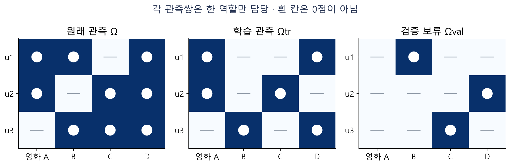
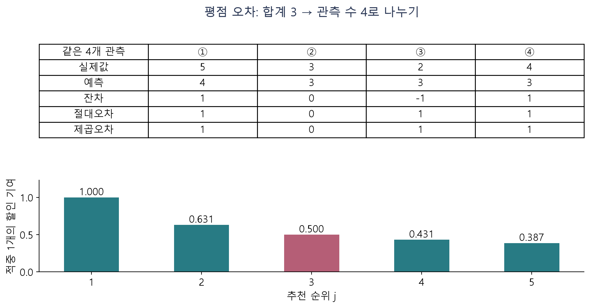
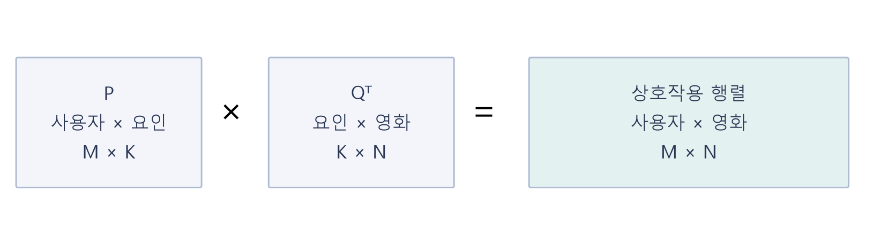
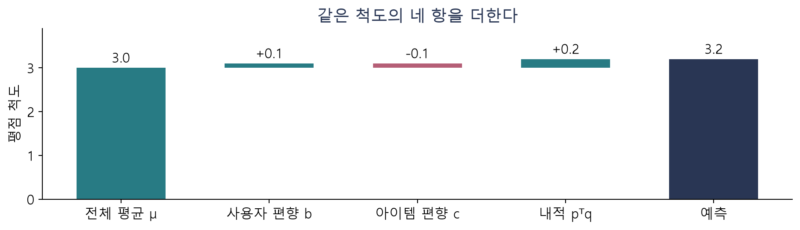
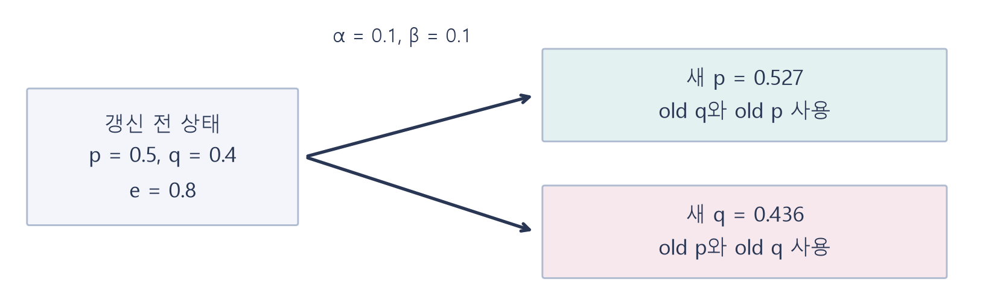
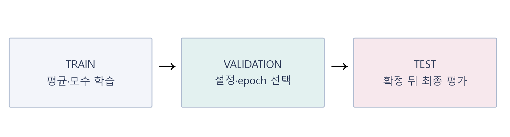
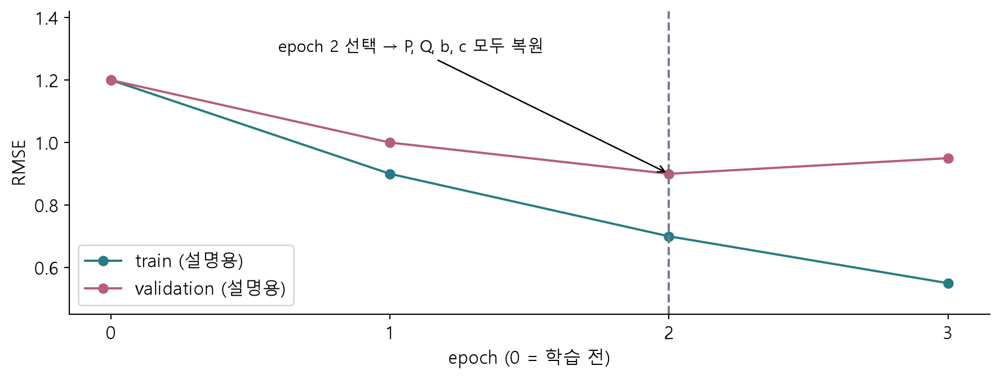
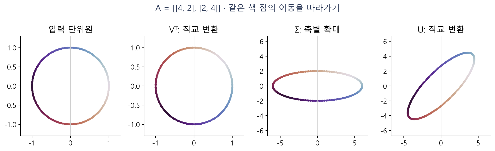
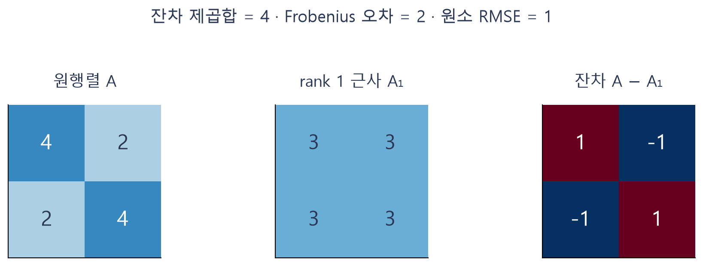
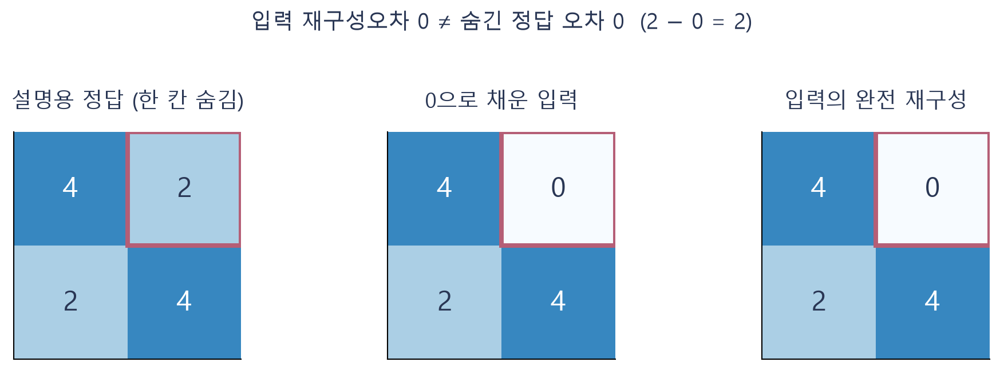

# W08A · 중간고사 대비 ③: 5~6주차 핵심 요약과 60문제

딥러닝응용I(추천시스템) · 동덕여자대학교 데이터사이언스전공 · 유원상 교수 · 2026년 10월 20일

## 오늘의 연결 지도

추천 결과를 **평가**하고, MF로 평점을 **예측**하며, SGD로 모수를 **학습**합니다. validation으로 설정과 학습 상태를 **선택**합니다. SVD는 주어진 행렬을 **분해·재구성**합니다. 이 다섯 동사는 비슷해 보여도 서로 다른 질문에 답합니다.

이 자료는 실제 5~6주차 강의와 보충문제를 복습합니다. 먼저 핵심 설명과 예제를 읽고, 뒤의 60문항을 스스로 풀어 보세요. 일반 39문항과 Python 21문항이며 기초·적용·통합 문제로 나뉩니다. 각 문항의 입력은 독립적입니다. 계산할 때는 **조건 → 핵심식 → 중간값 → 결과의 의미 → 검산**을 남기세요. 코드는 함수 이름을 외우기보다 변수와 배열이 무엇을 나타내는지 설명하는 연습입니다.

대표 학습 경로는 Q06 → Q10 → Q18 → Q26 → Q31 → Q39 → Q48 → Q51 → Q58입니다. 나머지 문제는 같은 개념을 다른 조건에 적용하는 자습 자료입니다. 도입·그림·앱의 확인 활동도 해당 Q 번호로 이어집니다. 설명 예제는 풀이 방법을 보여 주는 예이며 뒤의 연습문제와 입력값을 구별합니다.

## 1. 기호와 조건부터 맞추기

| 기호 | 의미 | 혼동하지 않을 것 |
|---|---|---|
| $M,N$ | 사용자 수, 아이템 수 | 추천 목록 길이는 $N_{\mathrm{rec}}$ |
| $K$ | MF 잠재요인 수 | 이웃 수 $k$, SVD 보존 항 수 $r$와 구별 |
| $P\in\mathbb R^{M\times K}$ | 사용자 요인 행렬 | 사용자 한 명의 벡터는 $p_u\in\mathbb R^K$ |
| $Q\in\mathbb R^{N\times K}$ | 아이템 요인 행렬 | 아이템 한 개의 벡터는 $q_i\in\mathbb R^K$ |
| $\mu,b_u,c_i$ | 학습 평균, 사용자 편향, 아이템 편향 | 기존 워크북의 아이템 편향 $b_i$를 여기서는 $c_i$로 표기 |
| $\Omega_{\mathrm{tr}},\Omega_{\mathrm{val}},\Omega_{\mathrm{te}}$ | 학습·검증·테스트 관측쌍 집합 | 같은 사용자라도 서로 다른 영화 관측은 다른 쌍 |
| $e_{ui}=r_{ui}-\hat r_{ui}$ | 실제 평점에서 예측을 뺀 잔차 | 부호가 기울기와 갱신 방향에 영향 |
| $\alpha,\beta$ | 학습률, 정규화 강도 | 단위와 역할이 서로 다름 |

이번 계산에서는 문제에 별도 지시가 없으면 중간값을 충분히 유지하고 마지막에 소수 넷째 자리까지 반올림합니다. MF 예측을 자동으로 1~5점에 자르지 않습니다. 표의 빈칸은 미관측이며 실제 0점이 아닙니다.



그림 2 · 왼쪽은 원래 관측 여부, 가운데는 학습에 사용한 관측, 오른쪽은 검증으로 보류한 관측입니다. 색이 없다는 이유만으로 실제 평점이 0이라고 해석하지 않습니다. Q14·Q35·Q36으로 연결됩니다. 모든 그림은 이번 수업을 위해 독자 제작한 설명용 도식입니다.

## 2. 평가: 어떤 오차를 무엇으로 나누는가

평점 예측은 같은 평가 관측 $n$개에서 실제값 $y_j$와 예측 $\hat y_j$를 비교합니다.

$$
\operatorname{MAE}=\frac1n\sum_{j=1}^n|y_j-\hat y_j|,\qquad
\operatorname{RMSE}=\sqrt{\frac1n\sum_{j=1}^n(y_j-\hat y_j)^2}.
$$

둘 다 원래 평점 단위입니다. MAE는 절댓값을, RMSE는 제곱을 평균낸 뒤 제곱근을 사용합니다. 큰 오차는 제곱 단계에서 더 크게 반영됩니다. 평균 잔차는 양수와 음수가 상쇄될 수 있으므로 이 두 오차 지표를 대신하지 못합니다.

**설명 예제:** 실제 평점 $(5,3,2,4)$, 예측 $(4,3,3,3)$이면 잔차는 $(1,0,-1,1)$입니다. 절대오차 합과 제곱오차 합이 모두 3이므로 MAE는 $3/4=0.75$, RMSE는 $\sqrt{3/4}\approx0.8660$입니다. 이번에 두 합이 같은 것은 각 잔차가 0 또는 절댓값 1인 특수한 입력이기 때문입니다.



그림 1 · 위쪽 표는 같은 네 관측의 변환을 비교합니다. 아래는 같은 적중이라도 순위에 따라 할인 기여가 달라짐을 보여 줍니다. Q06은 같은 MAE에서도 달라지는 큰 오차의 영향, Q10은 순위 지표의 분모 오류를 점검합니다.

상위 추천은 사용자가 좋아할 영화 집합과 추천 목록을 비교합니다. 이 수업에서는 추천을 요청한 길이 $N_{\mathrm{rec}}$를 Precision의 분모로 고정합니다. 후보가 부족하여 실제 반환이 짧아져도 이 분모를 임의로 줄이지 않습니다. 적중 수를 $H_u$, 관련 영화 수를 $R_u$라 하면 다음과 같습니다.

$$
\operatorname{Precision@}N_{\mathrm{rec}}=\frac{H_u}{N_{\mathrm{rec}}},\qquad
\operatorname{Recall@}N_{\mathrm{rec}}=\frac{H_u}{R_u}.
$$

예를 들어 4편을 요청하고 2편이 적중했으며 관련 영화가 5편이면 Precision은 $2/4$, Recall은 $2/5$입니다. 두 지표는 분자가 같아도 질문이 다릅니다. Precision은 요청한 추천 슬롯 중 적중 비중, Recall은 관련 영화 중 찾아낸 비중을 봅니다.

순위를 반영하는 NDCG는 이번 범위에서 이진 관련성 $\mathrm{rel}_j\in\{0,1\}$을 사용합니다.

$$
\operatorname{DCG@}N_{\mathrm{rec}}=\sum_{j=1}^{N_{\mathrm{rec}}}\frac{\mathrm{rel}_j}{\log_2(j+1)},\qquad
\operatorname{NDCG@}N_{\mathrm{rec}}=\frac{\operatorname{DCG@}N_{\mathrm{rec}}}{\operatorname{IDCG@}N_{\mathrm{rec}}}.
$$

IDCG는 같은 관련 집합에서 가능한 이상 순위입니다. 적중 항 수는 $\min(N_{\mathrm{rec}},R_u)$입니다. 관련 영화가 없는 사용자는 이번 수업의 순위 평가에서 모든 모델에 동일한 기준으로 제외하고 그 수를 보고합니다. 사용자별 지표를 평균내는 macro 방식과 모든 적중을 합쳐 나누는 방식은 서로 다릅니다.

**coverage도 분모를 확인합니다.** CF 근거 확보율은 평가 관측 중 이웃 근거로 예측한 비율입니다. 카탈로그 노출은 전체 카탈로그 중 추천 목록에 등장한 고유 아이템의 비율입니다. 근거가 없어 평균으로 대체한 예측도 평점 오차 평가에서 마음대로 빼지 않습니다.

공정한 비교에는 같은 평가 관측·사용자·후보 집합·추천 길이·관련성 기준이 필요합니다. 서로 다른 표본 크기와 분할에서 얻은 과거 수업의 숫자를 한 표에 넣어 알고리즘의 우열을 단정하지 않습니다.

## 3. MF: 한 칸의 예측을 항별로 읽기

MF는 사용자와 영화에 각각 길이 $K$의 벡터를 배정합니다. 사용자 $u$와 아이템 $i$의 상호작용은 같은 좌표끼리 곱해 더한 내적입니다.

$$
\hat r_{ui}=\mu+b_u+c_i+p_u^\top q_i
=\mu+b_u+c_i+\sum_{f=1}^K p_{uf}q_{if}.
$$



그림 3 · $P$의 한 행과 $Q$의 한 행을 선택해 내적을 계산합니다. 전체 상호작용 행렬은 $PQ^\top$이며 크기는 $M\times N$입니다. 내적은 코사인 유사도가 아니므로 길이로 나누지 않습니다. Q13·Q20·Q22으로 연결됩니다.

**설명 예제:** $K=1$, $\mu=3$, $b_u=0.1$, $c_i=-0.1$, $p_u=0.5$, $q_i=0.4$라 합시다. 상호작용은 $0.5\cdot0.4=0.2$이고 예측은 $3+0.1-0.1+0.2=3.2$입니다. 실제 평점이 4이면 잔차는 $4-3.2=0.8$입니다.



그림 4 · 각 항은 같은 평점 척도에서 합해집니다. 음의 편향은 기준보다 낮추는 항입니다. 잠재요인 좌표에 자동으로 ‘액션 선호’ 같은 장르 이름을 붙일 수는 없습니다. Q15·Q16·Q18로 연결됩니다.

이번 W05B 규약에서 관측 하나의 손실은 다음과 같습니다.

$$
\ell_{ui}=\frac12 e_{ui}^2+\frac\beta2
\left(\|p_u\|^2+\|q_i\|^2+b_u^2+c_i^2\right).
$$

앞 항은 관측 평점 오차, 뒤 항은 큰 모수에 대한 벌점입니다. 예제에서 $\beta=0.1$이면 $e^2/2=0.32$, 모수 제곱합은 $0.25+0.16+0.01+0.01=0.43$, 벌점은 $0.0215$, 손실은 $0.3415$입니다. RMSE에 이 벌점을 더하는 것은 아닙니다.

학습은 $\Omega_{\mathrm{tr}}$의 관측만 방문합니다. 이 식의 정규화는 **관측을 방문할 때마다** 적용되므로 같은 사용자·아이템이 자주 관측되면 해당 모수의 정규화 항도 그만큼 반복됩니다. 전체 모수에 한 번만 벌점을 주는 다른 목적함수와 계수를 섞지 않습니다. 미관측 칸을 0점 관측으로 추가하면 학습 문제 자체가 바뀝니다.

## 4. SGD: 같은 시점의 값으로 갱신하기

잔차가 실제값에서 예측을 뺀 값이므로 한 좌표의 기울기와 갱신은 다음과 같습니다.

$$
\frac{\partial\ell_{ui}}{\partial p_{uf}}=-e_{ui}q_{if}+\beta p_{uf},\qquad
p_{uf}^{\mathrm{new}}=p_{uf}^{\mathrm{old}}+\alpha(e_{ui}q_{if}^{\mathrm{old}}-\beta p_{uf}^{\mathrm{old}}).
$$

$$
q_{if}^{\mathrm{new}}=q_{if}^{\mathrm{old}}+\alpha(e_{ui}p_{uf}^{\mathrm{old}}-\beta q_{if}^{\mathrm{old}}),\qquad
b_u^{\mathrm{new}}=b_u^{\mathrm{old}}+\alpha(e_{ui}-\beta b_u^{\mathrm{old}}).
$$

아이템 편향 $c_i$도 $b_u$와 같은 형태로 갱신합니다. $\mu$는 train 평균으로 고정합니다. $p,q$의 두 갱신에 모두 같은 잔차와 **갱신 전 벡터**를 사용합니다. 먼저 바꾼 $p$를 즉시 $q$의 계산에 사용하면 교재의 일부 순차 갱신 코드처럼 다른 수치가 나옵니다. 이번 문제는 명시된 동시 갱신 규약으로 풉니다.



그림 5 · old 상태에서 나온 화살표만 새 값의 계산에 들어갑니다. Q26은 한 좌표를 계산하고 Q31은 새 값을 잘못 재사용한 코드를 수정합니다.

설명 예제에 $\alpha=0.1$, $\beta=0.1$을 적용하면 다음과 같습니다.

$$
p^{\mathrm{new}}=0.5+0.1(0.8\cdot0.4-0.1\cdot0.5)=0.527,
\qquad
q^{\mathrm{new}}=0.4+0.1(0.8\cdot0.5-0.1\cdot0.4)=0.436.
$$

사용자 편향은 $0.179$, 아이템 편향은 $-0.019$가 됩니다. 학습률은 한 번에 이동하는 크기를 조절하고 정규화는 모수를 0 방향으로 당기는 항을 만듭니다. 잔차가 양수라는 사실만으로 모든 좌표가 증가한다고 단정할 수는 없습니다. 상대 요인의 부호와 정규화도 봐야 합니다.

```python
# 설명 예제: 관측 하나, K=1. 원리는 위 식과 같다.
p_old, q_old = 0.5, 0.4
error, alpha, beta = 0.8, 0.1, 0.1
p_new = p_old + alpha * (error * q_old - beta * p_old)
q_new = q_old + alpha * (error * p_old - beta * q_old)
```

벡터에서는 단순 대입이 같은 배열을 가리킬 수 있어 `.copy()`가 필요합니다. 문제에서 복사 기능을 사용하면 의미를 함께 제공합니다. 두 요인을 모두 영벡터로 초기화하면 상호작용 기울기가 0에 머물 수 있습니다. 편향을 사용하는 모델에서는 편향의 학습까지 모두 멈춘다고 확대해 해석하지 않습니다.

## 5. validation: 가장 좋은 상태를 어떻게 고르는가



그림 6 · 평균과 모수는 train에서 배웁니다. validation은 설정·epoch 선택에 사용하며, test는 선택이 끝난 뒤 채점합니다. Q35·Q36·Q44로 연결됩니다.

학습되는 모수 $P,Q,b,c$와 사람이 선택하는 설정 $K,\alpha,\beta$를 구별합니다. 학습 epoch도 validation 결과로 선택할 수 있습니다.

$$
e^*=\operatorname*{arg\,min}_{e\in\{0,\ldots,E\}}
\operatorname{RMSE}_{\mathrm{val}}(\theta_e),\qquad
\theta_e=(P_e,Q_e,b_e,c_e).
$$

**설명 예제:** epoch 0,1,2,3의 validation RMSE가 각각 1.20,1.00,0.90,0.95이면 epoch 2의 상태를 선택합니다. 이 숫자는 동작을 설명하기 위한 표이며 실제 MovieLens 실행 결과가 아닙니다.



그림 7 · 마지막 epoch와 최적 epoch는 다를 수 있습니다. 선택 번호만 기록하는 것으로 끝나지 않고 그 시점의 모든 모수를 복원해야 합니다. Q39·Q43으로 연결됩니다.

기존 `fit_validated`는 상한 $E$까지 학습하고 **마지막에 최적 상태를 복원**합니다. 학습을 중간에 멈추는 실제 조기 종료와는 다릅니다. 초기 상태 epoch 0도 후보이고, 동점이면 먼저 관측된 상태를 선택합니다. $P,Q$와 사용자·아이템 편향 모두 복사해 보존합니다. 입력이 바뀌어도 전에 저장한 배열이 함께 변하는 참조 오류를 주의합니다.

W05A에서는 설정 선택 후 train과 validation을 합쳐 재학습한 뒤 test를 평가했습니다. W06A의 기본 예제는 train으로 학습한 최적 상태를 복원하여 test를 평가합니다. 두 절차 모두 명시하여 사용할 수 있지만, 결과표에서는 어느 절차인지 밝혀야 합니다. **두 경우 모두 test 성적을 보고 설정을 다시 고르면 독립 최종 평가가 아닙니다.**

## 6. SVD: 분해·재구성·근사의 차이

실수 행렬 $A\in\mathbb R^{m\times n}$는 $A=U\Sigma V^\top$로 분해됩니다. 축소 SVD에서 $q=\min(m,n)$이면 $U$는 $m\times q$, $\Sigma$는 $q\times q$, $V^\top$는 $q\times n$입니다. 축소 SVD 자체는 모든 특이값을 유지하므로 원행렬을 재구성합니다. 작은 특이값의 항을 버리는 **절단**과 구별하세요.

$$
A^\top A v_j=\lambda_jv_j,\qquad
\sigma_j=\sqrt{\lambda_j},\qquad
u_j=\frac{Av_j}{\sigma_j}\quad(\sigma_j>0).
$$

고유벡터는 길이 1로 정규화합니다. $A^\top A$의 고유값을 그대로 특이값이라고 쓰지 않습니다. 대응하는 $u_j,v_j$의 부호를 함께 반대로 해도 $u_j\sigma_jv_j^\top$는 같습니다. 검산에서는 벡터의 인쇄된 부호만 비교하지 말고 재구성과 직교성을 봅니다.



그림 8 · 같은 색 점을 왼쪽에서 오른쪽으로 따라갑니다. 직교 변환은 길이를 보존하고 특이값은 축 방향 길이를 바꿉니다. Q48·Q50으로 연결됩니다.

설명 예제 $A=\begin{bmatrix}4&2\\2&4\end{bmatrix}$에서는

$$
A^\top A=\begin{bmatrix}20&16\\16&20\end{bmatrix},\qquad
\lambda_1=36,\ \lambda_2=4,\qquad\sigma_1=6,\ \sigma_2=2.
$$

$v_1=(1,1)^\top/\sqrt2$, $v_2=(1,-1)^\top/\sqrt2$이며 이 예제에서는 $u_j=v_j$입니다. 첫 항만 남기면 $A_1=\begin{bmatrix}3&3\\3&3\end{bmatrix}$입니다.

$$
A_r=\sum_{j=1}^r\sigma_j u_jv_j^\top,\qquad
\|A-A_r\|_F^2=\sum_{j>r}\sigma_j^2.
$$



그림 9 · 버린 특이값은 2이므로 Frobenius 오차는 2, 제곱오차 합은 4입니다. 네 원소에 대한 RMSE는 $\sqrt{4/4}=1$입니다. 서로 다른 양을 같은 ‘오차’라는 이름만 보고 혼동하지 않습니다. Q51·Q54로 연결됩니다.

이 예제의 에너지 보존율은 $36/(36+4)=0.9$입니다. 이는 입력 행렬 제곱합의 90%를 보존한다는 뜻이며 추천 정확도 90%라는 뜻이 아닙니다. 직사각형 행렬·0 특이값은 이전 보충자료의 선택 확장으로 복습합니다. $\sigma=0$에 $Av/\sigma$를 적용하지 않습니다.

## 7. MF와 SVD: 결과가 좋아 보일 때 무엇을 확인할까

| 비교점 | 이번 수업의 관측 기반 MF | 완전행렬에 적용한 SVD |
|---|---|---|
| 입력 | 학습에 남긴 관측 평점 | 모든 칸에 유한한 수가 있는 행렬 |
| 목표 | 관측 오차와 명시된 정규화 | 주어진 행렬의 분해·저차원 재구성 |
| 빈칸 | 학습 관측에 포함하지 않음 | 처리 정책을 먼저 결정해야 함 |
| 확인할 성능 | 숨긴 관측의 평점 오차 등 | 원행렬의 재구성오차·보존 에너지 |



그림 10 · 설명용 정답 행렬의 한 칸을 숨기고 0을 넣은 입력을 완전히 재구성하면 입력 재구성오차는 0입니다. 그러나 숨긴 실제값이 2라면 그 칸의 예측오차는 2입니다. Q55·Q56·Q57·Q59·Q60으로 연결됩니다.

SVD도 $P=U_r\Sigma_r^{1/2}$, $Q=V_r\Sigma_r^{1/2}$로 놓으면 $A_r=PQ^\top$로 쓸 수 있습니다. 따라서 ‘인수 세 개와 두 개’만으로 MF와 SVD를 구별하지 않습니다. **어떤 입력·손실·관측 처리·제약으로 얻은 요인인지**가 중요합니다.

## 8. Colab과 마지막 앱

Colab A는 지표·MF·SGD, Colab B는 검증·SVD·통합 앱을 다룹니다. CPU에서 각각 독립적으로 위에서부터 실행합니다. 설명용 작은 합성 데이터는 자동 준비되며 개인 파일 업로드나 유료 API가 필요하지 않습니다. MovieLens는 기존 로더를 이용하는 선택 확장입니다.

| 가져오는 API | 입력과 반환 | 사용할 때 확인할 점 |
|---|---|---|
| `rating_metrics` | 실제값·예측값의 같은 길이 1차원 배열 → n/MAE/RMSE | 빈 배열·모양 불일치 금지, 정규화 손실 아님 |
| `sgd_step` | 두 요인 벡터·평점·평균·편향·설정 → 예측/잔차/새 모수 | 입력 불변, old 상태 갱신, clipping 없음 |
| `fit_validated` | train·validation 관측표와 설정 → 모델/전체 기록/선택 epoch | test 인수 없음, 마지막에 전체 최적 상태 복원 |
| `svd_steps` | 완전한 2차원 행렬·보존 rank → 분해/재구성/오차/에너지 | rank 0 가능, 영행렬의 에너지 비율은 정의하지 않음 |
| `mf_review_experiment` | K·정규화·epoch·rank 설정 → 모델/기록/선택 epoch/검증 지표/SVD 결과 | 같은 합성 데이터와 seed, test 선택 없음 |
| `mf_review_view` | 실험 설정과 선택적 보고 함수 → 설명/곡선/예측표/재구성/그림 | 보고 함수는 전체 결과 사본을 받음 |
| `build_mf_review_app` | 선택적 보고 함수 → 지표·SGD·검증·SVD 통합 앱 | 변경 후 다시 구성·실행 |
| `build_svd_app` | 선택적 `report_fn` → Gradio 앱 | 기존 MF·SVD 기능 연결, 실행은 별도 `launch` |

노트북에는 각 함수의 고정 버전 정의 링크와 실제 사용 예가 있습니다. `fit`이라는 이름만으로 어떤 학습을 하는지 판단하지 말고 입력·상태·출력을 읽으세요.

마지막 활동은 **Q58**입니다. Q58의 `my_report(d)`는 기존 SVD 앱의 `d["error"]`와 `d["energy_fraction"]`를 읽습니다. 통합 앱에서는 `report_fn=lambda result: my_report(result["svd"])`로 연결합니다. 앱의 `report_fn`에 연결되는 설명 함수에서 입력 재구성오차와 에너지의 의미를 정확히 쓰도록 코드를 수정합니다. 먼저 결과를 예상하고, 한 조건만 바꾸어 실행한 뒤, 수치·그림·설명 문장을 대조합니다. 수정한 함수로 앱을 다시 구성하고 실행해야 화면에 반영됩니다. 공유 링크는 해당 Colab 런타임이 실행되는 동안만 유효합니다.

## 점검 퀴즈

1. 설명 예제의 MAE와 RMSE가 원래 평점 단위로 해석되는 이유는 무엇인가요? (연결 Q06)
2. 설명 예제의 MF 예측에서 사용자·아이템 편향은 각각 어떤 기준 차이를 나타내나요? (연결 Q18)
3. 설명 예제에서 p를 먼저 갱신한 뒤 새 p로 q를 계산하면 명시된 동시 갱신과 같을까요? (연결 Q31)
4. 설명용 검증 곡선에서 선택 epoch의 번호만 저장하면 충분한가요? (연결 Q39)
5. 설명 예제의 SVD 에너지 보존율 90%를 추천 정확도라고 부를 수 있나요? (연결 Q58)

## 오답별 복습 경로와 참고자료

| 막힌 단계 | 다시 볼 자료 | 다시 시도할 문제 |
|---|---|---|
| 단위·분모·평균 | W05A 지표 보강 S1–S5 | Q01–Q12 |
| 차원·편향·관측 손실 | W05B 본문 §3–8, 워크북 S1 | Q13–Q22 |
| 잔차·갱신 순서 | W05B 워크북 S1–S3 | Q23–Q34 |
| 선택·누수·복원 | W06A 평가 워크북 W1–W3 | Q35–Q44 |
| 고유값·정규화·rank | W06B 계산 문제편 기존 Q4–Q6 | Q45–Q54 |
| 재구성·추천 주장 | W06B 기존 Q9, W06A §9–11 | Q55–Q60 |

- [W05A 지표 보강](../supplements/w05a-metrics-remediation.md)
- [W05B MF와 SGD](w05b-mf-sgd.md), [SGD 손계산 워크북](../supplements/w05b-sgd-workbook.md)
- [W06A MF 평가와 튜닝](w06a-mf-evaluation.md), [평가 워크북](../supplements/w06a-evaluation-workbook.md)
- [W06B SVD 기초](w06b-svd-foundations.md), [SVD 계산 문제편](../supplements/w06b-calculation-practice.md)
- [Google Developers: Matrix factorization](https://developers.google.com/machine-learning/recommendation/collaborative/matrix)
- [NumPy: SVD의 입력·반환 차원](https://numpy.org/doc/stable/reference/generated/numpy.linalg.svd.html)
- [scikit-learn: 데이터 누수](https://scikit-learn.org/stable/common_pitfalls.html)

원 강의의 교재 범위와 용어를 유지하며, 본문의 수치 예제와 그림은 복습용으로 새로 구성했습니다. 공식 문서는 원리·차원·검증 규약의 대조에 사용했고 새 알고리즘을 시험범위에 추가하지 않았습니다.

## 중간고사 안내 다시 확인

2026년 **10월 22일(목), 대학원 402호**에서 진행합니다. 10:30–10:40은 시험 안내, 10:40–11:45는 본 시험 65분이며 10:20 도착을 권장합니다. 시험범위는 1~6주차이고 객관식·주관식 단답형 약 20문항입니다. 종이 답안지에 자필로 작성합니다.

계산형 주관식은 핵심 수식과 중간 계산을 반드시 쓰세요. **최종 답이 맞아도 풀이 과정이 없으면 해당 문항은 0점**이며 과정에 따라 부분점수·감점이 적용됩니다. 프로그래밍이 되지 않는 공학용 계산기는 허용하지만 휴대전화·태블릿 계산기 앱과 모든 형태의 요약본·치팅 페이퍼는 허용하지 않습니다.

모든 스마트 기기는 전원을 끄고 가방 안쪽에 보관합니다. 스마트워치·이어폰 등 착용 기기도 벗습니다. 시험 중 책상 위·주머니·신체 착용 상태로 확인되면 실제 사용 여부와 관계없이 부정행위로 간주하여 **이번 시험을 0점 처리**한다는 기존 공지를 따릅니다. 의문이 생기면 손을 들어 안내를 받으세요.

## 60문항 연습 시작

앞의 설명 예제와 아래 문제의 숫자·조건을 구별하세요. 각 문항에서 최종 답뿐 아니라 사용한 조건과 계산 또는 코드 흐름을 남기면 어디에서 막혔는지 찾기 쉽습니다. 이 문제은행은 복습 자료이며 별도의 성적 과제나 제출 마감을 부여하지 않습니다.


## Q01 · 숫자의 단위와 평가 질문

**일반 · 기초 · 평가지표와 공정한 모델 비교**

영화 A의 점수는 평가 횟수 180회, 영화 B의 점수는 장르 코사인 0.85, 영화 C의 점수는 예측 평점 3.7점이다. (가) 이 세 값을 그대로 1–5점 실제 평점과 비교하여 RMSE를 계산해도 되는가? 각 값의 적합 여부를 쓰라. (나) ‘좋아할 영화가 추천 목록의 앞쪽에 놓였는가’를 평가할 때 MAE와 NDCG 중 무엇을 고를지 이유를 쓰라.

**풀이 기록:** 조건·핵심식 → 중간 계산 또는 코드 추적 → 결론·검산


---

## Q02 · 부호가 상쇄되어도 오차는 남는다

**일반 · 기초 · 평가지표와 공정한 모델 비교**

실제 평점 $y=(5,2,4)$, 예측 평점 $\hat y=(4,3,4)$이다. (가) $e=y-\hat y$와 단순 오차 평균을 구하라. (나) MAE와 RMSE를 구하고 ‘오차 평균이 0이므로 완벽한 예측’이라는 말을 판단하라.

**풀이 기록:** 조건·핵심식 → 중간 계산 또는 코드 추적 → 결론·검산


---

## Q03 · 반환 수가 부족한 추천의 분모

**일반 · 기초 · 평가지표와 공정한 모델 비교**

요청한 목록 길이는 $N_{rec}=6$이지만 후보가 부족해 [A,B,C,D] 네 편만 반환되었다. 보류 자료의 관련 집합은 $G=\{A,C,E,F,G\}$이다. (가) 적중 수, Precision@6, Recall@6을 구하라. (나) Precision을 $2/4$로 쓰지 않는 이유를 설명하라. 이 수업에서는 빈 추천 자리도 요청한 목록 길이에 포함한다.

**풀이 기록:** 조건·핵심식 → 중간 계산 또는 코드 추적 → 결론·검산


---

## Q04 · 적중 위치를 반영한 NDCG

**일반 · 기초 · 평가지표와 공정한 모델 비교**

상위 세 자리의 이진 관련성이 $(1,0,1)$이고 보류 자료의 관련 영화는 총 2편이다. $N_{rec}=3$이며 할인 가중치는 $w_1=1$, $w_2=1/\log_2 3\approx0.63093$, $w_3=0.5$다. (가) DCG·IDCG·NDCG를 구하라. (나) 적중 두 편을 1위·2위에 두면 Precision과 NDCG가 어떻게 되는가?

**풀이 기록:** 조건·핵심식 → 중간 계산 또는 코드 추적 → 결론·검산


---

## Q05 · 두 coverage의 서로 다른 분모

**일반 · 기초 · 평가지표와 공정한 모델 비교**

평가 평점 8건 중 6건은 CF 이웃 근거로 예측했고 2건은 평균 대체로 예측했다. 전체 영화 카탈로그는 10편이며 모든 사용자의 추천 목록에 한 번 이상 나온 고유 영화는 4편이다. (가) CF 근거 확보율과 카탈로그 노출 비율을 구하라. (나) 이 정책의 평점 RMSE를 계산할 때 사용할 평가 건수는 몇 개인가?

**풀이 기록:** 조건·핵심식 → 중간 계산 또는 코드 추적 → 결론·검산


---

## Q06 · 같은 MAE, 다른 큰 오차

**일반 · 적용 · 평가지표와 공정한 모델 비교**

동일한 5개 평가 관측의 실제 평점은 $(4,2,4,2,1)$이다. 모델 A의 예측은 $(3,3,3,3,1)$, 모델 B는 $(4,2,4,2,5)$이다. (가) 두 모델의 잔차·MAE·RMSE를 구하라. (나) 큰 평점 실수를 더 강하게 반영하는 지표로 어느 모델을 선택할지 쓰라. (다) 이 결과만으로 Top-5 추천에서도 그 모델이 우수하다고 결론 내릴 수 있는가?

**풀이 기록:** 조건·핵심식 → 중간 계산 또는 코드 추적 → 결론·검산


---

## Q07 · 사용자를 같은 비중으로 평균하기

**일반 · 적용 · 평가지표와 공정한 모델 비교**

같은 $N_{rec}=5$로 평가했다. U1은 관련 영화 2편 중 1편을 찾았고 U2는 관련 영화 8편 중 2편을 찾았다. U3은 보류 자료에 관련 영화가 없다. (가) 이 수업 규약의 macro Recall을 구하라. (나) 전체 적중/전체 관련 영화 비율과 비교하라. (다) 평가 사용자 수와 제외 수를 보고하라.

**풀이 기록:** 조건·핵심식 → 중간 계산 또는 코드 추적 → 결론·검산


---

## Q08 · 좋아 보이는 점수의 평가 분모 감사

**일반 · 통합 · 평가지표와 공정한 모델 비교**

같은 평가 관측 100건에 대해 A는 대체 예측을 포함한 전체 제곱오차 합 80을 보고했다. B는 CF 근거가 있는 50건만 골라 제곱오차 합 35를 보고하며 ‘A보다 RMSE가 낮다’고 주장했다. B의 나머지 50건은 평균 대체되며 그 제곱오차 합은 100이다. (가) A의 RMSE와 B가 처음 보고한 RMSE를 구하라. (나) 전체100건으로 B를 다시 평가하여 결론을 고쳐라. (다) 공정한 비교를 위해 함께 고정할 조건 두 가지를 쓰라.

**풀이 기록:** 조건·핵심식 → 중간 계산 또는 코드 추적 → 결론·검산


---

## Q09 · 빈칸: 오차의 계산 순서

**Python · 기초 · 평가지표와 공정한 모델 비교**

다음 빈칸 두 개를 채우고 출력될 MAE와 RMSE를 소수 여섯째 자리까지 예측하라. `sum`은 합, `len`은 개수, `x ** 0.5`는 제곱근이다.

```python
actual = [4, 1, 5]
predicted = [3, 2, 3]
errors = [a - p for a, p in zip(actual, predicted)]
mae = sum(abs(e) for e in errors) / ____
rmse = (sum(e * e for e in errors) / ____) ** 0.5
print(round(mae, 6), round(rmse, 6))
```

**풀이 기록:** 조건·핵심식 → 중간 계산 또는 코드 추적 → 결론·검산


---

## Q10 · 오류 찾기: 뒤바뀐 순위 지표 분모

**Python · 적용 · 평가지표와 공정한 모델 비교**

다음 코드는 요청한 Top-6에서 후보 부족으로 네 편만 반환한 상황이다. 관련성은 보류 자료에서 확인된 영화만 사용한다. (가) 두 지표의 분모 오류를 고쳐라. (나) 수정 전후 출력을 쓰고, Precision 분모를 `len(recommended)`로 고치는 것도 이 수업 규약과 다른 이유를 설명하라.

```python
recommended = ['A', 'B', 'C', 'D']
relevant = {'A', 'C', 'E', 'F', 'G'}
N_rec = 6
hits = sum(item in relevant for item in recommended)
precision = hits / len(relevant)
recall = hits / N_rec
print(round(precision, 6), round(recall, 6))
```

**풀이 기록:** 조건·핵심식 → 중간 계산 또는 코드 추적 → 결론·검산


---

## Q11 · 빈칸: 실제 순위와 이상 순위

**Python · 적용 · 평가지표와 공정한 모델 비교**

Top-3의 적중 여부가 `hits=[0,1,1]`이고 관련 영화는 총 두 편이다. `math.log2(x)`는 밑이2인 로그이며 위치 번호는1부터 센다. 두 빈칸을 채우고 NDCG를 구하라.

```python
import math
hits = [0, 1, 1]
weights = [1 / math.log2(j + 1) for j in range(1, 4)]
dcg = sum(h * w for h, w in zip(hits, weights))
ideal_hits = [____, ____, 0]
idcg = sum(h * w for h, w in zip(ideal_hits, weights))
print(round(dcg / idcg, 6))
```

**풀이 기록:** 조건·핵심식 → 중간 계산 또는 코드 추적 → 결론·검산


---

## Q12 · 실행 추적: 제외와 macro 평균

**Python · 적용 · 평가지표와 공정한 모델 비교**

각 튜플은 `(적중 수, 관련 영화 수)`이다. 다음 코드의 출력 네 값을 순서대로 쓰고 마지막 두 값이 다른 이유를 설명하라. `sum`은 합, `len`은 개수다.

```python
rows = [(1, 1), (1, 3), (0, 0)]
valid = [(h, g) for h, g in rows if g > 0]
macro = sum(h / g for h, g in valid) / len(valid)
pooled = sum(h for h, g in valid) / sum(g for h, g in valid)
print(len(valid), len(rows) - len(valid), round(macro, 6), round(pooled, 6))
```

**풀이 기록:** 조건·핵심식 → 중간 계산 또는 코드 추적 → 결론·검산


---

## Q13 · MF 행렬의 크기와 모수 수

**일반 · 기초 · MF 구조와 관측 손실**

사용자는 $M=4$명, 영화는 $N=7$편, 잠재요인은 $K=3$개다. 편향을 제외한 MF에서 $\hat R=PQ^\top$이다. (가) $P,Q,Q^\top,\hat R$의 크기를 쓰라. (나) $P,Q$의 전체 스칼라 모수 수와 한 평점 내적에 들어가는 곱셈 항 수를 구하라.

**풀이 기록:** 조건·핵심식 → 중간 계산 또는 코드 추적 → 결론·검산


---

## Q14 · 학습 관측과 보류 관측 구분

**일반 · 기초 · MF 구조와 관측 손실**

3명×3편 표의 학습 관측은 U1–A=4, U1–C=2, U2–A=5, U2–B=3, U3–C=1의 다섯 개다. 보류 관측 U1–B=5, U3–A=4는 평가에만 사용한다. U2–C와 U3–B는 원자료에도 평점이 없다. (가) 학습 관측 수·보류 관측 수·원자료 미관측 수를 쓰라. (나) 학습 평균 $\mu$를 구하라. (다) U1–B를 학습 손실에 넣어도 되는가?

**풀이 기록:** 조건·핵심식 → 중간 계산 또는 코드 추적 → 결론·검산


---

## Q15 · 잠재요인의 양·음 기여

**일반 · 기초 · MF 구조와 관측 손실**

평균과 편향을 제외한 한 평점의 예측은 $p^\top q$이다. $p=(0.3,-0.2)$, $q=(0.4,0.5)$일 때 (가) 요인별 기여와 합을 구하라. (나) 둘째 요인의 음수 기여만으로 그 축이 ‘싫어하는 장르’라고 결론 내릴 수 있는가?

**풀이 기록:** 조건·핵심식 → 중간 계산 또는 코드 추적 → 결론·검산


---

## Q16 · 편향과 미등록 ID의 예측

**일반 · 기초 · MF 구조와 관측 손실**

학습된 MF의 $\mu=3.4$, 알려진 사용자 편향 $b_u=-0.2$, 알려진 영화 편향 $c_i=0.3$, 알려진 사용자–영화의 내적은0.1이다. 이번 정책은 미등록 ID의 벡터·편향을0으로 두고 등록된 쪽 편향은 유지한다. (가) 둘 다 등록된 경우, (나) 사용자만 미등록인 경우, (다) 둘 다 미등록인 경우의 예측을 구하라. clipping은 하지 않는다.

**풀이 기록:** 조건·핵심식 → 중간 계산 또는 코드 추적 → 결론·검산


---

## Q17 · 가까운 영화와 높은 내적은 다르다

**일반 · 적용 · MF 구조와 관측 손실**

사용자 벡터 $p=(1,0)$, 영화 벡터 $q_A=(3,0)$, $q_B=(1,1)$이다. 평균·편향 없이 내적으로 추천 점수를 만든다. (가) 두 내적과 사용자 벡터까지의 유클리드 거리를 구하라. (나) 가까운 영화가 항상 높은 MF 점수를 받는다는 주장을 이 예로 판단하라.

**풀이 기록:** 조건·핵심식 → 중간 계산 또는 코드 추적 → 결론·검산


---

## Q18 · 편향 포함 예측에서 관측 손실까지

**일반 · 적용 · MF 구조와 관측 손실**

한 관측의 값은 $r=4$, $\mu=3$, $b_u=0.2$, $c_i=-0.1$, $p=(0.4,-0.2)$, $q=(0.5,0.5)$, $\beta=0.1$이다. 예측은 $\hat r=\mu+b_u+c_i+p^\top q$이고 손실은 $\ell=\frac12(r-\hat r)^2+\frac{\beta}{2}(\|p\|^2+\|q\|^2+b_u^2+c_i^2)$다. (가) 내적·예측·잔차를 구하라. (나) 데이터 손실·정규화 항·전체 손실을 구하라. clipping은 하지 않는다.

**풀이 기록:** 조건·핵심식 → 중간 계산 또는 코드 추적 → 결론·검산


---

## Q19 · 관측마다 적용하는 정규화

**일반 · 통합 · MF 구조와 관측 손실**

편향이 모두0인 $K=1$ MF에서 $p_U=0.5,p_V=1,q_A=0.2,q_B=0.4$다. 학습 관측은 (U,A),(U,B),(V,A)의 세 쌍이고 $\beta=0.2$다. 한 관측의 정규화 항은 $\frac{\beta}{2}(p_u^2+q_i^2)$다. (가) 세 관측의 정규화 항을 합하라. (나) 각 모수를 딱 한 번씩 세는 $\frac{\beta}{2}(p_U^2+p_V^2+q_A^2+q_B^2)$와 비교하라. (다) 관측별 목적함수의 평균을 기록한다면 (가)의 정규화 기여는 얼마인가? 데이터 손실은 계산하지 않는다.

**풀이 기록:** 조건·핵심식 → 중간 계산 또는 코드 추적 → 결론·검산


---

## Q20 · 빈칸: 예측·잔차·목적함수

**Python · 기초 · MF 구조와 관측 손실**

두 빈칸에 각각 내적 표현과 잔차 표현을 채우고 예측과 전체 손실을 구하라. `zip`은 대응 원소를 묶고 `sum`은 더한다.

```python
p = [0.2, 0.5]
q = [0.5, 0.2]
mu, b, c, rating, beta = 3.0, 0.1, -0.2, 4.0, 0.2
interaction = ____
prediction = mu + b + c + interaction
error = ____
penalty = beta / 2 * (sum(x*x for x in p + q) + b*b + c*c)
loss = 0.5 * error**2 + penalty
print(round(prediction, 6), round(loss, 6))
```

**풀이 기록:** 조건·핵심식 → 중간 계산 또는 코드 추적 → 결론·검산


---

## Q21 · 오류 찾기: 미관측을 학습 정답으로 넣기

**Python · 적용 · MF 구조와 관측 손실**

`None`은 평점이 없다는 뜻이다. 다음 코드에서 관측된 평점만을 평가하는 MSE로 고쳐라. (가) 잘못 추가된 정답과 분모 오류를 설명하라. (나) 수정 전후 출력과 평가 관측 수를 쓰라. 여기서는 1/2을 곱한 학습 손실이 아니라 평균제곱오차(MSE)를 구한다.

```python
ratings = [4, None, 2]
predicted = [3, 2, 3]
filled = [0 if r is None else r for r in ratings]
mse = sum((r-p)**2 for r,p in zip(filled,predicted)) / len(filled)
print(round(mse, 6))
```

**풀이 기록:** 조건·핵심식 → 중간 계산 또는 코드 추적 → 결론·검산


---

## Q22 · 실행 추적: 한 사용자와 한 영화 선택

**Python · 적용 · MF 구조와 관측 손실**

P의 행은 사용자, Q의 행은 영화이며 Python 인덱스는0부터 시작한다. (가) 코드의 두 출력 줄을 쓰라. (나) 계산한 대상은 몇 번째 사용자·몇 번째 영화이며 전체 예측 행렬은 어떤 크기인가?

```python
P = [[0.2, 0.4], [0.3, -0.1]]
Q = [[0.1, 0.2], [0.5, 0.5], [-0.2, 0.4]]
user_bias = [0.1, -0.1]
item_bias = [0.0, 0.2, -0.2]
mu = 3.0
u, i = 0, 1
parts = [a*b for a,b in zip(P[u],Q[i])]
prediction = mu + user_bias[u] + item_bias[i] + sum(parts)
print(len(P), len(Q), len(P[0]))
print([round(x, 6) for x in parts], round(prediction, 6))
```

**풀이 기록:** 조건·핵심식 → 중간 계산 또는 코드 추적 → 결론·검산


---

## Q23 · 양의 잔차가 좌표 증가를 뜻할까

**일반 · 기초 · SGD 한 단계와 코드 추적**

어느 관측의 갱신 전 잔차는 $e=r-\hat r=0.6$이고 한 좌표는 $p_k=0.4,q_k=-0.5$다. 다른 모든 값은 고정하고 이 p좌표만 갱신한다. 손실은 $\frac12e^2$, 정규화는0, 학습률은 $\alpha=0.1$이다. (가) $\partial\ell/\partial p_k$와 새 $p_k$를 구하라. (나) p가 감소해도 현재 내적 항이 증가하는 이유를 설명하라.

**풀이 기록:** 조건·핵심식 → 중간 계산 또는 코드 추적 → 결론·검산


---

## Q24 · 절반 제곱손실의 기울기

**일반 · 기초 · SGD 한 단계와 코드 추적**

한 관측 손실은 $\ell=\frac12e^2+\frac{\beta}{2}(p^2+q^2)$, $e=r-(\text{고정항}+pq)$이다. 갱신 전 $e=1.2,p=0.4,q=0.5,\beta=0.1$, 학습률 $\alpha=0.05$다. q와 고정항을 유지한 채 (가) p에 대한 데이터 기울기·정규화 기울기·전체 기울기를 구하라. (나) 새 p를 구하고 데이터 기울기에2를 추가로 곱하지 않는 이유를 설명하라.

**풀이 기록:** 조건·핵심식 → 중간 계산 또는 코드 추적 → 결론·검산


---

## Q25 · 잔차가0일 때 정규화의 이동

**일반 · 기초 · SGD 한 단계와 코드 추적**

현재 관측을 정확히 맞혀 $e=0$이다. $p=-0.6,q=0.3$, $\alpha=0.1,\beta=0.2$이며 동시 갱신식 $p^{new}=p+\alpha(eq-\beta p)$, $q^{new}=q+\alpha(ep-\beta q)$를 적용한다. (가) 두 새값을 구하라. (나) ‘정규화는 항상 좌표에서 양수를 빼므로 음수 좌표를 더 작게 만든다’는 주장을 고쳐라.

**풀이 기록:** 조건·핵심식 → 중간 계산 또는 코드 추적 → 결론·검산


---

## Q26 · 같은 시점으로 SGD 한 좌표 계산

**일반 · 적용 · SGD 한 단계와 코드 추적**

$K=1$인 한 관측에서 $r=4,\mu=2.5,b_u=0.1,c_i=-0.1,p=0.4,q=0.5,\alpha=0.1,\beta=0.2$다. 예측은 $\mu+b_u+c_i+pq$이며 벡터 갱신은 $p^{new}=p+\alpha(eq-\beta p)$, $q^{new}=q+\alpha(ep-\beta q)$이다. 오른쪽은 모두 갱신 전 값이다. (가) 예측과 잔차를 구하라. (나) p와q 각각의 데이터 방향항·수축항·변화량·새값을 구하라. 편향의 새값은 이 문항에서 계산하지 않는다.

**풀이 기록:** 조건·핵심식 → 중간 계산 또는 코드 추적 → 결론·검산


---

## Q27 · 관측 방문 횟수와 공유 모수

**일반 · 기초 · SGD 한 단계와 코드 추적**

사용자3명×영화4편의 표에서 실제 학습 관측은7개다. 모든 epoch에서 관측7개를 각각 한 번씩 방문하고 총6 epoch를 학습한다. (가) SGD 관측 갱신 횟수는 몇 번인가? (나) U2–C 한 관측을 갱신했을 때 U2–A, U1–C, U1–A 중 예측이 바뀔 수 있는 대상을 고르고 공유 모수를 설명하라. 전체 평균은 고정하며 해당 사용자·영화의 벡터와 편향만 직접 갱신한다.

**풀이 기록:** 조건·핵심식 → 중간 계산 또는 코드 추적 → 결론·검산


---

## Q28 · 학습률 실험이 말해 주는 것

**일반 · 적용 · SGD 한 단계와 코드 추적**

같은 초기 상태와 학습 자료·방문 순서를 사용하고 학습률만 바꾸었다. epoch0·1·2의 train RMSE가 작은 학습률에서는 (0.80,0.70,0.65), 큰 학습률에서는 (0.80,0.60,1.40)이다. (가) 각 설정의 epoch0→2 RMSE 변화량(나중−처음)을 구하라. (나) ‘큰 학습률은 첫 epoch에서 빠르게 줄었으므로 항상 더 좋다’와 ‘작은 학습률의 새 데이터 성능이 더 좋다’를 각각 판단하라.

**풀이 기록:** 조건·핵심식 → 중간 계산 또는 코드 추적 → 결론·검산


---

## Q29 · 동시 갱신과 순차 갱신 비교

**일반 · 통합 · SGD 한 단계와 코드 추적**

한 관측에서 $p=0.5,q=0.2,\mu=3,b=c=0,r=4,\alpha=0.2,\beta=0$이다. 이 비교에서는 평균·편향을 고정하고 p와q만 갱신한다. (가) 갱신 전 잔차를 구한 뒤 두 우변 모두 old p·old q를 쓰는 새값을 구하라. (나) 같은 잔차를 유지하되 p를 먼저 바꾸고 q갱신에 new p를 쓰면 q새값은 얼마인가? 두 방식이 같은지 설명하라.

**풀이 기록:** 조건·핵심식 → 중간 계산 또는 코드 추적 → 결론·검산


---

## Q30 · 빈칸: old 상태로 두 벡터 갱신

**Python · 기초 · SGD 한 단계와 코드 추적**

갱신 전 잔차는 이미 `error=0.8`로 계산되었다. 다음 코드의 빈칸 두 개에 표현식을 넣고 두 출력 리스트를 쓰라. `p_old`와 `q_old`는 갱신 전 복사본이며 `zip`은 같은 위치를 묶는다.

```python
p_old = [0.3, -0.1]
q_old = [0.2, 0.4]
error, alpha, beta = 0.8, 0.1, 0.2
p_new = [p + alpha * (____) for p,q in zip(p_old,q_old)]
q_new = [q + alpha * (____) for p,q in zip(p_old,q_old)]
print([round(x, 6) for x in p_new])
print([round(x, 6) for x in q_new])
```

**풀이 기록:** 조건·핵심식 → 중간 계산 또는 코드 추적 → 결론·검산


---

## Q31 · 오류 찾기: 새 p를 즉시 재사용

**Python · 적용 · SGD 한 단계와 코드 추적**

수업의 기본 규약은 갱신 전 p·q와 같은 잔차로 두 모수를 갱신하는 것이다. 아래 잔차1.0은 갱신 전에 계산된 값이며 β=0이다. (가) 이 규약을 어긴 줄과 이유를 찾고 코드를 고쳐라. (나) 원래 출력과 수정 출력을 쓰라. 잔차는 다시 계산하지 않는다.

```python
p, q = 0.4, 0.5
error, alpha = 1.0, 0.1
p = p + alpha * error * q
q = q + alpha * error * p
print(round(p, 6), round(q, 6))
```

**풀이 기록:** 조건·핵심식 → 중간 계산 또는 코드 추적 → 결론·검산


---

## Q32 · 빈칸: 평균과 두 편향의 역할

**Python · 기초 · SGD 한 단계와 코드 추적**

갱신 전 내적은0.1이며 μ는 학습 자료에서 정한 고정 평균이다. 다음 두 빈칸을 채워 두 편향을 같은 잔차로 갱신하고 출력을 쓰라. 벡터 갱신은 이번 코드에서 제외한다.

```python
mu, b_old, c_old = 3.0, 0.2, -0.1
interaction, rating = 0.1, 4.0
alpha, beta = 0.05, 0.2
error = rating - (mu + b_old + c_old + interaction)
b_new = b_old + alpha * (____)
c_new = c_old + alpha * (____)
print(round(mu, 6), round(b_new, 6), round(c_new, 6))
```

**풀이 기록:** 조건·핵심식 → 중간 계산 또는 코드 추적 → 결론·검산


---

## Q33 · 오류 찾기: 기울기를 더한 코드

**Python · 적용 · SGD 한 단계와 코드 추적**

이 문항은 q와μ를 고정하고 p 한 좌표만 갱신하는 실험이다. β=0이고 손실은 `0.5 * error**2`다. 다음 코드의 오류를 고쳐라. (가) 기울기와 갱신 방향을 설명하라. (나) 수정 전후의 p와 새 손실을 쓰고 원래 손실0.5와 비교하라.

```python
p, q, mu, rating = 0.4, -0.5, 3.2, 4.0
alpha = 0.1
error = rating - (mu + p*q)
gradient = -error*q
p_new = p + alpha*gradient
loss_new = 0.5*(rating-(mu+p_new*q))**2
print(round(p_new, 6), round(loss_new, 6))
```

**풀이 기록:** 조건·핵심식 → 중간 계산 또는 코드 추적 → 결론·검산


---

## Q34 · 실행 추적: 영벡터와 편향

**Python · 적용 · SGD 한 단계와 코드 추적**

다음은 K=1, 두 잠재벡터와 두 편향을0으로 시작한 한 관측의 동시 갱신이다. (가) 출력 다섯 값을 구하라. (나) ‘영초기화면 모든 모수가 전혀 학습되지 않는다’는 문장을 고쳐라. 모든 우변은 old값이다.

```python
p_old = q_old = b_old = c_old = 0.0
mu, rating, alpha, beta = 3.0, 4.0, 0.1, 0.2
error = rating - (mu+b_old+c_old+p_old*q_old)
p_new = p_old + alpha*(error*q_old-beta*p_old)
q_new = q_old + alpha*(error*p_old-beta*q_old)
b_new = b_old + alpha*(error-beta*b_old)
c_new = c_old + alpha*(error-beta*c_old)
pred_new = mu+b_new+c_new+p_new*q_new
print(*(round(x, 6) for x in [p_new,q_new,b_new,c_new,pred_new]))
```

**풀이 기록:** 조건·핵심식 → 중간 계산 또는 코드 추적 → 결론·검산


---

## Q35 · 관측을 감추는 세 가지 목적

**일반 · 기초 · 검증·설정 선택과 데이터 누수**

알고 있는 평점 24개를 train 14개, validation 5개, test 5개로 나누었다. 이 수업에서는 train으로만 학습하고 validation으로 최적 상태를 선택·복원한다. (가) 전체 평균 계산, SGD 갱신, 최적 epoch 선택, 최종 독립 평가에 각각 사용할 집합을 쓰라. (나) 원래 평점을 모르는 6칸을 test에 추가하여 정확도를 계산할 수 있는지 설명하라.

**풀이 기록:** 조건·핵심식 → 중간 계산 또는 코드 추적 → 결론·검산


---

## Q36 · 학습 평균에 들어갈 값

**일반 · 기초 · 검증·설정 선택과 데이터 누수**

train 평점은 $[5,2,4,1]$, validation은 $[5,5]$, test는 $[1,1]$이다. 현재는 설정 선택 전 train-only 학습 단계이며 train+validation 재학습은 하지 않는다. (가) MF의 학습 평균 $\mu_{tr}$을 구하라. (나) validation까지 섞은 평균과 전체 관측 평균을 각각 구하고, 두 평균을 학습에 쓰면 무엇이 잘못되는지 설명하라.

**풀이 기록:** 조건·핵심식 → 중간 계산 또는 코드 추적 → 결론·검산


---

## Q37 · 같은 사용자와 같은 관측쌍

**일반 · 기초 · 검증·설정 선택과 데이터 누수**

train에는 (u1,A,5), (u2,B,3), validation에는 (u1,C,4), (u2,B,3)이 들어 있다. 괄호는 사용자·영화·평점 순서다. (가) 겹치는 관측쌍을 찾으라. (나) validation의 u1이 train에도 등장한다는 사실만으로 누수인지 판단하라. (다) 이 분할로 새로운 사용자에 대한 성능을 평가했다고 말할 수 있는지 설명하라.

**풀이 기록:** 조건·핵심식 → 중간 계산 또는 코드 추적 → 결론·검산


---

## Q38 · 모수와 실험 설정

**일반 · 기초 · 검증·설정 선택과 데이터 누수**

MF에서 $P,Q,b_u,c_i$, 잠재요인 수 $K$, 학습률 $\alpha$, 정규화 $\beta$를 사용한다. (가) SGD가 직접 갱신하는 대상과 실험자가 후보를 정하는 대상을 나누라. (나) $K=2$보다 $K=6$의 학습 RMSE가 낮다는 사실만으로 최종 모형을 선택할 수 있는지 설명하라.

**풀이 기록:** 조건·핵심식 → 중간 계산 또는 코드 추적 → 결론·검산


---

## Q39 · 최적 epoch와 복원할 상태

**일반 · 적용 · 검증·설정 선택과 데이터 누수**

다음은 모든 epoch를 실행한 가상 기록이다.

| epoch | train RMSE | validation RMSE |
|---:|---:|---:|
| 0 | 1.30 | 1.25 |
| 1 | 1.02 | 1.04 |
| 2 | 0.88 | 0.92 |
| 3 | 0.79 | 0.92 |
| 4 | 0.72 | 1.01 |

검증 동점은 먼저 나온 epoch를 선택한다. (가) 최적 epoch를 고르라. (나) test를 평가하기 전 복원해야 할 모수 전체를 쓰라. (다) 이 실행을 ‘epoch 2에서 학습을 중단했다’고 설명해도 되는지 근거를 쓰라.

**풀이 기록:** 조건·핵심식 → 중간 계산 또는 코드 추적 → 결론·검산


---

## Q40 · 좋아 보이는 숫자의 비교 조건

**일반 · 적용 · 검증·설정 선택과 데이터 누수**

실험 A는 MovieLens 20K의 train 관측을 다시 채점해 RMSE 0.76을 얻었다. 실험 B는 별도 20K 분할의 test 관측에서 RMSE 0.94를 얻었다. (가) A가 더 잘 추천한다고 결론내릴 수 있는지 설명하라. (나) 모형 비교를 위해 반드시 맞추거나 공개해야 할 조건을 네 가지 쓰라.

**풀이 기록:** 조건·핵심식 → 중간 계산 또는 코드 추적 → 결론·검산


---

## Q41 · 복원과 재학습 두 프로토콜

**일반 · 통합 · 검증·설정 선택과 데이터 누수**

프로토콜 A는 train으로 여러 epoch를 학습하고 validation 최적 상태를 복원한 뒤 test를 평가한다. 프로토콜 B는 validation으로 설정과 사용할 학습 횟수를 고정하고 train+validation으로 새로 학습한 뒤 test를 평가한다. (가) 두 절차에서 test의 역할이 같은지 설명하라. (나) B의 재학습 모델이 A의 복원 모델과 같은 모수인지 설명하라. (다) B가 test 결과를 보고 학습 횟수를 다시 바꾸었다면 생기는 문제를 쓰라.

**풀이 기록:** 조건·핵심식 → 중간 계산 또는 코드 추적 → 결론·검산


---

## Q42 · 첫 최솟값을 선택하는 코드

**Python · 기초 · 검증·설정 선택과 데이터 누수**

다음 코드는 epoch 0을 포함하고 validation 동점에서 먼저 나온 epoch를 유지하려 한다. (가) 빈칸에 비교 연산자 하나를 넣으라. (나) 출력을 쓰고, 동점에서 왜 다른 epoch로 바뀌지 않는지 설명하라.

```python
val = [1.10, 0.97, 0.89, 0.89, 0.95]
best = 0
for epoch in range(1, len(val)):
    if val[epoch] ____ val[best]:
        best = epoch
print(best, val[best])
```

**풀이 기록:** 조건·핵심식 → 중간 계산 또는 코드 추적 → 결론·검산


---

## Q43 · 저장했다고 생각한 최적 상태

**Python · 적용 · 검증·설정 선택과 데이터 누수**

아래의 리스트는 선택 epoch의 P·Q·사용자 편향 b·아이템 편향 c를 각각 한 값으로 축약한 것이다. 이후 학습을 흉내 내어 값을 바꾼다. `values[:]`는 리스트를 복사한다. (가) 원 코드의 출력과 오류 원인을 설명하라. (나) best를 저장하는 한 줄을 수정하여 네 상태를 모두 보존하고 수정 후 출력을 쓰라.

```python
state = {'P': [0.4], 'Q': [0.5], 'b': [0.1], 'c': [-0.2]}
best = state
state['P'][0] = 0.9
state['Q'][0] = 0.8
state['b'][0] = 0.3
state['c'][0] = 0.2
restored = best
print(restored)
```

**풀이 기록:** 조건·핵심식 → 중간 계산 또는 코드 추적 → 결론·검산


---

## Q44 · 자료 역할로 평균을 계산하기

**Python · 적용 · 검증·설정 선택과 데이터 누수**

rows는 (집합 이름, 평점) 목록이다. (가) 학습 평균을 계산하도록 빈칸을 채우라. (나) 출력과 분모를 쓰라. (다) test의 1을 5로 바꾸어도 학습 평균이 같아야 하는 이유를 설명하라.

```python
rows = [('train', 4), ('validation', 5), ('train', 2),
        ('test', 1), ('train', 3)]
chosen = [rating for split, rating in rows if split == ____]
mean = sum(chosen) / ____
print(chosen, mean)
```

**풀이 기록:** 조건·핵심식 → 중간 계산 또는 코드 추적 → 결론·검산


---

## Q45 · 전치곱이 만드는 정방행렬

**일반 · 기초 · SVD 계산·차원·rank 근사**

$A=\begin{bmatrix}2&1\\0&3\end{bmatrix}$이다. (가) $A^\top$와 $A^\top A$를 원소별로 계산하라. (나) $A^\top A$가 대칭임을 확인하고, 이 행렬을 쓰는 이유를 입력 방향의 관점에서 설명하라.

**풀이 기록:** 조건·핵심식 → 중간 계산 또는 코드 추적 → 결론·검산


---

## Q46 · 길이 제곱에서 특이값으로

**일반 · 기초 · SVD 계산·차원·rank 근사**

어떤 완전한 $2\times2$ 실수 행렬의 $A^\top A$ 고유값은 49와 9이다. (가) 큰 순서의 특이값을 구하라. (나) 첫 단위 고유벡터 $v_1$에 대해 $Av_1$의 길이를 구하라. (다) 고유값을 그대로 특이값으로 쓰면 안 되는 이유를 쓰라.

**풀이 기록:** 조건·핵심식 → 중간 계산 또는 코드 추적 → 결론·검산


---

## Q47 · 방향을 단위 길이로 만들기

**일반 · 기초 · SVD 계산·차원·rank 근사**

$w=(3,4)^\top$가 $A^\top A$의 한 고유벡터이고 해당 특이값은 10이다. (가) 단위벡터 $v$를 구하라. (나) $Aw=(30,40)^\top$라는 추가 정보로 $Av$와 $u=Av/10$을 구하고 $u$의 길이를 검산하라.

**풀이 기록:** 조건·핵심식 → 중간 계산 또는 코드 추적 → 결론·검산


---

## Q48 · SVD 단계표에서 한 오류 찾기

**일반 · 적용 · SVD 계산·차원·rank 근사**

$A=\begin{bmatrix}3&1\\1&3\end{bmatrix}$의 중간 단계가 다음과 같이 주어졌다.

① $A^\top A=\begin{bmatrix}10&6\\6&10\end{bmatrix}$, ② 고유값은 16과 4, ③ $v_1=(1,1)^\top/\sqrt2$, $v_2=(1,-1)^\top/\sqrt2$, ④ 특이값은 16과 4, ⑤ $u_j=Av_j/\sigma_j$.

(가) 잘못된 단계 한 곳을 고치라. (나) 수정한 특이값으로 $u_1$을 구하고 길이를 확인하라. (다) 원래 ④를 사용하면 $u_1$의 길이가 왜 잘못되는지 계산하라.

**풀이 기록:** 조건·핵심식 → 중간 계산 또는 코드 추적 → 결론·검산


---

## Q49 · 답지와 부호가 반대인 벡터

**일반 · 기초 · SVD 계산·차원·rank 근사**

한 SVD 항이 $5uv^\top$이고 $u=(1,0)^\top$, $v=(3/5,4/5)^\top$이다. 다른 풀이에서는 $u^{\prime}=-u$, $v^{\prime}=-v$를 사용했다. (가) 두 외적 항을 계산하여 비교하라. (나) u만 부호를 바꾸면 어떻게 되는지 쓰라. (다) SVD 답안의 검산 기준을 두 가지 제시하라.

**풀이 기록:** 조건·핵심식 → 중간 계산 또는 코드 추적 → 결론·검산


---

## Q50 · 축소 SVD와 항 절단

**일반 · 적용 · SVD 계산·차원·rank 근사**

완전한 $2\times2$ 행렬 A의 특이값은 5와 1이며 모두 0보다 크다. 축소 SVD의 $U,\Sigma,V^\top$ 크기는 각각 $2\times2$이다. (가) 이 축소 표현이 정확한 복원인지 근사인지 쓰라. (나) 첫 항만 남길 때 세 인수의 크기와 결과 행렬의 크기를 쓰라. (다) 이 rank-1 결과가 정확히 A와 같을 수 있는지 특이값으로 설명하라.

**풀이 기록:** 조건·핵심식 → 중간 계산 또는 코드 추적 → 결론·검산


---

## Q51 · rank-1 패턴과 세 가지 오차 표현

**일반 · 통합 · SVD 계산·차원·rank 근사**

$A=\begin{bmatrix}4&1\\1&4\end{bmatrix}$의 특이값은 5와 3, 첫 단위벡터는 $u_1=v_1=(1,1)^\top/\sqrt2$이다. (가) $A_1=5u_1v_1^\top$와 $A-A_1$을 구하라. (나) Frobenius 오차, 네 원소에 대한 RMSE, 제곱합 보존 비율을 각각 구하라. (다) 보존 비율을 추천 정확도라고 부를 수 있는지 설명하라.

**풀이 기록:** 조건·핵심식 → 중간 계산 또는 코드 추적 → 결론·검산


---

## Q52 · 첫 SVD 항을 조립하는 코드

**Python · 기초 · SVD 계산·차원·rank 근사**

아래에서 `*`는 원소별 곱, `@`는 행렬곱이다. `U[:, :rank] * s[:rank]`는 선택한 각 U 열에 해당 특이값을 곱한다. (가) 빈칸에 행렬곱 연산자와 남길 Vt의 행 수를 채우라. (나) 출력과 결과의 크기를 쓰라.

```python
import numpy as np
U = np.array([[1., 0.], [0., 1.]])
s = np.array([8., 3.])
Vt = np.array([[1., 0.], [0., 1.]])
rank = 1
rebuilt = (U[:, :rank] * s[:rank]) ____ Vt[:____, :]
print(rebuilt.tolist())
```

**풀이 기록:** 조건·핵심식 → 중간 계산 또는 코드 추적 → 결론·검산


---

## Q53 · 실행되지만 재구성하지 않는 코드

**Python · 적용 · SVD 계산·차원·rank 근사**

주어진 SVD 인수의 원본은 $A=\begin{bmatrix}0&6\\2&0\end{bmatrix}$이다. `*`는 원소별 곱, `@`는 행렬곱이며 `(U * s)`는 각 열에 특이값을 곱한다. (가) 원 코드의 출력을 쓰고 틀린 이유를 설명하라. (나) rebuilt 한 줄을 수정하여 원본을 재구성하라.

```python
import numpy as np
U = np.array([[1., 0.], [0., 1.]])
s = np.array([6., 2.])
Vt = np.array([[0., 1.], [1., 0.]])
rebuilt = U * s * Vt
print(rebuilt.tolist())
```

**풀이 기록:** 조건·핵심식 → 중간 계산 또는 코드 추적 → 결론·검산


---

## Q54 · 출력 크기와 남은 오차 추적

**Python · 적용 · SVD 계산·차원·rank 근사**

다음 함수의 설명이 주어졌다. `svd(..., full_matrices=False)`는 축소 SVD를 반환하고 s는 특이값의 1차원 배열이다. `diag([a,b])`는 대각행렬, `norm`은 여기서 모든 원소 제곱합의 제곱근이다. (가) 두 print의 출력을 쓰라. (나) rank를 2로 바꾸면 B의 크기와 오차가 어떻게 되는지 설명하라.

```python
import numpy as np
A = np.diag([9., 4.])
U, s, Vt = np.linalg.svd(A, full_matrices=False)
rank = 1
B = (U[:, :rank] * s[:rank]) @ Vt[:rank, :]
print(U.shape, s.shape, Vt.shape, B.shape)
print(round(float(np.linalg.norm(A - B)), 4))
```

**풀이 기록:** 조건·핵심식 → 중간 계산 또는 코드 추적 → 결론·검산


---

## Q55 · 행렬 인수의 개수보다 중요한 차이

**일반 · 기초 · MF–SVD 비교와 결과 해석**

방법 X는 미관측을 0으로 채운 완전행렬 M의 모든 칸에 대해 $\|M-PQ^\top\|_F^2$를 줄인다. 방법 Y는 실제 train 관측집합 $\Omega_{tr}$에서만 평균·편향·내적의 평점 오차와 정규화 손실을 줄인다. (가) 미관측 칸이 두 목적함수에 들어가는 방식의 차이를 설명하라. (나) 둘 다 $PQ^\top$로 쓸 수 있다는 이유만으로 같은 학습 문제인지 판단하라.

**풀이 기록:** 조건·핵심식 → 중간 계산 또는 코드 추적 → 결론·검산


---

## Q56 · 완벽한 재구성이 놓친 평점

**일반 · 기초 · MF–SVD 비교와 결과 해석**

설명용 정답 행렬은 $R=\begin{bmatrix}4&3\\1&5\end{bmatrix}$이다. (1,2)의 3을 평가용으로 감춘 후 0을 대입하여 $M=\begin{bmatrix}4&0\\1&5\end{bmatrix}$를 만들었다. M을 모든 SVD 항으로 정확히 재구성했다. (가) 입력 M에 대한 Frobenius 오차를 구하라. (나) 감춘 칸의 예측과 실제값에 대한 절대오차·제곱오차를 구하라. (다) ‘재구성오차 0이므로 평점 예측도 완벽하다’는 주장을 평가하라.

**풀이 기록:** 조건·핵심식 → 중간 계산 또는 코드 추적 → 결론·검산


---

## Q57 · 제곱합 보존은 정답률인가

**일반 · 기초 · MF–SVD 비교와 결과 해석**

어떤 완전한 작은 행렬의 특이값은 12와 5이다. 첫 항만 남겼다. (가) 제곱합 보존 비율과 Frobenius 오차를 계산하라. (나) 보존 비율을 ‘사용자가 좋아할 영화의 정답률’이라고 발표할 수 있는지 설명하고, 평점 예측 성능을 말하려면 추가로 무엇이 필요한지 쓰라.

**풀이 기록:** 조건·핵심식 → 중간 계산 또는 코드 추적 → 결론·검산


---

## Q58 · 앱의 설명 함수를 직접 고치기

**Python · 적용 · MF–SVD 비교와 결과 해석**

SVD 앱은 `build_svd_app(report_fn=my_report)`로 연결한 함수를 계산 뒤 호출한다. d의 `error`는 입력 행렬에 대한 Frobenius 오차, `energy_fraction`은 제곱합 보존 비율이다. 영행렬에서는 비율이 None이다. (가) 두 빈칸에 제공된 키를 넣으라. (나) example의 출력을 쓰라. (다) 앱에서 rank만 바꾸어 실행하고, 선택한 행렬 이름·변경 전후 rank·각 실행의 실제 재구성오차와 보존 비율·내가 수정한 해석 문장을 기록하라. 이 해석이 필요한 이유도 설명하라. 함수 이름은 아래에서 제공되므로 외울 필요가 없다.

```python
def my_report(d):
    error = d[____]
    fraction = d[____]
    ratio = '정의하지 않음' if fraction is None else f'{100*fraction:.1f}%'
    return f'입력 재구성오차={error:.1f}; 제곱합 보존={ratio}. 추천 정확도는 별도 평가가 필요합니다.'

example = {'error': 5.0, 'energy_fraction': 144/169}
print(my_report(example))
# 실습 앱에서 연결: app = build_svd_app(report_fn=my_report)
```

**풀이 기록:** 조건·핵심식 → 중간 계산 또는 코드 추적 → 결론·검산


---

## Q59 · 숨긴 정답 대신 대입값을 채점한 코드

**Python · 적용 · MF–SVD 비교와 결과 해석**

truth는 평가를 위해 별도 보관한 설명용 정답이며 학습에는 전달하지 않았다. filled는 한 칸에 0을 대입한 입력이고 hidden은 그 한 칸만 True인 평가 마스크다. `a[mask]`는 True 위치의 값만 선택한다. (가) 원 코드 출력과 잘못된 비교 대상을 지적하라. (나) score 한 줄을 고쳐 실제 숨긴 평점의 RMSE와 출력을 구하라.

```python
import numpy as np
truth = np.array([[3., 4.], [2., 5.]])
filled = np.array([[3., 0.], [2., 5.]])
rebuilt = filled.copy()  # 모든 항을 유지한 정확한 입력 재구성
hidden = np.array([[False, True], [False, False]])
score = np.sqrt(np.mean((filled[hidden] - rebuilt[hidden])**2))
print(f'숨긴 평점 RMSE={score:.1f}')
```

**풀이 기록:** 조건·핵심식 → 중간 계산 또는 코드 추적 → 결론·검산


---

## Q60 · 성능이 좋아진 것처럼 보이는 평균 기준선

**Python · 통합 · MF–SVD 비교와 결과 해석**

다음 코드는 모든 test 평점을 하나의 평균으로 예측한다. test는 최종 평가용이며 모형 선택은 끝났다. (가) 원 코드의 평균·test RMSE를 구하고 누수 위치를 찾으라. (나) 평균 계산 한 줄을 고쳐 올바른 두 출력을 쓰라. (다) 수정 후 오차가 커졌다는 이유로 원 코드를 더 좋은 모형이라고 주장할 수 있는지 설명하라.

```python
train = [2.0, 4.0]
test = [5.0, 5.0]
mean = sum(train + test) / len(train + test)
rmse = (sum((y - mean)**2 for y in test) / len(test))**0.5
print(f'mean={mean:.1f}, test RMSE={rmse:.1f}')
```

**풀이 기록:** 조건·핵심식 → 중간 계산 또는 코드 추적 → 결론·검산
