# W09B · Factorization Machines: 특성 상호작용과 잠재벡터 공유

> 딥러닝응용I(추천시스템) · 동덕여자대학교 · 유원상 교수 · 2026-2
> 2026년 10월 29일(목) 10:30–11:45 · 주교재 5.1–5.4, 인쇄면 96–103쪽

중간고사 이전의 MF는 사용자와 아이템의 잠재벡터를 내적했습니다. 오늘은 한 관측을 여러 특성으로 표현하고, 특성 두 개씩의 관계를 잠재벡터로 공유하는 **2-way Factorization Machine(FM)** 을 배웁니다. 다음 W10A에서 5장 나머지의 데이터 준비와 전체 학습 실습으로 이어갑니다.

## 오늘 할 수 있게 되는 것

- 한 관측의 입력 $x$와 정답 $y$를 분리하고 사용자·아이템·추가 특성을 인코딩한다.
- FM의 절편·선형항·상호작용을 작은 숫자로 계산하고 MF와 연결한다.
- 합의 제곱에서 자기항과 중복을 제거하여 효율식을 설명한다.
- 예측 미분과 손실 미분을 구별하고 같은 이전 상태로 한 번 갱신한다.
- 0기반·1기반 인덱스를 구별하고 밀집 입력을 희소 index/value로 바꾼다.

75분은 MF 복습 7분, 5.1 표준식 17분, 5.2 효율화 16분, 5.3 학습 16분, 5.4 데이터 변형 14분, 계산기와 출구 질문 5분으로 진행합니다. 각 설명 뒤에는 **예상 → 예제 확인 → 독립 계산 → 이유 설명** 순서로 활동합니다. 독립 계산 L01–L06은 수업 중 필수, L07–L08은 확장입니다. 새 제출 과제나 마감은 없습니다.

## 1. MF에서 가져올 생각과 새로 바뀌는 것

MF에서 $p_u^\top q_i$는 사용자 $u$와 아이템 $i$ 사이의 상호작용이었습니다. FM은 사용자·아이템 ID를 원핫 특성으로 넣고, 다른 특성도 함께 입력할 수 있게 만듭니다. “맥락을 추가하면 어떤 쌍이 새로 생길까?”를 먼저 예상하세요.

**C01 · 잠깐 확인.** 오늘 식의 $i$와 $j$는 사용자 번호와 아이템 번호일까요, 입력 특성의 열 번호일까요? 두 원핫 블록이 차지하는 열이 서로 겹쳐도 되는지 설명하세요.

### 예제 E01 · 한 관측을 입력과 정답으로 나누기

계산을 위해 새로 만든 합성 사례를 사용합니다. 실제 사용자 정보나 학습 결과가 아닙니다. 사용자 A가 아이템 P를 평가한 관측의 정답은 $y=4$, 추가 맥락값은 1이라고 합시다. 맥락값은 수업용 무단위 수치이며 현실의 특정 특성을 뜻하지 않습니다.

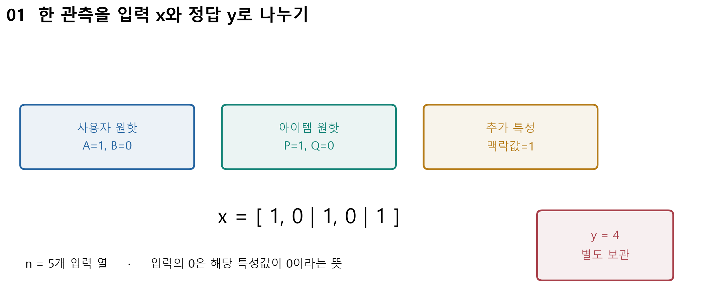

| 교재식 열 번호 | Python 열 번호 | 특성 | 이번 $x_i$ | $w_i$ | $v_i$ |
|---|---|---|---|---|---|
| 1 | 0 | user_A | 1 | 0.5 | [1, 1] |
| 2 | 1 | user_B | 0 | 0.2 | [0.3, -0.2] |
| 3 | 2 | item_P | 1 | -0.5 | [1, 0] |
| 4 | 3 | item_Q | 0 | -0.1 | [-0.1, 0.4] |
| 5 | 4 | context | 1 | 0.25 | [0, 1] |

이하 E02–E08은 이 표와 고정 절편 $w_0=1$을 사용합니다. $n=5$는 **입력 열 수**, $k=2$는 **잠재 차원 수**입니다. 정답 $y=4$는 입력 벡터 $x=[1,0,1,0,1]$ 안에 넣지 않습니다. $V$의 크기는 $n\times k=5\times2$입니다. 잠재 축을 장르 등으로 단정하지 않습니다. 모든 벡터를 같은 직교변환으로 돌려도 내적은 같기 때문입니다.

**직접 계산 L01.** 사용자 B, 아이템 Q, 맥락 0, 정답 2인 관측을 같은 열 순서로 표현하세요. 입력 5개와 정답을 분리해 쓰세요. 자세한 빈 계산표는 [계산 워크북](../supplements/w09b-fm-workbook.md)에 있습니다.

## 2. 5.1 · FM 표준식을 세 덩어리로 읽기

교재의 2-way FM 표준식은 다음과 같습니다.

$$
\hat y(x)=w_0+\sum_{i=1}^{n}w_i x_i+
\sum_{i=1}^{n-1}\sum_{j=i+1}^{n}\langle v_i,v_j\rangle x_i x_j.
$$

$$
\langle v_i,v_j\rangle=\sum_{f=1}^{k}v_{if}v_{jf}.
$$

| 부분 | 읽는 순서 | 의미 |
|---|---|---|
| $w_0$ | 출발점 | 이번 계산에서는 주어진 상수 1 |
| $\sum_i w_i x_i$ | 특성 혼자 기여 | 활성 특성마다 선형 계수와 입력값을 곱해 합산 |
| $\sum_{i<j}\langle v_i,v_j\rangle x_i x_j$ | 두 특성이 함께 기여 | 특성 벡터의 내적에 두 입력값을 곱해 합산 |

$i<j$는 자기 자신과의 쌍을 제외하고, 순서만 다른 쌍을 한 번만 세는 조건입니다. $x_i=0$이면 그 특성이 들어간 상호작용 기여는 0입니다. $x_i$가 1만 가능한 것은 아니므로 입력값의 곱을 생략하면 안 됩니다. $k$를 늘려도 여기서는 두 특성씩의 상호작용입니다. 고차 상호작용 모델로 바뀌지 않습니다.

### 예제 E02 · 맥락을 0으로 두면 MF와 연결된다

$x=[1,0,1,0,0]$이면 활성 특성은 A와 P뿐입니다. 절편 1, 선형항 $0.5-0.5=0$, 상호작용 $[1,1]\cdot[1,0]=1$이므로 예측은 2입니다. 사용자·아이템 원핫만 있고 각 편향과 잠재벡터를 맞추면, 이 식은 편향이 있는 MF의 예측식과 같습니다. 추가 특성이 활성화된 일반 FM 전체가 언제나 사용자–아이템 내적 하나로 줄어드는 것은 아닙니다.

### 예제 E03 · 활성 쌍을 빠짐없이 세기

맥락을 다시 1로 둡니다. 활성 열은 1, 3, 5이고 가능한 쌍은 세 개입니다.

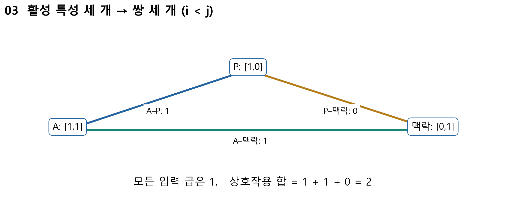

| 쌍 $(i,j)$ | 내적 | 입력 곱 | 상호작용 기여 |
|---|---|---|---|
| (1, 3) | $1\cdot1+1\cdot0=1$ | $1\cdot1=1$ | 1 |
| (1, 5) | $1\cdot0+1\cdot1=1$ | $1\cdot1=1$ | 1 |
| (3, 5) | $1\cdot0+0\cdot1=0$ | $1\cdot1=1$ | 0 |

선형항은 $0.5-0.5+0.25=0.25$이고 상호작용 합은 2입니다. 따라서 $\hat y=1+0.25+2=3.25$입니다. 마지막 쌍은 활성 특성 쌍이지만 내적이 0입니다. “계산할 쌍이 없다”와 “계산 결과가 0이다”를 구별하세요.

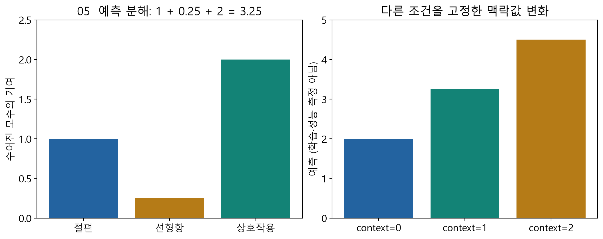

**C02.** 활성 특성이 세 개일 때 $k=2$이므로 쌍도 두 개일까요? 쌍의 수와 각 내적의 길이를 구별하세요.

**직접 계산 L02–L03.** 일반적인 수치 특성 네 개가 모두 비영일 때 쌍 수를 구하세요. 이어 워크북의 새로운 $x,w,V$로 절편·선형항·세 상호작용을 독립 계산하세요.

### 예제 E04 · 적게 관측된 쌍에 정보를 나누는 원리

일반적인 2차 다항식은 쌍마다 독립 계수 $a_{ij}$를 둘 수 있습니다. FM은 이를 $a_{ij}=v_i^\top v_j$로 구성합니다. 같은 특성의 벡터 $v_i$가 여러 쌍에서 재사용되므로 다른 관측의 학습 정보가 그 벡터를 통해 여러 쌍에 영향을 줍니다. 상호작용 모수는 쌍마다 독립 저장하는 $n(n-1)/2$개 대신 $nk$개가 됩니다. $k$가 작을 때 효율적이며 표현력에 제약도 생깁니다.

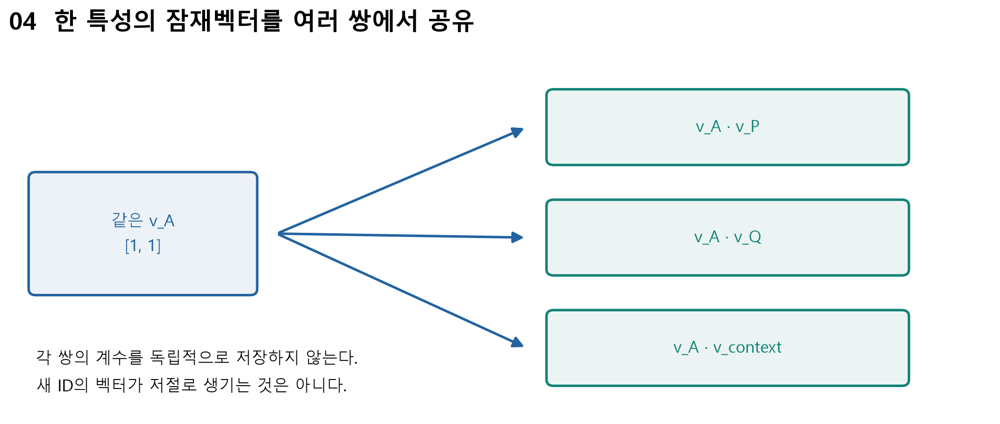

이 설명은 특성 벡터가 확보된 두 특성의 **관측되지 않은 조합**에 관한 것입니다. 사전에 정의되지 않은 새 사용자 ID의 벡터가 자동으로 생기거나, 모든 cold start가 해결된다는 뜻은 아닙니다. 부가 특성·초기화·신규 ID 처리 전략은 별도로 필요합니다.

**C03.** A–P의 학습으로 $v_A$가 바뀌면 A–Q 계수도 바뀔 수 있나요? P–Q 계수는 어떨까요? 다른 모수는 고정해 생각하세요.

## 3. 5.2 · 쌍을 하나씩 계산하지 않는 효율식

각 쌍의 내적을 직접 구하면 밀집 입력의 상호작용 계산량은 $O(kn^2)$입니다. 이는 $n$에 대해 이차적으로 증가합니다. 교재 98쪽의 증가 설명은 이 차수로 이해합니다. 지수 증가로 해석하지 않습니다.

먼저 한 잠재 차원의 세 값을 $a,b,c$라고 잠시 부릅시다.

$$
(a+b+c)^2=a^2+b^2+c^2+2ab+2ac+2bc.
$$

자기항 $a^2+b^2+c^2$을 빼면 순서가 바뀐 쌍이 두 번씩 남습니다. 2로 나누면 원하는 세 쌍입니다.

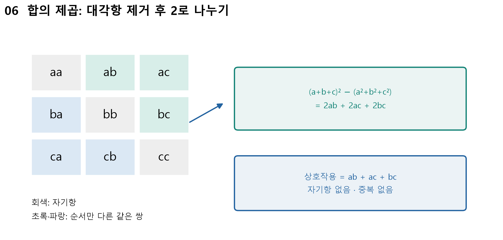

일반식에서는 $a_i=v_{if}x_i$로 두고 잠재 차원 $f$마다 같은 원리를 적용합니다.

$$
\sum_{i<j}\langle v_i,v_j\rangle x_i x_j
=\frac12\sum_{f=1}^{k}\left[
\left(\sum_{i=1}^{n}v_{if}x_i\right)^2
-\sum_{i=1}^{n}v_{if}^{2}x_i^{2}\right].
$$

**C04.** 왜 자기항을 빼나요? 뺀 뒤에도 왜 2로 나누나요? 두 질문을 따로 설명하세요.

### 예제 E05 · 같은 상호작용 2를 다른 순서로 구하기

활성 행 1, 3, 5만 보겠습니다. 첫 잠재 차원의 $v_{if}x_i$는 [1, 1, 0]이고 둘째는 [1, 0, 1]입니다.

| 잠재 차원 $f$ | $S_f=\sum_i v_{if}x_i$ | $D_f=\sum_i(v_{if}x_i)^2$ | $\frac12(S_f^2-D_f)$ |
|---|---|---|---|
| 1 | 2 | 2 | 1 |
| 2 | 2 | 2 | 1 |

두 차원의 기여를 더하면 2로 E03의 쌍별 합과 같습니다. 덧셈 순서만 바꾼 **정확한 항등식**이며 근사식이 아닙니다. 부동소수점 계산에서는 아주 작은 반올림 차이가 생길 수 있습니다.

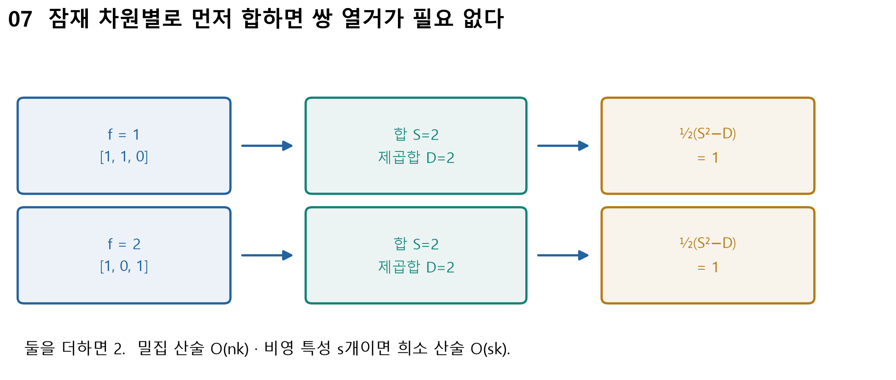

각 차원에서 전체 특성을 한 번씩 훑으면 산술 핵심은 $O(nk)$입니다. 비영 입력이 $s$개라면 해당 행만 사용하여 $O(sk)$로 계산할 수 있습니다. 교육용 코드의 전체 모수 유한성 검사 비용은 이 산술 복잡도와 구별합니다.

**직접 계산 L04.** 한 잠재 차원의 값이 [1, 2, -1]일 때 세 쌍의 합과 효율식이 같은지 두 방법으로 구하세요.

**C05.** 입력이 원핫만 있다고 생각하여 자기항의 $x_i^2$를 $x_i$로 바꾸면, 연속값 0.5나 2에서도 맞을까요?

## 4. 5.3 · 오차에서 잠재벡터 갱신까지

교재의 예시처럼 이번에는 절편을 고정합니다. 일반 FM에서 절편을 학습할 수 없다는 뜻은 아닙니다. 손계산의 정규화 계수는 0으로 두며, 한 관측의 손실을 다음처럼 정의합니다.

$$
e=y-\hat y,\qquad L=\frac12(y-\hat y)^2,\qquad
\frac{\partial L}{\partial\hat y}=-e.
$$

RMSE는 여러 평가 관측의 예측 오차를 요약할 때 쓰는 별도 지표입니다. 이 한 단계 갱신은 위 제곱손실의 미분에서 나옵니다. $e=\hat y-y$라고 정의한 책이나 코드의 부호를 그대로 섞지 마세요.

### 예측 미분과 손실 미분을 한 칸씩 연결하기

$$
S_f=\sum_{j=1}^{n}v_{jf}x_j,\qquad
\frac{\partial\hat y}{\partial w_i}=x_i,\qquad
\frac{\partial\hat y}{\partial v_{if}}=x_i(S_f-v_{if}x_i).
$$

$S_f$에는 자기 자신 $v_{if}x_i$도 포함됩니다. 이를 빼면 다른 특성들과 연결된 항만 남습니다. 바깥의 $x_i$는 그 특성이 이번 관측에 얼마나 들어왔는지를 곱합니다. 효율식을 미분하는 과정은 [수학 보강 노트](../supplements/w09b-fm-math.md)에 한 줄씩 있습니다.

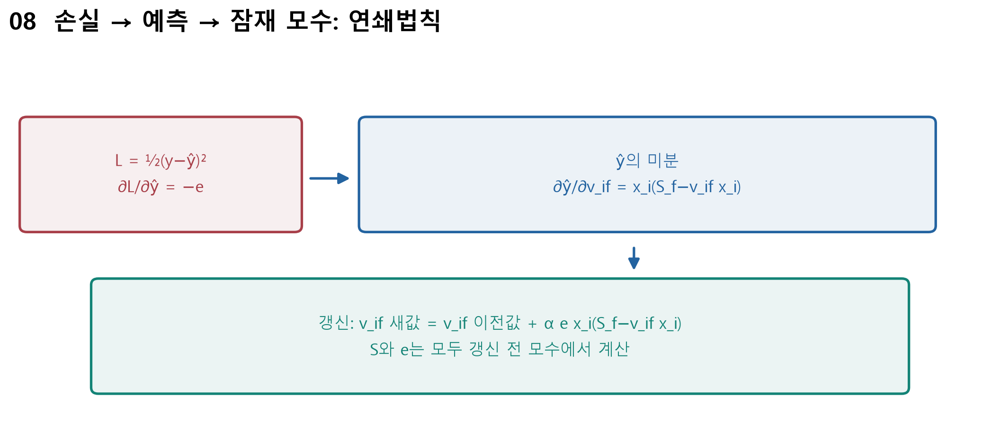

손실을 줄이는 경사하강 한 단계는 다음과 같습니다. 우변의 값은 모두 **갱신 전** 상태입니다.

$$
w_i^{\mathrm{new}}=w_i^{\mathrm{old}}+\alpha e x_i,
$$

$$
v_{if}^{\mathrm{new}}=v_{if}^{\mathrm{old}}
+\alpha e x_i(S_f-v_{if}^{\mathrm{old}}x_i).
$$

### 예제 E06 · 한 관측을 한 번 갱신하기

E03의 예측은 3.25, 정답은 4입니다. 따라서 $e=0.75$, 이전 손실은 $0.5\times0.75^2=0.28125$입니다. $\alpha=0.1$, $S=[2,2]$입니다.

- $w_1^{new}=0.5+0.1\times0.75\times1=0.575$.
- $\partial\hat y/\partial v_{11}=1(2-1)=1$이므로 $v_{11}^{new}=1.075$.
- $\partial\hat y/\partial v_{12}=1(2-1)=1$이므로 $v_{12}^{new}=1.075$.
- $v_{32}$는 이전 값이 0이지만 다른 활성 벡터의 둘째 값들이 합쳐져 미분이 $1(2-0)=2$입니다. 따라서 새 값은 0.15입니다.

| 갱신 대상 | 이전 값 | 예측 미분 | 새 값 |
|---|---|---|---|
| $w_1,w_3,w_5$ | [0.5, -0.5, 0.25] | [1, 1, 1] | [0.575, -0.425, 0.325] |
| $v_1$ | [1, 1] | [1, 1] | [1.075, 1.075] |
| $v_3$ | [1, 0] | [1, 2] | [1.075, 0.15] |
| $v_5$ | [0, 1] | [2, 1] | [0.15, 1.075] |

비활성 행 2, 4는 이번 **정규화 없는 규칙의 데이터 미분**이 0이므로 바뀌지 않습니다. 정규화가 있는 모든 알고리즘으로 이 결론을 일반화하지 않습니다. 절편은 주어진 1을 유지합니다.

모든 새 모수를 넣은 예측은 4.43125입니다. 정답을 조금 넘었지만 새 손실은 0.09298828125로 작아졌습니다. 예측이 정답을 넘었는지만으로 손실 증가를 판단하지 않습니다. 학습률이 크면 손실이 증가할 수도 있습니다. 한 관측의 손실 감소는 검증 성능 개선을 증명하지 않습니다.

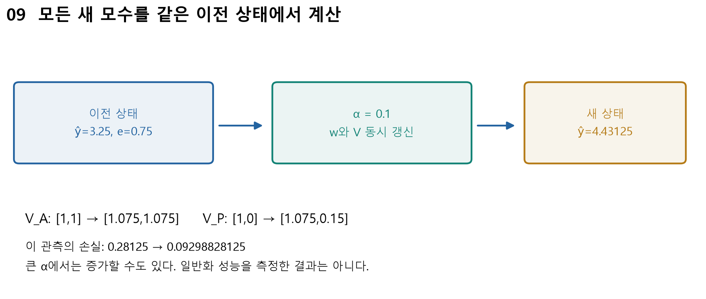

**C06.** 첫 벡터를 갱신한 후 그 새 값으로 두 번째 벡터의 $S_f$를 다시 계산하면 지금의 한 단계와 같을까요?

**직접 계산 L05.** 워크북에 제시한 새로운 잔차·학습률·연속 입력값으로 선형 계수 하나와 잠재 계수 하나를 갱신하세요.

## 5. 5.4 · 관측별 행과 희소 표현

교재 그림 5-1은 사용자–아이템 평점 행렬에서 **평점 하나마다 데이터 한 행**을 만드는 변형을 보여 줍니다. 사용자와 아이템 원핫, 부가 특성을 입력 $x$에 놓고 평점 $y$를 별도로 둡니다. 아래는 교수자가 수업용 발췌를 승인한 교재 그림입니다. 원본 그림의 출처 표기도 함께 보존했습니다.

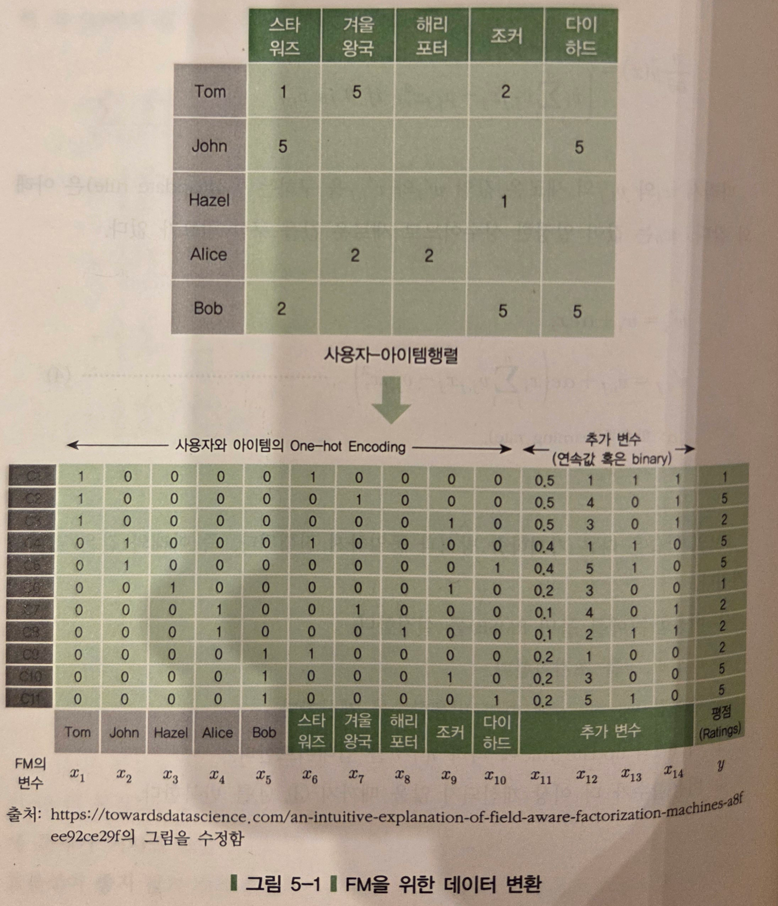

출처: 임일(2025), 주교재 100쪽 그림 5-1 발췌. 교재는 그림 아래에 Towards Data Science의 field-aware FM 설명 그림을 수정했다고 밝힙니다. 여기서는 데이터 표현만 읽으며 FFM 모델을 학습 범위에 추가하지 않습니다. 교재의 첫 관측 C1을 따라 사용자 원핫·아이템 원핫·부가 특성·정답의 위치를 찾으세요. 나머지 강의 수치 계산은 E01의 별도 합성 표를 사용합니다.

원핫 열이 많으면 한 행 대부분이 0입니다. 그러나 0을 전부 저장하고 계산할 필요는 없습니다. **어느 열인지**와 **그 값이 무엇인지**를 함께 보관합니다. 원핫의 1뿐 아니라 0.5 같은 연속값도 보존해야 합니다.

### 예제 E07 · 밀집 벡터를 index/value로 바꾸기

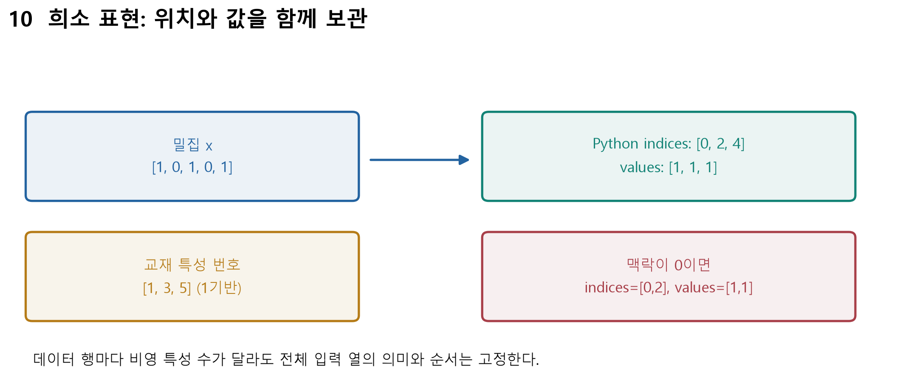

| 표현 | 위치 | 값 |
|---|---|---|
| 교재식 1기반 열 번호 | [1, 3, 5] | [1, 1, 1] |
| Python 0기반 indices | [0, 2, 4] | [1, 1, 1] |

맥락을 0으로 바꾸면 Python indices는 [0,2], values는 [1,1]입니다. 전체 입력 차원 $n=5$와 열의 의미는 바뀌지 않습니다. 행마다 저장하는 비영 원소 개수 $s$만 달라집니다. 희소 입력에서 생략된 0은 입력 특성값입니다. 평점 행렬의 미관측 정답을 0으로 채워 학습한다는 의미가 아닙니다.

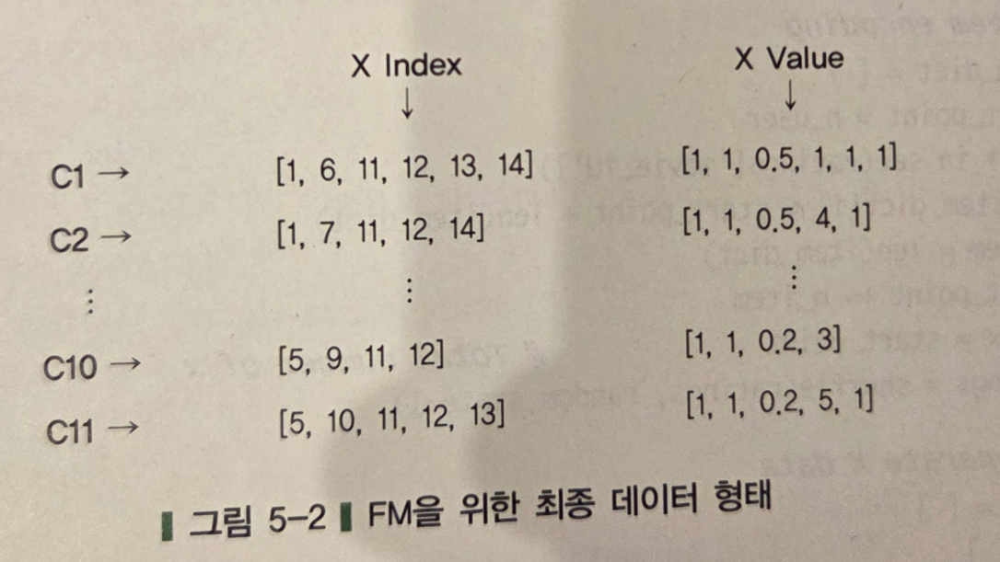

출처: 임일(2025), 주교재 103쪽 그림 5-2 발췌. 그림의 X Index는 1기반입니다. Python에 옮길 때 명시적으로 1을 뺍니다. $y$는 이 배열에 합치지 않습니다.

**C07.** 서로 다른 행의 indices 길이가 달라도 $V$의 전체 행 수는 같아야 하나요? 같은 열의 의미를 왜 유지해야 하나요?

**직접 계산 L06.** 워크북의 음수·연속값이 섞인 입력을 희소 표현으로 바꾸고 다시 복원하세요.

### 예제 E08 · 연속값으로 잘못된 공식을 발견하기

맥락만 2로 바꾸면 $x=[1,0,1,0,2]$입니다. 선형항은 $0.5-0.5+0.25\times2=0.5$, 쌍 기여는 A–P=1, A–맥락=2, P–맥락=0으로 합이 3입니다. 예측은 $1+0.5+3=4.5$입니다.

효율식에서는 둘째 차원의 입력 가중 값이 [1,0,2]입니다. 합의 제곱은 9, 자기항 합은 $1^2+0^2+2^2=5$이므로 기여는 2입니다. 첫 차원의 기여 1과 합치면 3입니다. $x_i^2$를 $x_i$로 잘못 바꾸면 자기항 제거가 틀어집니다.

**C08.** 같은 예제가 원핫 입력에서만 맞는 것과 연속·음수 입력에서도 맞는 것 중 어느 쪽이 더 좋은 검산일까요? 이유와 반례를 적으세요.

## 6. 계산 확인과 다음 수업 연결

계산 노트북은 고정된 합성 모수에서 예상값을 검산하는 도구입니다. 먼저 종이에 예측한 뒤 실행하세요. `fm_score_naive`, `fm_score`, `fm_score_sparse`의 결과를 비교하고, 맥락만 0→1→2로 바꾸며 어떤 항이 바뀌었는지 설명합니다. 계산기에서 $k=1$을 선택하는 것은 주어진 $V$의 첫 열만 쓰는 비교이며 새 모델을 재학습하는 실험이 아닙니다.

[학생용 계산 노트북](https://colab.research.google.com/github/lunalab-ai/recommender/blob/2026-fall-w09b/notebooks/student/w09b-fm-theory.ipynb) · [실행 코드 읽기](../supplements/w09b-fm-math.md) · [독립 계산 워크북](../supplements/w09b-fm-workbook.md)

전체 FM 학습기 작성, 데이터 분할과 전처리 적합, 정규화·검증·최적 상태 선택, 앱 조립은 W10A에서 다룹니다. 오늘의 한 관측 갱신을 전체 학습·성능 평가와 구별하세요.

**출구 질문 X01–X03.** ① FM이 공유하는 모수는 무엇인가요? ② 효율식에서 자기항과 중복을 제거하는 두 연산은 무엇인가요? ③ 희소 index/value에서 정답과 인덱스 기준을 어떻게 관리하나요? 각 한 문장으로 답하세요.

## 점검 퀴즈

1. FM에서 입력 차원 n과 잠재 차원 k는 각각 무엇을 세나요?
2. 2-way FM에서 i<j 조건은 어떤 두 종류의 중복을 막나요?
3. 선형항과 상호작용항은 각각 무엇을 나타내나요?
4. 사용자와 아이템 원핫만 활성인 FM을 편향이 있는 MF와 연결하려면 어떤 조건이 필요한가요?
5. 잠재벡터 공유는 관측되지 않은 조합의 예측에 어떻게 도움을 주며, 새 ID와는 어떻게 다른가요?
6. 효율식에서 자기항을 빼고 2로 나누는 이유는 무엇인가요?
7. 연속 입력을 허용할 때 자기항에서 입력값을 제곱해야 하는 이유는 무엇인가요?
8. e=y−예측일 때 제곱손실의 경사하강 갱신식에 양의 αe 항이 나타나는 이유는 무엇인가요?
9. 한 관측의 모든 잠재벡터 갱신에서 같은 이전 상태를 사용해야 하는 이유는 무엇인가요?
10. 희소 표현의 입력 0, 평점의 미관측, 0기반 인덱스를 어떻게 구별하나요?

## 핵심 정리와 출처

FM은 특성별 벡터를 공유하여 쌍의 계수를 만듭니다. 효율식은 같은 상호작용을 다른 계산 순서로 정확히 구합니다. 학습에서는 잔차의 부호·입력 곱·같은 이전 상태를 함께 지켜야 합니다. 표현 방식이 밀집에서 희소로 바뀌어도 예측식의 의미는 같습니다.

- **주교재에서 확인한 내용:** 임일(2025), 『AI 에이전트를 위한 개인화 추천 알고리즘: Python, 머신러닝, AI, LLM 활용』, 청람, 5.1–5.4, 96–103쪽. 표준식·효율식·예시의 고정 절편·관측별 데이터와 희소 표현을 따릅니다. 교재 PDF와 출판사 코드는 배포 자료에 포함하지 않습니다.
- **원 논문:** S. Rendle(2010), [Factorization Machines](https://jame-zhang.github.io/assets/algo/Factorization-Machines-Rendle2010.pdf), II–III 및 V-A. 저자 원 논문의 공개 사본입니다. 잠재 모수 공유·효율식·MF 연결을 보완 확인했습니다.
- **보충 해설:** [Dive into Deep Learning 21.9](https://d2l.ai/chapter_recommender-systems/fm.html), 21.9.1–2. FM 정의와 선형 시간 계산을 교차 확인했습니다.
- **희소 형식:** [libFM 매뉴얼](https://www.libfm.org/libfm-1.42.manual.pdf), 3.1·3.3. 실제 파일 형식과 이 수업의 Python index/value 배열은 구별합니다.
- **추가 제작:** E01–E08, L01–L08, 개념 그림 10개와 계산 모듈은 이 수업을 위해 작성한 합성 예제·교육적 해석입니다. 그림 5-1·5-2 발췌는 위 출처와 구별해 표시했습니다.
