# W10A · FM 복습과 딥러닝을 이용한 추천 시스템

> 딥러닝응용I(추천시스템) · 동덕여자대학교 데이터사이언스전공 · 유원상 교수 · 2026-2 · 2026-11-03

주교재6장 전체를 A–D로 읽습니다. 먼저 FM의 같은 사례를 다시 계산하고, MF를 Keras로 표현한 뒤 MLP와 추가 정보로 확장합니다. 수식의 기호와 배열 크기를 확인하고, 실행 전 결과를 예상한 뒤 중간값과 비교하세요.

수업 후에는 입력과 정답, 임베딩 조회와 내적, 연결과 Dense, 학습과 순전파, 검증과 시험을 구별하고 작은 예를 직접 계산할 수 있어야 합니다. 처음 등장하는 용어는 본문에서 정의합니다.

- [A · FM 복습](../supplements/w10a-a-fm-review.md)
- [B · MF와 Keras](../supplements/w10a-b-keras-mf.md)
- [C · 신경망 추천](../supplements/w10a-c-mlp.md)
- [D · 추가 변수와 평가](../supplements/w10a-d-features.md)
- [계산 워크북](../supplements/w10a-workbook.md)
- [재사용 API 안내](../supplements/w10a-api-guide.md)

수업용 합성 모수·합성 데이터, 교재에 보고된 결과, 이번 실제 실행 결과를 각각 표시합니다. 독립 연습은 완성 예제와 다른 조건으로 풀어 보세요. 새 제출 과제나 마감은 없습니다.

# A · FM을 다시 계산하며 MF로 연결하기

> 주교재5.1–5.4(pp.96–103) 복습. 아래 숫자는 지난 W09B와 같은 수업용 합성 모수이며 실제 학습 결과가 아닙니다.

## 1. 한 행은 무엇을 뜻할까?

한 관측은 “사용자 A가 영화 P에 평점4를 주었고, 맥락값은1이었다”입니다. 입력은 사용자·영화·맥락이고, 맞히려는 정답은 평점입니다. 정답을 입력에 넣으면 예측 문제가 사라집니다. 여기서 맥락은 계산을 설명하기 위한 무단위 합성값입니다.

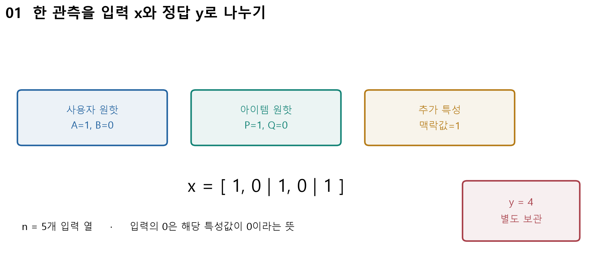

그림 읽기: 파란 사용자 블록 → 초록 영화 블록 → 보라 맥락 열 → 별도로 둔 정답 순서입니다. 각 원핫 블록에서 선택한 대상만1입니다. W09B 독자 합성 도해를 재사용했습니다.

| 기호 | 뜻 | 이번 크기/값 |
|---|---|---|
| $x$ | 한 관측의 입력 열 | $[1,0,1,0,1]$, 길이5 |
| $y$ | 관측한 정답 평점 | 4, 입력에 넣지 않음 |
| $w_0$ | 전체 출발점인 편향 | 주어진 상수1 |
| $w_i$ | 입력 열 하나의 선형 계수 | $w=[.5,.2,-.5,-.1,.25]$ |
| $v_i$ | 입력 열 $i$의 잠재벡터 | $V$의 한 행, 길이 $K=2$ |
| $i,j$ | 특성 열 번호 | 사용자 번호/영화 번호와 구별 |

잠재값은 데이터로 학습할 수 있는 숫자입니다. 각 축이 액션/로맨스 같은 특정 의미라고 단정하지 않습니다. 차원 수 $K$와 상호작용 쌍 수는 다른 개념입니다.

### E01 · 입력과 정답을 분리하기

열 순서는 A, B, P, Q, 맥락입니다. A와 P를 선택하고 맥락1을 넣으면 $x=[1,0,1,0,1]$입니다. 평점4는 $y=4$로 따로 둡니다. 이번 입력과 잠재벡터는 다음과 같습니다.

| 열 | $x_i$ | $w_i$ | $v_i$ |
|---|---:|---:|---|
| A | 1 | .5 | $[1,1]$ |
| B | 0 | .2 | $[.3,-.2]$ |
| P | 1 | −.5 | $[1,0]$ |
| Q | 0 | −.1 | $[-.1,.4]$ |
| 맥락 | 1 | .25 | $[0,1]$ |

## 2. FM의 긴 식을 세 덩어리로 읽기

$$
\hat y=w_0+\sum_{i=1}^{n}w_ix_i+
\sum_{i<j}\langle v_i,v_j\rangle x_ix_j.
$$

첫 항은 출발점, 둘째 항은 각 특성 혼자의 기여, 셋째 항은 두 특성이 함께 있을 때의 기여입니다. 내적은 같은 위치끼리 곱해 더합니다. $[a,b]\cdot[c,d]=ac+bd$입니다. $i<j$는 자기 자신과의 쌍과 순서만 바뀐 중복을 제외합니다.

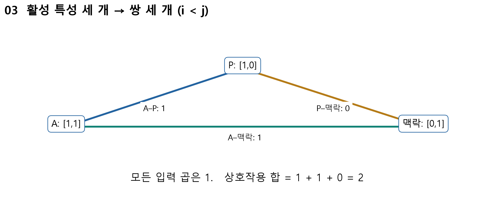

그림 읽기: 세 활성 꼭짓점을 찾고 각 선의 양끝 벡터를 내적합니다. P–맥락 선의 결과0도 실제 계산한 쌍입니다. 출처: W09B 독자 합성 도해.

### E02 · 3.25가 나오는 모든 중간 계산

선형항은 $.5\times1+(-.5)\times1+.25\times1=.25$입니다. 활성 쌍은 A–P, A–맥락, P–맥락의 세 개입니다.

| 쌍 | 벡터 내적 | 입력값 곱 | 기여 |
|---|---|---:|---:|
| A–P | $1\times1+1\times0=1$ | 1 | 1 |
| A–맥락 | $1\times0+1\times1=1$ | 1 | 1 |
| P–맥락 | $1\times0+0\times1=0$ | 1 | 0 |

따라서 $\hat y=1+.25+(1+1+0)=3.25$입니다. 정답4와 예측3.25의 차이는 $.75$입니다. $K=2$는 각 내적에서 곱해 더할 좌표가 두 개라는 뜻입니다. 활성 특성3개의 쌍 수는 $3\times2/2=3$입니다.

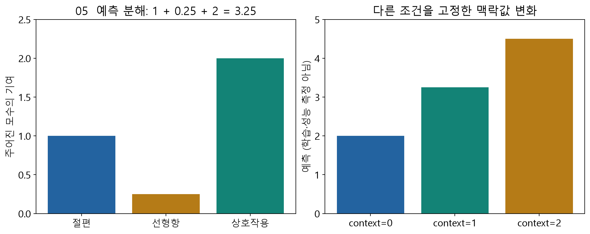

읽기: 각 항의 높이를 더한 뒤 맥락0/1/2의 예측2/3.25/4.5를 비교하세요. 입력만 바꾸고 모수는 고정한 실험입니다. 출처: W09B 독자 합성 도해.

### E03 · 효율식의 자기항 제거와 1/2

첫 잠재 좌표의 활성 값은 $[1,1,0]$입니다. 합의 제곱은4, 각 값의 제곱합은2이므로 $(4-2)/2=1$입니다. 둘째 좌표도 $[1,0,1]$이므로1입니다. 두 좌표를 더하면 상호작용2를 얻습니다.

$$
\sum_{i<j}\langle v_i,v_j\rangle x_ix_j
=\frac12\sum_{f=1}^{K}
\left[\left(\sum_i v_{if}x_i\right)^2-\sum_i(v_{if}x_i)^2\right].
$$

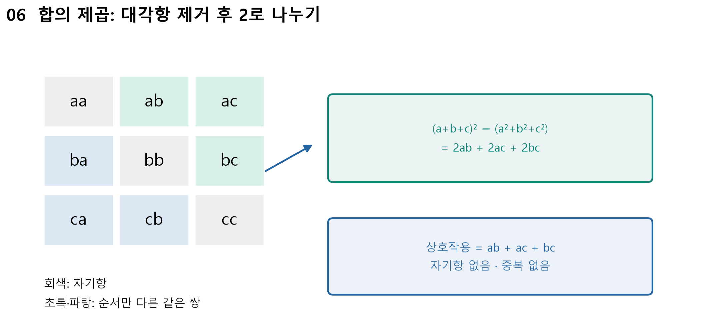

대각선은 자기 자신을 곱한 값이어서 빼고, 위·아래의 같은 쌍이 두 번 있으므로2로 나눕니다. 연속형 입력에서도 자기항은 $(v_{if}x_i)^2$입니다. $x_i$의 제곱을 생략하지 않습니다. 출처: W09B 독자 도해; 교재5.2(p.98)의 식을 수치화했습니다.

### E04 · 학습은 오차를 이용해 모수를 바꾸는 것

손실을 $L=\tfrac12(y-\hat y)^2$로 두면 현재 $L=.5\times.75^2=.28125$입니다. 학습률 $\alpha=.1$에서 A의 선형 계수는 $w_A'= .5+.1\times.75\times1=.575$입니다. 학습률은 한 번에 바꾸는 크기를 조절합니다.

이것은 한 계수의 갱신 예입니다. 모든 새 모수를 갱신 전의 같은 상태로 계산해야 합니다. 하나를 먼저 바꾸고 그 새 값으로 다음 미분을 계산하면 다른 알고리즘이 됩니다. 교재5.3의 잔차는 여기서 $e=y-\hat y$로 통일합니다.

## 3. MF가 되는 특별한 경우

맥락을0으로 두면 A와 P만 활성입니다. 선형항은0, 내적은1이므로 예측은2입니다. 사용자 원핫·영화 원핫만 있고 각 편향과 잠재벡터를 대응시키면 FM은 편향이 있는 MF와 같은 식이 됩니다. 이번에는 이 MF를 Keras의 입력·임베딩·내적 층으로 옮깁니다.

복습 데이터 변환은 교재 그림5-1(p.100),5-2(p.103)를 참고하세요. 원핫을 실제로 큰 배열에 모두 저장하지 않고 정수 ID 또는 비영 index/value로 나타낼 수 있습니다. 0은 “미관측 평점”과 같은 뜻이 아닙니다.

직접 확인 C01: 입력 열 수5, 활성 열 수3, 잠재폭2, 활성 쌍 수3을 각각 그림에서 가리키세요. 워크북 L01(필수),L02(보충)로 독립 계산합니다.

# B · 6.1–6.2: MF를 Keras로 표현하기

> 주교재6.1(pp.120–124),6.2(pp.125–133 상단). 이 절은 MF의 계산을 신경망 도구로 표현합니다.

## 1. 처음 만나는 용어부터

모형은 입력에서 예측을 만드는 계산 규칙입니다. 모수는 데이터로 학습할 숫자입니다. MF에서는 사용자·영화 잠재벡터와 편향이 모수입니다. 신경망의 층(layer)은 입력을 받아 다음 값을 만드는 계산 단위입니다. 임베딩(Embedding)은 정수 ID로 학습 가능한 벡터 표의 행을 꺼냅니다.

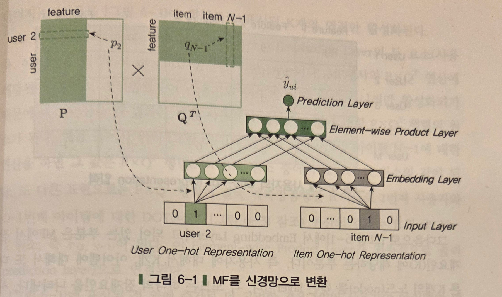

출처: 임일(2025), 주교재6장 p.121 그림6-1 원본 선별 발췌. 읽기: 아래 원핫 → 가운데 임베딩 → 같은 좌표끼리의 곱 → 합산 예측 순서입니다. 행렬의 특정 행/열을 선택하는 것과 벡터를 꺼내는 계산을 대응시키세요.

### E05 · 원핫 곱셈이 행 조회와 같은 이유

사용자 표를 $P=\begin{bmatrix}1&1\\.3&-.2\\-.5&.4\end{bmatrix}$라고 합시다. A의 원핫 $[1,0,0]$를 왼쪽에서 곱하면 $1[1,1]+0[.3,-.2]+0[-.5,.4]=[1,1]$입니다. 정수 ID0으로 첫 행을 꺼내도 $[1,1]$입니다. 원핫은 어느 행을 고를지를 표시합니다.

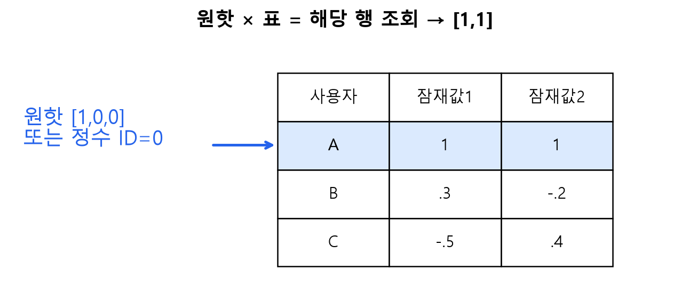

독자 수업 도해. 읽기: 원핫의1 위치 → 강조된 표의 행 → 반환 벡터입니다. 여기서는0기반 예제입니다. 실제 실습의 ID0은 미학습 표지로 예약하므로 인코딩 규약을 섞지 마세요.

## 2. MF의 네 부분과 평균

$$
\hat r_{ui}=\mu+b_u+b_i+p_u^\top q_i.
$$

$r$은 평점, $\hat r$은 예측 평점, $u,i$는 사용자·영화 번호, $p_u,q_i$는 길이 $K$ 벡터, $b_u,b_i$는 사용자·영화 편향, $\mu$는 훈련 평점의 평균입니다. $p_u^\top q_i$는 전치 기호가 붙은 내적입니다. 한 관측의 출력은 숫자 하나입니다.

### E06 · 편향과 내적을 더하기

앞의 합성 모수 $\mu=1,b_A=.5,b_P=-.5,p_A=[1,1],q_P=[1,0]$를 씁니다. 내적은1이고, $\hat r_{AP}=1+.5-.5+1=2$입니다. 이는 A절에서 맥락0으로 계산한 FM 결과와 같습니다. 여기의 평균1은 수업용으로 주어진 값입니다. 실제 실습에서는 훈련 자료에서 평균을 계산합니다.

교재에서는 전체 평균을 네트워크 밖에서 처리합니다. 학습 목표는 $r-\mu$, 모델 출력은 중심화 점수입니다. 예측할 때 $\mu$를 한 번 더해 원래 평점 척도로 돌아옵니다.

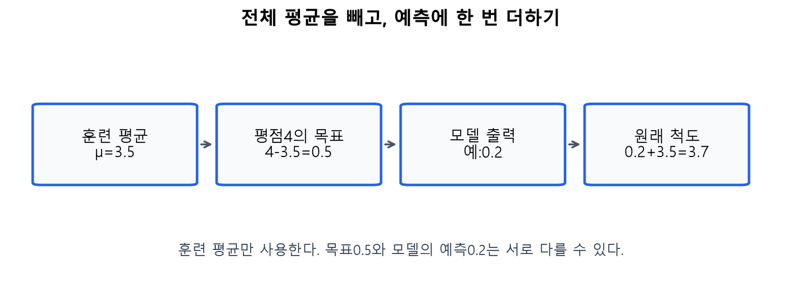

독자 수계산 도해. 평균3.5, 관측 평점4이면 목표는0.5입니다. 모델이0.2를 예측했다면 원래 평점 예측은3.7입니다. 목표와 예측은 같을 필요가 없으며, 그 차이가 학습의 출발점입니다.

## 3. 배열의 모양을 읽는 법

배열의 shape는 축별 크기입니다. `(2,3)`은 행2개·열3개, `(B,1,K)`는 세 축입니다. $B$는 현재 한 번에 처리하는 관측 수인 배치 크기입니다. $M$은 사용자 표의 행 수, $N$은 영화 표의 행 수, $K$는 잠재벡터 폭입니다. `None`은 실행 때 정해질 배치 크기입니다.

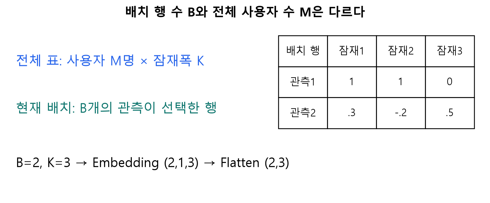

독자 도해. 같은 사용자가 배치에 두 번 나타날 수도 있습니다. 따라서 배치 행 수와 서로 다른 사용자 수를 동일시하지 않습니다.

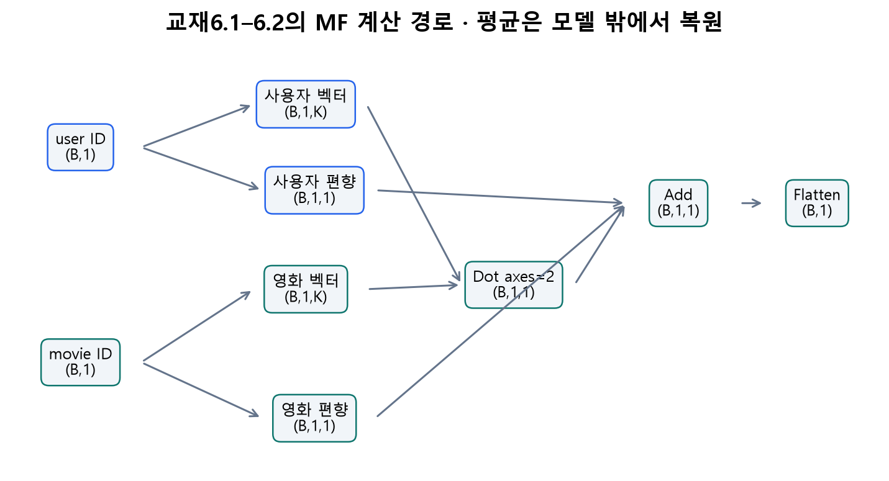

독자 도해, 교재6.1–6.2의 계산을 차원과 연결했습니다. 화살표를 따라 아래 표의 한 행씩 확인하세요.

| 단계 | 입력/출력 크기 | 하는 계산 |
|---|---|---|
| `Input(shape=(1,))` | `(B,1)` | 한 관측당 ID 하나 |
| `Embedding(M,K)` | `(B,1,K)` | 사용자 표에서 벡터 조회 |
| 영화 임베딩 | `(B,1,K)` | 영화 표에서 벡터 조회 |
| `Dot(axes=2)` | `(B,1,1)` | 각 관측 안에서 길이 $K$ 내적 |
| 사용자·영화 편향 임베딩 | 각각 `(B,1,1)` | 각 편향 하나 조회 |
| `Add` | `(B,1,1)` | 내적과 두 편향을 더함 |
| `Flatten` | `(B,1)` | 배치를 보존하며 뒤 축을 펼침 |

`Flatten`은 값을 더하거나 학습하지 않습니다. 모양을 바꾸는 계산입니다. 교재 코드의 `(M,1,K)` 같은 주석은 실제 실행에서는 배치 축을 가진 `(B,1,K)`로 읽어야 합니다. ID의 최댓값이943이고 그대로 사용한다면 행 번호0~943을 수용하기 위해 `input_dim=944`가 필요합니다.

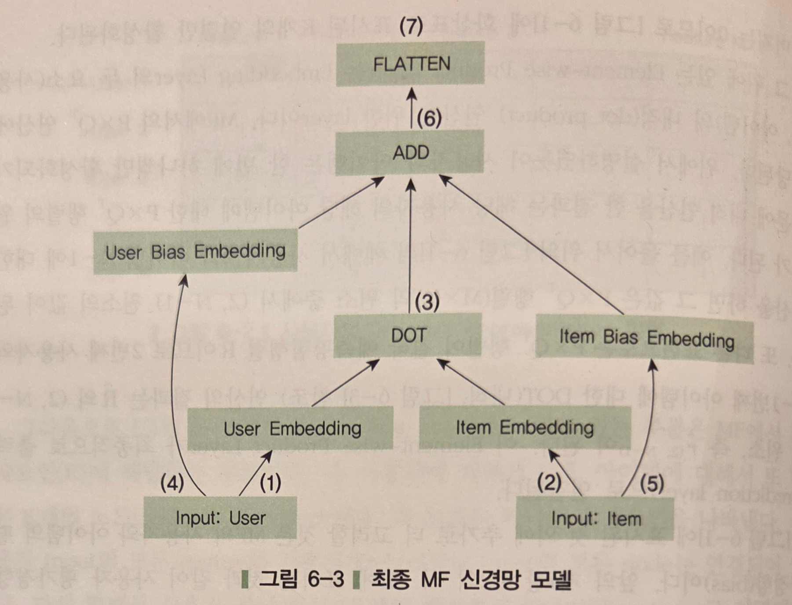

출처: 임일(2025), p.124 그림6-3 원본 선별 발췌. 입력 두 갈래 → 벡터와 편향 → DOT → ADD → FLATTEN으로 읽습니다. 전체 평균은 그림 밖의 전처리/복원 단계입니다.

### E07 · 모수 수를 직접 세기

사용자 표의 행 수 $M=944$, 영화 표의 행 수 $N=1683$, $K=200$이면 벡터와 편향의 모수 수는 $(M+N)(K+1)=2627\times201=528027$입니다. 배치 크기를 바꿔도 모수 수는 바뀌지 않습니다. 반면 $K$를 바꾸면 표의 폭이 바뀌어 모수 수가 바뀝니다.

## 4. 학습·예측·평가를 구별하기

손실은 틀린 정도를 수치화한 함수입니다. MSE는 관측별 오차 제곱의 평균입니다. SGD는 손실의 기울기를 이용해 모수를 조금씩 바꾸는 방법입니다. 에포크(epoch)는 훈련 자료 전체를 한 번 사용하는 단위이고, 미니배치(minibatch)는 한 번의 갱신에 사용하는 일부 관측입니다. 학습률은 갱신 크기를 정합니다. 모멘텀은 이전 갱신 방향을 일부 반영합니다.

L2 정규화는 큰 모수에 제곱 벌점을 더합니다. 따라서 학습의 `loss`가 “MSE+정규화 벌점”일 때, 그 값의 제곱근을 바로 RMSE라고 부르면 안 됩니다. 실습은 별도 `rmse` 지표와 원래 평점의 직접 계산을 함께 확인합니다.

학습 중에는 임베딩과 편향이 바뀌고, 예측 중에는 모수를 고정합니다. Keras의 `fit`은 학습, `model(inputs, training=False)`는 고정 모수의 계산입니다. 이것을 앱의 단순 입력 변경과도 구별하세요.

직접 확인 C02: $B=4,K=3$일 때 임베딩과 Flatten의 shape를 적으세요. 워크북 L03·L04로 수계산하고 Colab A에서 같은 결과를 확인합니다.

공식 참고: [Embedding](https://keras.io/api/layers/core_layers/embedding/), [Dot](https://keras.io/api/layers/merging_layers/dot/). 교재 p.133의 약0.91448은 책에 보고된 한 실행의 RMSE이며 이번 실행에서 재현한 결과로 표시하지 않습니다.

# C · 6.3: 내적에서 학습 가능한 신경망으로

> 주교재6.3(pp.133 하단–140). 여기서는 사용자·영화 벡터를 연결한 뒤 MLP로 평점을 예측합니다.

## 1. 무엇을 바꾸는가?

MF는 두 벡터의 같은 좌표끼리 곱해 더하는 내적을 사용합니다. MLP(Multi-Layer Perceptron, 다층 퍼셉트론)는 여러 층의 가중합과 활성함수를 조합합니다. 이번에는 임베딩을 얻는 앞부분을 유지하고, 예측을 만드는 뒷부분을 바꿉니다. 같은 입력 사례로 계산 구조를 비교합니다.

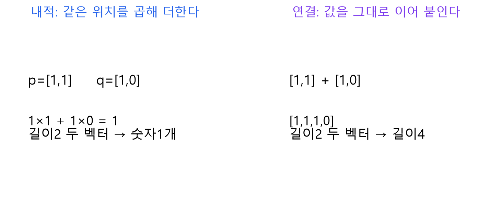

독자 도해. 왼쪽은 두 벡터에서 숫자 하나를 만들고, 오른쪽은 값을 이어 붙여 길이4 벡터를 만듭니다. 연결 자체가 내적을 계산하지는 않습니다.

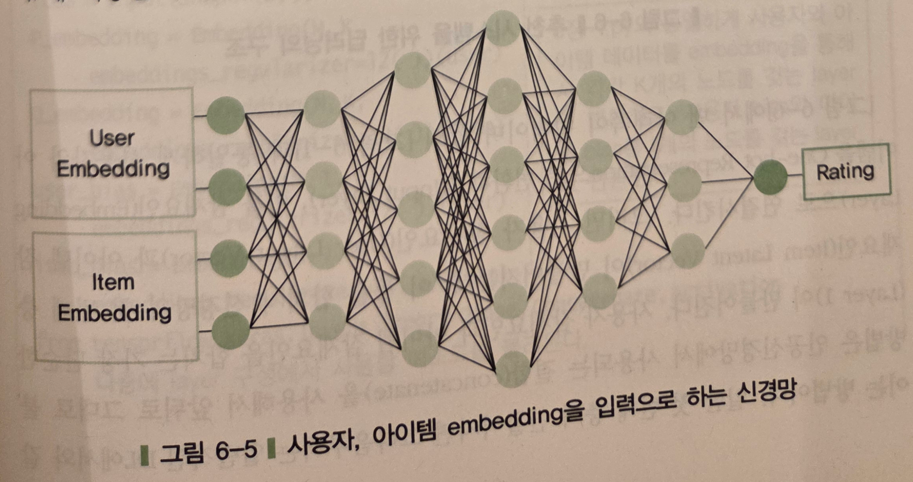

출처: 임일(2025), p.133 그림6-5 원본 선별 발췌. 왼쪽 임베딩 → 가운데 은닉층 → 오른쪽 평점 예측을 읽습니다. 은닉층은 외부에 정답으로 주어진 값이 아니라 앞선 층의 값으로 계산되는 중간 표현입니다.

### E08 · 연결 벡터의 길이

$p_A=[1,1],q_P=[1,0]$를 연결하면 $[1,1,1,0]$입니다. 교재 코드는 사용자·영화의1차원 임베딩 두 개도 연결하므로 $z=[1,1,1,0,.5,-.5]$이고 길이는 $2K+2=6$입니다. 이 두 추가 값은 이후 Dense의 입력 특성입니다. MF처럼 마지막에 독립적으로 더하는 $b_u+b_i$와 역할이 동일하다고 보장되지 않습니다.

## 2. Dense를 계산기로 따라가기

Dense(완전연결층)의 가중합은 $a=zW+b$입니다. $z$는 입력 행벡터, $W$는 입력 폭×출력 폭의 가중치 표, $b$는 출력 폭의 편향 벡터입니다. 출력 뉴런마다 서로 다른 $W$의 열을 사용합니다. 활성함수는 그 가중합을 좌표별로 변환합니다.

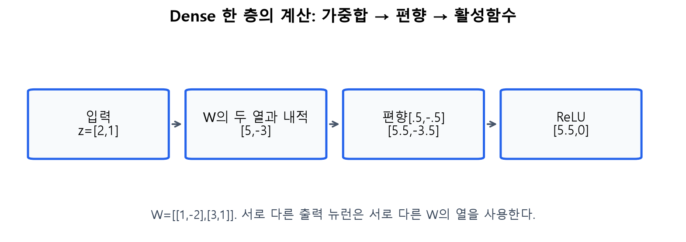

독자 수계산 도해. 입력 $[2,1]$, $W=\begin{bmatrix}1&-2\\3&1\end{bmatrix}$, 편향 $[.5,-.5]$이면 가중합 $[5.5,-3.5]$, ReLU 출력 $[5.5,0]$입니다. 그림의 각 숫자를 직접 곱해 확인하세요.

ReLU는 $\operatorname{ReLU}(t)=\max(0,t)$입니다. 음수이면0, 양수이면 그대로입니다. `linear` 활성함수는 $a(t)=t$입니다. **Dense 뒤의 linear 활성함수가 값을 그대로 통과시킨다는 것과 Dense 층 자체가 아무 계산도 하지 않는다는 것은 다릅니다.** Dense는 여전히 $zW+b$를 계산합니다.

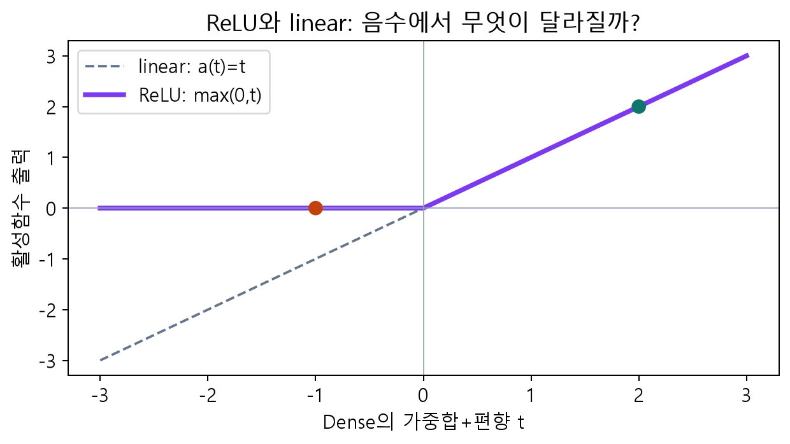

독자 함수 그래프. 입력−1에서 두 함수의 출력이 다른 이유를 말해 보세요. 여러 선형 계산 사이에 비선형 활성함수를 넣는 것이 모형이 표현할 수 있는 관계를 바꿉니다.

### E09 · 작은 MLP의 모든 중간값

E08의 길이6 입력을 사용합니다. 첫 가중치와 편향을 다음과 같이 정했습니다. 학습된 결과가 아닌 설명용 모수입니다.

$$
W_1=\begin{bmatrix}1&0\\-1&1\\.5&1\\0&1\\1&0\\0&0\end{bmatrix},
\quad b_1=[-2,0].
$$

첫 출력은 $1-1+.5+0+.5+0-2=-1$, 둘째 출력은 $0+1+1+0+0+0+0=2$입니다. 따라서 $a_1=[-1,2]$, ReLU 후 $h_1=[0,2]$입니다. 둘째 Dense를 $W_2=I,b_2=0$인 작은 예로 두면 $h_2=[0,2]$입니다. 출력 가중치 $[.5,.25]$, 편향 $.1$이면 중심화 예측은 $.5\times0+.25\times2+.1=.6$입니다. 주어진 평균1을 복원하면 평점 예측은1.6입니다.

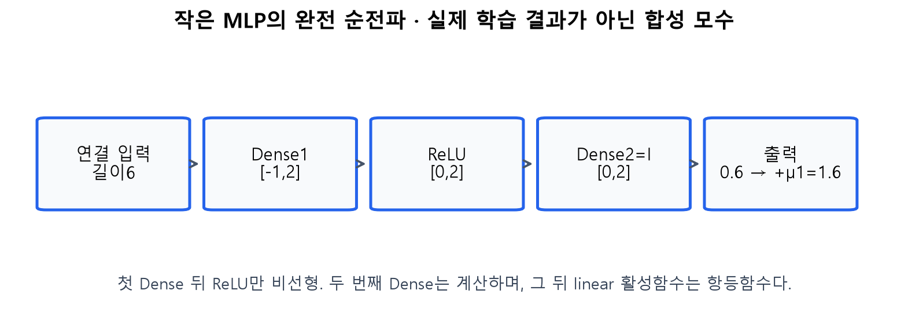

독자 수계산 도해. ReLU를 linear로 바꾸면 첫 중간값−1도 통과합니다. 출력이 어떻게 달라질지 먼저 예상한 뒤 앱에서 확인하세요. 서로 따로 학습한 두 모형의 성능 비교가 아닌, 같은 고정 모수의 순전파 비교입니다.

## 3. 작은 예와 교재 코드를 대응시키기

교재6.3의 $K=200$에서는 연결 입력 폭이402입니다. 실제 구조는 `402 → Dense2048 → ReLU → Dense256 → linear → Dense1`입니다. 두 번째 활성함수를 ReLU로 바꿔 읽지 않습니다. 수업의 짧은 학습은 $K=8$, 은닉폭16/8을 사용하며, 교재 설정은 선택 재현 셀에서 따로 다룹니다.

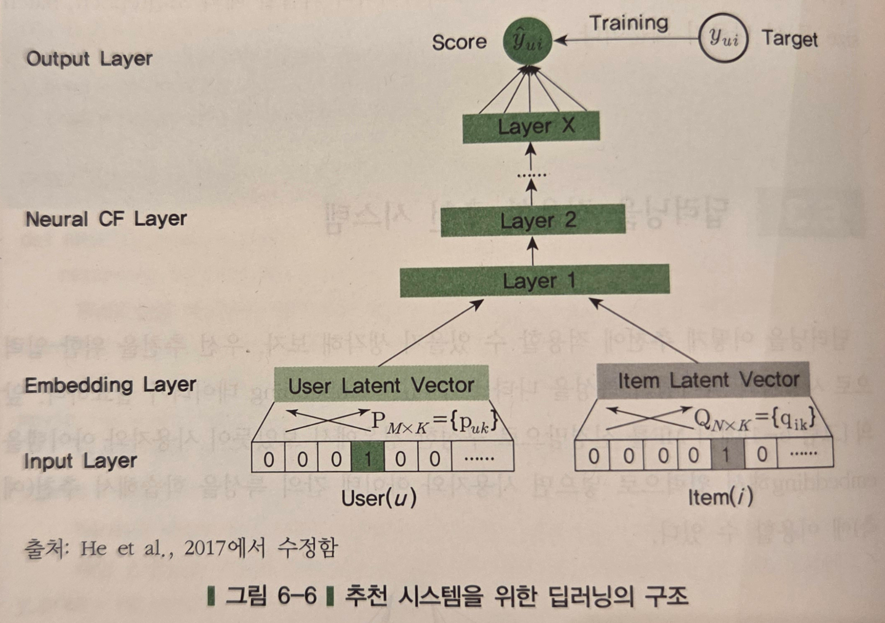

출처: 임일(2025), p.134 그림6-6 원본 선별 발췌; 교재가 He et al.(2017)에서 수정한 그림입니다. 아래 ID → 임베딩 → 신경망 층 → 예측을 읽습니다. 원논문은 암묵적 피드백의 설정을 주로 실험하며, 이 장은 평점의 MSE 회귀를 학습합니다. 두 실험 설정을 동일시하지 않습니다.

### E10 · 모수 수와 복잡도를 읽기

입력402, 출력2048인 Dense에는 $402\times2048$개의 가중치와2048개의 편향, 총 $(402+1)\times2048=825344$개가 있습니다. 다음 Dense는 $(2048+1)\times256=524544$개, 출력층은257개입니다. 임베딩528027개를 더하면 총1878172개입니다.

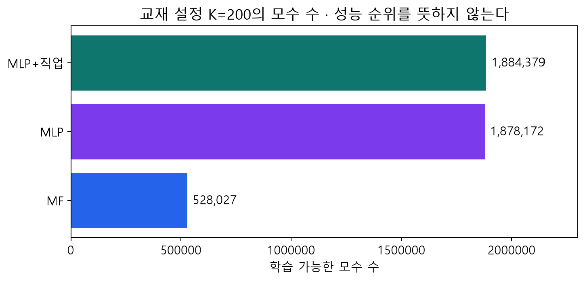

독자 검산 그래프. 모수 수는 모델의 학습 가능한 숫자 개수입니다. 학습 자료 수나 정확도와 같은 값이 아닙니다. 큰 모델은 더 다양한 관계를 표현할 수 있지만 관측되지 않은 자료의 오차가 반드시 작아지는 것은 아닙니다.

직접 확인 C03: `Concatenate`, `Dense`, `ReLU`, `Flatten` 중 학습 가능한 모수를 갖는 계산은 무엇인지 설명하세요. 워크북 L05(필수),L07(보충)을 풉니다.

공식 참고: [Dense](https://keras.io/api/layers/core_layers/dense/), [Functional API](https://keras.io/guides/functional_api/), [NCF 원논문](https://arxiv.org/abs/1708.05031).

# D · 6.4: 직업·나이 추가와 공정한 평가

> 주교재6.4(pp.141–146), 연습문제6-1까지. 추가 정보를 어디에 넣고, 어떻게 효과를 확인할지 배웁니다.

## 1. 직업을 숫자로 바꾸는 이유

직업은 범주형 변수입니다. `student=1`, `engineer=2`처럼 ID를 붙이는 것은 범주를 구별하기 위한 번호이지 크기 순서가 아닙니다. 임베딩은 그 번호의 행을 꺼내 길이3 벡터로 만듭니다. 같은 직업은 같은 임베딩 행을 공유합니다. 해당 벡터도 훈련으로 학습됩니다.

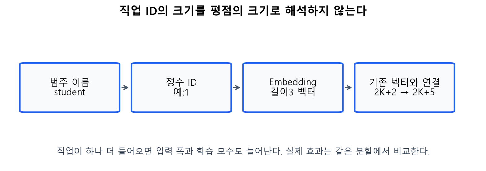

독자 도해, 교재6.4의3차원 직업 임베딩을 설명합니다. 기본 길이 $2K+2$에3개 값이 추가되므로 연결 폭은 $2K+5$입니다. $K=2$ 예는6→9, 교재의 $K=200$은402→405입니다.

### E11 · 변수 추가가 바꾸는 것

교재의 직업 표가21행×3열이면 모수63개가 추가됩니다. 첫 Dense의 입력도3개 늘어 가중치가 $3\times2048=6144$개 추가됩니다. 따라서 증가량은6207개, 전체 모수는1884379개입니다. 새 실습은 미학습 범주용 ID0을 예약하므로 실제 표 행 수는 “훈련에서 본 범주 수+1”입니다. 이 차이가 모수 수에 반영됩니다.

직업 값을 붙일 때에는 평점 행과 같은 사람의 값인지 확인해야 합니다. 두 배열 길이가 같다는 것만으로 올바르게 결합됐다고 판단할 수 없습니다.

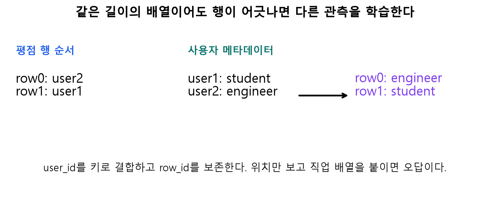

독자 합성 도해. `user_id`를 키로 `many_to_one` 결합하고 `row_id`를 보존합니다. 사용자 표를 임의로 섞어도 올바른 결합 결과는 같아야 합니다. 보충 L06에서 오류를 찾습니다.

## 2. 나이는 어떻게 넣을까? · 연습문제6-1

나이는 연속형 수치입니다. 교재의 마지막 문제는 직업을 임베딩으로 처리하면서 나이는 Dense 경로로 보내도록 안내합니다. 이번 실습은 훈련 평균·표준편차로 나이를 표준화한 뒤 Dense3+ReLU로 변환해 연결하는 설계를 제공합니다. 폭3과 ReLU는 수업에서 명시적으로 선택한 확장입니다.

### E12 · 표준화와 Dense 경로의 작은 계산

훈련 나이가20,40이면 평균30, 모집단 표준편차10입니다. 나이40의 표준화 값은 $(40-30)/10=1$입니다. 예를 들어 이 값을 두 뉴런 Dense에 넣고 가중치를 $[.5,-1]$, 편향을 $[0,.5]$로 두면 출력은 $[.5,-.5]$, ReLU 후 $[.5,0]$입니다. 실제 선택 구현은3뉴런이므로 같은 계산을 세 열로 확장합니다.

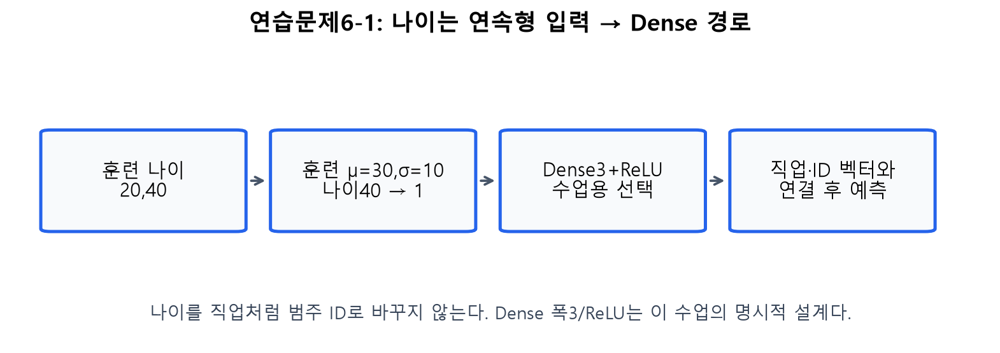

독자 도해. 검증·시험 나이로 평균/표준편차를 다시 계산하지 않습니다. 표준화 후에도 나이는 연속형 값이며 ID 번호가 아닙니다. 보충 L09에서 다른 나이로 계산합니다.

## 3. 모형의 효과를 어떻게 확인할까?

훈련(train)은 모수를 맞추는 자료, 검증(validation)은 학습 횟수·설정을 고르는 자료, 시험(test)은 선택이 끝난 후 평가하는 자료입니다. 이번 실습은 관측 행을70/15/15로 고정 분할합니다. 같은 분할에서 평균 기준모형, MF, MLP, 직업 추가 MLP를 비교합니다.

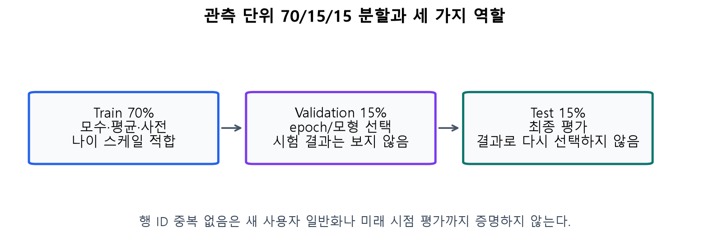

독자 실험 설계 도해. 평균·ID 사전·나이 스케일은 훈련 자료에서만 만듭니다. 검증 RMSE로 epoch를 고르고 그때의 가중치를 복원합니다. 미학습 ID의 건수를 표시하고 훈련 평균으로 예측하며, 학습된 ID 결과와 전체 결과를 구분합니다. 관측 단위 분할은 미래 시점 평가나 신규 사용자 평가와 다릅니다.

$$
\operatorname{MSE}=\frac1T\sum_{t=1}^{T}(r_t-\hat r_t)^2,
\qquad \operatorname{RMSE}=\sqrt{\operatorname{MSE}}.
$$

$T$는 평가 관측 수입니다. 실제 평점이 $[2,4]$, 예측이 $[1,3]$이면 오차는 $[1,1]$, MSE는1, RMSE도1입니다. 정답이 `(B,)`, 예측이 `(B,1)`이면 NumPy가 자동으로 `(B,B)`로 확장할 수 있으므로 두 배열을 명시적으로1차원으로 맞춘 후 검사합니다. L07에서 새 숫자로 확인하세요.

## 4. 학습 곡선을 읽는 순서

가로축은 에포크, 세로축은 RMSE입니다. 파란 선은 훈련, 주황 선은 검증입니다. 훈련 오차가 계속 줄어도 검증 오차가 다시 커지면 학습 자료에 지나치게 맞추는 과적합을 의심할 수 있습니다. 최적 epoch는 검증 선에서 선택합니다.

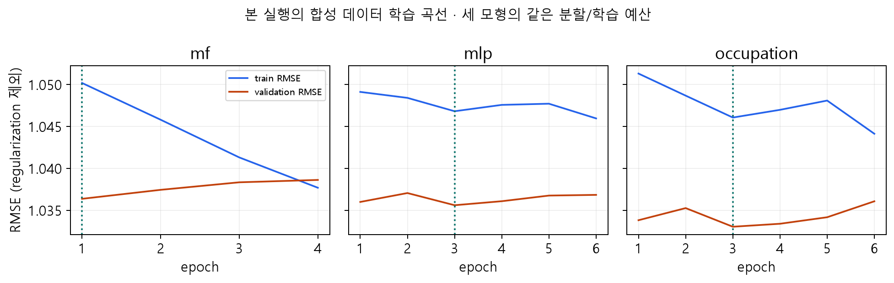

위 그림은 이번 소형 합성 데이터 실행에서 얻은 실제 곡선입니다. 설정은 $K=8$, 은닉폭16/8, SGD 학습률0.05·모멘텀0.7, 최대8에포크, 배치128, 시드20261103입니다. 세 모형은 같은 분할을 사용합니다. 직업 모형은 모수 수도 늘어나므로 단순한 변수 추가만의 인과 효과로 해석하지 않습니다. 구체적 결과와 데이터 모드는 Colab의 실행 표에서 다시 확인하세요.

교재 p.140 그림6-7과 p.146 그림6-8에서도 해당 실행에서 깊은 모형·직업 추가의 성능 향상이 뚜렷하지 않았습니다. “복잡하므로 더 좋다”를 결론으로 정하지 말고, 기준모형·검증/시험의 역할·변동·모수 수를 함께 읽습니다. 워크북 L08에서 곡선과 선택을 연습합니다.

## 5. Colab에서 앱까지

Colab A는 FM 계산 → 같은 고정 가중치의 Keras MF → 작은 실제 학습을 확인합니다. B는 데이터 준비부터 독립 실행하여 MF/MLP/직업 모형을 비교하고 누적 앱을 조립합니다. 실제 MovieLens 모드는 공식 다운로드/캐시를 사용하며, 합성 결과를 실제 MovieLens 결과로 부르지 않습니다.

마지막 앱에서는 FM 복습 기능을 유지하고 MF/MLP의 입력·가중합·활성함수·출력을 연결합니다. 입력 변경은 고정된 모수의 순전파입니다. 실제 학습은 앞선 `fit_neural` 실행입니다. 위젯 → `button.click`의 인자 → 계산 함수 → 표의 순서를 따라 자신의 출력 문구를 수정하세요. 필수 L10의 목표입니다. 공유 주소는 실행 중인 런타임에 의존합니다.

직접 확인 C04: 같은 검증 분할에서 직업 모형의 오차가 더 크다면 어떤 결론을 쓸 수 있을까요? 변수 유무 외에 함께 바뀐 조건을 구별해 설명하세요.

참고: [MovieLens100K 원출처·이용조건](https://files.grouplens.org/datasets/movielens/ml-100k-README.txt). 원데이터는 저장소·Notion ZIP에 재배포하지 않습니다.

## 이번 CPU 실행의 결과 표

합성 데이터80명·18편·960평점, 관측70/15/15분할의 결과입니다. 실제 MovieLens 결과와 구별합니다.

| 모형 | 검증RMSE | 최종시험RMSE | 선택epoch | 모수 수 |
|---|---:|---:|---:|---:|
| mf | 1.0364 | 1.0235 | 1 | 900 |
| mlp | 1.0356 | 1.0128 | 3 | 1,349 |
| occupation | 1.0330 | 1.0143 | 3 | 1,412 |
| 훈련평균 기준모형 | 1.0362 | 1.0208 | 해당 없음 | 평균1개 |

검증 결과로 설정을 선택하고 시험 결과로 다시 선택하지 않습니다. 한 시드의 소형 실험이며 일반적인 우열을 증명하지 않습니다.

## 점검 퀴즈

1. FM의 입력 특성 열 번호와 사용자·영화 번호는 어떻게 다른가요?
2. 활성 특성3개와 잠재폭2일 때 활성 쌍 수와 각 내적 길이는 얼마인가요?
3. 원핫 벡터와 임베딩 조회가 같은 결과를 주는 이유는 무엇인가요?
4. MF 모델에서 중심화한 목표와 최종 평점 예측은 어떻게 연결되나요?
5. 배치 크기 B와 사용자 표 행 수 M을 구별해 설명하세요.
6. 내적과 Concatenate의 출력 차이는 무엇인가요?
7. Dense 뒤의 linear 활성함수는 Dense 층 전체를 없애도 된다는 뜻인가요?
8. 직업 임베딩3차원을 추가하면 연결 입력 폭은 어떻게 변하나요?
9. 검증 자료와 시험 자료는 각각 무엇을 위해 사용하나요?
10. 추가 변수나 더 깊은 모형이 항상 RMSE를 개선하나요?

## 핵심 정리

FM은 특성 쌍의 내적으로 관계를 표현하고 MF는 사용자·영화만 남긴 특별한 경우와 연결됩니다. Keras MF는 같은 계산을 층으로 표현합니다. MLP는 연결된 벡터를 가중합과 활성함수로 처리합니다. 직업과 나이는 자료형에 맞는 경로로 넣고, 효과는 분리된 자료와 기준모형으로 확인합니다.

## 참고자료

- 임일(2025), 『AI 에이전트를 위한 개인화 추천 알고리즘』, 청람,5.1–5.4(pp.96–103),6.1–6.4 및 연습6-1(pp.120–146).
- [Keras Embedding](https://keras.io/api/layers/core_layers/embedding/), [Dense](https://keras.io/api/layers/core_layers/dense/), [Dot](https://keras.io/api/layers/merging_layers/dot/), [Functional API](https://keras.io/guides/functional_api/).
- [He et al.(2017), Neural Collaborative Filtering](https://arxiv.org/abs/1708.05031).
- [Dive into Deep Learning, Factorization Machines](https://d2l.ai/chapter_recommender-systems/fm.html).
- [GroupLens MovieLens100K README](https://files.grouplens.org/datasets/movielens/ml-100k-README.txt).
