# W10B · 오토인코더 추천을 한 칸씩 이해하기

> 딥러닝응용I(추천시스템) · 동덕여자대학교 데이터사이언스전공 · 유원상 교수 · 2026-2 · 2026-11-05

주교재 7장 전체를 공부합니다. 7.1의 압축과 복원에서 시작해 7.2의 데이터 준비·학습·마스킹·평가를 연결하고, 사용자 기준과 아이템 기준을 비교하는 연습문제 7-1까지 다룹니다.

**평점표의 어떤 숫자가 입력이고, 어떤 칸에서 오차를 계산하는지 직접 가리킬 수 있는 것**이 이번 수업의 출발점입니다. 각 개념에서 쉬운 말 → 그림 → 작은 계산 → 수식 → 코드 → 조건 변경 순서로 확인하세요. 처음에는 예제의 모든 중간값을 읽고, 이어지는 워크북에서는 숫자나 조건을 바꾸어 독립적으로 계산합니다.

- [계산 워크북: 핵심4개와 추가 반복4개](../supplements/w10b-workbook.md)
- [실습 API 길잡이](../supplements/w10b-api-guide.md)
- [선수 복습: MF와 Keras의 학습 대상](../supplements/w10a-mf-keras-explained.md)

설명용 작은 숫자와 고정 모수는 독자적으로 만든 자료입니다. 교재가 보고한 성능과 이번 실제 실행 결과는 출처를 구별해 표시합니다. 새 제출 과제나 마감은 없습니다.

# A · 7.1: 작은 평점표에서 압축과 복원 이해하기

## 1. 지난 MF와 이번 AE는 무엇을 입력할까?

MF에서는 사용자 ID와 영화 ID로 숫자표의 행을 꺼내 내적과 편향을 계산했습니다. 오토인코더(AutoEncoder, AE)는 **사용자 한 명의 영화별 평점 벡터**를 입력받아 같은 길이의 벡터를 출력합니다. 출력의 각 위치는 원래와 같은 영화에 대응합니다.

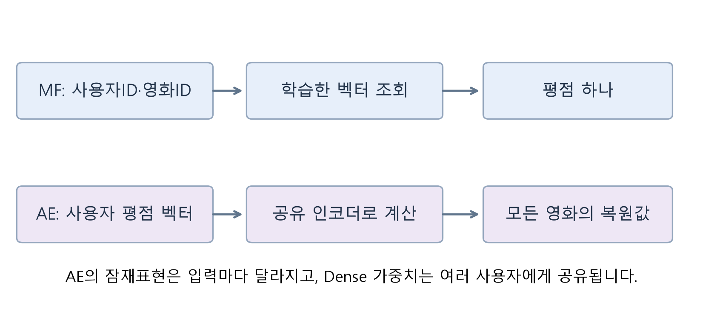

독자 설명 도해입니다. 위쪽은 ID → 벡터 조회 → 평점 하나, 아래쪽은 평점 벡터 → 공유 인코더 → 여러 영화의 복원값 순서로 읽으세요. AE에서는 입력에 따라 잠재표현이 계산됩니다. 사용자마다 독립된 잠재벡터 표를 조회하는 MF의 방식과 연결해서 구별하세요.

벡터는 숫자를 순서대로 나열한 것입니다. 차원은 그 벡터에 들어 있는 숫자의 개수입니다. 영화4편의 평점을 한 명씩 입력하면 입력 벡터의 길이는4입니다. 평점표의 빈칸은 아직 평가를 모르는 곳입니다.

## 2. E01 · 표에서 사용자 한 명의 벡터 꺼내기

다음은 독자 합성 평점표입니다. A–D는 가상의 사용자, P–S는 가상의 영화입니다. 숫자는1–5 평점이고 빈칸은 미관측입니다.

| 사용자 | P | Q | R | S |
|---|---:|---:|---:|---:|
| A | 5 | 빈칸 | 3 | 1 |
| B | 4 | 2 | 빈칸 | 3 |
| C | 빈칸 | 5 | 3 | 1 |
| D | 1 | 3 | 5 | 빈칸 |

관측된 평점12개의 합은36이므로 이 설명용 표의 평균은3입니다. 먼저 A의 행을 꺼내면 `[5, 빈칸,3,1]`입니다. 관측된 칸에서 평균3을 빼고, 빈칸은 입력용0으로 채웁니다.

$$
\boldsymbol{x}_A=[5-3,\ 0,\ 3-3,\ 1-3]=[2,0,0,-2].
$$

이때 관측 여부도 따로 남깁니다.

$$
\boldsymbol{m}_A=[1,0,1,1].
$$

둘째 칸의0은 미관측 자리표시자이고, 셋째 칸의0은 실제3점에서 평균3을 뺀 결과입니다. 값은 같아도 의미는 다릅니다. 관측 여부는 평균을 빼기 **전에** 기록합니다.

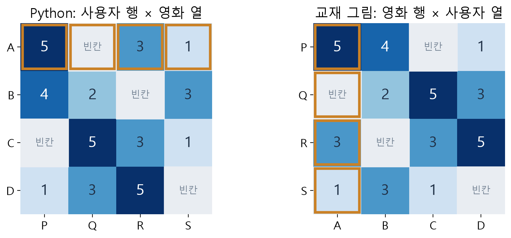

독자 도해입니다. 주교재p.149 그림7-1에서는 사용자 한 명이 세로 열이고, Python 구현에서는 사용자 한 명이 가로 행입니다. 주황색 테두리의 A를 따라가면 두 표현이 같은 데이터를 나타냄을 확인할 수 있습니다. 이 수업의 코드는 사용자 행×영화 열로 통일합니다.

직접 확인 C01: A의 입력과 관측 마스크를 각각 쓰고, 두 개의0이 어떻게 다른지 설명하세요. 워크북 L01로 숫자를 바꾸어 계산합니다.

## 3. 인코더·잠재표현·디코더를 처음부터 읽기

인코더(encoder)는 긴 입력을 더 짧은 표현으로 계산하는 부분입니다. 잠재표현(latent representation)은 그 중간의 숫자 벡터입니다. 디코더(decoder)는 이 표현을 받아 원래 입력과 같은 크기의 출력을 계산합니다. 원래 입력을 다시 나타내는 출력을 복원 또는 재구성(reconstruction)이라고 부릅니다.

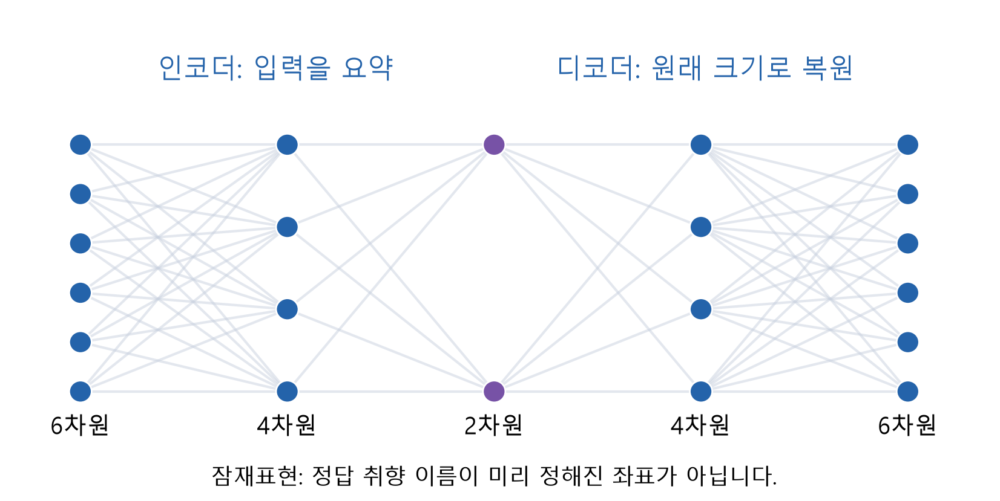

주교재pp.148–149 그림7-1의6→4→2→4→6 구조를 독자적으로 재구성했습니다. 왼쪽 → 가운데의 두 숫자 → 오른쪽 순서로 읽으세요. 특정 가중치의 실제 순전파를 나타낸 그림은 아닙니다.

가운데가 좁은 부분을 병목(bottleneck)이라고 부릅니다. 많은 평점을 적은 숫자로 표현하도록 제약하면 여러 입력에서 공통으로 나타나는 패턴을 배울 수 있습니다. **병목이 있다는 사실만으로 정확한 추천이나 과적합 방지가 보장되지는 않습니다.** 어떤 데이터와 목적함수로 학습하고, 보류한 관측에서 잘 작동하는지 확인해야 합니다.

잠재좌표 두 개를 곧바로 ‘액션 취향’과 ‘로맨스 취향’이라고 부르지 않습니다. 이 좌표는 평점을 잘 복원하도록 함께 학습되는 숫자이며, 의미를 해석하려면 별도의 근거가 필요합니다.

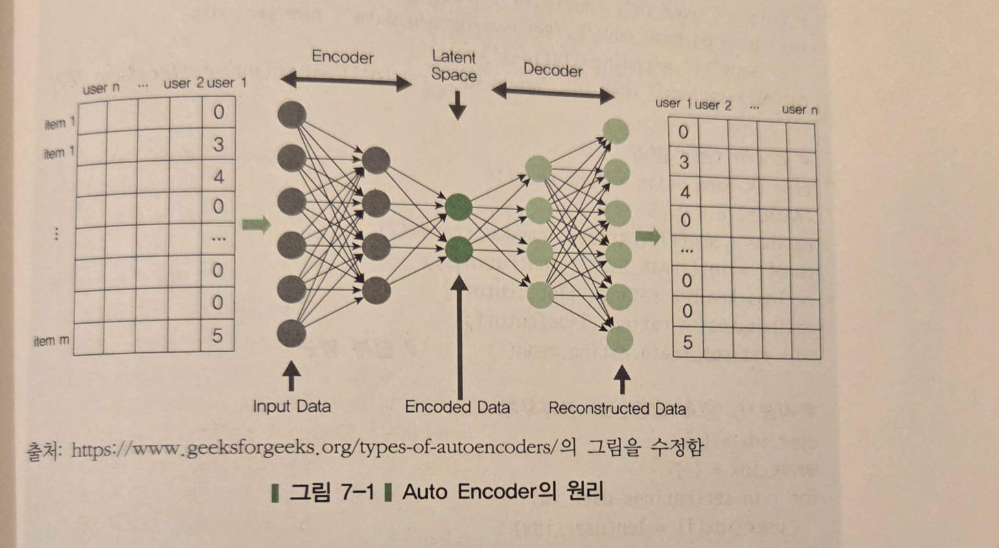

출처: 임일(2025), 『AI 에이전트를 위한 개인화 추천 알고리즘』, p.149 그림7-1 **원본 선별 발췌**. 교재는 GeeksforGeeks의 types-of-autoencoders 그림을 수정했다고 밝힙니다. 전체 페이지 스캔을 배포하는 자료가 아닙니다. 사용자 한 열 → 인코더 → 잠재공간 → 디코더 순서로 읽고, 위 독자 도해와 축을 대응시키세요.

## 4. E02 · Dense와tanh를 숫자로 계산하기

Dense 층은 각 입력에 가중치를 곱해 더하고 편향을 더합니다. 활성함수는 그 합을 다음 값으로 바꾸는 규칙입니다. 이번 작은 모형은 `4→2(tanh)→4(linear)`입니다. 교재의 다층 모형을 계산 연습을 위해 줄인 **한 은닉층 설명 모형**입니다.

행 벡터 관례를 사용합니다. 입력은길이4, 인코더 가중치 $V$는4×2, 잠재표현은길이2, 디코더 가중치 $W$는2×4입니다. 편향은 모두0으로 주어집니다.

$$
V=\begin{bmatrix}.5&0\\0&.5\\.5&.5\\0&.5\end{bmatrix},
\qquad W=\begin{bmatrix}1&.5&0&-1\\0&.5&1&0\end{bmatrix}.
$$

인코더의 첫 가중합은 다음과 같습니다.

$$
a_1=2(.5)+0(0)+0(.5)+(-2)(0)+0=1.
$$

둘째 가중합은 다음과 같습니다.

$$
a_2=2(0)+0(.5)+0(.5)+(-2)(.5)+0=-1.
$$

쌍곡탄젠트인tanh는 가중합을−1과1 사이의 활성값으로 바꿉니다. 값표나 계산기를 사용해도 됩니다.

$$
\tanh(a)=\frac{e^a-e^{-a}}{e^a+e^{-a}},\qquad
\boldsymbol{z}=\tanh([1,-1])\approx[.761594,-.761594].
$$

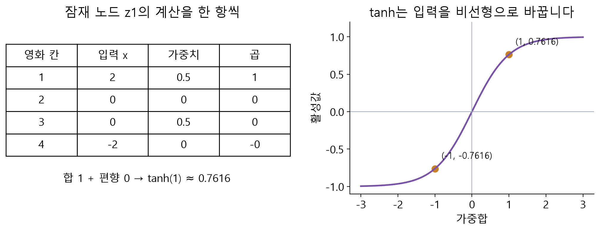

독자 고정 모수 예제입니다. 왼쪽에서 첫 노드의 곱 네 개를 더하고, 오른쪽 곡선에서 합1이 약.7616으로 바뀌는 위치를 찾으세요. 둘째 노드에는 합−1을 넣습니다.

디코더는 같은 위치의 잠재값과 가중치를 곱해 더합니다. $t=\tanh(1)$이라고 줄여 쓰면 다음과 같습니다.

$$
\widehat{\boldsymbol{x}}=\boldsymbol{z}W
=[t,\ .5t+.5(-t),\ -t,\ -t]=[t,0,-t,-t].
$$

즉 중심화 출력은 약 `[.761594,0,−.761594,−.761594]`입니다. 아직 평균을 더하지 않았습니다. 여기까지가 입력에서 출력으로 값을 계산하는 순전파(forward pass)이며, 가중치를 학습한 것은 아닙니다.

## 5. E03 · 평균 복원과 배열 크기 확인하기

원래 평점 척도로 돌아오려면 훈련 평균3을 **한 번** 더합니다.

$$
\widehat{\boldsymbol{r}}_A=\widehat{\boldsymbol{x}}_A+3
\approx[3.761594,3,2.238406,2.238406].
$$

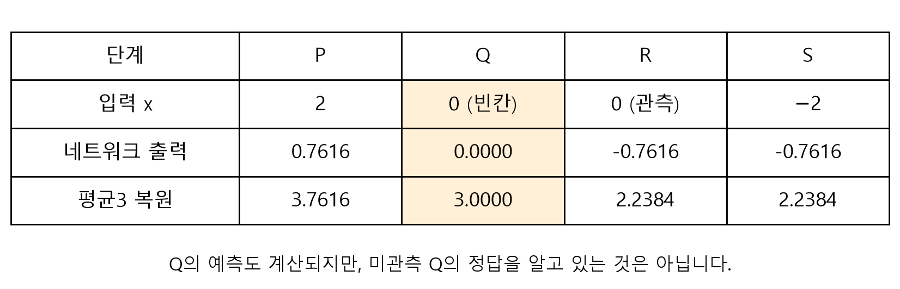

독자 수계산 결과입니다. 위 → 아래로 같은 영화 열을 따라가세요. Q에도 예측3점이 생기지만, Q의 실제 평점은 여전히 모릅니다. 계산할 수 있다는 사실과 예측이 정확하다는 사실은 다릅니다.

| 기호/코드 | 뜻 | 크기 |
|---|---|---|
| $N$ | 전체 사용자 수 | 이 작은 표에서는4 |
| $M$ | 영화 수, 사용자AE의 입력폭 | 이 작은 표에서는4 |
| $B$ | 한 번에 계산하는 사용자 수 | 한 명이면1 |
| $K$ | 작은 모형의 잠재차원 | 2 |
| 입력 | 사용자 평점 벡터 묶음 | $(B, M)$ |
| $V$, 인코더 편향 | 학습 가능한 숫자 | $(M, K)$와$(K,)$ |
| 잠재표현 | 인코더의 출력 | $(B, K)$ |
| $W$, 디코더 편향 | 학습 가능한 숫자 | $(K, M)$와$(M,)$ |
| 복원 출력 | 영화별 중심화 점수 | $(B, M)$ |

작은 모형의 학습 가능한 숫자는 $4\times2+2+2\times4+4=22$개입니다. 입력4개나 배치 수와 모수 수는 다릅니다. 인코더·디코더 가중치는 여러 사용자 입력에 **공유**됩니다. 입력이 달라지면 같은 가중치로 다른 잠재표현을 계산합니다.

실습 A에서는 `fixed_ae_forward()`의NumPy 결과와 `build_fixed_autoencoder()`의Keras 결과를 같은 고정 모수로 비교합니다. `build_fixed_autoencoder`는 구조와 숫자를 만드는 함수이고, 모델을 호출하는 것은 예측입니다.

```python
trace = fixed_ae_forward()
model = build_fixed_autoencoder()
centered = model(trace['input'][None, :], training=False)
rating = centered.numpy() + trace['mean']
```

직접 확인 C02: E02의 두 가중합을 가리고 다시 계산하세요. 워크북 L02는 입력을 바꿉니다. L03에서는 평균 복원과 모수 수를 다시 확인합니다.

# B · 7.2: 어떤 칸에서 오차를 계산할까?

## 1. 데이터 준비를 그림과 코드로 연결하기

원자료 한 행은 `(사용자ID, 영화ID, 평점)` 관측입니다. 이를 사용자 행×영화 열의 행렬로 바꿉니다. 코드의0번 행은 첫 사용자 위치이고, 행렬 값0은 중심화 값이나 빈칸 채움 값일 수 있습니다. **행 번호0과 평점값0, 관측 여부0은 서로 다른 개념**입니다.

성능을 평가할 때는 관측을 먼저 훈련·검증·시험으로 나눕니다. 훈련 평균은 훈련 관측에서만 구합니다. 원래 표를 입력한 뒤 그 표에서 시험 평점을 골라 평가하면 입력에 정답이 섞일 수 있으므로, 입력에는 훈련 관측만 남깁니다.

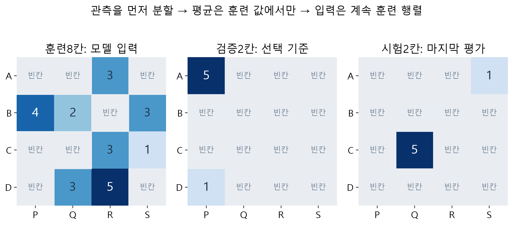

독자 설명용 분할입니다. 왼쪽의 훈련 평점만 평균을 빼서 모델 입력에 넣습니다. 검증·시험 칸은 비교할 정답으로 보관합니다. 실제 실습 B의 MovieLens는 관측 단위70/15/15로 분할하며, 그림의8/2/2와 구별하세요.

이 그림에서 A의 훈련 관측은 R의3점 하나입니다. 훈련 평균도3이므로 A의 입력은 `[0,0,0,0]`이지만, 관측 마스크는 `[0,0,1,0]`입니다. 입력이 전부0이라고 해서 관측이 하나도 없다는 뜻은 아닙니다.

코드에서 하는 일은 다음 세 가지로 나누어 읽습니다.

```python
# 관측 여부를 먼저 기록합니다.
train_mask[user_index, movie_index] = True

# 관측 칸에서만 훈련 평균을 뺍니다.
train_values[user_index, movie_index] = rating - training_mean

# 나머지 칸은 입력용0으로 둡니다.
```

평점값에서 관측 여부를 다시 추측하지 않는 것이 핵심입니다. 이번 공통 API의 `values['train']`은 입력, `masks['train']`은 훈련 오차에 사용할 칸입니다. 검증·시험에도 별도의 관측 마스크가 있습니다.

## 2. E04 · 네 칸의 오차를 한 칸씩 구하기

오차는 예측과 정답의 차이입니다. MSE는 오차를 제곱해 평균 낸 것이고, RMSE는 그 제곱근입니다. 어떤 칸을 평균에 넣는지가 먼저 정해져야 합니다.

여기서는 **오차 계산만 따로 보기 위해 주어진 예측값**을 사용합니다. A절의 고정 모형이 출력한 값과 다른 설명용 예측입니다. 입력과 관측 마스크는 같은 A의 행입니다.

| 영화 | 중심화 정답 $x_i$ | 주어진 예측 $\hat x_i$ | 제곱오차 | 관측 $m_i$ |
|---|---:|---:|---:|---:|
| P | 2 | 1 | $(2-1)^2=1$ | 1 |
| Q | 0:빈칸 채움 | .4 | $.16$:비교할 실제 정답 아님 | 0 |
| R | 0:관측3점의 중심화 | 2 | $(0-2)^2=4$ | 1 |
| S | −2 | −1 | $(-2+1)^2=1$ | 1 |

실제 관측 P·R·S만 선택하면 제곱오차 합은 $1+4+1=6$, 관측 수는3입니다.

$$
\operatorname{MSE}_{\mathrm{obs}}=\frac{6}{3}=2,\qquad
\operatorname{RMSE}_{\mathrm{obs}}=\sqrt{2}\approx1.414214.
$$

빈칸까지 네 칸 모두 사용하면 다음처럼 다른 양을 계산합니다.

$$
\operatorname{RMSE}_{\mathrm{all}}=
\sqrt{\frac{1+.16+4+1}{4}}=\sqrt{1.54}\approx1.240967.
$$

두 값의 차이는 모형이 달라져서 생긴 것이 아닙니다. **비교할 항과 분모가 달라졌기 때문**입니다. 빈칸의 채움 값0을 실제 정답처럼 취급하면 추천하려는 미관측 평점의 정확도를 직접 측정한 것이 아닙니다.

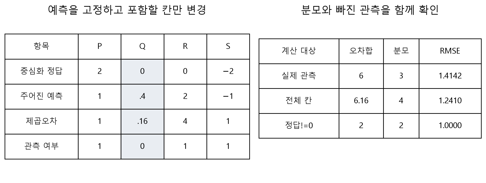

독자 수계산 예제입니다. 왼쪽에서 Q가 빠지는 이유와 R이 남는 이유를 말한 뒤 오른쪽의 분모3을 확인하세요. 전체 칸 RMSE가 항상 더 작아지는 것은 아닙니다. Q의 주어진 예측을4로 바꾸면 전체 칸의 오차가 커집니다. 워크북 L04에서 확인합니다.

전체 관측을 수식으로 쓰면 다음과 같습니다. $m_{ui}=1$인 칸만 오차에 포함합니다.

$$
\operatorname{RMSE}_{\mathrm{obs}}=
\sqrt{\frac{\sum_{u=1}^{N}\sum_{i=1}^{M}m_{ui}(r_{ui}-\hat r_{ui})^2}
{\sum_{u=1}^{N}\sum_{i=1}^{M}m_{ui}}}.
$$

분자의 합은 관측된 제곱오차의 합, 분모는 관측 수입니다. 같은 평균을 뺀 정답과 예측을 비교해도 $(r-\mu)-(\hat r-\mu)=r-\hat r$이므로 오차는 같습니다.

## 3. E05 · 왜 ‘0이 아닌 값’만 고르면 충분하지 않을까?

교재의 두 번째 코드는 `y_true != 0`으로 항을 선택합니다. 이번 작은 예에서 이를 그대로 적용하면 중심화 정답 `[2,0,0,−2]` 중 P와S만 남습니다. 실제 관측인 R도 빠집니다.

$$
\sqrt{\frac{1+1}{2}}=1.
$$

이것은 관측 RMSE1.414214와 다릅니다. R의 원래 평점은3점이었고, 평균과 같아서 중심화 후 0이 되었을 뿐입니다. 실제 MovieLens에서 훈련 평균이 비정수이면 이 반례가 드러나지 않을 수 있지만, 관측 여부를 값으로 정의하는 일반 규칙으로 삼을 수는 없습니다.

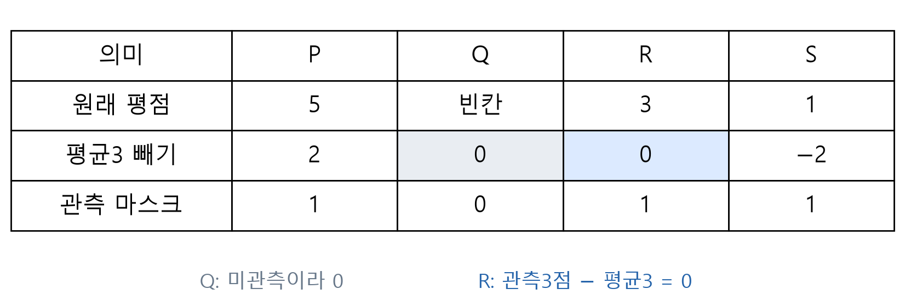

독자 도해입니다. Q와R의 숫자0을 비교하고 마지막 행의 마스크를 읽으세요. 색과 함께 ‘빈칸/관측’ 표시로 의미를 구별했습니다.

이번 실습은 미리 보존한 관측 마스크를 사용합니다. 아래 코드는 기본 원리를 보여 주는 NumPy 표현입니다.

```python
error = prediction[observed] - target[observed]
mse = np.sum(error ** 2) / np.sum(observed)
rmse = np.sqrt(mse)
```

관측 수가0이면 RMSE를 계산했다고 표시하지 않습니다. 또한 Keras의 `Masking` 층은 시퀀스의 시점 마스크를 위한 기능이며, 이 평점 행렬의 **셀별 관측 손실 마스크를 자동으로 만들어 주는 기능과 구별**해야 합니다. 이번 코드는 관측 배열과 손실 계산을 명시적으로 연결합니다. 이 부분은 현재 공식 API와 작은 반례를 바탕으로 추가한 구현 설명입니다.

## 4. 교재 그림7-2~7-4의 결과를 읽는 순서

| 교재 위치 | 교재가 제시한 값 | 읽을 때 확인할 것 |
|---|---:|---|
| p.154 그림7-2 | `val_rmse` 약.1770 | 빈칸0을 포함한 전체 칸 계산 |
| p.155 그림7-3 | 관측을 선택한 값 약.9204 | 앞과 계산 대상이 달라짐 |
| p.156 그림7-4 | 별도 좌표 평가 약.9206 | 실제 시험 관측에서 다시 계산 |

이 숫자는 **교재의 실행 보고값**입니다. 이번 소형 모델을 실행해서 얻은 값이 아닙니다. .1770이 .9204보다 작다고 첫 모델이 더 좋다고 결론내리지 않습니다. 먼저 무엇을 몇 개의 관측으로 계산했는지 확인해야 합니다.

실제 100K의 사용자943명×영화1682편은1,586,126칸입니다. 교재의75/25 분할에서 시험 관측은25,000개입니다. 관측25,000개와 전체1,586,126칸을 분모로 쓰는 계산은 다른 대상을 평가합니다.

직접 확인 C03: R의 오차4를 반드시 포함해야 하는 이유를 한 문장으로 설명하세요. 워크북 L04와L05는 분모와 마스크를 바꾸어 봅니다.

# C · 7.2: Keras 모형에서 학습과 평가 연결하기

## 1. 교재 그림과 실제 코드의 층 크기는 다릅니다

교재 그림7-1의6→4→2→4→6은 원리 그림입니다. 실제 코드의 입력폭은 영화 수 $M$이고, 은닉폭은2048·1024·2048입니다. MovieLens 100K에서는 다음 구조가 됩니다.

$$
1682\longrightarrow2048\longrightarrow1024\longrightarrow2048\longrightarrow1682.
$$

첫 은닉층2048은 입력1682보다 큽니다. 모든 층에서 차원이 줄어드는 구조가 아닙니다. 가운데1024차원이 입력보다 작은 병목입니다. 앞부분tanh가 있으므로 가운데 활성함수가linear라는 사실만으로 모형 전체가 선형이 되는 것도 아닙니다.

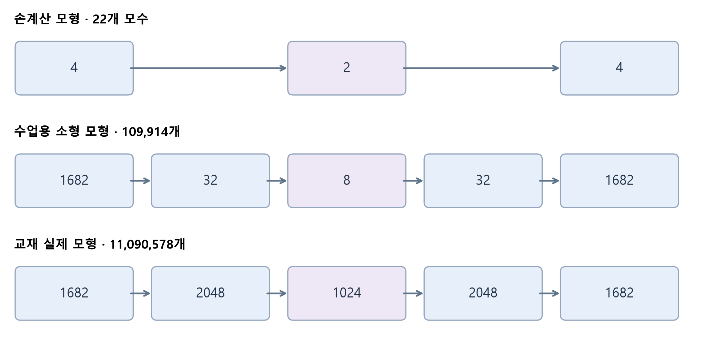

독자 차원 계산 도해입니다. 위에서부터 서로 다른 모형입니다. 네트워크 그림의 도형 너비는 실제 노드 수의 축척이 아닙니다. 숫자와 설명을 읽으세요. 실습 A의22개 모수와 교재 약1,109만개 모수를 혼동하지 않습니다.

수업의 실제 자료 실습은 CPU에서 짧게 실행하기 위해 `M→32→8→32→M`을 기본으로 사용합니다. 교재와 같은 인코더·병목·디코더의 흐름을 가지지만 은닉폭과 학습 설정이 달라집니다. 사용자 기준 소형 모형의 모수 수는109,914개입니다.

| 항목 | 교재 원형 | 수업 기본 실제 자료 실험 |
|---|---|---|
| 은닉폭 | 2048,1024,2048 | 32,8,32 |
| 활성함수 | tanh, linear, tanh, linear출력 | 같은 순서 |
| L1 대상 | 두 번째Dense의kernel | 같은 위치 |
| L1 계수 | .003 | .0003 |
| optimizer | Adamax, 학습률.001 | Adamax, 학습률.001 |
| 학습 목적 | RMSE+L1 | 관측 MSE+L1 |
| 분할 | 75/25, 시험표를validation에도 사용 | 70/15/15, 검증과 시험 분리 |
| 최대 epoch | 첫 코드30, 수정 코드65 | 기본8, 검증 기준 조기 종료 가능 |

위 표의 오른쪽은 **수업을 위한 구현 선택**입니다. 교재 수치를 그대로 재현하는 실험으로 부르지 않습니다. RMSE 목적을 살펴보는 선택 경로는 `sqrt(관측 MSE+1e-8)+L1`이며, 작은 안정화 상수를 추가했다는 점도 표시합니다. 보고하는 RMSE는 안정화 상수를 더하지 않은 정확한 관측 오차입니다.

## 2. 코드 한 줄마다 수학의 역할 찾기

`build_autoencoder`는 다음 계산을 Keras로 조립합니다. 활성함수를Dense 안에 쓰는 표기는 교재의 `Dense` 다음 `Activation` 표기와 계산을 대응시킬 수 있습니다.

```python
inputs = keras.Input((M,))
h1 = keras.layers.Dense(32, activation='tanh')(inputs)
z = keras.layers.Dense(8, activation='linear',
    kernel_regularizer=keras.regularizers.L1(.0003))(h1)
h2 = keras.layers.Dense(32, activation='tanh')(z)
outputs = keras.layers.Dense(M)(h2)  # 기본linear
model = keras.Model(inputs, outputs)
```

`Input((M,))`에는 배치 축을 쓰지 않습니다. 실행할 때 입력이 `(B, M)`이 됩니다. `Dense(M)` 출력은 `(B, M)`이고, 각 위치의 의미는 처음과 같은 영화입니다. `build_autoencoder`를 호출한 시점에는 모수 초기값이 만들어질 뿐 학습은 시작되지 않습니다.

교재의 `fit(x=train_data, y=train_data)`는 같은 형태의 자료를 복원하도록 학습한다는 뜻입니다. 추천에서는 관측 마스크로 오차를 선택합니다. 이번 API는 그 과정을 읽을 수 있도록 훈련 입력·관측 마스크·목적함수·optimizer 갱신을 명시적으로 연결합니다. `fit_autoencoder`가 실제 학습을 수행합니다.

```python
data = prepare_autoencoder_data(prepared, seed=20261105)
fitted = fit_autoencoder(data, direction='user', epochs=8)
prediction = predict_autoencoder(fitted, data)
metric = evaluate_autoencoder(data, prediction, split='test')
```

각 함수의 입력·반환값·부작용은 API 길잡이에서 확인하세요. `predict_autoencoder`는 훈련 입력만 읽어 예측하고 평균을 한 번 복원합니다. 예측 호출이 가중치를 학습시키는 것은 아닙니다.

## 3. E06 · 가중치 한 개가 바뀌는 모습을 계산하기

순전파 다음에는 예측 오차를 줄이는 방향으로 모수를 조정합니다. 원리를 분리하기 위해 A절의 작은 모형에서 **디코더의첫 가중치 $w=W_{11}$만** 바꾸고 다른 가중치와잠재값은 고정하겠습니다. 정규화는0, 방법은모멘텀 없는SGD입니다. 교재의Adamax 한 번 갱신과 같은 알고리즘은 아닙니다.

현재 $t=\tanh(1)\approx.761594$, $w=1$이고 P의 중심화 예측은 $tw$입니다. 관측된 P·R·S의 MSE를 $L$이라고 하면 다음과 같습니다.

$$
L(w)=\frac{(tw-2)^2+(-t-0)^2+(-t+2)^2}{3}.
$$

이 식에서 $w$가 들어 있는 것은 첫 항뿐입니다. 안쪽 $tw-2$를 $w$로 미분하면 $t$이고, 제곱을 미분하면 $2(tw-2)$가 됩니다.

$$
\frac{\partial L}{\partial w}=\frac{2}{3}(tw-2)t
\approx-0.628775.
$$

학습률을 $.1$로 두면 다음과 같이 갱신합니다.

$$
w_{\mathrm{new}}=w-.1\frac{\partial L}{\partial w}
=1-.1(-.628775)\approx1.062878.
$$

| 확인할 값 | 갱신 전 | 한 가중치만 갱신한 뒤 |
|---|---:|---:|
| P의 중심화 예측 | .761594 | .809481 |
| 관측 MSE | 1.215775 | 1.177003 |

음의 기울기이므로 $w$를 조금 증가시켰고, 이번에는 오차가 줄었습니다. TensorFlow 자동미분으로도 같은 기울기를 확인했습니다. 실제 전체 신경망 학습은 여러 가중치의 기울기를 갱신 전의 같은 상태에서 구해 함께 조정합니다. 학습률이 크다고 항상 더 좋은 것은 아닙니다.

실제 `fit_autoencoder`는Adamax를 사용합니다. 지금의SGD 계산은 기울기와갱신 방향을 이해하기 위한 한 좌표 연습입니다. 워크북 L06은 학습률과한 좌표의변화를 다시 계산합니다.

## 4. E07 · loss와RMSE는 왜 다를까?

정규화(regularization)는 관측 오차에 더해 가중치의 크기 등에 벌점을 주는 방법입니다. 교재의 L1은 두 번째Dense의kernel에 적용됩니다. bias나모든 층에자동 적용하는 설정이 아닙니다.

설명을 위해 벌점 대상 가중치가 다음 네 개라고 합시다. 실제 학습한32×8 행렬의 값이 아니라 **작은 독자 계산 예**입니다.

$$
A=\begin{bmatrix}1&-2\\0&.5\end{bmatrix},\qquad
\lambda=.003.
$$

절댓값 합은 $1+2+0+.5=3.5$이므로L1 벌점은 $.003\times3.5=.0105$입니다. E04의 관측 MSE2를 사용하면 다음처럼 됩니다.

$$
J_{\mathrm{MSE}}=2+.0105=2.0105,\qquad
\operatorname{RMSE}=\sqrt2\approx1.414214.
$$

RMSE를 직접 학습 목적에 쓰는 경우에는 $J_{\mathrm{RMSE}}=\sqrt2+.0105\approx1.424714$입니다. 어느 식을 최적화했는지 먼저 확인하고, 순수 RMSE와정규화 포함 목적함수를 구별해야 합니다.

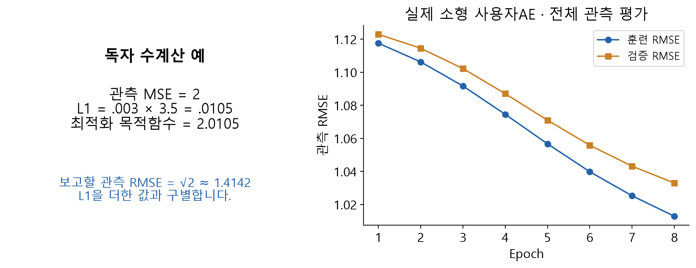

왼쪽은 위 독자 수계산, 오른쪽은 이번에 실제 실행한MovieLens 100K 소형 사용자 AE의CPU 이력입니다. 오른쪽 두 곡선은각epoch 끝의전체 관측 RMSE입니다. 검증 곡선으로 모형을 선택하며, 이 그림에 시험 곡선은 넣지 않았습니다.

## 5. 검증·시험과집계의 기준 지키기

교재의 `validation_data=(train_data, test_data)`에서 앞의 값은 모델에 넣을 입력이고, 뒤의 값은 비교할 정답입니다. 따라서 이를 ‘시험 평점을 입력하는 코드’라고 읽으면 안 됩니다. 다만 같은 시험표를 매epoch 관찰하고 마지막 평가에도 쓰기 때문에, 이번 보강 실험에서는 검증과 시험을 별도로 나눴습니다.

1. 훈련 입력과훈련 마스크로 가중치를 갱신합니다.
2. 같은 훈련 입력을 모델에 넣고, 검증 마스크의관측과 비교해모형을 선택합니다.
3. 선택을 끝낸 뒤 시험 마스크의관측에서 마지막으로 평가합니다.

표본을 여러 배치로 나누어 계산해도 최종 RMSE는 **제곱오차 합과관측 수를 먼저 합쳐서** 구합니다.

$$
\operatorname{RMSE}_{\mathrm{global}}=
\sqrt{\frac{\operatorname{SSE}_1+\operatorname{SSE}_2}{n_1+n_2}}.
$$

배치별 RMSE를 단순 평균하면 일반적으로 같은 값이 아닙니다. 또한 카탈로그에는 있지만 훈련 관측이 없는 사용자나 영화는 이번 구현에서 훈련 평균으로 예측하고, 그 관측 수를 따로 보고합니다.

이번 로컬 CPU 실행에서 같은 시험 관측 15,000개로 비교했습니다. 평균 기준 모형의 RMSE는 약 1.122868, 소형 사용자 AE의 RMSE는 약 1.033672였습니다. 이 실행에서 미학습 축과 관련된 시험 관측 28개는 평균 예측으로 평가했습니다. Python3.12.10/TensorFlow2.21.0/Keras3.15.1, 분할seed20261105, 위 수업 기본 설정의 결과입니다. 환경이나 설정이 달라지면 숫자는 달라질 수 있습니다.

이것은 이번 설정에서 관측 평점 예측을 비교한 결과입니다. 모든 데이터에서 AE가 우수하거나 추천 목록의 만족도가 높다는 결론으로 확대하지 않습니다. 워크북 L07에서 무엇을 비교했는지 설명합니다.

# D · 사용자·아이템 기준 비교와 추천 실습

## 1. A가 평가하지 않은 Q의 예측은 어디서 올까?

A의Q에는 정답이 없으므로 그 칸의 오차로 직접 학습할 수는 없습니다. 하지만 다른 사용자의 **훈련 관측**에서Q를 복원하도록 학습하면, Q로 연결되는 공유 가중치도 조정됩니다. 학습한 인코더가 A의 훈련 평점에서 잠재표현을 계산하고, 디코더가 그 표현으로Q의 값을 계산합니다.

이것이 여러 사용자 사이에서 모수를 공유하는 효과입니다. 다른 사용자의 시험 정답을 입력으로 사용하는 과정이 아닙니다. Q가 모든 사용자에게서 훈련 미관측이면, Q의 평점 패턴을 학습할 근거도 부족합니다. 이번 실습은 그런 미학습 축을 평균 예측으로 처리하고 수를 따로 보고합니다.

## 2. E08 · 같은 표를 전치하면 무엇이 바뀔까?

전치(transpose)는 행과 열의 역할을 바꾸는 연산입니다. 처음 4×4 표는 정사각형이라 전치해도 숫자로 나타낸shape는4×4입니다. 그렇다고 축의 의미가 같아지는 것은 아닙니다. 차이를 보기 위해 **같은 표의 첫 3명만** 고르겠습니다.

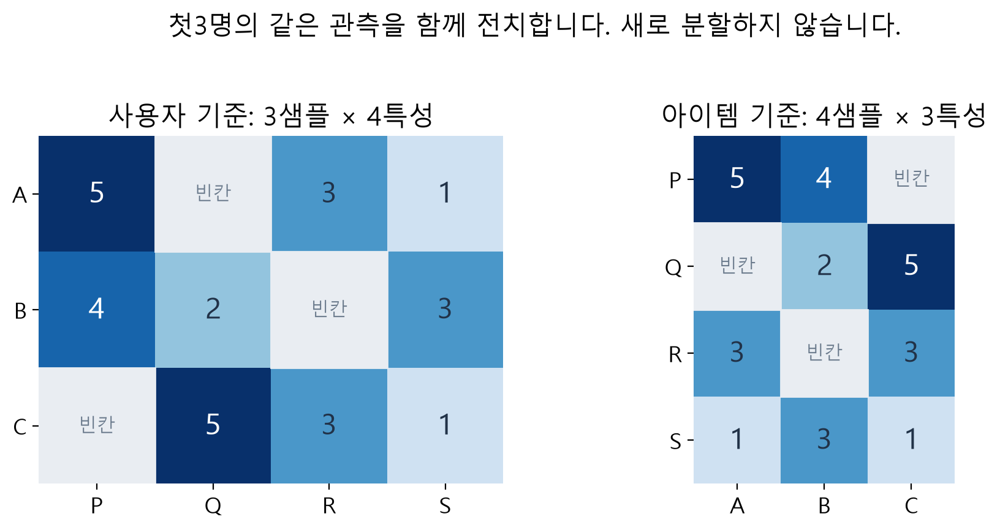

독자 도해입니다. 왼쪽A행의 P평점5가 오른쪽P행의 A열5로 이동하는지 확인하세요. 빈칸과 관측 마스크도 함께 이동합니다. 숫자를 새로 뽑거나 분할을 다시 하지 않습니다.

| 기준 | 샘플 하나 | 샘플 수 | 입력·출력 길이 |
|---|---|---:|---:|
| 사용자 기준 | 한 사용자의 영화별 평점 | 3 | 4 |
| 아이템 기준 | 한 영화의 사용자별 평점 | 4 | 3 |
| 실제 100K 사용자 기준 | 한 사용자의1682편 평점 | 943 | 1682 |
| 실제 100K 아이템 기준 | 한 영화의943명 평점 | 1682 | 943 |

같은 원척도 예측행렬을 단순히 전치하고 같은 관측을 골라 계산하면 RMSE는 같습니다. 그러나 **서로 다른 방향으로 새로 학습한 두 모형**의 예측이 같아야 하는 것은 아닙니다. 입력 길이, 샘플 수, 모수 수와학습 과정이 달라집니다.

## 3. 주교재 연습7-1을 수행하는 순서

실습 B는 사용자 기준을 기본으로 실행합니다. 같은 데이터를 다시 준비하거나 분할을 새로 하지 않고, 아이템 기준으로 방향을 바꾸어 결과를 기록하세요. 공통 코드가 값과마스크를 함께 전치하고 최종 예측을 원래 사용자×영화 방향으로 돌립니다.

1. 관측 분할과훈련 평균을 고정합니다.
2. 기준을 바꿨을 때 샘플 수와 입력폭을 먼저 예상합니다.
3. 같은 은닉폭·학습률·정규화·최대 epoch 설정으로 실행합니다.
4. 검증 기준으로 선택된 모형의 시험 RMSE와관측 수를 기록합니다.
5. 모수 수·갱신 수·시간도 함께 적고, 관측한 차이를 설명합니다.

| 기록 항목 | 사용자 기준 | 아이템 기준 |
|---|---|---|
| 입력 shape | 직접 기록 | 직접 기록 |
| 훈련/검증/시험 관측 수 | 직접 기록 | 같은 분할인지 확인 |
| 선택된epoch | 실행 후 기록 | 실행 후 기록 |
| 모수 수·갱신 수·시간 | 실행 후 기록 | 실행 후 기록 |
| 시험 RMSE | 실행 후 기록 | 실행 후 기록 |
| 이번 결과의 조건·한계 | 두 기준의 차이를 설명 | 일반적인 우열로 확대하지 않기 |

동일 epoch라도 샘플 수가 달라 미니배치 갱신 횟수가 달라질 수 있습니다. 이번 소형 사용자 모형은109,914개, 아이템 모형은61,879개 모수를 가집니다. 따라서 ‘방향만 바꾸었으니 계산량도 같다’고 쓰지 않습니다. 사전에 정한 비교 조건과 검증 기준을 유지하고, 시험 결과를 보며 계속 설정을 고르는 방식은 피하세요.

직접 확인 C04: 첫 3명의 표에서 한 샘플의 의미와입력폭을 말하세요. 워크북 L08과실습 B에서 전치·비교·해석을 수행합니다.

## 4. 복원된 점수에서 추천 후보 고르기

A절의 고정 예제에서 A의 예측은 약 `[3.761594,3,2.238406,2.238406]`이었습니다. P가 가장 높더라도 A는 이미P를 평가했습니다. 알고 있는 관측 이력을 제외하면 이 작은 표에서 A의 미관측 후보는Q입니다.

실제 실습의 `recommend_autoencoder`는 알려진 전체 관측 이력을 제외한 후보를 점수로 정렬합니다. 여기서 얻는 것은 **추천 후보 표**입니다. 평점 RMSE가 작다는 사실만으로 상위 추천의 만족도나발견성이 검증되지는 않습니다. 순위 품질을 주장하려면 해당 목적에 맞는 별도 평가가 필요합니다.

기본 출력은linear이므로 예측이1–5 밖으로 나올 수도 있습니다. 이번 평가에서는 출력을 자르지 않습니다. 범위 제한을 추가하는 실험은 별도의 후처리 조건으로 기록해야 합니다.

## 5. 마지막 앱 활동: 입력에서 CSV까지 한 곳 수정하기

누적 앱에는 기존FM·MF·MLP 복습과새AE 기능이 함께 있습니다. AE의 **고정 모수 계산** 탭에서는 평점과 관측 여부를 바꾸고, 잠재표현·복원값·오차표를 확인합니다. **작은 모델 실제 학습** 탭에서는 독자 합성 80명·18편 자료로 실제 소형 모형을 학습합니다. 실제 MovieLens 실험은실습 B에서 수행합니다.

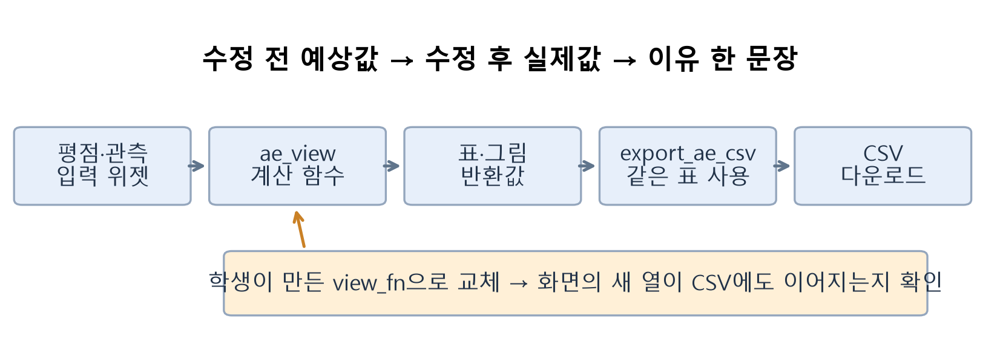

독자 앱 설계 도해입니다. 입력 → `ae_view` → 반환 표 → `export_ae_csv` → CSV를 따라가세요. 학생이 제공하는 `view_fn`의 같은 표를 화면과 CSV에 사용합니다.

수정 전에는 P의평점5를4로 바꾸면 어떤 잠재값과복원값이 바뀔지 예상하세요. 버튼을 누른 뒤 실제 값과비교하고 이유를 씁니다. 이어서 자신의 표시 함수에서 **관측된 칸의 절대오차 열**을 추가합니다. 미관측 칸의 표시 규칙을 먼저 정하고, 새 열이 화면과 다운로드한 CSV 모두에 있는지 확인하세요. 실습 A의빈칸은 기본 실행 변수와분리되어 있어 흐름을 막지 않습니다.

앱의 고정 모수 탭에서 입력을 바꾸는 것과새 소형 모형을 학습하는 것을 구별하세요. 학습 탭을 실행해도 고정 설명용 가중치가 바뀌는 것은 아닙니다. Colab 공유 주소는 해당 런타임이 켜져 있는 동안 사용할 수 있습니다.

## 6. 실습을 처음 실행할 때

Colab에서 자신의 사본을 저장한 뒤 첫 셀부터 실행하세요. 실습 A와B는 각각 설치·입력 준비를 포함하므로 독립적으로 실행할 수 있습니다. 개인 파일 업로드나API키, 유료GPU가 필요하지 않습니다.

- A: 작은 4×4 표, 고정 모수의NumPy/Keras 대조, 관측 오차와앱 수정.
- B: 공식MovieLens 자동 다운로드/캐시, 관측 분할, 선택한 방향의 실제AE 학습과평가, 연습7-1 비교 기록.

설치 후 재시작 안내가 나오면 런타임을 재시작하고 처음부터 실행합니다. `NameError`가 나면 정의한 셀부터 순서대로 실행했는지 확인하세요. 실제 자료 준비가 실패하면 오류를 해결하고 다시 준비합니다. 합성 자료의 결과를 실제 MovieLens 결과로 바꾸어 표시하지 않습니다.

## 점검 퀴즈

1. 사용자 기준 AE의 한 입력 샘플은 무엇이며, MF의 ID 입력과 어떻게 다른가요?
2. 입력이 4차원이고 잠재표현이 2차원일 때, 출력이 다시 4차원이어야 하는 이유는 무엇인가요?
3. 입력 `[2,0,0,−2]`와 E02의 가중치에서 두 잠재 노드의 가중합과 활성값은 각각 무엇인가요?
4. 원래 평점3, 훈련 평균3인 관측이 중심화 후 0이 되면, 오차 계산에 포함해야 하나요?
5. E04의 관측 제곱오차 합 6과 관측 수 3에서 MSE와 RMSE는 각각 얼마인가요?
6. 관측 MSE 2와 L1 벌점 .0105가 주어졌을 때, 최적화 목적함수와 순수 RMSE는 어떻게 다른가요?
7. 교재의 `validation_data=(train_data, test_data)`에서 모델 입력과 비교할 정답은 각각 무엇인가요?
8. 같은 관측 분할로 사용자 기준과 아이템 기준을 비교할 때, RMSE 외에 어떤 조건과 수를 함께 기록해야 하나요?

## 이번 수업에서 기억할 것

- AE는 평점 벡터를 요약하고 같은 위치의 평점을 복원하는 공유 계산을 학습합니다.
- 값이 0인지와 관측이 있는지는 다른 문제입니다. 관측 마스크를 별도로 보존합니다.
- 오차를 해석할 때는 포함한 칸·분모·원척도·정규화 여부를 함께 확인합니다.
- 검증은 모형 선택에, 시험은 선택을 끝낸 뒤의 평가에 사용합니다.
- 사용자/아이템 방향은 같은 관측을 유지한 채 바꾸고, 실제로 계산하고 설명한 내용을 기록합니다.

## 참고자료와 출처 구분

- 주교재: 임일(2025), 『AI 에이전트를 위한 개인화 추천 알고리즘: Python, 머신러닝, AI, LLM 활용』, 청람,7장pp.148–156, 그림7-1~7-4, 연습7-1. 교재 보고값은B절 표에 별도 표시했습니다.
- [AutoRec: Autoencoders Meet Collaborative Filtering](https://ssanner.github.io/papers/anu/www15.pdf): 관측 재구성 오차·공유 모수·사용자/아이템 기준의 원논문. 이 논문의 구조·규제·데이터·학습법과 교재/수업 구현은 동일하지 않습니다.
- [Keras Dense](https://keras.io/api/layers/core_layers/dense/): 가중합·편향·활성함수와배열 크기.
- [Keras Masking](https://keras.io/api/layers/core_layers/masking/): 시점 마스크와이번 관측 손실 마스크의역할 구분.
- [Keras Losses](https://keras.io/api/losses/),[가중치 정규화](https://keras.io/api/layers/regularizers/),[Adamax](https://keras.io/api/optimizers/adamax/): 손실 집계·L1·실제 학습 방법.
- [TensorFlow 오토인코더 입문](https://www.tensorflow.org/tutorials/generative/autoencoder): 인코더와 디코더의 기본 설명. 이미지 손실을 희소 평점에 그대로 적용하는 자료는 아닙니다.
- [MovieLens 100K 공식README](https://files.grouplens.org/datasets/movielens/ml-100k-README.txt): 자료 크기·형식·이용조건. 실습 중 공식 자료를 준비하며 원자료를 배포 묶음에 복사하지 않습니다.
- [IES 학습·수업 설계 가이드](https://ies.ed.gov/ncee/wwc/PracticeGuide/1): 풀이 예제와 독립 문제의 교대, 그림·언어 및 추상·구체 표현의 연결에 참고했습니다.

외부 문서 확인: 2026-11-04. 별도 표시한 교재 그림 외 도해와 작은 숫자 예제는독자 제작입니다. 실제 소형 사용자 AE의 곡선과 수치는 이번 로컬 CPU 실행 범위를 나타내며, 향후 모든 환경의 성능을 보장하지 않습니다.
