# W11A · 이력을 읽고 다음 아이템을 추천하기

**딥러닝응용I(추천시스템) · 동덕여자대학교 데이터사이언스전공 · 유원상 교수 · 2026-2 · 2026-11-10**

주교재 **8장 전체**: 8.1 Transformer, 8.2 추천 활용, 8.3 구현과 연습 8-1. 지난 7장의 핵심 실습을 먼저 마무리합니다.

이번 목표는 네 가지입니다. 평점 복원과 다음 아이템 예측을 구별하기, 작은 attention을 계산하기, 실제 학습 코드를 읽고 수정하기, 자신의 예측으로 만든 추천 목록을 올바르게 평가하기입니다.

실습은 **예상 한 줄 → 작은 계산 → 본문 코드 실행 → 한 조건 수정 → 변화의 이유** 순서로 진행합니다. 준비 셀부터 실행하면 공식 자료를 자동으로 내려받거나 캐시를 재사용합니다. 개인 파일 업로드·유료 GPU·API 키는 필요하지 않습니다.

| 자료 | 하는 일 |
|---|---|
| [7A 보강 실습](https://colab.research.google.com/github/lunalab-ai/recommender/blob/2026-fall-w11a/notebooks/student/w11a-ch07-a-principles.ipynb) | 기존 작은 평점표·관측 손실·실제 갱신 |
| [7B 보강 실습](https://colab.research.google.com/github/lunalab-ai/recommender/blob/2026-fall-w11a/notebooks/student/w11a-ch07-b-comparison.ipynb) | 같은 데이터에서 사용자/아이템 방향 비교 |
| [8A attention 실습](https://colab.research.google.com/github/lunalab-ai/recommender/blob/2026-fall-w11a/notebooks/student/w11a-attention-principles.ipynb) | 손계산·행렬·마스크·수정 앱 |
| [8B 순차 추천 실습](https://colab.research.google.com/github/lunalab-ai/recommender/blob/2026-fall-w11a/notebooks/student/w11a-transformer-recommendation.ipynb) | 실제 데이터·학습·반복 추천·평가 |

[계산 워크북](../supplements/w11a-workbook.md)과 [실습 길잡이](../supplements/w11a-api-guide.md)를 함께 사용하세요. 기존 W10B 자료와 실습 링크도 그대로 사용할 수 있습니다.

## 1. 무엇을 입력하고 무엇을 맞힐까?

7장의 AutoEncoder는 한 사용자의 **평점 벡터를 복원**합니다. 8장은 **기록된 아이템의 순서로 다음 아이템을 분류**합니다. 같은 추천 문제라도 정답과 손실이 다릅니다.

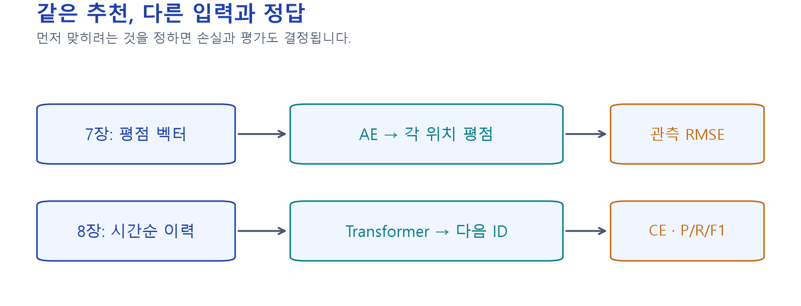

*독자 비교 도해. 주교재 7장 pp.148–156과 8.2 pp.161–162의 문제 설정을 연결했습니다. 위·아래의 입력과 정답을 각각 읽으세요.*

MovieLens의 timestamp는 **평점을 기록한 시각**입니다. 실제 영화를 본 순서라고 확정할 수 없고, 같은 시각의 기록도 많습니다. 실습은 같은 시각이면 원래 파일 행 순서를 유지하지만, 그것이 실제 행동 순서라는 뜻은 아닙니다. 평점 크기에 따른 ‘좋아한 영화’ 필터도 적용하지 않습니다.

## 2. 7장 복습: 순전파와 한 번의 학습

**E01 · 같은 가중치로 복원하기.** 관측 평점이 $[5,\mathrm{NaN},3,1]$, 주어진 훈련 평균이 3이면 관측 여부는 $[1,0,1,1]$, 중심화 입력은 $x=[2,0,0,-2]$입니다.

$$
W_e=\begin{bmatrix}.5&0\\0&.5\\.5&.5\\0&.5\end{bmatrix},\qquad
W_d=\begin{bmatrix}1&.5&0&-1\\0&.5&1&0\end{bmatrix}.
$$

편향을 0으로 놓으면 $xW_e=[1,-1]$, $z=\tanh(xW_e)\approx[.761594,-.761594]$입니다. 디코더 출력은 약 $[.761594,0,-.761594,-.761594]$, 평균을 복원하면 $[3.761594,3,2.238406,2.238406]$입니다. 여기까지는 **주어진 가중치의 순전파**이며 학습하지 않았습니다.

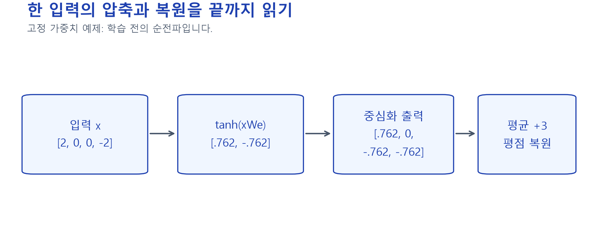

*독자 고정 모수 예제. 기존 W10B E02의 값을 유지했습니다. 입력·잠재값·중심화 출력·평점 출력을 구분하세요.*

**E02 · 어느 칸을 오차에 넣을까?** 오차 계산용으로 별도 예측 $[1,.4,2,-1]$을 줍니다. 관측 칸 P·R·S의 제곱오차는 $1,4,1$입니다.

$$
L_{\mathrm{MSE}}=\frac{\sum_j m_j(x_j-\hat x_j)^2}{\sum_jm_j}
=\frac{6}{3}=2,\qquad \mathrm{RMSE}=\sqrt2\approx1.414214.
$$

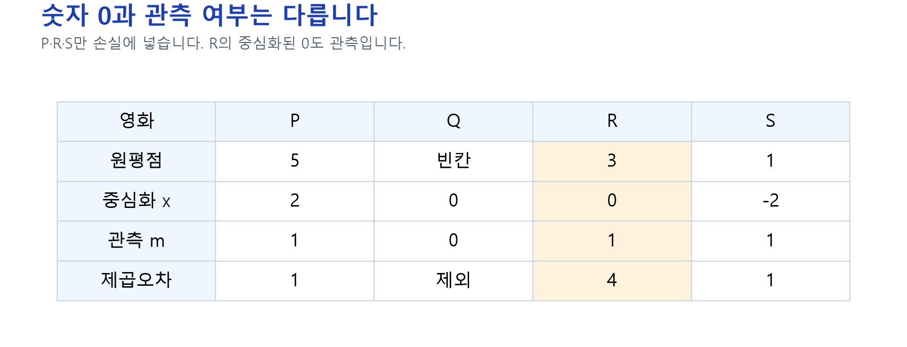

*독자 마스크 예제. 값이 0인지보다 원래 관측됐는지를 먼저 확인합니다. `target != 0`은 관측된 R을 빠뜨립니다.*

**E03 · 학습은 무엇이 추가될까?** 한 관측에서 $x=2$, $\hat x=wx$, $w=.5$, $y=2$라면 $L=(y-wx)^2=1$입니다. 기울기는 $-2x(y-wx)=-4$이고 학습률 .1의 SGD는 $w_{\mathrm{new}}=.5-.1(-4)=.9$를 만듭니다. 새 예측은 1.8, 새 손실은 .04입니다. 실제 7장 신경망 실습은 여러 가중치에 Adamax를 적용하므로 이 SGD 수치와 같지는 않습니다.

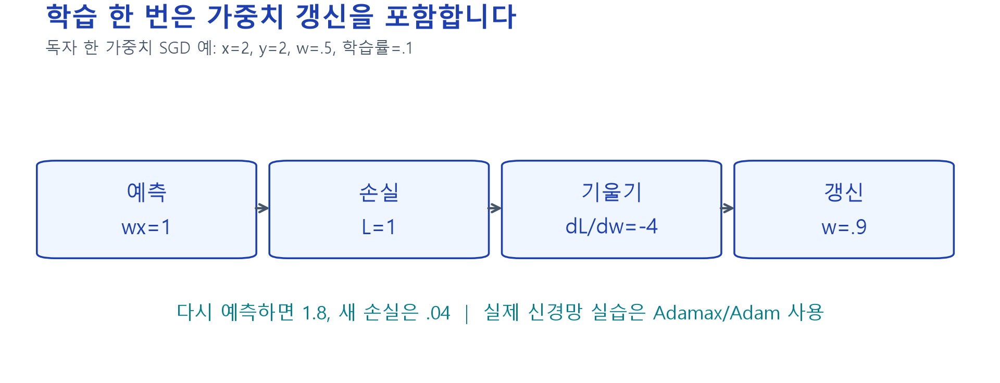

*독자 SGD 예제. 7A 본문의 `autoencoder_train_step`은 실제 모형에서 같은 역할을 수행합니다.*

7B에서는 값과 마스크를 **함께 전치**합니다. 사용자 방향의 한 샘플은 한 사용자, 아이템 방향은 한 영화입니다. 예측을 원래 사용자×영화 좌표로 되돌린 뒤 **동일한 보류 관측**에서 평가합니다.

## 3. 8.2: 다음 정답을 만들기

**E04 · 접두 이력 만들기.** 기록 순서가 A→B→C→D라면 학습 쌍은 `[A,B]→C`, `[A,B,C]→D`처럼 만듭니다. 맞혀야 할 아이템을 입력에 넣지 않습니다.

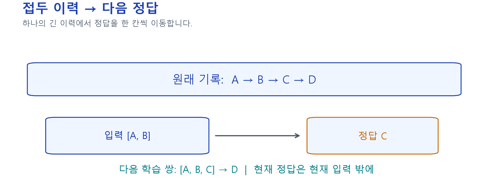

*주교재 그림 8-3(pp.161–162)의 접두 이력 원리를 독자 A–D 예제로 재구성했습니다. 화살표 오른쪽 정답은 왼쪽 입력 밖에 있습니다.*

입력 길이가 다르므로 배열 길이를 맞춥니다. 최근 이력만 남기고 뒤를 0으로 채웁니다. 이 0은 아이템이 아닙니다.

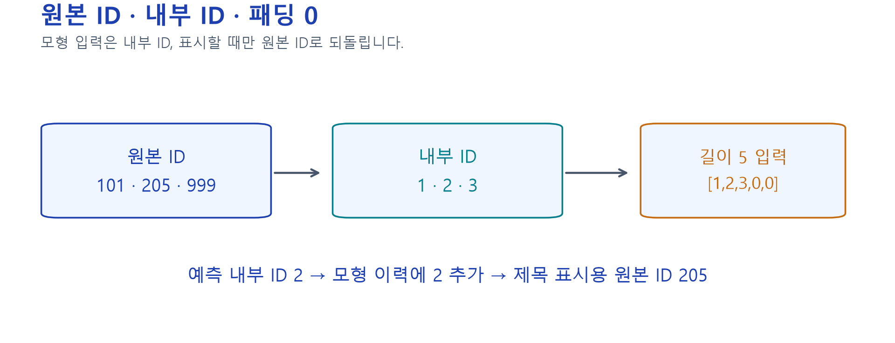

*독자 ID 반례. 원본 ID 101·205·999를 내부 ID 1·2·3으로 바꿨다면, 모형에는 2를 추가하고 제목을 표시할 때만 205로 복원합니다.*

## 4. 8.1: attention을 한 행씩 계산하기

Query(Q)는 ‘현재 무엇을 찾는가’, Key(K)는 ‘각 위치가 어떤 특징을 제공하는가’, Value(V)는 ‘얼마나 섞을 정보인가’를 나타내는 벡터입니다. 실제 모형에서는 임베딩에 **학습할 투영 행렬**을 곱해 Q·K·V를 만듭니다.

**E05 · 작은 주어진 Q·K·V.** 원리를 보기 위해 다음 수치를 직접 줍니다. 학습된 값이 아닙니다.

$$
Q=K=\begin{bmatrix}1&0\\0&1\\1&1\end{bmatrix},\qquad
V=\begin{bmatrix}2&0\\0&2\\2&2\end{bmatrix}.
$$

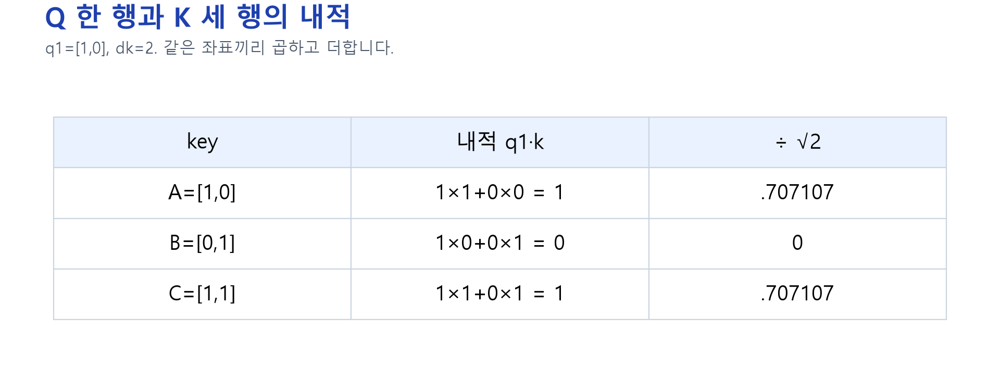

*주교재 그림 8-2(p.160)의 scaled dot-product 관계를 독자 수치로 재구성했습니다.*

첫 query $[1,0]$와 세 key의 내적은 $[1,0,1]$입니다. key 차원 $d_k=2$의 제곱근으로 나누면 $[.707107,0,.707107]$입니다. softmax는 이 점수들을 음수가 아닌 가중치로 바꾸고 합을 1로 만듭니다.

$$
a_j=\frac{e^{s_j}}{\sum_\ell e^{s_\ell}},\qquad
a\approx[.401112,.197776,.401112].
$$

$$
o_1=.401112[2,0]+.197776[0,2]+.401112[2,2]
\approx[1.604448,1.197776].
$$

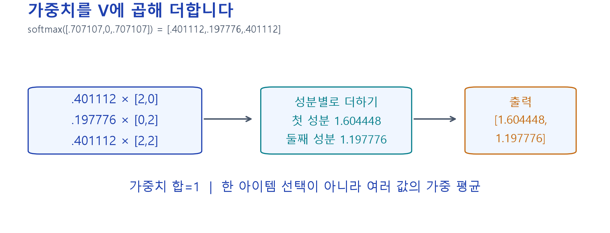

*독자 검산 그림. 가장 큰 아이템 하나만 고르는 연산이 아니라 여러 V를 가중 평균합니다. 가중치 행의 합과 출력의 각 성분을 따로 확인하세요.*

행렬로 쓰면 다음 한 식입니다. $Q$가 $T\times d_k$, $K$가 $S\times d_k$, $V$가 $S\times d_v$이면 가중치는 $T\times S$, 출력은 $T\times d_v$입니다.

$$
\operatorname{Attention}(Q,K,V)
=\operatorname{softmax}\!\left(\frac{QK^\top}{\sqrt{d_k}}\right)V.
$$

## 5. 마스크·위치·다중 헤드는 왜 필요할까?

패딩 마스크는 **빈 자리를 읽지 못하게** 합니다. 인과 마스크는 각 query가 **자기보다 뒤인 위치를 읽지 못하게** 합니다. 두 목적을 구분해야 합니다.

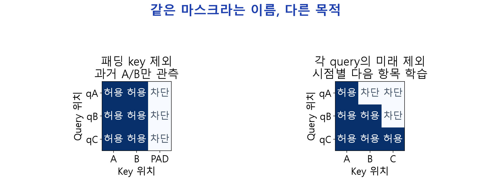

*독자 마스크 그림. 진한 칸만 읽을 수 있습니다. 교재의 ‘관측된 접두 전체→다음 한 개’ 분류는 과거 접두 안의 양방향 attention을 사용할 수 있습니다. 모든 시점에서 다음 아이템을 동시에 예측하는 방식에는 시점별 미래 차단이 필요합니다.*

아이템 임베딩은 아이템의 특징, 위치 임베딩은 이력 안의 위치를 표현합니다. 둘을 더해 입력합니다. 실습은 패딩 마스크를 명시적으로 전달하고 패딩 위치 출력을 다시 0으로 만듭니다. `mask_zero=True` 하나로 모든 사용자 정의 층의 처리가 보장되는 것은 아닙니다.

다중 헤드는 다른 투영으로 attention을 여러 번 계산하고 합쳐서 원래 폭으로 투영합니다. **Keras의 `key_dim`은 헤드 하나의 폭**입니다.

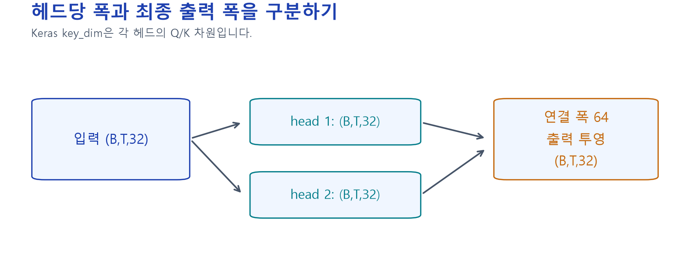

*독자 배열 도해. 교재 p.170의 헤드폭 설명과 실제 코드 설정을 구분합니다. 코드 `embed_dim=32, heads=2, key_dim=32`의 내부 폭은 2×32이며, 출력 투영으로 다시 32가 됩니다. 교재 p.172 모수 표는 이 코드와 일치합니다.*

위치 임베딩을 제거했을 때도 `Flatten`이 위치별 출력을 다르게 연결하므로 모형 전체가 반드시 순서에 무관해지는 것은 아닙니다. 구조의 어느 부분을 바꿨는지 확인하세요.

## 6. Transformer 블록에서 분류 출력까지

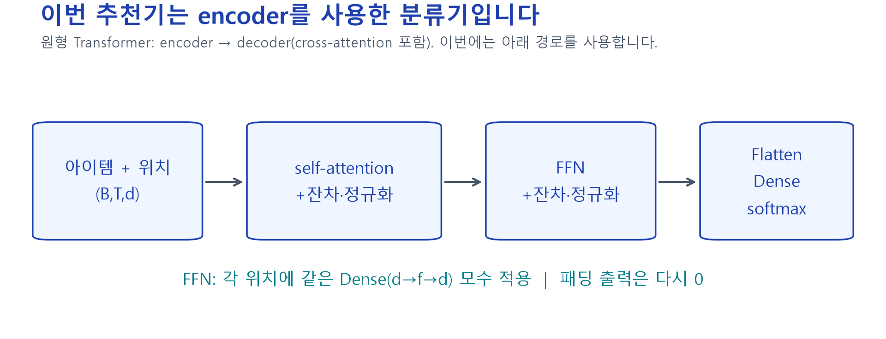

*주교재 그림 8-1(p.159), 8-4·8-5(pp.167–171)의 구조 관계를 독자 배치로 재구성했습니다. 원형 Transformer의 decoder·cross-attention과 이번 추천 분류기의 encoder를 구별하세요.*

attention 뒤에는 원래 입력을 더하는 **잔차 연결**과 **층 정규화**가 있습니다. FFN은 각 위치의 특징을 Dense→활성함수→Dense로 변환하며, 그 뒤에도 잔차·정규화를 적용합니다. 잔차는 기존 정보를 함께 전달하고, 정규화는 한 위치의 특징값 크기를 정돈합니다. FFN의 같은 모수는 위치마다 공유합니다.

교재 분류기는 이 출력을 `Flatten`으로 펴고 Dense를 거쳐 아이템별 softmax 확률을 출력합니다. 원래 encoder-decoder를 모두 구현해야만 이 추천 분류기를 만들 수 있는 것은 아닙니다.

**E06 · 정답 확률과 손실.** 출력 확률이 $[.2,.5,.3]$, 정답이 두 번째 아이템이면 다음과 같습니다.

$$
L=-\log p(y\mid h)=-\log(.5)\approx.693147.
$$

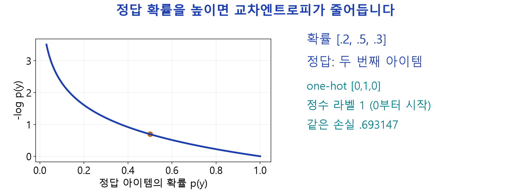

*독자 손실 도해. 실제 데이터에서는 정수 정답을 받는 SparseCategoricalCrossentropy를 사용합니다. 같은 확률·정답의 one-hot 교차엔트로피와 값이 같습니다.*

학습 한 번은 `GradientTape` 안의 모형 호출·손실 계산 → 기울기 → optimizer 적용입니다. 8B 본문의 `sequence_train_step`을 읽고 실제 갱신 전후의 모수 차이를 확인합니다.

## 7. 8.3: 실제 데이터와 설정을 연결하기

사용자를 먼저 훈련·검증·시험으로 나누고, 그 뒤 각 사용자의 접두 쌍을 만듭니다. 겹치는 접두 쌍을 먼저 만든 다음 무작위로 나누면 같은 사용자 이력이 양쪽에 섞일 수 있습니다.

| 항목 | 교재 코드 원형 | 수업 기본 설정 |
|---|---|---|
| 최대 이력 길이 | 80 | 20 |
| 임베딩 / 헤드 / 헤드당 폭 | 32 / 2 / 32 | 16 / 2 / 8 |
| 블록 / FFN 폭 / 최종 Dense 폭 | 2 / 32 / 512 | 1 / 32 / 64 |
| 최소 접두 길이 | 20 | 20 |
| 정답 표현 | one-hot | 정수 라벨, 동등한 교차엔트로피 |
| 학습 | Adam .0003, 조기 종료·체크포인트 | Adam .0003, 최대 3 epoch, 검증 CE 최소 가중치 복원 |
| 수업용 제한 | 원형 전체 실험 | 적격 사용자 최대 120명, 훈련쌍 최대 1,500개 |
| 시험 | 끝 10개 보류, 7개 생성 | 같은 규칙, 사용자별 정답 비교 |

수업 기본값은 실행 시간을 줄인 **별도 실험 조건**입니다. 적격 사용자는 보류 뒤에도 학습용 최소 이력을 확보할 수 있어야 합니다. 사용자 분리는 약 60/15/25이며 전체 사용자를 달력 시각 하나로 나눈 실험은 아닙니다. 최종 시험 정답으로 epoch나 설정을 선택하지 않습니다.

8B는 데이터 모드·분할 크기·설정·모수 수·실제 갱신 수·검증 이력을 출력합니다. 실제 실행 결과를 자신의 기록표에 적으세요. 교재에 보고된 성능이나 작은 예제의 값이 이번 실험의 보장된 결과는 아닙니다.

## 8. 자기 예측을 다음 입력에 추가하기

**E07 · 반복 생성.** 현재 이력이 `[A,B]`이고 모형이 C를 골랐다면 다음 입력은 `[A,B,C]`입니다. 다음 보류 정답이 D라는 사실을 알고 있어도 D를 대신 넣지 않습니다.

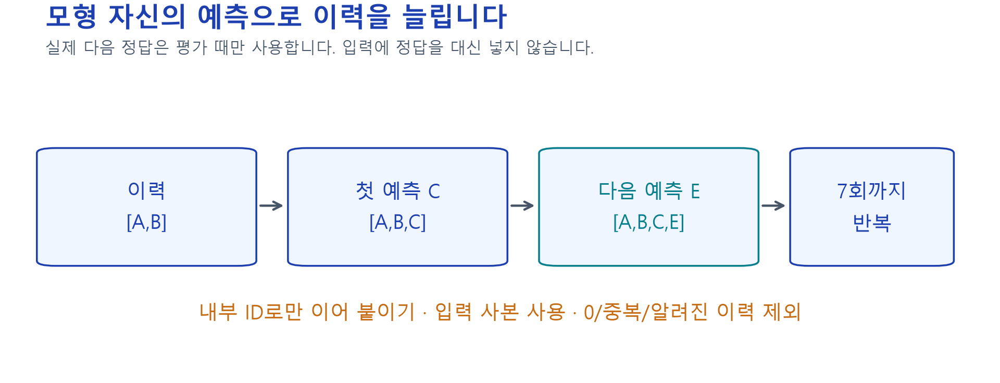

*주교재 그림 8-6(p.174)의 반복 예측 관계를 독자 예제로 재구성했습니다. 입력 이력의 사본에 내부 ID만 추가하며, 실제 정답은 평가할 때만 사용합니다.*

후보 규칙도 실험 조건입니다. 기본값은 **0·중복·이미 관측한 아이템 제외**입니다. 미래 정답을 미리 들여다보고 후보에서 빼거나 남기지 않습니다. 노트북에서 `select_candidates`를 수정한 뒤 실제 추천 목록과 앱의 CSV까지 변화가 이어지는지 확인합니다.

## 9. 추천을 어떻게 평가하고 비교할까?

**E08 · 7개 추천 중 2개가 보류 정답 10개에 포함된 경우.**

$$
P@7=\frac27\approx.285714,\quad R@10=\frac2{10}=.2,\quad
F1=\frac{2PR}{P+R}=\frac4{17}\approx.235294.
$$

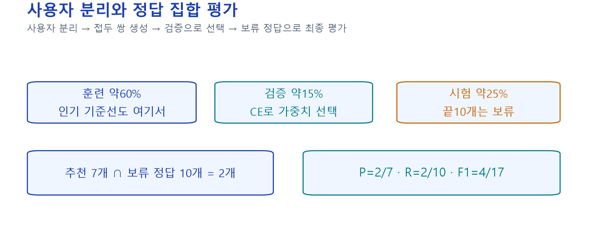

*독자 평가 도해. 여기서 R@10의 10은 보류 정답 집합 크기이며, 두 지표 모두 생성 목록 7개를 평가합니다. 각 순서가 정확히 같은지를 측정한 값은 아닙니다. 사용자별 값을 구한 뒤 같은 비중으로 평균합니다.*

훈련 사용자만으로 계산한 인기 기준선도 **동일한 시험 사용자·보류 정답·후보 규칙**으로 평가합니다. 인기 빈도는 선택된 훈련 사용자의 전체 기록에서 집계하고, Transformer의 학습 쌍은 수업용으로 제한하므로 학습량까지 같은 비교는 아닙니다. Transformer가 반드시 기준선보다 좋을 것이라고 예상값을 정하지 않습니다.

주교재 연습 8-1에서는 이력 길이·헤드 수·학습률 등 **한 조건만 바꾸고** 검증 결과로 비교할 설정을 선택합니다. 선택이 끝난 뒤 시험 결과를 확인합니다. 7장의 RMSE와 8장의 CE·P/R/F1은 서로 다른 문제를 측정하므로 숫자 크기로 우열을 비교하지 않습니다.

마지막 앱에서는 입력 위젯 → 본문 함수 → 결과 표 → CSV의 연결을 따라가세요. 기존 FM·MF·MLP·AE 탭도 유지됩니다. 공유 주소는 실행 중인 Colab 런타임에 의존합니다.

## 점검 퀴즈

1. 7장의 평점 복원과 8장의 다음 아이템 예측은 입력·정답·손실이 어떻게 다른가요?
2. 중심화된 관측값이 0일 때도 손실에 포함해야 하는 이유는 무엇인가요?
3. Q가 3×2, K가 3×2, V가 3×2이면 attention 가중치와 출력의 크기는 각각 무엇인가요?
4. attention 가중치의 한 행 합이 1인 이유와 V에 곱하는 이유는 무엇인가요?
5. 패딩 마스크와 인과 마스크는 무엇을 다르게 가리나요?
6. 정답 아이템 확률이 .5일 때 교차엔트로피는 얼마이며, 학습은 무엇을 바꾸나요?
7. 반복 추천에서 원본 ID와 내부 ID, 실제 다음 정답은 각각 어디에 사용하나요?
8. 추천 7개 중 정답 10개와 겹치는 아이템이 2개일 때 P/R/F1을 구하고 평가 의미를 설명하세요.

## 기억할 것과 참고자료

입력·정답을 먼저 정하고, 작은 계산을 본문 코드와 대조하세요. 함수 하나를 수정한 뒤 실제 결과의 변화와 이유를 설명할 수 있어야 합니다.

- 임일(2025), 『AI 에이전트를 위한 개인화 추천 알고리즘』, 8장 전체 pp.158–176, 연습 8-1; 7장 pp.148–156 복습. 교재의 개념·원형과 독자 수치·보완 구현을 구분했습니다.
- [Attention Is All You Need, §§3.1–3.5](https://arxiv.org/html/1706.03762v7)
- [SASRec: 다른 순차 학습 설정과 인과성](https://arxiv.org/html/1808.09781v1)
- [Keras MultiHeadAttention](https://keras.io/api/layers/attention_layers/multi_head_attention/)
- [TensorFlow masking과 padding](https://www.tensorflow.org/guide/keras/understanding_masking_and_padding)
- [Keras 직접 학습 루프](https://keras.io/guides/writing_a_custom_training_loop_in_tensorflow/)
- [MovieLens 100K 자료와 이용 조건](https://files.grouplens.org/datasets/movielens/ml-100k-README.txt)
