# W11B · LLM을 사용한 추천의 원리와 구현

**딥러닝응용I(추천시스템) · 동덕여자대학교 데이터사이언스전공 · 유원상 교수 · 2026-2 · 2026-11-11**

주교재 **9장 전체(pp.178–207)**: 9.1 활용 방식, 9.2 프롬프팅 CF·CB, 9.3 리뷰 임베딩과 FM. 이번 핵심 질문은 **“말로 준 근거와 숫자로 학습한 근거는 어떻게 추천으로 이어질까?”**입니다.

[실습 A · 실제 CF·CB 요청](https://colab.research.google.com/github/lunalab-ai/recommender/blob/2026-fall-w11b/notebooks/student/w11b-llm-recommendation.ipynb) · [실습 B · 임베딩+FM](https://colab.research.google.com/github/lunalab-ai/recommender/blob/2026-fall-w11b/notebooks/student/w11b-embedding-fm.ipynb)

[계산 워크북](../supplements/w11b-workbook.md) · [실습 길잡이](../supplements/w11b-api-guide.md)

**예상 한 줄 → 작은 계산 → 본문 실행 → 한 곳 수정 → 이유 설명** 순서로 진행합니다. 첫 준비 셀은 CPU용 실행 파일·모델·공식 데이터를 자동 준비합니다. 최초 약2.2GB 다운로드는 수 분 걸릴 수 있어 도입과 동시에 시작합니다. API 키·개인 파일 업로드는 필요하지 않습니다.

## 1. 9.1 · 네 방식에서 바뀌는 것은 무엇일까?

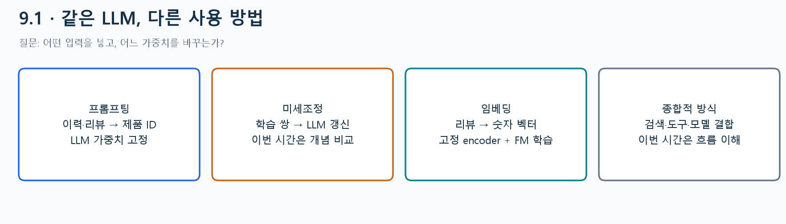

*교재 9.1의 네 방식을 재구성한 독자 도해. 미세조정·종합적 방식은 개념과 흐름을 다루며, 이번 직접 구현은 프롬프팅과 임베딩+FM입니다.*

**E01 · 같은 제품 추천, 다른 작업.** “이 고객은 P1/P2를 사용했다. 후보 P3/P4/P5 중3개를 추천하라”는 요청은 프롬프팅입니다. 이런 입력·정답 쌍으로 LLM 가중치 자체를 바꾸면 미세조정입니다. 리뷰를 벡터로 바꾸고 평점 FM에 넣으면 임베딩 활용입니다. 검색·추천모델·설명 도구를 연결하는 방식은 종합적 활용입니다. 도구를 여러 개 부른다는 사실만으로 새 학습이 일어나는 것은 아닙니다.

지난 Transformer 수업에서는 다음 아이템의 손실로 모형을 학습했습니다. 이번 프롬프팅에서는 사전학습한 언어모델을 고정한 채 **요청 내용**을 바꿉니다.

## 2. 예시를 보여 주는 것과 학습을 구별하기

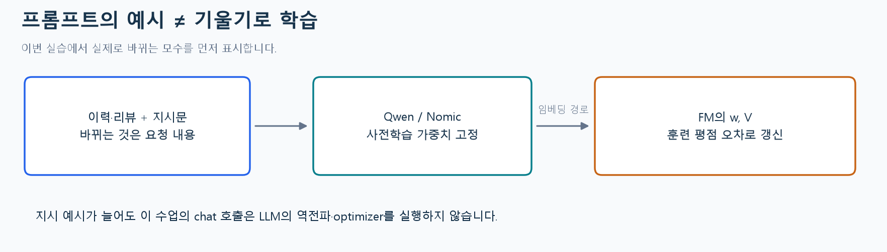

*독자 학습 경로 도해. Qwen의 생성 가중치와 Nomic의 인코더 가중치는 고정합니다. 실제 평점 학습은 FM의 w와 V에서 일어납니다.*

few-shot은 프롬프트에 몇 개의 예시를 보여 주는 방식입니다. 이 수업의 `chat` 호출은 LLM optimizer나 역전파를 실행하지 않습니다. 예시3개를0개로 바꾸는 활동은 **추론 입력 실험**입니다. 반면 실습 B에서 epoch를 반복하면 평점 오차를 이용해 FM 모수가 바뀝니다.

교재의 Ollama/Llama3.1 구성은 유지해 설명하고, CPU 실습은 **Ollama0.40.15 + Qwen2.5 0.5B / Nomic v1.5**로 경량화했습니다. 작은 모델의 응답이 큰 모델·교재와 같다고 가정하지 않습니다. 생성 실패는 그대로 표시하며 임의의 정답이나 랜덤 벡터로 대체하지 않습니다.

## 3. 9.2 CF · 다른 사용자의 이력을 말로 주기

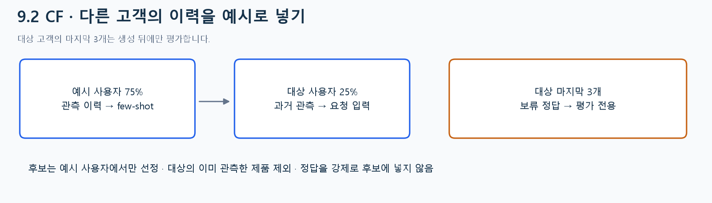

*교재 CF 흐름을 재구성한 독자 도해. 수업은 공식 Software 5-core의 구조적 소표본을 사용하고 예시·대상 사용자를75/25로 나눕니다.*

**E02 · 과거와 정답을 분리하기.** 합성 대상의 기록이 시간순 `[P1,P2,P3,P4,P5,P6,P7]`이면 입력용 과거는 `[P1,P2,P3,P4]`, 마지막3개 `[P5,P6,P7]`은 보류 정답입니다. 요청에는 과거와 예시 사용자 이력만 줍니다. 정답을 미리 넣으면 답을 보고 답하는 실험이 됩니다.

실제 후보8개는 **예시 사용자들의 관측 수**로만 정하고 대상의 이미 관측한 제품을 제외합니다. 보류 정답을 후보에 억지로 넣지 않습니다. 정답이 후보에 없으면 그 제품을 맞힐 수 없으므로 후보 안 정답 비율도 따로 표시합니다. 기록 시각은 리뷰 관측 순서이며 실제 구매·사용 순서라고 확정하지 않습니다.

## 4. 9.2 CB · 제품의 내용과 과거 선호를 주기

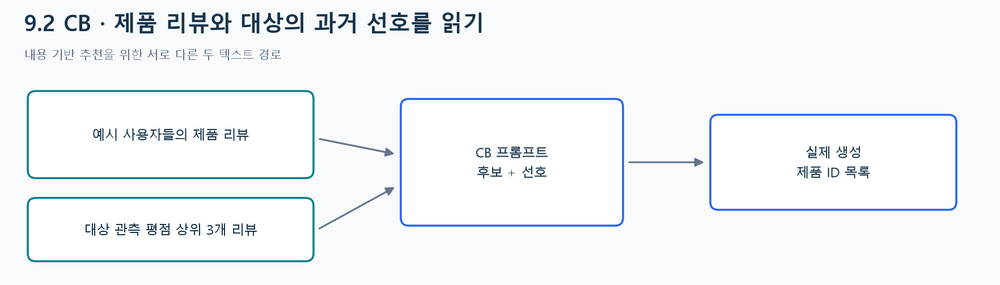

*교재 CB 입력을 재구성한 독자 도해. 후보 제품의 리뷰는 예시 사용자에서 집계하고, 대상 선호는 보류 전 관측에서만 고릅니다.*

CF는 **누가 무엇을 관측했는가**, CB는 **제품에 관해 어떤 내용이 적혔는가**를 주된 근거로 사용합니다. 대상의 관측 평점이5,2,4,5이면 높은 평점의 리뷰3개를 골라 선호 근거로 줍니다. 동점은 시각·행순서로 고정합니다. 제품의 마지막 보류 리뷰까지 합치지 않습니다.

리뷰는 길고 잡음이 있습니다. 후보 제품별140자를60자로 줄이면 실제 요청 길이가 줄지만 중요한 내용도 잘릴 수 있습니다. **어떤 정보를 제거했는지**와 **결과가 바뀌었는지**를 함께 기록하세요. 길이 감소가 항상 품질 향상은 아닙니다.

## 5. 프롬프트는 코드로 읽고 한 곳만 수정하기

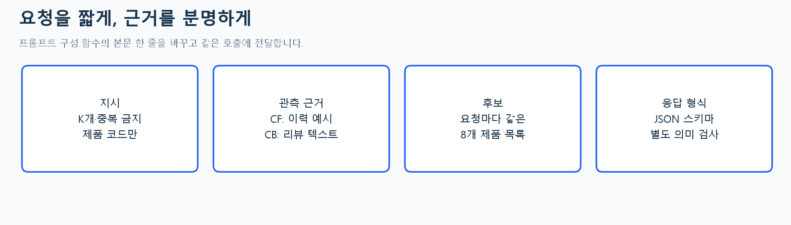

*독자 구현 도해. 실습 A의 펼쳐진 build_prompt 본문과 네 블록을 대조하세요.*

```python
# 본문 함수 안의 CF 예시 선택 한 줄
payload['examples'] = case['examples'][:shots]
# 별도 실험: 뒤쪽 예시부터 읽기
payload['examples'] = list(reversed(case['examples']))[:shots]
```

수정 후 **함수 셀 → 실제 요청 셀 → 앱 조립 셀**을 다시 실행합니다. 입력 해시·문자 수·실제 토큰 수·응답·유효 목록을 비교합니다. 입력은 달라졌지만 출력은 같을 수도 있습니다. 같은 출력이 나왔다고 수정이 적용되지 않았다고 단정하지 말고 요청 해시를 확인하세요. CF 예시 순서와 CB 길이를 동시에 바꾸면 원인을 분리하기 어렵습니다.

## 6. 응답을 믿기 전에 검사하기

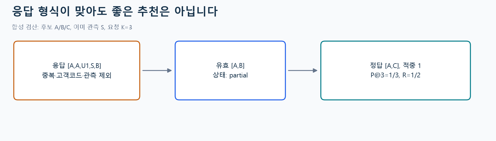

*독자 합성 검산. 실제 모델 응답과 구별한 잘못된 목록 예시입니다.*

**E03 · 형식 검사와 적중 검사.** 후보 A/B/C, 관측 S, K=3인데 `[A,A,U1,S,B]`를 반환했다면 중복 A·사용자코드 U1·이미 관측 S를 거릅니다. 유효 목록은 `[A,B]`이고3개를 채우지 못했으므로 `partial`입니다. 부족분을 가짜 ID로 채우지 않습니다.

보류 정답이 A/C이면 적중은1개입니다.

$$
P@3=\frac{1}{3},\qquad R=\frac{1}{2},\qquad F1=\frac{2PR}{P+R}=.4.
$$

precision 분모는 **요청한3개**로 고정합니다. JSON 스키마를 만족해도 중복·근거 없는 선택·낮은 적중이 생길 수 있습니다. 이 지표는 보류제품 포함률이며 사용자 만족도나 확률을 측정한 것이 아닙니다.

## 7. 9.3 · 리뷰에서 실제 임베딩 만들기

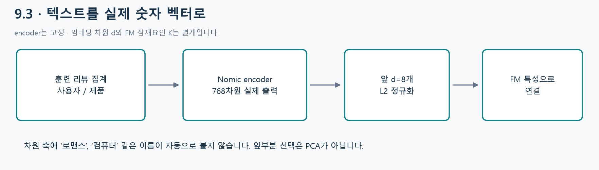

*교재 임베딩 생성·저장 흐름의 독자 재구성. 사용자 리뷰와 제품 리뷰를 각각 벡터로 만듭니다.*

문장을 숫자 배열로 바꾸면 모형이 텍스트의 표현을 특성으로 사용할 수 있습니다. 수업은 훈련 사용자/제품별 최근 비어 있지 않은 리뷰3개를 각300자까지 묶어 **실제 Nomic encoder**에 보냅니다. 생략 문자 수와 사용한 원본행ID도 남깁니다. 영어 리뷰용 모델을 사용하며 임의의 한국어 리뷰에도 동일한 성능을 보장하지 않습니다.

원출력은768차원입니다. CPU 수업의 FM 입력은 앞 $d=8$개를 고르고 L2정규화합니다. 이는 학습된 차원선택이나 PCA가 아닙니다. 특정 좌표가 ‘게임 선호’ 같은 고정된 이름을 뜻하지도 않습니다. 원출력·선택 차원·정규화 규칙을 분리해서 기록하세요.

## 8. 벡터의 방향을 손으로 계산하기

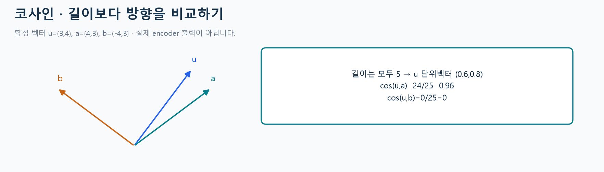

*E04용 독자 합성 벡터. 실제 LLM 임베딩이나 학습 결과가 아닙니다.*

**E04.** $u=(3,4)$, $a=(4,3)$, $b=(-4,3)$의 길이는 모두5입니다. $u$를 길이로 나누면 $(.6,.8)$입니다.

$$
\cos(u,a)=\frac{3\cdot4+4\cdot3}{5\cdot5}=.96,\qquad
\cos(u,b)=\frac{3(-4)+4\cdot3}{25}=0.
$$

코사인은 방향의 유사도입니다. .96을96% 추천 확률로 읽지 않습니다. 이 계산은 임베딩의 직관을 익히는 중간 예시이고, **교재9.3의 최종 구현은 코사인 순위만 만드는 것이 아니라 임베딩을 FM에 붙여 평점을 학습**합니다.

## 9. 원핫 두 블록과 임베딩 두 블록 연결하기

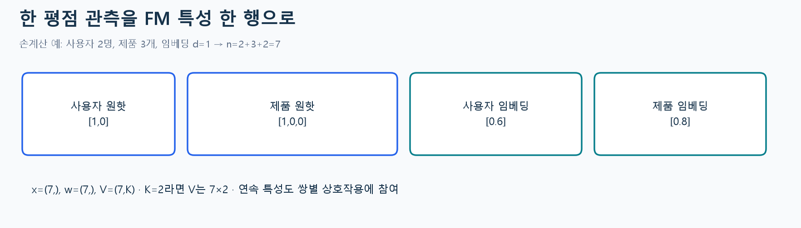

*E05용 독자 고정 수치. 사용자2명·제품3개·d=1의 작은 조립 예입니다.*

**E05.** U01의 첫 사용자 원핫은 `[1,0]`, P01의 첫 제품 원핫은 `[1,0,0]`입니다. 주어진 리뷰 표현이 .6과 .8이면 다음과 같습니다.

$$
x=[1,0,1,0,0,.6,.8],\quad n=U+I+2d=7.
$$

FM 잠재요인 수 $K=2$라면 $w$는7개, $V$는7×2입니다. **리뷰 선택 차원 d**와 **FM의 상호작용 차원 K**는 다릅니다. 임베딩을 끄면 사용자·제품 원핫만 남아 n=5입니다. 임베딩을 켜면 원핫×리뷰·리뷰×리뷰 쌍도 생기므로 원핫 두 개의 상호작용만 계산해서는 안 됩니다.

## 10. FM 예측에서 한 번의 학습까지

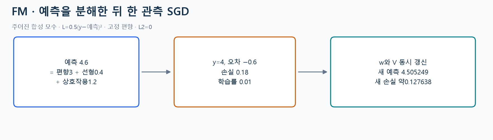

*E06·E07 독자 합성 모수 예. 편향 고정·L2=0·반제곱오차이며 교재의 모든 설정을 복제한 예는 아닙니다.*

$$
\hat y=b+\sum_iw_ix_i+\sum_{i<j}\langle v_i,v_j\rangle x_ix_j.
$$

**E06 · 항을 하나씩 더하기.** 활성 위치0/2/5/6의 $w$가 `[.1,.2,.3,-.1]`, $V$행이 `(1,0),(0,1),(1,1),(-1,1)`이면 선형항은 $.1+.2+.18-.08=.4$입니다. 여섯 쌍의 기여는 $0,.6,-.8,.6,.8,0$이므로 상호작용 합은1.2입니다. 편향3을 더하면 예측4.6입니다.

**E07 · SGD.** $y=4$, $e=y-\hat y=-.6$이면 $L=.5e^2=.18$입니다. 학습률 $.01$일 때 $w_0'=.1+.01(-.6)1=.094$입니다. $V$도 같은 갱신 전 값으로 동시에 바꾸면 새 예측은4.50524854528입니다. 순전파만 반복하면 이 변화는 없습니다. 실제 FM 학습은 이 관측 갱신을 반복합니다.

**V 한 칸도 따라가기.** 요인 $f$의 합을 $S_f=\sum_jv_{jf}x_j$라 두면, 자신의 항을 뺀 나머지 특성과의 연결이 기울기를 정합니다.

$$
v_{if}'=v_{if}+\alpha e\,x_i(S_f-v_{if}x_i).
$$

첫 활성 특성의 첫 요인은 $S_0=1+.6-.8=.8$, $x_0=1$, $v_{00}=1$입니다. 따라서 $v_{00}'=1+.01(-.6)(.8-1)=1.0012$입니다. 예측이 너무 컸다고 모든 모수를 줄이는 것은 아닙니다. 이 좌표의 예측 기울기는 $-.2$이므로 이 값을 늘리면 예측을 줄이는 방향으로 작용합니다. 각 좌표를 **같은 갱신 전 V**로 계산하세요.

## 11. 정보를 나눈 뒤 만들고, 선택하고, 평가하기

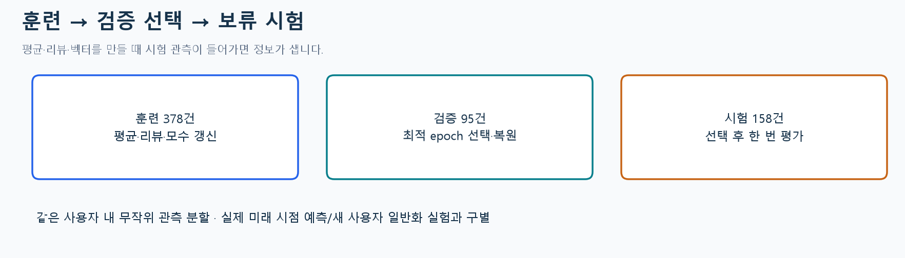

*수업 기본형 실제 분할. 교재 원자료와 다른 공식 Software 5-core 소표본입니다.*

**E08 · 공정한 비교.** 구조적 표본은 관측 많은 최대32명, 동률 고정seed, 사용자별 최근20개로 정합니다. 평점값이나 모형 오차로 좋은 표본을 고르지 않습니다. 중복 사용자·제품 관측은 가장 이른 시각/행순서 하나를 보존합니다. 최종631행을 사용자 내 무작위 관측 분할로378/95/158로 나눕니다. 실제 미래 시점·신규 사용자 예측 실험과는 다릅니다.

평균·리뷰·ID사전은 **훈련에서만** 만듭니다. ID만 FM/임베딩+FM은 같은 분할·관측 순서·K=4·25epoch·학습률 .03을 사용하고 같은 이름의 특성은 같은 초기값을 받습니다. 최적 검증 epoch의 w/V를 복원한 뒤 보류 시험을 읽습니다. 수업은 검증 선택을 분리하는 보강을 추가했습니다. 교재의 반복 시험 RMSE 확인과 구별하세요.

캐시 키는 텍스트·모델digest·훈련행·d·집계/정규화 함수까지 포함합니다. 캐시 적중이면 새 인코딩 요청0입니다. 가중치 학습이 생략됐다는 뜻은 아닙니다.

## 12. 결과와 한계를 함께 설명하기

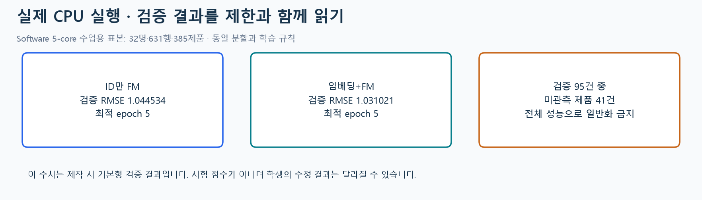

*제작 시 실제 CPU 실행 검증 결과. ID만1.044534, 임베딩+FM1.031021, 둘 다 최적 epoch5. 시험 점수가 아닙니다.*

검증95건 중41건은 훈련에서 보지 못한 제품입니다. 이 경우 제품 원핫은0이고 제품 벡터는 **명시적 훈련 평균 표현**을 씁니다. 이 평균을 실제 그 제품 리뷰를 인코딩한 것처럼 표시하지 않습니다. 전체 오차와 미관측 건수를 함께 읽습니다. 한 표본의 작은 차이로 임베딩이 항상 좋다고 결론 내리지 않습니다.

앱에서 한 행의 **bias+linear+interaction=prediction**을 확인하고 마지막 표를 CSV로 저장하세요. 본문 함수를 수정한 뒤 재학습·앱 조립을 해야 새 규칙이 반영됩니다. 원문 리뷰와 원본 사용자 식별자는 공유 앱·CSV에 싣지 않습니다. 수업 활동 기록은 변경한 코드·고정 조건·수치·이유 네 가지를 남기며 별도 새 제출기한은 없습니다.

## 점검 퀴즈

1. 프롬프팅에 예시를 추가하는 것과 LLM 미세조정은 어떤 차이가 있나요?
2. 이번 CF와 CB 프롬프트는 각각 어떤 근거를 읽나요?
3. 후보 A/B/C, K=3에서 유효 추천 A/B, 보류 정답 A/C이면 P@3과 recall은 얼마인가요?
4. 벡터 (3,4)와 (4,3)의 코사인을 계산하고 그 의미를 설명하세요.
5. 사용자2명·제품3개·양쪽 임베딩 d=1·FM K=2일 때 x와 V의 크기는 무엇인가요?
6. FM에서 편향3·선형항 .4·상호작용1.2이면 예측과 y=4의 반제곱오차는 얼마인가요?
7. 왜 리뷰 임베딩을 만든 뒤에 훈련·시험을 나누면 안 되나요?
8. 캐시를 재사용한 실행과 임베딩+FM의 성능 향상을 각각 어떻게 확인해야 하나요?

## 출처와 수업 보강 구별

- **주교재**: 임일(2025), 『AI 에이전트를 위한 개인화 추천 알고리즘: Python, 머신러닝, AI, LLM 활용』, 청람, 9장 pp.178–207.
- **독자 보강**: 도해12개·합성 E01–E08·분리 평가·응답 검사·캐시·본문 함수 수정·앱/CSV 연결.
- **공식 데이터**: [UCSD Amazon Reviews 2018](https://cseweb.ucsd.edu/~jmcauley/datasets/amazon_v2/)의 Software 5-core. 교재 제공 Amazon 전체와 표본·규모가 다릅니다. 원문은 공식 경로에서 자동 준비합니다.
- **공식 구현 문서**: [Ollama](https://docs.ollama.com/api/introduction), [Qwen2.5 0.5B](https://huggingface.co/Qwen/Qwen2.5-0.5B-Instruct), [Nomic v1.5](https://huggingface.co/nomic-ai/nomic-embed-text-v1.5). 실제 실행 모델·해시·배열 크기를 실습에 표시합니다.
