# W12A · 영화제 편성 실습과 하이브리드 추천

**딥러닝응용I(추천시스템) 01 · 동덕여자대학교 데이터사이언스전공 · 유원상 교수 · 2026-2 · 2026-11-17(화) 10:30–11:45**

주교재 9.2–9.3 실습을 마무리하고 10.1–10.3과 연습 10-1을 공부합니다. 먼저 영화 세 편을 편성해 모델 답을 검수하고, 이어서 두 모델의 평점을 섞는 기준을 실험합니다.

[실습 A · LLM 영화제 편성](https://colab.research.google.com/github/lunalab-ai/recommender/blob/2026-fall-w12a/notebooks/student/w12a-festival-llm.ipynb) · [실습 B · CF·MF 가중 결합](https://colab.research.google.com/github/lunalab-ai/recommender/blob/2026-fall-w12a/notebooks/student/w12a-hybrid-recommendation.ipynb) · [영화 카드와 계산 기록지](../supplements/w12a-workbook.md)

## 9.2 · 캠퍼스 영화제 편성회의

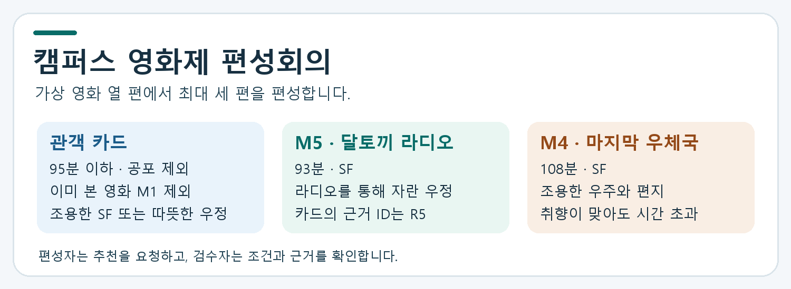

**먼저 예측해 보세요.** M1은 조용한 SF지만 관객이 이미 봤습니다. M4는 취향에 맞지만 108분입니다. 편성자와 검수자를 정해 조건을 통과하는 영화부터 찾아보세요. 그동안 팀당 한 대에서 무료 CPU 생성 모델을 준비합니다.

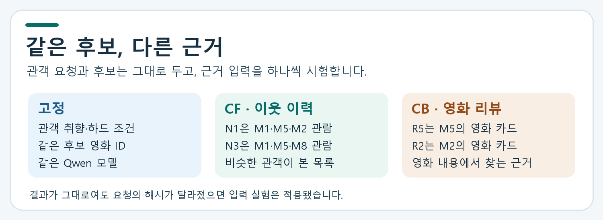

**같은 문제, 근거만 변경.** CF 프롬프트에는 비슷한 관객 N1–N3의 관람 이력을, CB 프롬프트에는 각 후보의 리뷰 R1–R10을 넣습니다. 후보와 모형을 고정하고 실습 A의 `build_ballot_prompt` 본문에서 N3만 빼 보세요. 입력 해시가 달라졌는지 먼저 확인합니다. 이 호출에서 모형 가중치는 고정입니다.

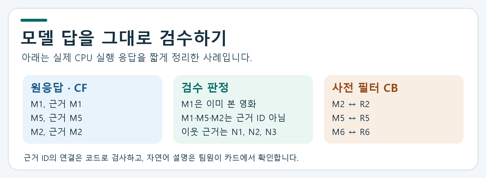

**형식과 내용은 따로 확인합니다.** 실제 CF 호출은 JSON을 만들었지만 M1을 골랐고 근거 칸에 영화 ID를 붙였습니다. CB에서 후보를 먼저 필터링한 한 실행에서는 M2·M5·M6이 짝이 맞는 근거 ID와 함께 남았습니다. 코드가 ID 관계를 검수한 뒤, 옆 팀이 설명 문장까지 실제 카드에 맞는지 확인하세요.

**교대 미션.** 새 관객은 88분 이하, 공포와 SF 제외, M2는 이미 봤습니다. 편성할 세 편이 부족하면 조건을 지키고 가능한 편수만 남기세요. 형태는 맞지만 내용이 틀린 응답 하나를 적으세요.

## 9.3 · 문장이 숫자가 되면

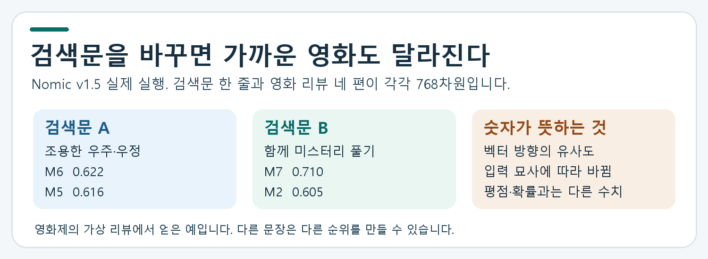

Nomic은 문장 하나를 길이 768짜리 벡터로 바꿉니다. 검색문만 바꾸면 유사도를 다시 계산할 수 있습니다. 벡터가 (3, 4)와 (4, 3)이면 방향 유사도는 내적 24를 길이의 곱 25로 나눈 0.96입니다.

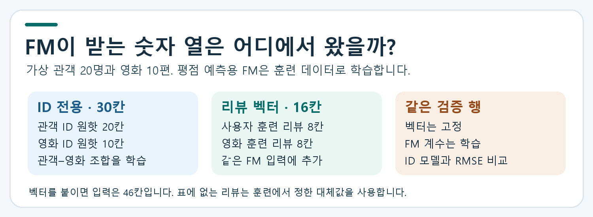

**코사인 순위와 평점 예측은 다른 출력입니다.** FM은 사용자 ID와 영화 ID, 그리고 선택한 두 리뷰 벡터를 입력 받아 평점으로 학습합니다. 실습의 ID 전용은 30열, 사용자·영화의 8차원씩을 붙이면 46열입니다. 벡터는 훈련 리뷰에서 만들고 두 FM은 같은 검증 행으로 비교합니다. 실습 A에서 `assemble_features`의 사용자 벡터 대입 줄을 찾아보세요.

## 10.1 · 두 모델을 왜 섞을까?

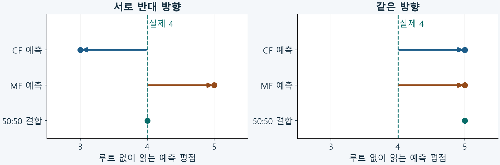

**실제 평점이 4라면** CF 3과 MF 5의 50:50 결합은 4입니다. 두 모델이 모두 5라면 같은 방식으로 섞어도 5입니다. CF는 비슷한 사람이 남긴 평점, MF는 사용자와 영화의 잠재 벡터를 사용합니다. 둘이 서로 다른 정보를 사용하면 오차가 상쇄될 수 있습니다. 데이터에서 확인해야 합니다.

## 10.2 · 비중의 뜻과 계산하기

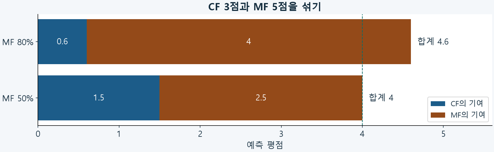

$w$는 MF의 비중이며 CF의 몫은 $1-w$입니다. 끝점 0에서는 CF 그대로, 1에서는 MF 그대로입니다.

$$
\widehat r_{\mathrm{mix}}=w\,\widehat r_{\mathrm{MF}}+(1-w)\,\widehat r_{\mathrm{CF}}
$$

교재 10.2의 가상 예측기처럼 80:20으로 시작해 봅시다. CF 3과 MF 5를 섞으면 CF 기여가 0.6, MF 기여가 4.0, 합이 4.6입니다. 10.2에서는 계산 절차를 보기 위해 가상의 두 예측기를 사용하고, 다음 절에서는 실제 추천 모형을 사용합니다.

**두 행 예제.** 실제 평점 (4, 4), CF (3, 5), MF (5, 5)의 개별 RMSE는 둘 다 1입니다. 50:50 예측 (4, 5)의 RMSE는 $\sqrt{(0^2+1^2)/2}\approx 0.707$입니다. 평점을 먼저 섞고 행별 오차를 계산합니다.

## 10.3 · 실제 CF·MF를 같은 행에 맞추기

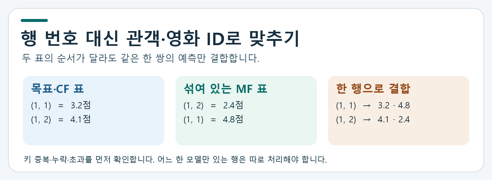

영화 2의 MF 2.4를 영화 1의 CF 3.2와 섞으면 계산은 실행되지만 다른 영화를 비교하게 됩니다. 실습 B의 `align_predictions`에서 두 키가 일대일인지 확인하세요. CF 이웃이나 MF 훈련 ID가 부족한 경우 모형별 적용률을 표시하고 같은 훈련 전체 평균으로 대체합니다.

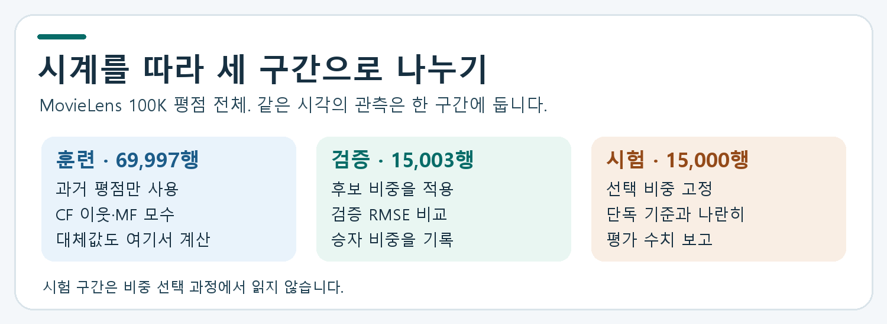

**교재와 실습의 평가 절차.** 교재 10.3의 한 실행은 MF 0.909601, CF 0.946719, MF 0.8 결합 0.909193입니다. 교재는 0.01씩 시험 오차를 비교해 MF 0.88의 예도 보여 줍니다. 수업은 검증에서만 비중을 고른 뒤 한 번의 시험 비교로 평가합니다. 교재와 수업의 데이터·분할·설정이 달라 수치는 직접 비교하지 않습니다.

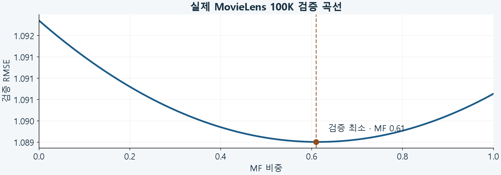

**실제 예의 결과.** 검증이 고른 MF 비중은 0.61입니다. 시험에서는 CF 1.1198, MF 1.1109, 0.8 결합 1.1115, 검증에서 고른 결합 1.1127이었습니다. 선택한 혼합이 시험에서 MF 단독을 이기지 못한 결과까지 기록합니다.

## 실습 B · 슬라이더로 추천 목록이 바뀌는 지점 찾기

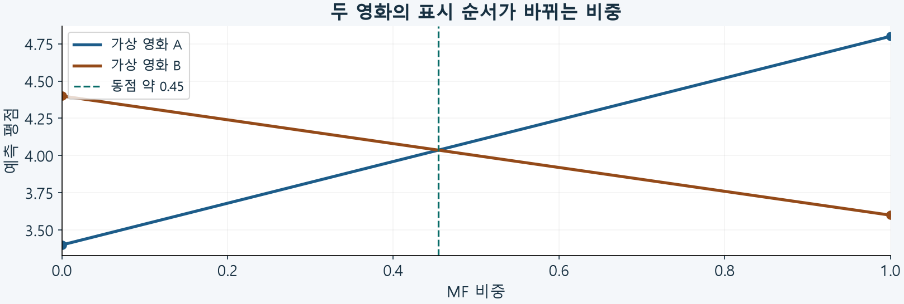

가상 영화 A의 점수는 CF 3.4, MF 4.8이고 B는 CF 4.4, MF 3.6입니다. 두 영화의 점수 차는 $-1.0+2.2w$이므로 MF 비중 약 0.45에서 순서가 바뀝니다. 실습 B에서 다른 후보의 Top-3·두 점수의 기여·CSV가 함께 바뀌는지 확인하세요. 검증 RMSE는 여러 관측의 평점 오차, Top-3는 해당 사용자에게 보여 주는 정렬입니다.

## 연습 10-1 · MF에 딥러닝 예측을 결합하기

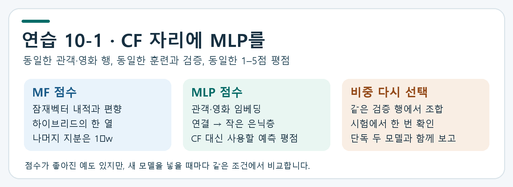

9장 실습의 영화제는 가상 카드이고, 10-1은 MovieLens 평점을 사용합니다. 사용자·영화 임베딩과 작은 MLP의 예측을 CF 열 대신 넣습니다. 행과 척도를 맞추고 MLP와 MF 각각을 기준으로 비교합니다. CF·MF에 골랐던 0.61을 그대로 쓰지 않고 검증에서 다시 선택합니다.

**수업 끝에 남길 두 문장.** 내 본문 코드에서 바꾼 한 줄과 확인한 출력은? 시험 전에 고정한 선택은?

임일(2025), 『AI 에이전트를 위한 개인화 추천 알고리즘』 9.2–9.3, 10장 본문 210–215쪽. 그림은 수업용으로 직접 제작했습니다. 실습 A는 Qwen2.5 0.5B와 Nomic v1.5를 CPU로 실행하고, 실습 B는 GroupLens 공식 데이터를 내려받습니다. [Ollama 구조화 출력](https://docs.ollama.com/capabilities/structured-outputs) · [GroupLens MovieLens 100K](https://grouplens.org/datasets/movielens/100k/) · [추천 단계 도해](https://developers.google.com/machine-learning/recommendation/overview/types) · [고정 배포판](https://github.com/lunalab-ai/recommender/releases/tag/2026-fall-w12a)

## 점검 퀴즈

1. CF 프롬프트의 N1과 CB 프롬프트의 R5는 각각 어떤 정보를 담나요?
2. 모델이 M1을 valid JSON의 picks에 넣었습니다. 어떤 조건을 위반했나요?
3. 리뷰 벡터를 만드는 모델이 고정일 때 FM에서는 무엇이 학습되며 입력 폭은 얼마인가요?
4. 실제 4점, CF 3점, MF 5점일 때 MF 비중이 0, 0.5, 0.8, 1이면 예측이 각각 얼마인가요?
5. 두 모형이 모두 5를 예측하고 실제가 4라면 50:50으로 섞은 후 절대오차는 얼마인가요?
6. 사용자와 영화의 예측 표가 서로 다른 순서로 들어올 때 무엇으로 한 행을 맞추나요?
7. 시험에서 최저 RMSE를 보인 비중을 골라 그 오차를 최종 성능으로 보고하면 어떤 문제가 있나요?
8. CF 열을 MLP 평점으로 바꾼 연습 10-1에서 어떤 조건을 유지하고 어떤 선택을 다시 하나요?
