# W12B · 하이브리드 추천 시스템 · 두 예측을 하나의 추천으로

2026-2 딥러닝응용I(추천시스템) 01 · 11월 19일 · 주교재 10.1–10.3과 연습 10-1

한 관객에게 영화 A와 B 중 무엇을 먼저 보여 줄까요? 오늘은 두 예측기가 같은 영화에 붙인 점수를 따라가며, 결합 평점이 어떻게 만들어지고 순위가 언제 바뀌는지 설명합니다.

## S01 · 두 예측을 섞으면 오차는 어떻게 바뀔까

영화 A의 실제 평점은 4점입니다. CF는 3점으로 1점 낮게, MF는 5점으로 1점 높게 예측했습니다. 두 점수를 절반씩 섞으면 4점입니다. 실제값에 더했다가 뺀 양이 같아서 이 한 행의 오차가 사라집니다.

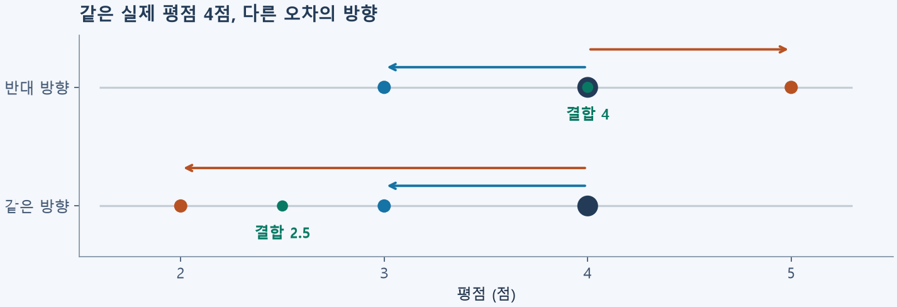

**계산 예제 1. 오차의 방향을 바꿔 보기.** A의 MF 예측을 2점으로 바꾸면 CF 3점과 MF 2점은 둘 다 실제보다 낮습니다. 절반씩 결합한 값은 2.5점이고, 실제와의 차이는 1.5점입니다. 같은 방향의 오차에는 서로 상쇄할 부분이 없습니다.

예측 오차를 $e=\hat r-r$로 쓰면, 결합 오차도 $e_H=(1-\alpha)e_{CF}+\alpha e_{MF}$입니다. 개별 점수는 한 행에서 결합하고, RMSE는 결합 뒤 여러 행에 걸쳐 계산합니다.

## S02 · 한 행의 가중 기여를 더하고 RMSE 계산하기

$\alpha$는 **MF 비중**입니다. $\alpha=0$이면 CF만, $\alpha=1$이면 MF만 남습니다. 같은 사용자·영화의 두 예측이 모두 1–5점 평점 단위일 때 다음 식을 적용합니다.

$$\hat r_H=(1-\alpha)\hat r_{CF}+\alpha\hat r_{MF}$$

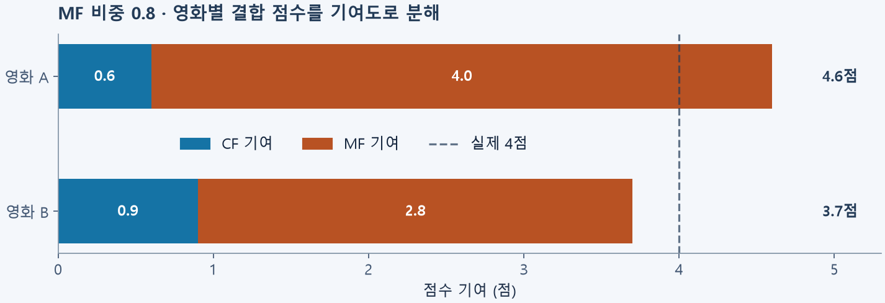

**계산 예제 2. 두 영화의 점수.** 두 실제 평점은 모두 4점입니다. A의 CF·MF 점수는 3과 5, B는 4.5와 3.5입니다. MF 비중 0.8에서 A는 $0.2(3)+0.8(5)=0.6+4.0=4.6$, B는 $0.2(4.5)+0.8(3.5)=0.9+2.8=3.7$입니다.

**계산 예제 3. 두 행의 RMSE.** A의 오차는 $0.6$, B의 오차는 $-0.3$입니다. 각각 제곱하고 두 행의 평균을 내어 제곱근을 취하면 $\sqrt{(0.36+0.09)/2}=0.4743$점입니다. 이 두 행에서 CF와 MF 단독 RMSE는 각각 $\sqrt{(1+0.25)/2}=0.7906$점입니다.

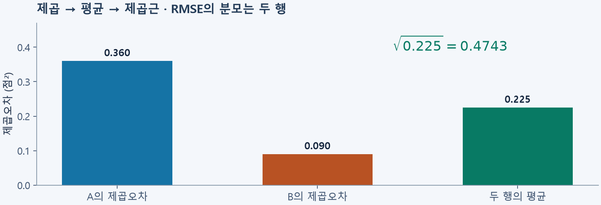

**Colab S02.** `blend_one`의 본문을 읽고 $\alpha$를 0, 0.5, 1로 바꾼 뒤 기여도와 점수를 비교합니다. 단독 RMSE 두 개를 먼저 평균하면 각 행의 오차 방향 정보가 빠집니다.

## S03 · 같은 관객과 영화의 CF·MF 점수 추적하기

**계산 예제 4. CF의 이웃 기여.** A를 예측하는 관객의 평균은 3.5점입니다. 이웃의 평점 편차가 각각 $-1.5$, $+1.5$, 정규화된 유사도 가중치가 $2/3$, $1/3$이라고 합시다. 가중 편차는 $-1$과 $+0.5$입니다. 기준 평균에 합을 더하면 $3.5-1+0.5=3.0$점입니다.

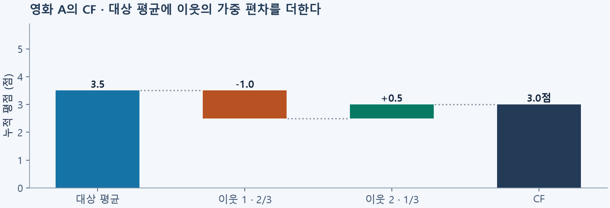

**계산 예제 5. MF의 점수 분해.** 훈련 전체 평균 3.5점, 사용자 편향 0.2점, 영화 편향 0.3점, 두 잠재벡터가 각각 $(0.8,0.6)$인 손계산 예입니다. 내적은 $0.8^2+0.6^2=1.0$이고 합계는 $3.5+0.2+0.3+1.0=5.0$점입니다. 실제 모형에서 편향과 잠재벡터는 훈련에 관측된 평점으로 학습합니다.

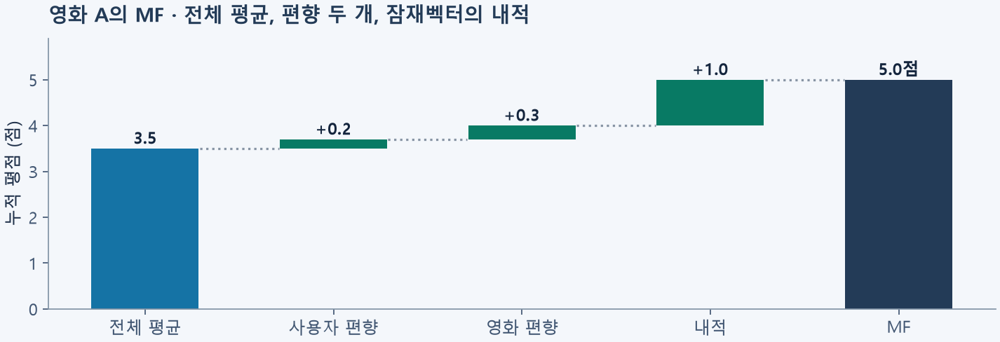

**계산 예제 6. 예측표의 행이 섞이면.** A의 CF 3에 B의 MF 3.5를 위치로 붙이면 $0.2(3)+0.8(3.5)=3.4$점입니다. 사용자 ID와 영화 ID로 연결하면 A의 MF 5가 돌아와 4.6점이 됩니다. 키가 누락되거나 중복된 경우에는 먼저 진단하고 평가 행을 임의로 버리지 않습니다.

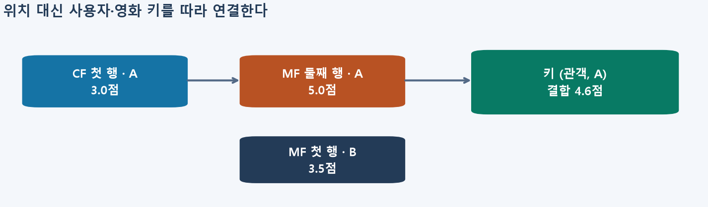

**Colab S03.** `align_predictions`가 두 ID를 모두 검사하는지 확인합니다. 이어 실제 한 행에 대해 CF 이웃별 유사도·편차·기여 합, MF 네 항과 각 잠재 차원의 곱을 출력해 예측을 다시 계산합니다.

## S04 · 훈련과 검증과 시험을 시간순으로 나누기

MovieLens 100K에서는 과거의 평점으로 CF·MF를 학습합니다. 그 다음 기간의 검증 평점으로 $\alpha$를 정합니다. 마지막 기간의 시험 평점은 최종 비교 때 사용합니다. 같은 초에 기록된 행은 한 구간에 둡니다.

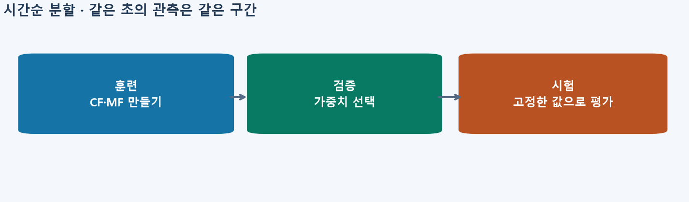

**계산 예제 7. 지원율, 대체, 평가 분모.** 5행 중 CF 근거가 3행에 있으면 대체 전 지원율은 $3/5=60\%$입니다. 두 모델 모두 지원하지 않는 행의 실제값이 5점이고 훈련 전체 평균이 3.6점이면, 공통 대체 정책 적용 후 두 예측은 3.6점입니다. 결합의 제곱오차는 $(-1.4)^2=1.96$이고 분모에는 이 행도 포함됩니다.

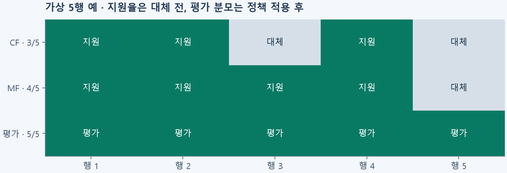

**계산 예제 8. 가중치 후보 고르기.** 검증에서 두 영화의 실제값을 각각 4로 둔 소규모 예입니다. $\alpha=0,0.5,0.8,1$의 RMSE는 각각 약 0.791, 0, 0.474, 0.791입니다. 여기서 0.5를 골라 별도 시험 기간에 적용합니다. 실제 데이터에서는 검증 곡선이 평평할 수 있으므로 차이와 평가 건수를 함께 읽습니다.

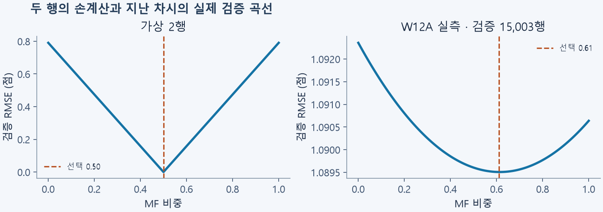

**교재 관측과 교실 실험.** 교재 214쪽의 한 실행은 MF 0.909601, CF 0.946719, 0.8 대 0.2 결합 0.909193을 보였습니다. 교재 215쪽의 0.88 대 0.12도 그 실행의 탐색 결과입니다. 이전 W12A의 시간순 분할 실험에서는 검증 비중이 0.61이었고 시험은 MF 약 1.11085, 결합 약 1.11273이었습니다. 어떤 비중을 골랐고 어느 분할에서 비교했는지 함께 기록합니다.

**Colab S04.** 0부터 1까지 가중치 후보를 검증 표에만 적용합니다. `select_weight`의 탐색 간격을 바꾸고 초깃값과 선택값을 기록합니다. 그 다음 시험 표의 평점과 각 모형의 RMSE를 확인합니다.

## S05 · 순위가 바뀌는 지점 찾기와 연습 10-1

**계산 예제 9. 두 후보의 교차.** A 점수는 $3+2\alpha$, B 점수는 $4.5-\alpha$입니다. 두 값을 같게 두면 $3\alpha=1.5$이고 $\alpha=0.5$에서 동점입니다. 0.4에서는 A 3.8점, B 4.1점이고 0.6에서는 A 4.2점, B 3.9점입니다. 이 표는 한 관객의 표시 순서를 비교합니다. 시험 RMSE는 실제 평점과의 오차를 요약합니다.

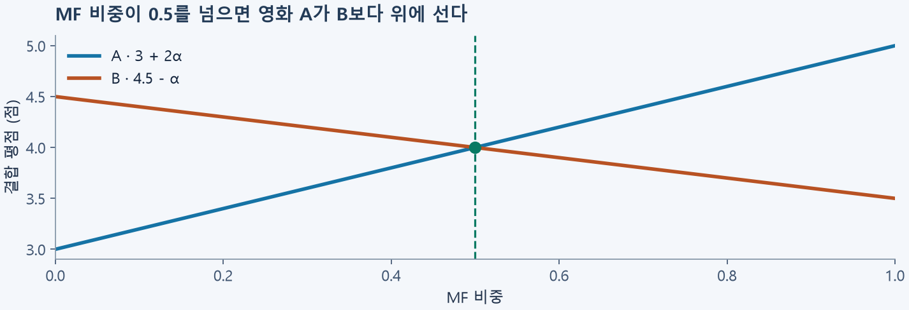

**계산 예제 10. CF 열을 MLP로 바꾸기.** A의 MLP 예측을 3.8점으로 둔 합성 예입니다. MF 5점과 같은 0.8 비중으로 결합하면 $0.2(3.8)+0.8(5)=4.76$점입니다. 예측기 조합을 바꾸면 검증에서 비중을 다시 선택합니다. 실제 MLP 재현에서도 동일 사용자·영화 키, 훈련·검증·시험 분할과 평점 단위를 유지합니다.

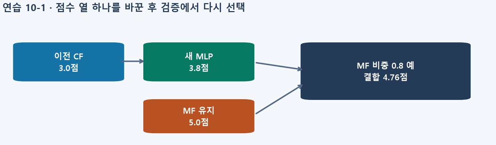

**계산 예제 11. 학습 한 걸음 읽기.** 별도 한 차원 예에서 예측 3.5점, 실제 4점, 잠재요인 $p=0.5$, $q=1.0$, 학습률 0.1, 정규화 0이라면 잔차는 $4-3.5=0.5$점입니다. 갱신 전 두 값을 써서 $p'=0.55$, $q'=1.025$를 얻습니다. 이 단계에서 바뀌는 것은 MF 모수입니다. $\alpha$는 이후의 결합 단계에서 선택합니다.

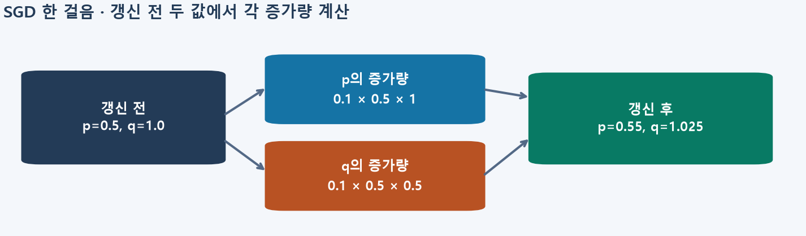

## S06 · 결과를 한 문장으로 설명하기

계산 기록지에 세 가지를 적으세요. (1) 무엇을 같은 행으로 맞췄는가? (2) 어느 데이터로 결합 비중을 골랐는가? (3) 어느 비중부터 두 영화의 순서가 바뀌는가?

- [계산 기록지와 강의 PDF](https://github.com/lunalab-ai/recommender/releases/tag/2026-fall-w12b)
- [W12B Colab](https://colab.research.google.com/github/lunalab-ai/recommender/blob/2026-fall-w12b/notebooks/student/w12b-hybrid-recommendation.ipynb)
- 임일, 『AI 에이전트를 위한 개인화 추천 알고리즘』, 청람, 2025, 10장 210–215쪽.
- [GroupLens MovieLens 100K](https://grouplens.org/datasets/movielens/100k/) · [Robin Burke, Hybrid Recommender Systems](https://link.springer.com/article/10.1023/A:1021240730564)

## 점검 퀴즈

1. 실제 4, CF 3, MF 5이면 50:50의 예측과 오차는 무엇인가요?
2. 실제 4, CF 3, MF 2면 50:50의 절대오차는 얼마인가요?
3. MF 비중 0.8에서 A의 CF 3.0과 MF 5.0은 각각 얼마나 기여하나요?
4. 두 오차가 0.6과 −0.3이면 RMSE는 얼마인가요?
5. 가중평균 전 두 예측표의 어떤 키와 단위를 확인하나요?
6. CF가 5행 중 3행을 지원했는데 대체 후 전체를 평가하면 어떤 분모를 쓰나요?
7. A 점수가 3+2α이고 B가 4.5−α일 때 동점과 α=0.6의 1위는 무엇인가요?
8. CF 점수 대신 MLP 점수를 넣으면 언제 결합 비중을 고르나요?
