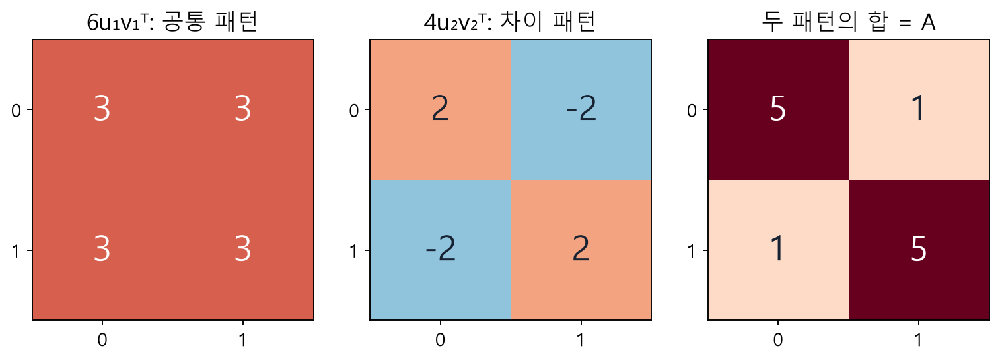
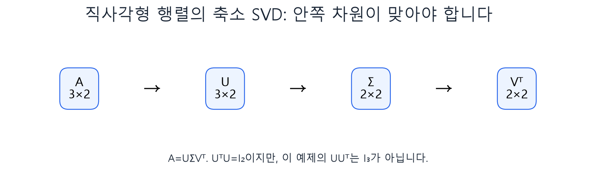

# W07A · SVD 섹션 8–13 마무리

추천시스템 · 2026년10월13일 · 동덕여자대학교 · 유원상 교수

지난 W06B의 섹션8부터 이어갑니다. 이 노트는 계산을 함께 확인하는 보충 노트이며 중간고사 대비60문항과 별도입니다. 식의 숫자보다 “각 행렬이 무엇을 하고 어떤 오차를 줄이는가”를 설명하는 것이 목표입니다.

## 1. 다시 시작할 세 가지 기호

$$A=U\Sigma V^\top,\qquad A^\top A v_j=\lambda_j v_j,\qquad\sigma_j=\sqrt{\lambda_j}.$$

A는 원래 변환입니다. v는 입력 쪽 특별한 단위 방향, u는 그 방향을 변환한 출력 쪽 단위 방향입니다. 특이값은 길이의 배율이며 음수가 아닙니다. 고유값은 AᵀA에서 구한 길이 제곱입니다. 정규화는 벡터를 자기 길이로 나누어 길이1로 만드는 것입니다.

## 2. 대표 행렬: 여섯 단계를 끝까지

$$A=\begin{bmatrix}5&1\\1&5\end{bmatrix},\quad A^\top A=\begin{bmatrix}26&10\\10&26\end{bmatrix}.$$

첫 칸은5×5+1×1=26, 오른쪽 위는5×1+1×5=10입니다. 행과 열의 내적으로 각 칸을 계산합니다.

$$\det(A^\top A-\lambda I)=(26-\lambda)^2-10^2=(\lambda-36)(\lambda-16)=0.$$

고유값36을 넣으면−10x+10y=0이라 y=x입니다. 고유값16이면10x+10y=0이라 y=−x입니다. 각각(1,1),(1,−1)을 선택하고 길이√2로 나눕니다.

$$v_1=\frac1{\sqrt2}\begin{bmatrix}1\\1\end{bmatrix},\quad v_2=\frac1{\sqrt2}\begin{bmatrix}1\\-1\end{bmatrix},\quad\Sigma=\begin{bmatrix}6&0\\0&4\end{bmatrix}.$$

여기서 특이값은36,16이 아니라 그 제곱근6,4입니다. 출력 방향은 실제 A에 v를 곱한 뒤 특이값으로 나누어 구합니다.

$$Av_1=\frac1{\sqrt2}\begin{bmatrix}6\\6\end{bmatrix},\quad
u_1=\frac{Av_1}{6}=v_1,\qquad
Av_2=\frac1{\sqrt2}\begin{bmatrix}4\\-4\end{bmatrix},\quad u_2=\frac{Av_2}{4}=v_2.$$

이 행렬에서는 U=V이지만 일반적인 행렬에서는 그렇지 않습니다. 마지막으로 재구성해야 계산이 끝납니다.

$$U\Sigma V^\top=\frac12\begin{bmatrix}6&4\\6&-4\end{bmatrix}\begin{bmatrix}1&1\\1&-1\end{bmatrix}=\frac12\begin{bmatrix}10&2\\2&10\end{bmatrix}=A.$$

**검산 순서:** 각 v의 길이가1인가 → 서로 내적0인가 → Av=σu인가 → 세 인수의 곱이A인가. NumPy와 벡터 부호가 다르더라도 이 검산을 통과할 수 있습니다.

## 3. 두 패턴을 겹치기



그림9. 기존 W06B의 독자 제작 계산 그림을 재사용했습니다. 첫 항은 공통 수준3, 둘째는 대각과 비대각 차이입니다. 이는 이 작은 행렬의 해석이며 실제 잠재축의 이름이 자동으로 정해진다는 뜻이 아닙니다.

$$A=6u_1v_1^\top+4u_2v_2^\top=\begin{bmatrix}3&3\\3&3\end{bmatrix}+\begin{bmatrix}2&-2\\-2&2\end{bmatrix}.$$

rank-1은 첫 패턴 하나만 남깁니다. 행렬은 여전히2×2이지만 두 열이 같아 독립적인 열 방향은 하나입니다. rank를 남은 칸의 개수로 읽지 않습니다.

$$\lVert A-A_1\rVert_F^2=2^2+(-2)^2+(-2)^2+2^2=16,\quad
\lVert A-A_1\rVert_F=4,\quad\mathrm{RMSE}_{\mathrm{entry}}=\sqrt{16/4}=2.$$

제곱오차 합16, Frobenius 오차4, 원소당RMSE2는 서로 다릅니다. 제곱합 보존 비율은36/(36+16)≈0.6923입니다. 이는 입력 행렬의 제곱합 보존 비율이며 추천 정확도69.23%가 아닙니다.

## 4. 직사각형·0·부호 확인

| 형태 (q=min(m,n)) | U | Σ | Vᵀ | 복원 |
|---|---|---|---|---|
| 완전 SVD | m×m | m×n | n×n | 정확 |
| 축소 SVD | m×q | q×q | q×n | 정확 |
| k항 절단 | m×k | k×k | k×n | 보통 근사, 비영 항을 모두 남기면 정확 |



그림10. 기존 W06B 독자 제작 차원 그림입니다. 인접한 차원이 맞아 곱셈 결과가m×n인지 읽으세요. 축소는 불필요한 방향을 표현에서 줄인 것이지 반드시 근사한다는 뜻이 아닙니다.

σ=0이면 Av/σ로 u를 구할 수 없습니다. 양의 항만 쓰는 compact 표현을 사용하거나 필요한 직교 방향을 별도로 보충합니다. u와v의 부호를 동시에 바꾸면 외적의 두 음수가 상쇄되어 같은 패턴입니다.

## 5. 미관측에0을 넣은 반례

$$R=\begin{bmatrix}5&1\\1&5\end{bmatrix},\qquad M=\begin{bmatrix}5&0\\1&5\end{bmatrix}.$$

R의 오른쪽 위1을 감춘 뒤0으로 대입하여M을 만들었다고 합시다. M의 완전 SVD 재구성은 M 자체이므로 입력M에 대한 오차는0입니다. 그러나 감춘 칸의 예측은0이고 실제값1과의 절대오차는1입니다. 따라서 입력을 완벽히 복원했다는 사실만으로 추천 예측이 정확하다고 말할 수 없습니다.

## 6. 실습 재개와 검산

[기존 Colab B · rank와 웹 앱](https://colab.research.google.com/github/lunalab-ai/recommender/blob/2026-fall-w06b/notebooks/student/w06b-svd-reconstruction.ipynb)

새 런타임이면 설치 셀부터 실행합니다. 이어서 **1. 외적 한 항 → rank별 오차 → 미관측0대입 → 마지막 앱**을 순서대로 확인합니다. **기존 계산 문제5–9**를 다시 풀고, 공개된 기존 상세 풀이로 중간 단계를 대조하세요.

```python
import numpy as np
A=np.array([[5.,1.],[1.,5.]])
U,s,Vt=np.linalg.svd(A,full_matrices=False)
A1=U[:,:1] @ np.diag(s[:1]) @ Vt[:1,:]
print(s, A1, np.linalg.norm(A-A1))
assert np.allclose(s,[6,4])
assert np.allclose(A1,np.full((2,2),3))
assert np.isclose(np.linalg.norm(A-A1),4)
```

`@`는 행렬곱, `np.diag(s)`는 특이값 벡터로 대각행렬을 만드는 연산입니다. 출력은 특이값[6,4], 모든 칸3인A1, 오차4입니다. 큰 행렬의 실제 구현은 손계산처럼AᵀA를 직접 만들어 고유분해하는 방식만 사용하는 것이 아닙니다. 위 NumPy 함수가 수치 SVD를 수행합니다.

이번 Colab B의 마지막 앱에서도 SVD 탭을 열고 k=1→2로 바꾸어 보세요. **S1:** 바뀐 행렬과 오차를 설명하고, 그것이 추천 정확도 변화라고 말할 수 없는 이유를 적으세요.

## 출처

임일(2025), 주교재4.6 인쇄93–94쪽의 SVD/MF 구분과 기존 W06B 섹션8–13. 여섯 단계 손계산·반례·설명 그림은 수업을 위한 독자 보충입니다. [NumPy SVD 공식 문서](https://numpy.org/doc/stable/reference/generated/numpy.linalg.svd.html), [기존 SVD 강의](https://fancy-ballcap-a15.notion.site/W06b-SVD-3f27fd00109f81059e90c409d18410cf).
