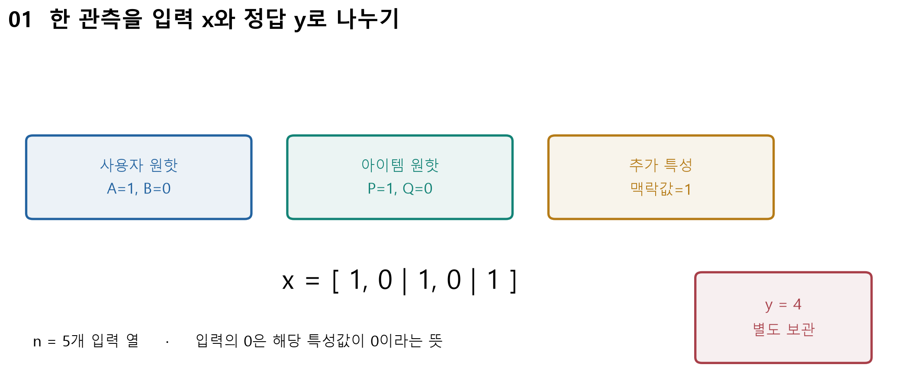
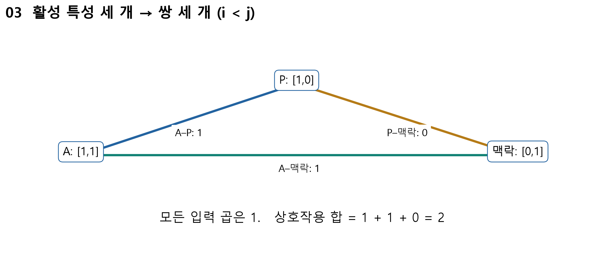
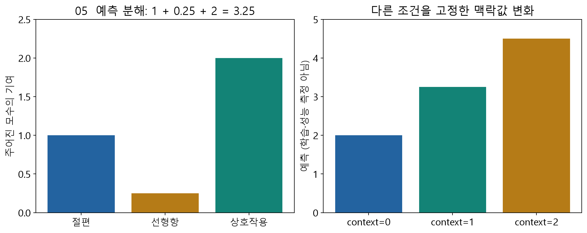
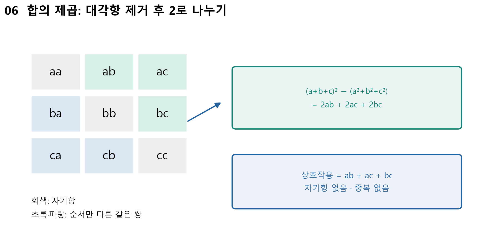

# A · FM을 다시 계산하며 MF로 연결하기

> 주교재5.1–5.4(pp.96–103) 복습. 아래 숫자는 지난 W09B와 같은 수업용 합성 모수이며 실제 학습 결과가 아닙니다.

## 1. 한 행은 무엇을 뜻할까?

한 관측은 “사용자 A가 영화 P에 평점4를 주었고, 맥락값은1이었다”입니다. 입력은 사용자·영화·맥락이고, 맞히려는 정답은 평점입니다. 정답을 입력에 넣으면 예측 문제가 사라집니다. 여기서 맥락은 계산을 설명하기 위한 무단위 합성값입니다.

그림 읽기: 파란 사용자 블록 → 초록 영화 블록 → 보라 맥락 열 → 별도로 둔 정답 순서입니다. 각 원핫 블록에서 선택한 대상만1입니다. W09B 독자 합성 도해를 재사용했습니다.

| 기호 | 뜻 | 이번 크기/값 |
|---|---|---|
| $x$ | 한 관측의 입력 열 | $[1,0,1,0,1]$, 길이5 |
| $y$ | 관측한 정답 평점 | 4, 입력에 넣지 않음 |
| $w_0$ | 전체 출발점인 편향 | 주어진 상수1 |
| $w_i$ | 입력 열 하나의 선형 계수 | $w=[.5,.2,-.5,-.1,.25]$ |
| $v_i$ | 입력 열 $i$의 잠재벡터 | $V$의 한 행, 길이 $K=2$ |
| $i,j$ | 특성 열 번호 | 사용자 번호/영화 번호와 구별 |

잠재값은 데이터로 학습할 수 있는 숫자입니다. 각 축이 액션/로맨스 같은 특정 의미라고 단정하지 않습니다. 차원 수 $K$와 상호작용 쌍 수는 다른 개념입니다.

### E01 · 입력과 정답을 분리하기

열 순서는 A, B, P, Q, 맥락입니다. A와 P를 선택하고 맥락1을 넣으면 $x=[1,0,1,0,1]$입니다. 평점4는 $y=4$로 따로 둡니다. 이번 입력과 잠재벡터는 다음과 같습니다.

| 열 | $x_i$ | $w_i$ | $v_i$ |
|---|---:|---:|---|
| A | 1 | .5 | $[1,1]$ |
| B | 0 | .2 | $[.3,-.2]$ |
| P | 1 | −.5 | $[1,0]$ |
| Q | 0 | −.1 | $[-.1,.4]$ |
| 맥락 | 1 | .25 | $[0,1]$ |

## 2. FM의 긴 식을 세 덩어리로 읽기

$$
\hat y=w_0+\sum_{i=1}^{n}w_ix_i+
\sum_{i<j}\langle v_i,v_j\rangle x_ix_j.
$$

첫 항은 출발점, 둘째 항은 각 특성 혼자의 기여, 셋째 항은 두 특성이 함께 있을 때의 기여입니다. 내적은 같은 위치끼리 곱해 더합니다. $[a,b]\cdot[c,d]=ac+bd$입니다. $i<j$는 자기 자신과의 쌍과 순서만 바뀐 중복을 제외합니다.

그림 읽기: 세 활성 꼭짓점을 찾고 각 선의 양끝 벡터를 내적합니다. P–맥락 선의 결과0도 실제 계산한 쌍입니다. 출처: W09B 독자 합성 도해.

### E02 · 3.25가 나오는 모든 중간 계산

선형항은 $.5\times1+(-.5)\times1+.25\times1=.25$입니다. 활성 쌍은 A–P, A–맥락, P–맥락의 세 개입니다.

| 쌍 | 벡터 내적 | 입력값 곱 | 기여 |
|---|---|---:|---:|
| A–P | $1\times1+1\times0=1$ | 1 | 1 |
| A–맥락 | $1\times0+1\times1=1$ | 1 | 1 |
| P–맥락 | $1\times0+0\times1=0$ | 1 | 0 |

따라서 $\hat y=1+.25+(1+1+0)=3.25$입니다. 정답4와 예측3.25의 차이는 $.75$입니다. $K=2$는 각 내적에서 곱해 더할 좌표가 두 개라는 뜻입니다. 활성 특성3개의 쌍 수는 $3\times2/2=3$입니다.

읽기: 각 항의 높이를 더한 뒤 맥락0/1/2의 예측2/3.25/4.5를 비교하세요. 입력만 바꾸고 모수는 고정한 실험입니다. 출처: W09B 독자 합성 도해.

### E03 · 효율식의 자기항 제거와 1/2

첫 잠재 좌표의 활성 값은 $[1,1,0]$입니다. 합의 제곱은4, 각 값의 제곱합은2이므로 $(4-2)/2=1$입니다. 둘째 좌표도 $[1,0,1]$이므로1입니다. 두 좌표를 더하면 상호작용2를 얻습니다.

$$
\sum_{i<j}\langle v_i,v_j\rangle x_ix_j
=\frac12\sum_{f=1}^{K}
\left[\left(\sum_i v_{if}x_i\right)^2-\sum_i(v_{if}x_i)^2\right].
$$

대각선은 자기 자신을 곱한 값이어서 빼고, 위·아래의 같은 쌍이 두 번 있으므로2로 나눕니다. 연속형 입력에서도 자기항은 $(v_{if}x_i)^2$입니다. $x_i$의 제곱을 생략하지 않습니다. 출처: W09B 독자 도해; 교재5.2(p.98)의 식을 수치화했습니다.

### E04 · 학습은 오차를 이용해 모수를 바꾸는 것

손실을 $L=\tfrac12(y-\hat y)^2$로 두면 현재 $L=.5\times.75^2=.28125$입니다. 학습률 $\alpha=.1$에서 A의 선형 계수는 $w_A'= .5+.1\times.75\times1=.575$입니다. 학습률은 한 번에 바꾸는 크기를 조절합니다.

이것은 한 계수의 갱신 예입니다. 모든 새 모수를 갱신 전의 같은 상태로 계산해야 합니다. 하나를 먼저 바꾸고 그 새 값으로 다음 미분을 계산하면 다른 알고리즘이 됩니다. 교재5.3의 잔차는 여기서 $e=y-\hat y$로 통일합니다.

## 3. MF가 되는 특별한 경우

맥락을0으로 두면 A와 P만 활성입니다. 선형항은0, 내적은1이므로 예측은2입니다. 사용자 원핫·영화 원핫만 있고 각 편향과 잠재벡터를 대응시키면 FM은 편향이 있는 MF와 같은 식이 됩니다. 이번에는 이 MF를 Keras의 입력·임베딩·내적 층으로 옮깁니다.

복습 데이터 변환은 교재 그림5-1(p.100),5-2(p.103)를 참고하세요. 원핫을 실제로 큰 배열에 모두 저장하지 않고 정수 ID 또는 비영 index/value로 나타낼 수 있습니다. 0은 “미관측 평점”과 같은 뜻이 아닙니다.

직접 확인 C01: 입력 열 수5, 활성 열 수3, 잠재폭2, 활성 쌍 수3을 각각 그림에서 가리키세요. 워크북 L01(필수),L02(보충)로 독립 계산합니다.
