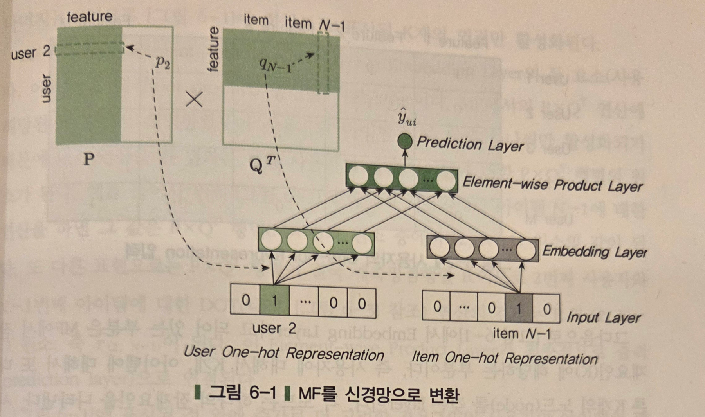
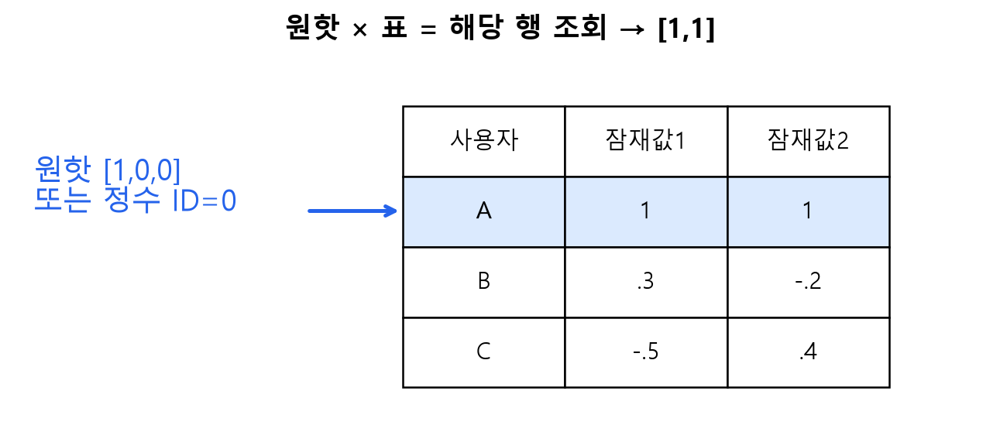
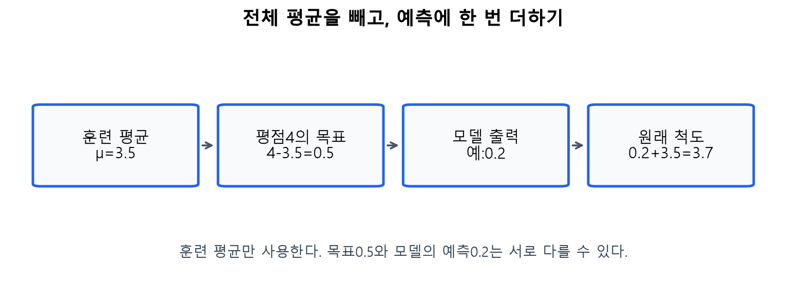
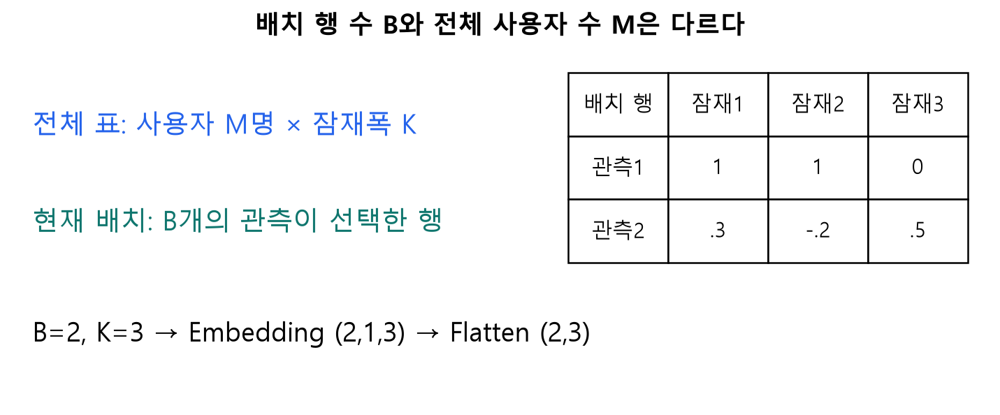
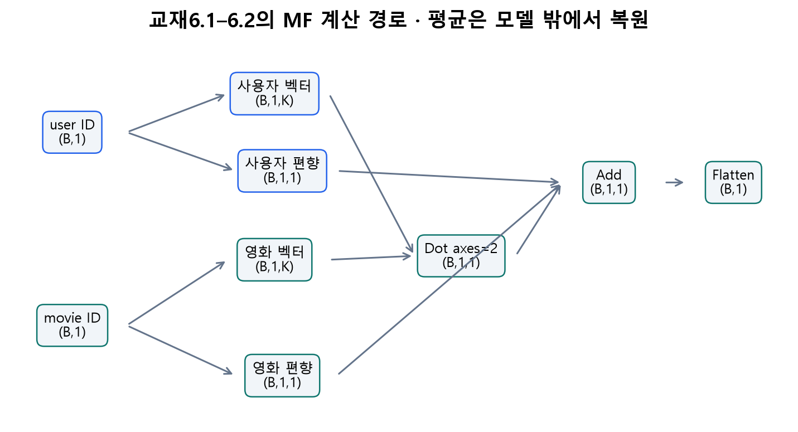
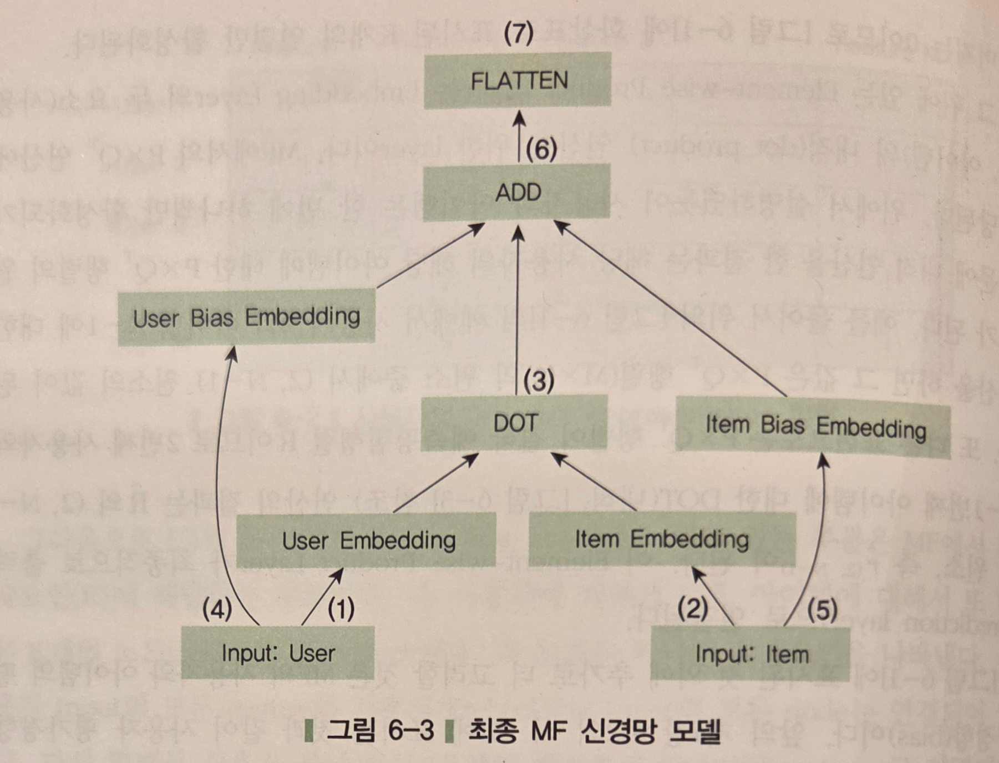

# B · 6.1–6.2: MF를 Keras로 표현하기

> 주교재6.1(pp.120–124),6.2(pp.125–133 상단). 이 절은 MF의 계산을 신경망 도구로 표현합니다.

## 1. 처음 만나는 용어부터

모형은 입력에서 예측을 만드는 계산 규칙입니다. 모수는 데이터로 학습할 숫자입니다. MF에서는 사용자·영화 잠재벡터와 편향이 모수입니다. 신경망의 층(layer)은 입력을 받아 다음 값을 만드는 계산 단위입니다. 임베딩(Embedding)은 정수 ID로 학습 가능한 벡터 표의 행을 꺼냅니다.

출처: 임일(2025), 주교재6장 p.121 그림6-1 원본 선별 발췌. 읽기: 아래 원핫 → 가운데 임베딩 → 같은 좌표끼리의 곱 → 합산 예측 순서입니다. 행렬의 특정 행/열을 선택하는 것과 벡터를 꺼내는 계산을 대응시키세요.

### E05 · 원핫 곱셈이 행 조회와 같은 이유

사용자 표를 $P=\begin{bmatrix}1&1\\.3&-.2\\-.5&.4\end{bmatrix}$라고 합시다. A의 원핫 $[1,0,0]$를 왼쪽에서 곱하면 $1[1,1]+0[.3,-.2]+0[-.5,.4]=[1,1]$입니다. 정수 ID0으로 첫 행을 꺼내도 $[1,1]$입니다. 원핫은 어느 행을 고를지를 표시합니다.

독자 수업 도해. 읽기: 원핫의1 위치 → 강조된 표의 행 → 반환 벡터입니다. 여기서는0기반 예제입니다. 실제 실습의 ID0은 미학습 표지로 예약하므로 인코딩 규약을 섞지 마세요.

## 2. MF의 네 부분과 평균

$$
\hat r_{ui}=\mu+b_u+b_i+p_u^\top q_i.
$$

$r$은 평점, $\hat r$은 예측 평점, $u,i$는 사용자·영화 번호, $p_u,q_i$는 길이 $K$ 벡터, $b_u,b_i$는 사용자·영화 편향, $\mu$는 훈련 평점의 평균입니다. $p_u^\top q_i$는 전치 기호가 붙은 내적입니다. 한 관측의 출력은 숫자 하나입니다.

### E06 · 편향과 내적을 더하기

앞의 합성 모수 $\mu=1,b_A=.5,b_P=-.5,p_A=[1,1],q_P=[1,0]$를 씁니다. 내적은1이고, $\hat r_{AP}=1+.5-.5+1=2$입니다. 이는 A절에서 맥락0으로 계산한 FM 결과와 같습니다. 여기의 평균1은 수업용으로 주어진 값입니다. 실제 실습에서는 훈련 자료에서 평균을 계산합니다.

교재에서는 전체 평균을 네트워크 밖에서 처리합니다. 학습 목표는 $r-\mu$, 모델 출력은 중심화 점수입니다. 예측할 때 $\mu$를 한 번 더해 원래 평점 척도로 돌아옵니다.

독자 수계산 도해. 평균3.5, 관측 평점4이면 목표는0.5입니다. 모델이0.2를 예측했다면 원래 평점 예측은3.7입니다. 목표와 예측은 같을 필요가 없으며, 그 차이가 학습의 출발점입니다.

## 3. 배열의 모양을 읽는 법

배열의 shape는 축별 크기입니다. `(2,3)`은 행2개·열3개, `(B,1,K)`는 세 축입니다. $B$는 현재 한 번에 처리하는 관측 수인 배치 크기입니다. $M$은 사용자 표의 행 수, $N$은 영화 표의 행 수, $K$는 잠재벡터 폭입니다. `None`은 실행 때 정해질 배치 크기입니다.

독자 도해. 같은 사용자가 배치에 두 번 나타날 수도 있습니다. 따라서 배치 행 수와 서로 다른 사용자 수를 동일시하지 않습니다.

독자 도해, 교재6.1–6.2의 계산을 차원과 연결했습니다. 화살표를 따라 아래 표의 한 행씩 확인하세요.

| 단계 | 입력/출력 크기 | 하는 계산 |
|---|---|---|
| `Input(shape=(1,))` | `(B,1)` | 한 관측당 ID 하나 |
| `Embedding(M,K)` | `(B,1,K)` | 사용자 표에서 벡터 조회 |
| 영화 임베딩 | `(B,1,K)` | 영화 표에서 벡터 조회 |
| `Dot(axes=2)` | `(B,1,1)` | 각 관측 안에서 길이 $K$ 내적 |
| 사용자·영화 편향 임베딩 | 각각 `(B,1,1)` | 각 편향 하나 조회 |
| `Add` | `(B,1,1)` | 내적과 두 편향을 더함 |
| `Flatten` | `(B,1)` | 배치를 보존하며 뒤 축을 펼침 |

`Flatten`은 값을 더하거나 학습하지 않습니다. 모양을 바꾸는 계산입니다. 교재 코드의 `(M,1,K)` 같은 주석은 실제 실행에서는 배치 축을 가진 `(B,1,K)`로 읽어야 합니다. ID의 최댓값이943이고 그대로 사용한다면 행 번호0~943을 수용하기 위해 `input_dim=944`가 필요합니다.

출처: 임일(2025), p.124 그림6-3 원본 선별 발췌. 입력 두 갈래 → 벡터와 편향 → DOT → ADD → FLATTEN으로 읽습니다. 전체 평균은 그림 밖의 전처리/복원 단계입니다.

### E07 · 모수 수를 직접 세기

사용자 표의 행 수 $M=944$, 영화 표의 행 수 $N=1683$, $K=200$이면 벡터와 편향의 모수 수는 $(M+N)(K+1)=2627\times201=528027$입니다. 배치 크기를 바꿔도 모수 수는 바뀌지 않습니다. 반면 $K$를 바꾸면 표의 폭이 바뀌어 모수 수가 바뀝니다.

## 4. 학습·예측·평가를 구별하기

손실은 틀린 정도를 수치화한 함수입니다. MSE는 관측별 오차 제곱의 평균입니다. SGD는 손실의 기울기를 이용해 모수를 조금씩 바꾸는 방법입니다. 에포크(epoch)는 훈련 자료 전체를 한 번 사용하는 단위이고, 미니배치(minibatch)는 한 번의 갱신에 사용하는 일부 관측입니다. 학습률은 갱신 크기를 정합니다. 모멘텀은 이전 갱신 방향을 일부 반영합니다.

L2 정규화는 큰 모수에 제곱 벌점을 더합니다. 따라서 학습의 `loss`가 “MSE+정규화 벌점”일 때, 그 값의 제곱근을 바로 RMSE라고 부르면 안 됩니다. 실습은 별도 `rmse` 지표와 원래 평점의 직접 계산을 함께 확인합니다.

학습 중에는 임베딩과 편향이 바뀌고, 예측 중에는 모수를 고정합니다. Keras의 `fit`은 학습, `model(inputs, training=False)`는 고정 모수의 계산입니다. 이것을 앱의 단순 입력 변경과도 구별하세요.

직접 확인 C02: $B=4,K=3$일 때 임베딩과 Flatten의 shape를 적으세요. 워크북 L03·L04로 수계산하고 Colab A에서 같은 결과를 확인합니다.

공식 참고: [Embedding](https://keras.io/api/layers/core_layers/embedding/), [Dot](https://keras.io/api/layers/merging_layers/dot/). 교재 p.133의 약0.91448은 책에 보고된 한 실행의 RMSE이며 이번 실행에서 재현한 결과로 표시하지 않습니다.
