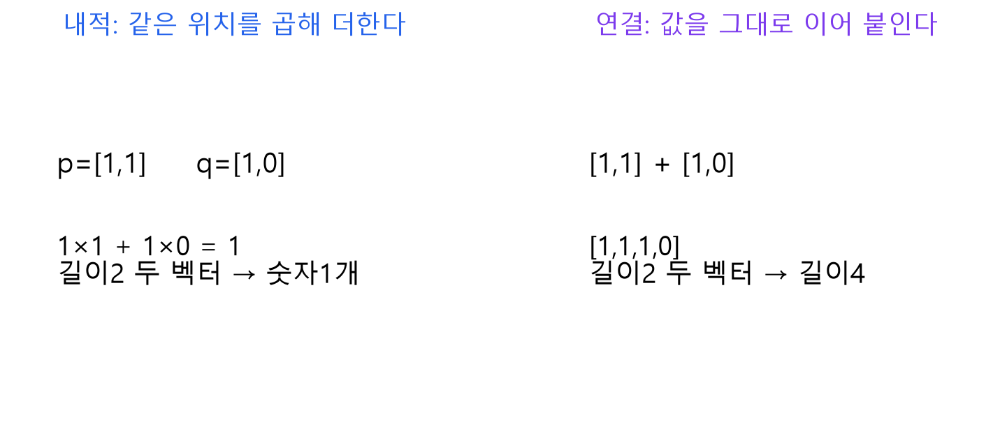
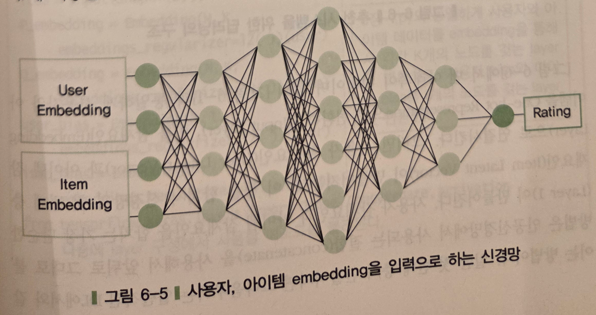
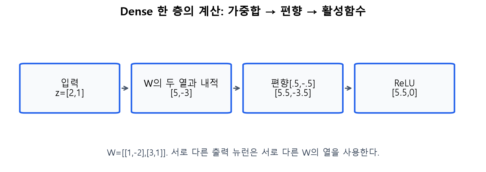
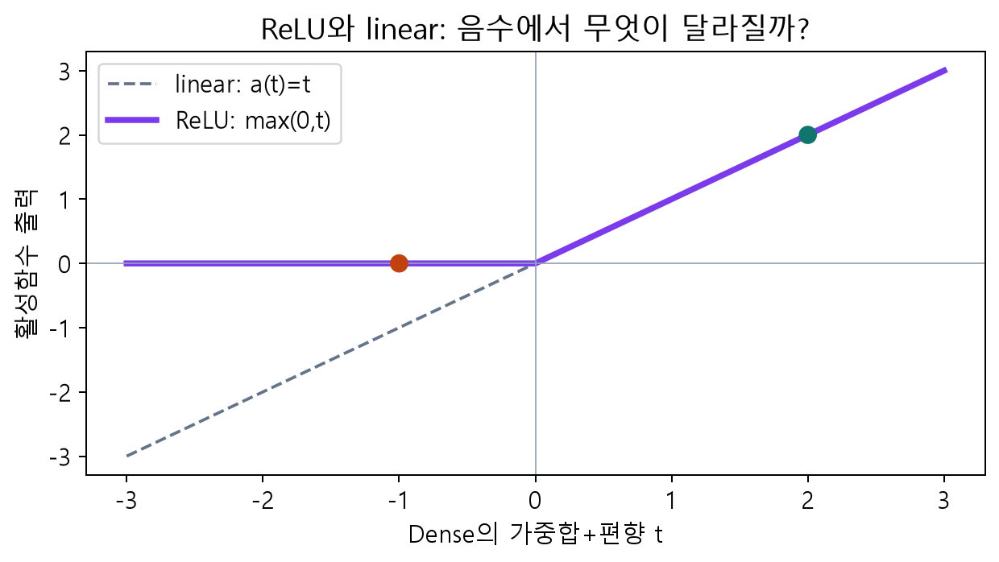
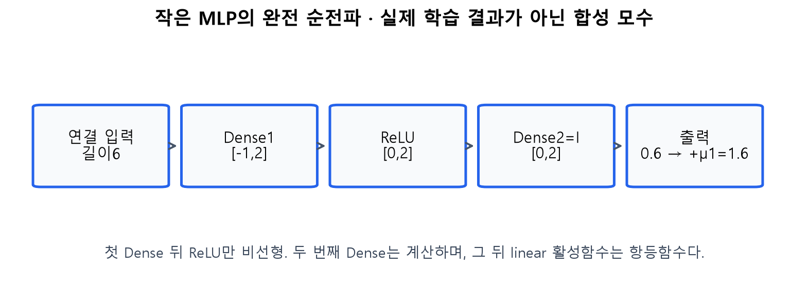
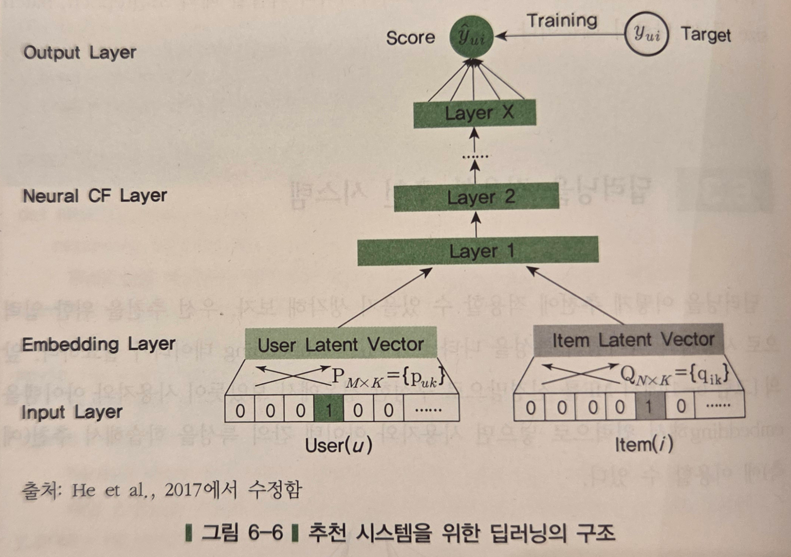
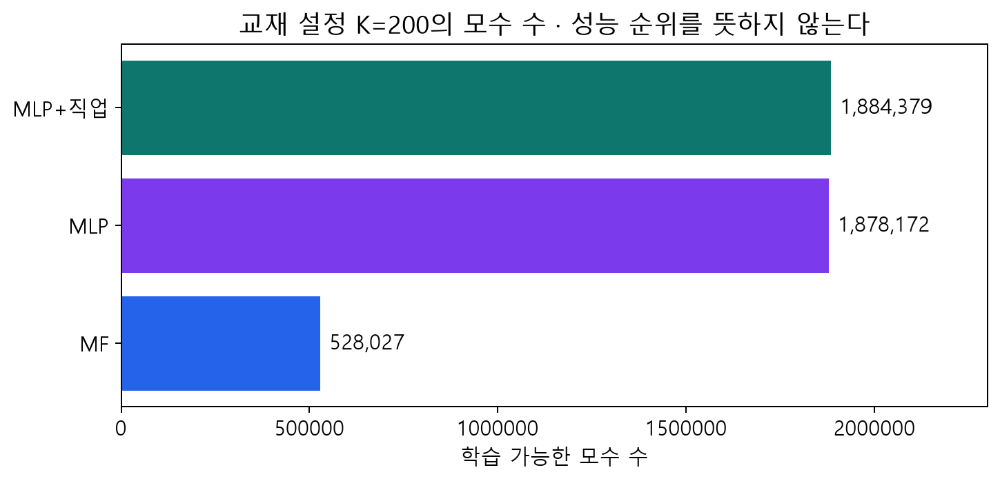

# C · 6.3: 내적에서 학습 가능한 신경망으로

> 주교재6.3(pp.133 하단–140). 여기서는 사용자·영화 벡터를 연결한 뒤 MLP로 평점을 예측합니다.

## 1. 무엇을 바꾸는가?

MF는 두 벡터의 같은 좌표끼리 곱해 더하는 내적을 사용합니다. MLP(Multi-Layer Perceptron, 다층 퍼셉트론)는 여러 층의 가중합과 활성함수를 조합합니다. 이번에는 임베딩을 얻는 앞부분을 유지하고, 예측을 만드는 뒷부분을 바꿉니다. 같은 입력 사례로 계산 구조를 비교합니다.

독자 도해. 왼쪽은 두 벡터에서 숫자 하나를 만들고, 오른쪽은 값을 이어 붙여 길이4 벡터를 만듭니다. 연결 자체가 내적을 계산하지는 않습니다.

출처: 임일(2025), p.133 그림6-5 원본 선별 발췌. 왼쪽 임베딩 → 가운데 은닉층 → 오른쪽 평점 예측을 읽습니다. 은닉층은 외부에 정답으로 주어진 값이 아니라 앞선 층의 값으로 계산되는 중간 표현입니다.

### E08 · 연결 벡터의 길이

$p_A=[1,1],q_P=[1,0]$를 연결하면 $[1,1,1,0]$입니다. 교재 코드는 사용자·영화의1차원 임베딩 두 개도 연결하므로 $z=[1,1,1,0,.5,-.5]$이고 길이는 $2K+2=6$입니다. 이 두 추가 값은 이후 Dense의 입력 특성입니다. MF처럼 마지막에 독립적으로 더하는 $b_u+b_i$와 역할이 동일하다고 보장되지 않습니다.

## 2. Dense를 계산기로 따라가기

Dense(완전연결층)의 가중합은 $a=zW+b$입니다. $z$는 입력 행벡터, $W$는 입력 폭×출력 폭의 가중치 표, $b$는 출력 폭의 편향 벡터입니다. 출력 뉴런마다 서로 다른 $W$의 열을 사용합니다. 활성함수는 그 가중합을 좌표별로 변환합니다.

독자 수계산 도해. 입력 $[2,1]$, $W=\begin{bmatrix}1&-2\\3&1\end{bmatrix}$, 편향 $[.5,-.5]$이면 가중합 $[5.5,-3.5]$, ReLU 출력 $[5.5,0]$입니다. 그림의 각 숫자를 직접 곱해 확인하세요.

ReLU는 $\operatorname{ReLU}(t)=\max(0,t)$입니다. 음수이면0, 양수이면 그대로입니다. `linear` 활성함수는 $a(t)=t$입니다. **Dense 뒤의 linear 활성함수가 값을 그대로 통과시킨다는 것과 Dense 층 자체가 아무 계산도 하지 않는다는 것은 다릅니다.** Dense는 여전히 $zW+b$를 계산합니다.

독자 함수 그래프. 입력−1에서 두 함수의 출력이 다른 이유를 말해 보세요. 여러 선형 계산 사이에 비선형 활성함수를 넣는 것이 모형이 표현할 수 있는 관계를 바꿉니다.

### E09 · 작은 MLP의 모든 중간값

E08의 길이6 입력을 사용합니다. 첫 가중치와 편향을 다음과 같이 정했습니다. 학습된 결과가 아닌 설명용 모수입니다.

$$
W_1=\begin{bmatrix}1&0\\-1&1\\.5&1\\0&1\\1&0\\0&0\end{bmatrix},
\quad b_1=[-2,0].
$$

첫 출력은 $1-1+.5+0+.5+0-2=-1$, 둘째 출력은 $0+1+1+0+0+0+0=2$입니다. 따라서 $a_1=[-1,2]$, ReLU 후 $h_1=[0,2]$입니다. 둘째 Dense를 $W_2=I,b_2=0$인 작은 예로 두면 $h_2=[0,2]$입니다. 출력 가중치 $[.5,.25]$, 편향 $.1$이면 중심화 예측은 $.5\times0+.25\times2+.1=.6$입니다. 주어진 평균1을 복원하면 평점 예측은1.6입니다.

독자 수계산 도해. ReLU를 linear로 바꾸면 첫 중간값−1도 통과합니다. 출력이 어떻게 달라질지 먼저 예상한 뒤 앱에서 확인하세요. 서로 따로 학습한 두 모형의 성능 비교가 아닌, 같은 고정 모수의 순전파 비교입니다.

## 3. 작은 예와 교재 코드를 대응시키기

교재6.3의 $K=200$에서는 연결 입력 폭이402입니다. 실제 구조는 `402 → Dense2048 → ReLU → Dense256 → linear → Dense1`입니다. 두 번째 활성함수를 ReLU로 바꿔 읽지 않습니다. 수업의 짧은 학습은 $K=8$, 은닉폭16/8을 사용하며, 교재 설정은 선택 재현 셀에서 따로 다룹니다.

출처: 임일(2025), p.134 그림6-6 원본 선별 발췌; 교재가 He et al.(2017)에서 수정한 그림입니다. 아래 ID → 임베딩 → 신경망 층 → 예측을 읽습니다. 원논문은 암묵적 피드백의 설정을 주로 실험하며, 이 장은 평점의 MSE 회귀를 학습합니다. 두 실험 설정을 동일시하지 않습니다.

### E10 · 모수 수와 복잡도를 읽기

입력402, 출력2048인 Dense에는 $402\times2048$개의 가중치와2048개의 편향, 총 $(402+1)\times2048=825344$개가 있습니다. 다음 Dense는 $(2048+1)\times256=524544$개, 출력층은257개입니다. 임베딩528027개를 더하면 총1878172개입니다.

독자 검산 그래프. 모수 수는 모델의 학습 가능한 숫자 개수입니다. 학습 자료 수나 정확도와 같은 값이 아닙니다. 큰 모델은 더 다양한 관계를 표현할 수 있지만 관측되지 않은 자료의 오차가 반드시 작아지는 것은 아닙니다.

직접 확인 C03: `Concatenate`, `Dense`, `ReLU`, `Flatten` 중 학습 가능한 모수를 갖는 계산은 무엇인지 설명하세요. 워크북 L05(필수),L07(보충)을 풉니다.

공식 참고: [Dense](https://keras.io/api/layers/core_layers/dense/), [Functional API](https://keras.io/guides/functional_api/), [NCF 원논문](https://arxiv.org/abs/1708.05031).
