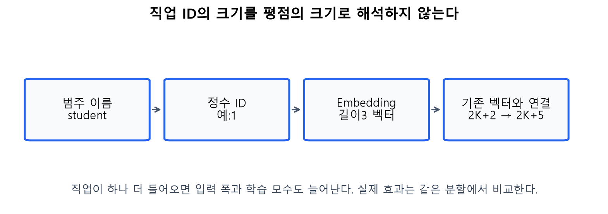
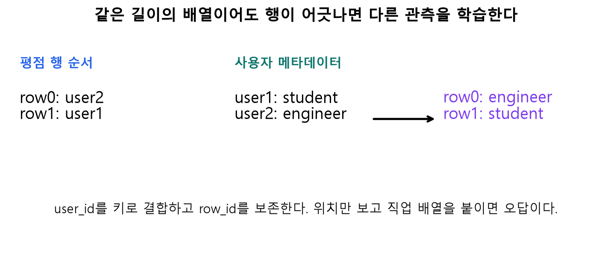
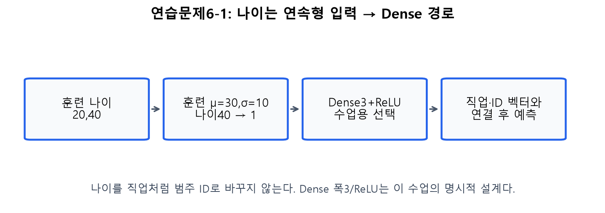
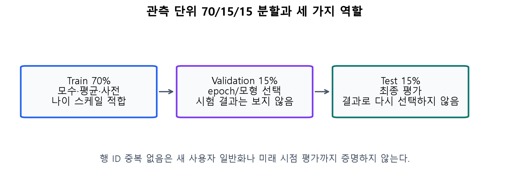
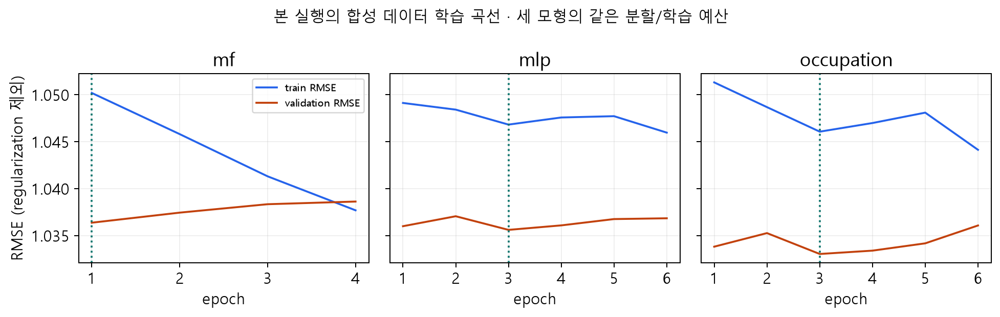

# D · 6.4: 직업·나이 추가와 공정한 평가

> 주교재6.4(pp.141–146), 연습문제6-1까지. 추가 정보를 어디에 넣고, 어떻게 효과를 확인할지 배웁니다.

## 1. 직업을 숫자로 바꾸는 이유

직업은 범주형 변수입니다. `student=1`, `engineer=2`처럼 ID를 붙이는 것은 범주를 구별하기 위한 번호이지 크기 순서가 아닙니다. 임베딩은 그 번호의 행을 꺼내 길이3 벡터로 만듭니다. 같은 직업은 같은 임베딩 행을 공유합니다. 해당 벡터도 훈련으로 학습됩니다.

독자 도해, 교재6.4의3차원 직업 임베딩을 설명합니다. 기본 길이 $2K+2$에3개 값이 추가되므로 연결 폭은 $2K+5$입니다. $K=2$ 예는6→9, 교재의 $K=200$은402→405입니다.

### E11 · 변수 추가가 바꾸는 것

교재의 직업 표가21행×3열이면 모수63개가 추가됩니다. 첫 Dense의 입력도3개 늘어 가중치가 $3\times2048=6144$개 추가됩니다. 따라서 증가량은6207개, 전체 모수는1884379개입니다. 새 실습은 미학습 범주용 ID0을 예약하므로 실제 표 행 수는 “훈련에서 본 범주 수+1”입니다. 이 차이가 모수 수에 반영됩니다.

직업 값을 붙일 때에는 평점 행과 같은 사람의 값인지 확인해야 합니다. 두 배열 길이가 같다는 것만으로 올바르게 결합됐다고 판단할 수 없습니다.

독자 합성 도해. `user_id`를 키로 `many_to_one` 결합하고 `row_id`를 보존합니다. 사용자 표를 임의로 섞어도 올바른 결합 결과는 같아야 합니다. 보충 L06에서 오류를 찾습니다.

## 2. 나이는 어떻게 넣을까? · 연습문제6-1

나이는 연속형 수치입니다. 교재의 마지막 문제는 직업을 임베딩으로 처리하면서 나이는 Dense 경로로 보내도록 안내합니다. 이번 실습은 훈련 평균·표준편차로 나이를 표준화한 뒤 Dense3+ReLU로 변환해 연결하는 설계를 제공합니다. 폭3과 ReLU는 수업에서 명시적으로 선택한 확장입니다.

### E12 · 표준화와 Dense 경로의 작은 계산

훈련 나이가20,40이면 평균30, 모집단 표준편차10입니다. 나이40의 표준화 값은 $(40-30)/10=1$입니다. 예를 들어 이 값을 두 뉴런 Dense에 넣고 가중치를 $[.5,-1]$, 편향을 $[0,.5]$로 두면 출력은 $[.5,-.5]$, ReLU 후 $[.5,0]$입니다. 실제 선택 구현은3뉴런이므로 같은 계산을 세 열로 확장합니다.

독자 도해. 검증·시험 나이로 평균/표준편차를 다시 계산하지 않습니다. 표준화 후에도 나이는 연속형 값이며 ID 번호가 아닙니다. 보충 L09에서 다른 나이로 계산합니다.

## 3. 모형의 효과를 어떻게 확인할까?

훈련(train)은 모수를 맞추는 자료, 검증(validation)은 학습 횟수·설정을 고르는 자료, 시험(test)은 선택이 끝난 후 평가하는 자료입니다. 이번 실습은 관측 행을70/15/15로 고정 분할합니다. 같은 분할에서 평균 기준모형, MF, MLP, 직업 추가 MLP를 비교합니다.

독자 실험 설계 도해. 평균·ID 사전·나이 스케일은 훈련 자료에서만 만듭니다. 검증 RMSE로 epoch를 고르고 그때의 가중치를 복원합니다. 미학습 ID의 건수를 표시하고 훈련 평균으로 예측하며, 학습된 ID 결과와 전체 결과를 구분합니다. 관측 단위 분할은 미래 시점 평가나 신규 사용자 평가와 다릅니다.

$$
\operatorname{MSE}=\frac1T\sum_{t=1}^{T}(r_t-\hat r_t)^2,
\qquad \operatorname{RMSE}=\sqrt{\operatorname{MSE}}.
$$

$T$는 평가 관측 수입니다. 실제 평점이 $[2,4]$, 예측이 $[1,3]$이면 오차는 $[1,1]$, MSE는1, RMSE도1입니다. 정답이 `(B,)`, 예측이 `(B,1)`이면 NumPy가 자동으로 `(B,B)`로 확장할 수 있으므로 두 배열을 명시적으로1차원으로 맞춘 후 검사합니다. L07에서 새 숫자로 확인하세요.

## 4. 학습 곡선을 읽는 순서

가로축은 에포크, 세로축은 RMSE입니다. 파란 선은 훈련, 주황 선은 검증입니다. 훈련 오차가 계속 줄어도 검증 오차가 다시 커지면 학습 자료에 지나치게 맞추는 과적합을 의심할 수 있습니다. 최적 epoch는 검증 선에서 선택합니다.

위 그림은 이번 소형 합성 데이터 실행에서 얻은 실제 곡선입니다. 설정은 $K=8$, 은닉폭16/8, SGD 학습률0.05·모멘텀0.7, 최대8에포크, 배치128, 시드20261103입니다. 세 모형은 같은 분할을 사용합니다. 직업 모형은 모수 수도 늘어나므로 단순한 변수 추가만의 인과 효과로 해석하지 않습니다. 구체적 결과와 데이터 모드는 Colab의 실행 표에서 다시 확인하세요.

교재 p.140 그림6-7과 p.146 그림6-8에서도 해당 실행에서 깊은 모형·직업 추가의 성능 향상이 뚜렷하지 않았습니다. “복잡하므로 더 좋다”를 결론으로 정하지 말고, 기준모형·검증/시험의 역할·변동·모수 수를 함께 읽습니다. 워크북 L08에서 곡선과 선택을 연습합니다.

## 5. Colab에서 앱까지

Colab A는 FM 계산 → 같은 고정 가중치의 Keras MF → 작은 실제 학습을 확인합니다. B는 데이터 준비부터 독립 실행하여 MF/MLP/직업 모형을 비교하고 누적 앱을 조립합니다. 실제 MovieLens 모드는 공식 다운로드/캐시를 사용하며, 합성 결과를 실제 MovieLens 결과로 부르지 않습니다.

마지막 앱에서는 FM 복습 기능을 유지하고 MF/MLP의 입력·가중합·활성함수·출력을 연결합니다. 입력 변경은 고정된 모수의 순전파입니다. 실제 학습은 앞선 `fit_neural` 실행입니다. 위젯 → `button.click`의 인자 → 계산 함수 → 표의 순서를 따라 자신의 출력 문구를 수정하세요. 필수 L10의 목표입니다. 공유 주소는 실행 중인 런타임에 의존합니다.

직접 확인 C04: 같은 검증 분할에서 직업 모형의 오차가 더 크다면 어떤 결론을 쓸 수 있을까요? 변수 유무 외에 함께 바뀐 조건을 구별해 설명하세요.

참고: [MovieLens100K 원출처·이용조건](https://files.grouplens.org/datasets/movielens/ml-100k-README.txt). 원데이터는 저장소·Notion ZIP에 재배포하지 않습니다.

## 이번 CPU 실행의 결과 표

합성 데이터80명·18편·960평점, 관측70/15/15분할의 결과입니다. 실제 MovieLens 결과와 구별합니다.

| 모형 | 검증RMSE | 최종시험RMSE | 선택epoch | 모수 수 |
|---|---:|---:|---:|---:|
| mf | 1.0364 | 1.0235 | 1 | 900 |
| mlp | 1.0356 | 1.0128 | 3 | 1,349 |
| occupation | 1.0330 | 1.0143 | 3 | 1,412 |
| 훈련평균 기준모형 | 1.0362 | 1.0208 | 해당 없음 | 평균1개 |

검증 결과로 설정을 선택하고 시험 결과로 다시 선택하지 않습니다. 한 시드의 소형 실험이며 일반적인 우열을 증명하지 않습니다.
