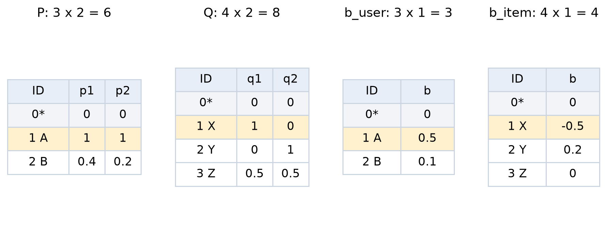
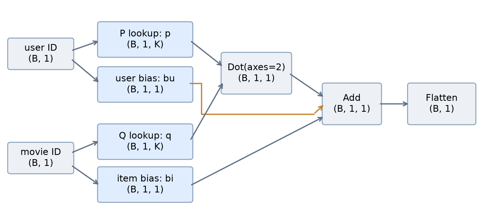
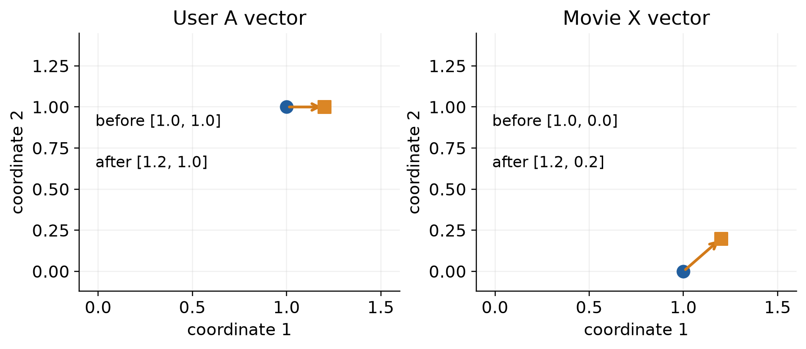
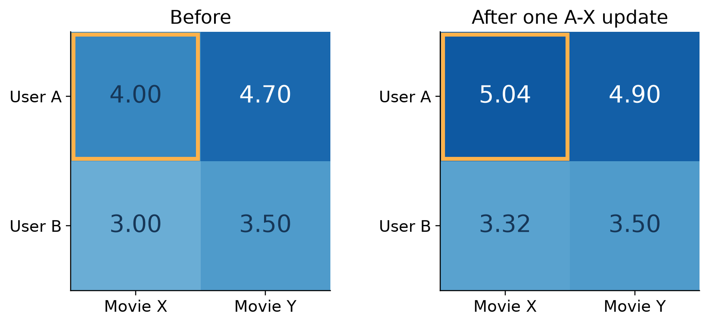

# MF를 Keras로 구현하면 무엇이 학습될까?

추천시스템 W10A 보충 자료 · 2026-11-03 · 동덕여자대학교 · 유원상 교수

## 1. 학습 대상은 네 개의 숫자표다

**MF의 학습은 사용자·영화 벡터와 편향을 담은 네 표의 숫자를 바꾸는 과정**입니다. 사용자 ID와 영화 ID는 어느 행을 꺼낼지 지정합니다. 별도의 ‘취향 정답 벡터’를 입력하지 않고, 관측 평점을 잘 맞추도록 벡터를 찾습니다.

$$
\hat r_{ui}=\mu+b_u+b_i+\underbrace{p_u^\top q_i}_{\text{사용자와 영화의 상호작용}}
$$

| 기호 | 쉬운 뜻 | 코드의 층 | 학습되는 숫자 |
|---|---|---|---|
| $p_u$ | 사용자 한 명을 표현하는 벡터 | `user_embedding` | 사용자마다 $K$개 |
| $q_i$ | 영화 한 편을 표현하는 벡터 | `item_embedding` | 영화마다 $K$개 |
| $b_u$ | 사용자가 전반적으로 높게/낮게 평가하는 경향 | `user_bias` | 사용자마다 1개 |
| $b_i$ | 영화가 전반적으로 높게/낮게 평가되는 경향 | `item_bias` | 영화마다 1개 |
| $\mu$ | 훈련 평점 평균, 이 구현에서는 고정 | 모델 밖에서 처리 | optimizer가 갱신하지 않음 |



독자 설명용 표입니다. 행 0은 예약하고 사용자 A/B는 1/2, 영화 X/Y/Z는 1/2/3입니다. 좌표 두 개의 의미를 ‘액션·로맨스’로 미리 정하지 않습니다. 숫자가 학습 과정에서 함께 정해지므로 잠재벡터라고 부릅니다.

**말로 설명하기:** “Keras는 처음에 숫자표를 만들고, 평점 예측이 틀리면 그 예측에 연결된 숫자들을 조정합니다.”

---

## 2. 실제 Keras 구조를 코드에서 찾기

아래는 공개 `build_mf`와 같은 계산 구조를 갖는 독립 실행형 코드입니다. 원본의 `_keras(seed)` 도우미는 `keras.utils.set_random_seed(seed)`로 풀어 썼습니다. 네 층 이름·내적 축·편향 합산·출력 크기·L2 설정을 유지합니다.

```python
import numpy as np
import tensorflow as tf
keras = tf.keras

def build_mf(n_users, n_items, *, k=8, reg=0.0002, seed=20261103):
    if min(n_users, n_items, k) < 1 or reg < 0:
        raise ValueError("Positive table sizes/k and nonnegative reg required")
    keras.utils.set_random_seed(seed)
    regularizer = keras.regularizers.l2(reg)
    u = keras.Input((1,), dtype="int32", name="user_id")
    i = keras.Input((1,), dtype="int32", name="movie_id")
    p = keras.layers.Embedding(n_users, k, embeddings_regularizer=regularizer,
                               name="user_embedding")(u)
    q = keras.layers.Embedding(n_items, k, embeddings_regularizer=regularizer,
                               name="item_embedding")(i)
    bu = keras.layers.Embedding(n_users, 1, embeddings_regularizer=regularizer,
                                name="user_bias")(u)
    bi = keras.layers.Embedding(n_items, 1, embeddings_regularizer=regularizer,
                                name="item_bias")(i)
    dot = keras.layers.Dot(axes=2, name="mf_dot")([p, q])
    added = keras.layers.Add(name="mf_add")([dot, bu, bi])
    output = keras.layers.Flatten(name="centered_rating")(added)
    return keras.Model([u, i], output, name="keras_mf")
```

`Embedding(...)(u)`의 앞부분은 숫자표를 가진 층을 만들고, `(u)`는 입력 ID로 그 표를 조회하도록 계산을 연결합니다. `p`는 사용자 표 전체가 아니라 **이번 입력에 해당하는 행을 꺼낸 결과**입니다. `q`, `bu`, `bi`도 같습니다.

`build_mf(...)`를 호출하면 모델과 초기 숫자가 만들어집니다. 실제 숫자 갱신은 뒤에서 `train_on_batch` 또는 `fit`을 실행할 때 발생합니다.

---

## 3. 네 표와 계산 노드의 차이, 그리고 shape



파란 상자 네 개는 학습할 숫자표를 보유합니다. 회색 상자는 입력 또는 고정된 계산입니다. `Add`로 들어오는 세 경로는 내적·사용자 편향·영화 편향입니다.

| 단계 | 이번 한 관측의 실제 크기 | 의미 |
|---|---|---|
| 사용자/영화 `Input` | 각각 `(1, 1)` | ID 하나를 담은 배치 1개 |
| 사용자 벡터 `p`, 영화 벡터 `q` | 각각 `(1, 1, 2)` | 한 관측에서 길이 2 벡터 조회 |
| 사용자/영화 편향 | 각각 `(1, 1, 1)` | 편향 하나씩 조회 |
| `Dot(axes=2)` | `(1, 1, 1)` | 마지막 축의 두 좌표를 곱해 합산 |
| `Add` | `(1, 1, 1)` | 내적 + 사용자 편향 + 영화 편향 |
| `Flatten` | `(1, 1)` | 숫자를 유지하고 뒤쪽 축을 펼침 |

배치 크기 $B=4$면 맨 앞의 `1`이 `4`가 됩니다. 사용자 표 전체의 행 수 $M$과 배치 크기 $B$는 다릅니다. 같은 사용자가 배치에 여러 번 나타날 수도 있습니다.

$$
\underbrace{MK}_{P}+\underbrace{NK}_{Q}+\underbrace{M}_{b_u}+\underbrace{N}_{b_i}
=(M+N)(K+1)
$$

이번 표는 $M=3,N=4,K=2$이므로 $6+8+3+4=21$개 숫자가 학습 가능합니다. 이는 **4개 trainable tensor 안의 21개 scalar parameter**입니다. `Dot`·`Add`·`Flatten`의 모수는 각각 0개입니다. 배치 크기는 이 모수 수를 바꾸지 않습니다.

---

## 4. 작은 데이터를 정하고 숫자표를 직접 넣기

전체 설명용 훈련 데이터는 두 관측입니다. 아래 두 관측 모두로 평균을 먼저 구하고, 한 번의 갱신에서는 A-X만 사용합니다.

| 사용자 | 영화 | 실제 평점 |
|---|---|---:|
| A: ID 1 | X: ID 1 | 5 |
| B: ID 2 | Y: ID 2 | 1 |

평균은 `(5 + 1) / 2 = 3`입니다. 따라서 A-X의 중심화 정답은 `5 - 3 = 2`입니다. A-X 한 행만 보고 평균을 5로 다시 계산하면 이 예제와 다른 문제가 됩니다.

```python
def demo_model(reg=0.0):
    model = build_mf(3, 4, k=2, reg=reg)
    tables = {
        "user_embedding": [[0, 0], [1, 1], [0.4, 0.2]],
        "item_embedding": [[0, 0], [1, 0], [0, 1], [0.5, 0.5]],
        "user_bias": [[0], [0.5], [0.1]],
        "item_bias": [[0], [-0.5], [0.2], [0]],
    }
    for name, values in tables.items():
        model.get_layer(name).set_weights([np.array(values, dtype="float32")])
    return model

train_ratings = np.array([5.0, 1.0], dtype="float32")
mean = float(train_ratings.mean())  # 3.0
model = demo_model(reg=0.0)
```

`set_weights`는 손계산과 실행을 맞추기 위한 **설명용 초기값 지정**입니다. 이 줄을 실행했다고 학습한 것은 아닙니다. 원래 `Embedding`의 기본 초기값은 난수이며, 편향용 `Embedding`도 여기서는 별도로 0 초기화를 지정하지 않습니다.

이 자료의 모든 작은 숫자와 데이터는 독자 수계산 예제입니다. MovieLens 성능 실험이나 실제 사용자의 취향을 나타내는 값이 아닙니다.

---

## 5. 순전파: 학습하기 전 평점 한 개를 계산하기

입력은 사용자 A와 영화 X의 ID입니다. 정답 평점은 학습 때 비교할 별도 값입니다.

```python
inputs = {
    "user_id": np.array([[1]], dtype="int32"),
    "movie_id": np.array([[1]], dtype="int32"),
}
target = np.array([[5.0 - mean]], dtype="float32")
centered = model(inputs, training=False).numpy()
rating = centered + mean
```

| 계산 순서 | 이번에 꺼내거나 계산한 값 |
|---|---|
| 사용자 표의 1번 행 | $p_A=[1,1]$ |
| 영화 표의 1번 행 | $q_X=[1,0]$ |
| 사용자 편향 표의 1번 행 | $b_A=0.5$ |
| 영화 편향 표의 1번 행 | $b_X=-0.5$ |
| 좌표끼리 곱해 합산 | $p_A^\top q_X=1\times1+1\times0=1$ |
| 중심화 점수 | $\hat y=1+0.5-0.5=1$ |
| 원래 평점 복원 | $\hat r=\hat y+\mu=1+3=4$ |

$$
y=r-\mu=5-3=2,\qquad \hat y=1,\qquad e=\hat y-y=-1
$$

평균을 뺀 공간에서도 오차는 같습니다: $(\hat r-\mu)-(r-\mu)=\hat r-r$입니다. 따라서 중심화해 학습해도 원래 평점의 오차를 줄이는 방향은 같습니다.

**현재 결과:** 모델은 4점을 예측했지만 실제 평점은 5점입니다. 아직 어떤 숫자도 갱신하지 않았습니다. 단순히 모델을 호출해 예측한 것입니다.

---

## 6. 역전파: 어느 숫자를 어느 방향으로 바꿀까?

이 절에서는 한 관측, 정규화 0, 모멘텀 0으로 원리를 분리합니다. 한 관측이므로 MSE는 오차 제곱 하나입니다.

$$
L=(\hat y-y)^2=e^2=1,\qquad
\frac{\partial L}{\partial\hat y}=2e=-2
$$

모델 출력은 $\hat y=b_A+b_X+p_{A1}q_{X1}+p_{A2}q_{X2}$입니다. 각 숫자가 출력에 미치는 영향을 연결하면 다음 기울기가 나옵니다.

| 학습할 숫자 | 기울기 계산 | 값 |
|---|---|---:|
| $p_{A1}$ | $2e\,q_{X1}=(-2)\times1$ | -2 |
| $p_{A2}$ | $2e\,q_{X2}=(-2)\times0$ | 0 |
| $q_{X1}$ | $2e\,p_{A1}=(-2)\times1$ | -2 |
| $q_{X2}$ | $2e\,p_{A2}=(-2)\times1$ | -2 |
| $b_A$ | $2e\times1$ | -2 |
| $b_X$ | $2e\times1$ | -2 |

기울기는 현재 값 근처에서 ‘그 숫자를 조금 증가시키면 손실이 얼마나 변하는가’를 나타냅니다. 음의 기울기라면 값을 증가시키는 것이 현재 손실을 줄이는 방향입니다. 실제 갱신량은 학습률도 함께 결정합니다.

```python
with tf.GradientTape() as tape:
    prediction = model(inputs, training=True)
    loss = tf.reduce_mean(tf.square(prediction - target))

grads = tape.gradient(loss, model.trainable_variables)
# grads는 각 학습 가능한 표에 대한 기울기다.
# Embedding의 희소 기울기는 tf.convert_to_tensor(g)로 펼쳐 볼 수 있다.
```

`GradientTape`는 미분을 계산합니다. 위 코드만으로 숫자가 갱신되지는 않습니다. `Dot`과 `Add`는 자신의 학습 모수가 없어도, 앞쪽 표에 전달할 미분 계산에 참여합니다.

---

## 7. SGD 한 번으로 표 안의 숫자가 바뀌는 모습

학습률 $\eta=0.1$이고 모멘텀이 0이면 모든 모수에 다음 규칙을 적용합니다.

$$
\theta_{\mathrm{new}}=\theta_{\mathrm{old}}-\eta\frac{\partial L}{\partial\theta}
$$

| 갱신 대상 | 계산 | 갱신 결과 |
|---|---|---|
| 사용자 벡터 | $[1,1]-0.1[-2,0]$ | $[1.2,1]$ |
| 영화 벡터 | $[1,0]-0.1[-2,-2]$ | $[1.2,0.2]$ |
| 사용자 편향 | $0.5-0.1(-2)$ | $0.7$ |
| 영화 편향 | $-0.5-0.1(-2)$ | $-0.3$ |



**모든 기울기는 갱신 전의 같은 모수 상태에서 계산합니다.** 사용자 벡터를 먼저 바꿔 놓고 그 새 값을 영화 벡터의 기울기에 사용하면 위 Keras의 한 번의 동시 갱신과 달라집니다.

$$
\hat y_{\mathrm{new}}=0.7-0.3+1.2\times1.2+1\times0.2=2.04
$$
$$
\hat r_{\mathrm{new}}=3+2.04=5.04,\qquad L_{\mathrm{new}}=(2.04-2)^2=0.0016
$$

손실이 1에서 0.0016으로 줄었습니다. 정확히 5가 될 때까지 한 번에 푸는 연산은 아니므로 조금 지나칠 수도 있습니다. 이 MF의 출력에는 1~5 범위를 강제하는 함수가 없어 5.04 같은 예측도 가능합니다.

---

## 8. 실제 Keras로 한 번 학습하고 직접 확인하기

앞의 `build_mf`, `demo_model`, import 코드를 준비한 뒤 아래를 실행합니다. **매번 새 모델로 시작하므로 같은 초기값에서 같은 한 번의 갱신을 비교**할 수 있습니다.

```python
model = demo_model(reg=0.0)
mean = float(np.mean([5.0, 1.0]))
inputs = {
    "user_id": np.array([[1]], dtype="int32"),
    "movie_id": np.array([[1]], dtype="int32"),
}
target = np.array([[5.0 - mean]], dtype="float32")

model.compile(
    optimizer=keras.optimizers.SGD(learning_rate=0.1, momentum=0.0),
    loss="mse",
)
before = float(model(inputs, training=False).numpy()[0, 0])
step_loss = model.train_on_batch(inputs, target)  # 갱신은 여기서 1회
after = float(model(inputs, training=False).numpy()[0, 0])

print("평점 예측:", before + mean, "->", after + mean)
print("갱신 후 손실:", (after - float(target[0, 0])) ** 2)
for name in ("user_embedding", "item_embedding", "user_bias", "item_bias"):
    print(name, model.get_layer(name).get_weights()[0][1])
```

실제 CPU 실행에서 얻은 결과를 반올림하면 다음과 같습니다.

```text
평점 예측: 4.000000 -> 5.040000
갱신 후 손실: 0.001600
user_embedding [1.2 1.0]
item_embedding [1.2 0.2]
user_bias [0.7]
item_bias [-0.3]
```

`train_on_batch`가 돌려준 이번 손실은 **갱신 전 예측으로 계산한 1.0**입니다. 갱신 후 손실을 보려면 위 코드처럼 다시 예측해 계산합니다. `fit`도 같은 종류의 학습 갱신을 미니배치와 에포크에 걸쳐 반복합니다. `training=True`만 지정해 호출하는 것은 optimizer의 갱신 명령이 아닙니다.

---

## 9. 왜 안 본 사용자-영화 조합의 예측도 바뀔까?



| 조합 | 갱신 전 평점 예측 | 갱신 후 | 이번 갱신에서 연결되는 표 |
|---|---:|---:|---|
| A-X | 4.00 | 5.04 | A 벡터·편향, X 벡터·편향 |
| A-Y | 4.70 | 4.90 | 같은 A 벡터·편향을 공유 |
| B-X | 3.00 | 3.32 | 같은 X 벡터·편향을 공유 |
| B-Y | 3.50 | 3.50 | 이 한 번에는 B/Y의 숫자가 유지됨 |

예를 들어 B-X의 새 내적은 $[0.4,0.2]\cdot[1.2,0.2]=0.52$입니다. 따라서 $3+0.1-0.3+0.52=3.32$가 됩니다.

MF는 사용자-영화 조합마다 별도의 숫자를 외우는 대신, 여러 조합에서 같은 사용자 행과 같은 영화 행을 재사용합니다. 이 공유 구조 덕분에 관측이 없는 조합에도 예측을 계산할 수 있습니다. **예측을 계산할 수 있다는 사실이 그 예측의 정확성을 보장하지는 않습니다.**

이 표는 정규화와 모멘텀이 모두 0인 한 번의 갱신 결과입니다. 실제 L2 정규화나 이전 모멘텀 상태가 있으면 이번 배치에 등장하지 않은 행도 갱신될 수 있습니다.

`model(inputs, training=False)`로 추천 결과를 읽는 동안에는 이 예제의 네 표가 유지됩니다. 실제 실행에서 예측 호출 전후 표의 배열이 같은지도 확인했습니다.

---

## 10. 원래 수업 코드의 설정과 이번 손계산 구분하기

| 항목 | 이 자료의 한 번 갱신 | 기존 공개 수업 코드 |
|---|---|---|
| 잠재벡터 차원 | $K=2$ | 기본 $K=8$, 설정 가능 |
| 표 초기값 | 직접 지정한 작은 숫자 | 기본 난수 초기화 |
| 정규화 계수 | `reg=0.0` | 기본 `reg=0.0002` |
| optimizer | SGD, 학습률 0.1, 모멘텀 0 | `fit_neural`: 기본 학습률 0.05, 모멘텀 0.7 |
| 갱신 자료 | A-X 한 관측 | 훈련 미니배치를 여러 에포크 사용 |
| 평균 | 전체 설명용 훈련 평점 평균 3 | 실제 훈련 평점에서 한 번 계산 |

기존 모델은 네 표 모두에 L2 벌점을 설정합니다. 한 관측이라면 목적함수는 다음과 같습니다.

$$
J=(\hat y-y)^2+\lambda\left(\|P\|_F^2+\|Q\|_F^2+\|b_u\|_2^2+\|b_i\|_2^2\right)
$$

이번 초기표에서 제곱합은 5.25이므로 `reg=0.0002`의 벌점은 $0.0002\times5.25=0.00105$입니다. 따라서 초기 목적함수는 1.00105가 됩니다. MSE 1과 정규화 포함 loss 1.00105를 구별해야 합니다.

A-X만 사용해도 L2를 포함하면 사용자 B 벡터에 $2\lambda[0.4,0.2]=[0.00016,0.00008]$의 기울기가 생깁니다. 이 숫자도 실제 자동미분 결과와 대조했습니다.

`n_users`, `n_items`, `k`, `reg`, `seed`, 학습률은 사람이 정하는 구조·학습 설정입니다. 이 구현의 optimizer가 자동으로 학습하는 값은 네 표 안의 실수입니다. 원래 API의 `build_mf(81,19,k=8)`은 $(81+19)(8+1)=900$개의 모수를 가집니다. 예약 0번 행도 이 숫자표의 모수 수에는 포함됩니다.

---

## 11. 직접 실행할 때 확인할 것과 참고자료

이번 설명은 **수업에서 제공한 MF 계산 구조**와 **작은 독자 수계산 예제**를 연결한 보충 자료입니다. 새 채점 과제나 제출 마감은 없습니다.

| 확인 지점 | 확인할 결과 |
|---|---|
| 숫자표의 수 | trainable tensor 4개 |
| 작은 모델의 모수 수 | 21개 |
| 학습 정답 | 평균을 뺀 2.0 |
| 학습 전 모델 출력 / 평점 | 1.0 / 4.0 |
| 학습 후 모델 출력 / 평점 | 약 2.04 / 5.04 |
| 한 관측의 MSE | 1.0 → 약 0.0016 |
| 예측만 호출한 후 모수 | 변화 없음 |

전체 실행형 파일은 `w10a-mf-keras-worked-example.py`입니다. 본 자료와 함께 제공됩니다. TensorFlow와 NumPy를 설치한 환경에서 다음처럼 실행합니다. 교재 원본 파일·MovieLens 다운로드·API 키·GPU는 필요하지 않습니다.

```text
python w10a-mf-keras-worked-example.py
```

실제 확인 환경: Python 3.12.10, TensorFlow 2.21.0, Keras 3.15.1, NumPy 2.5.3. 본 보충 자료는 로컬 CPU에서 실행했습니다. 이 새 예제를 Google Colab에서 실행했다고 주장하지 않습니다. 실제 실행 결과는 float32 오차 범위에서 수계산과 대조했습니다.

**강의 중 설명 순서:** 네 표를 가리킵니다 → ID로 한 행을 꺼냅니다 → 4점을 계산합니다 → 실제 5점과 비교합니다 → 기울기로 숫자를 바꿉니다 → 5.04점을 다시 계산합니다 → 다른 조합의 예측 변화도 확인합니다.

참고자료

- [수업 공개 build_mf 및 fit_neural 원본](https://github.com/lunalab-ai/recommender/blob/2026-fall-w10a/src/luna_recsys/neural_recommenders.py#L161)
- [기존 W10A B절 Notion](https://fancy-ballcap-a15.notion.site/B-6-1-6-2-MF-Keras-40b7fd00109f81a38c20e61691481dce)
- [Keras Embedding](https://keras.io/api/layers/core_layers/embedding/)
- [Keras Dot](https://keras.io/api/layers/merging_layers/dot/)
- [Keras SGD](https://keras.io/api/optimizers/sgd/)

주교재: 임일(2025), 『AI 에이전트를 위한 개인화 추천 알고리즘』, 청람, 6.1-6.2. 이 보충 자료의 그림과 작은 데이터는 새로 만든 설명용 자료이며 교재 스캔을 포함하지 않습니다.
